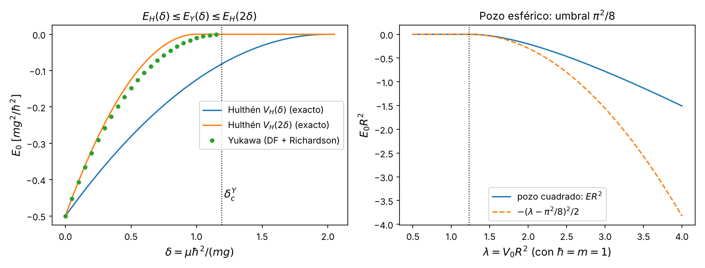

# 0. Marco del trabajo: pregunta, régimen, cierre, hipótesis, genealogía y toy model

**Proyecto 05, Umbral de enlace en el potencial de Yukawa** · Fase 1 · Bloque 00
Script: `fase1/codigo/00_toy_model.py` (sympy, numpy, scipy; unos 25 s). Figura: `fase1/figuras/00_toy_model.png`. Todas las cifras nuevas de este bloque salen de ese script; las demás remiten a la sección que las produce.

Esta sección se escribió en la segunda ronda (12 de octubre de 2026) para cubrir lo que la guía de bitácora del equipo (`enunciado/guia_bitacora.md`, secciones 1, 3 y 4) pide fijar antes del desarrollo y que la Fase 1 no tenía: objetivo como pregunta, régimen de validez, criterio de cierre, punto de salida con hipótesis numeradas, notación fija, genealogía, toy model, conexión con otros campos y la casilla de revisión final.

## 0.0 Datos de la sesión

- **Tarea:** Fase 1 del proyecto 05 de la guía del profesor: "adimensionalizar, estudiar el límite de Coulomb y derivar un criterio de estado ligado; pedir a la IA una lista de límites físicos que el algoritmo debe cumplir y verificarla", más la secuencia común de la Fase 1 (pregunta, fuentes, acción, observable, referencia independiente, protocolo, unidades, fronteras, prueba analítica y plan de cómputo).
- **Grupo SLV:** Juan Sebastián Calixto y Luis Felipe Ramírez. Grupo de dos integrantes: Valentina Isabel Burbano se retiró del equipo (confirmado por Luis Felipe Ramírez, Lucho, el 13-10-2026). La guía del profesor está pensada para equipos de tres ("hablan los tres integrantes", rotación de tres responsabilidades); este equipo es de dos, y la exposición y la rotación de roles se repartieron entre los dos (guion y sección 9.12).
- **Roles en esta fase:** Juan Sebastián Calixto, formulación física; Luis Felipe Ramírez, implementación y verificación (confirmado por Lucho el 21-10-2026, decisión 6 de `decisiones_pendientes.md`). En la Fase 2 rotan según la sección 9.12. En las bitácoras 1 y 2 del grupo, cuando era de tres, los roles fueron: prompts y línea principal, la integrante que después se retiró; cuestionador, Sebastián; revisor y verificador, Luis. La bitácora de la primera ronda de esta fase nombra como autores a Luis Felipe Ramírez y Juan Sebastián Calixto.
- **IA usada:** Claude (Anthropic), en la primera ronda (redacción de los bloques 01 a 06 y sus revisiones adversariales) y en la segunda (auditoría y secciones 00, 07, 08, 09 y 10). El registro detallado está en la sección 10.

## 0.1 Objetivo: la pregunta

> **¿Para qué valor del apantallamiento $\mu$, a $g$, $m$ y $\hbar$ fijos, deja de existir el estado fundamental ligado ($1s$) de $V(r)=-g\,e^{-\mu r}/r$, y cómo se comportan su energía $E_0$ y su extensión radial $\langle r\rangle$ al acercarse a ese valor?**

Por la sección 1, la pregunta depende de un solo número puro, $\delta=\mu\hbar^2/(mg)$. Decir "$\mu$ a $g$ fijo" y decir "$\delta$" es lo mismo: el umbral es un número adimensional $\delta_c$ y, en unidades físicas, $\mu_c=\delta_c\,mg/\hbar^2$. No se reclama una cifra desligada de $m$, $g$ y $\hbar$.

**Magnitudes que se calculan.**

| Magnitud | Qué es | Dónde |
|---|---|---|
| Intervalo $[\delta_-,\delta_+]\ni\delta_c$ | cotas demostradas (inferior y superior) para el umbral | secciones 3, 4 y 0.6 |
| $\delta_c$ de referencia | valor numérico independiente de la caja | sección 5 (método C) y 0.6 |
| $E_0(\delta)$ | energía del $1s$ en unidades $mg^2/\hbar^2$ | secciones 2, 5, 7 |
| $\langle r\rangle(\delta)$ | observable de localización; diverge en el umbral | secciones 5, 7 (L11), 9 |

**Lo que no se responde en la Fase 1.** La Fase 1 no calcula aún el umbral con la integral de camino; fija la pregunta, las cotas analíticas, la referencia independiente, la acción, el peso y el plan. El aviso del profesor se adopta desde ahora: la existencia de enlace no se decidirá por el signo de un autovalor en una sola caja, sino comparando varias cajas y un observable de localización (criterio concreto en la sección 9.6).

## 0.2 Régimen de validez

El resultado vale bajo estas condiciones; cada una dice qué cambia fuera de ella.

1. **No relativista.** Ecuación de Schrödinger. En el caso atómico (hidrógeno apantallado) las correcciones relativistas son de orden $\alpha^2$ relativo a la energía de enlace. Fuera de este régimen (ecuaciones de Dirac o Klein-Gordon) el umbral cambia y no se estudia aquí.
2. **Dos cuerpos reducidos a uno.** $m$ es la masa reducida de la coordenada relativa; el centro de masa se separa. Para el hidrógeno la diferencia con $m_e$ es de orden $m_e/m_p$ y solo reescala la unidad de longitud $a=\hbar^2/(mg)$; $\delta_c$ no cambia.
3. **Potencial estático, central y local.** $V(r)=-g\,e^{-\mu r}/r$ sin dependencia del tiempo, de la velocidad ni de la energía. En un plasma esto es el apantallamiento de Debye, que es una respuesta lineal, estática y de campo medio, válida solo en plasmas débilmente acoplados; en plasmas densos o fríos el perfil de apantallamiento cambia (ver la extensión, 0.9). En física nuclear el Yukawa de un pion es solo la cola de largo alcance; a corta distancia hay otras fuerzas.
4. **Sin espín y sin campos externos.** No hay interacción espín-órbita ni fuerzas tensoriales. Para $\ell=0$ el espín-órbita no actúa; en el deuterón, en cambio, la fuerza tensorial mezcla ondas S y D y el modelo deja de ser suficiente.
5. **Solo el estado fundamental, $\ell=0$.** En un potencial central atractivo el fundamental es una onda $s$ sin nodos; si hay algún estado ligado, el $1s$ lo está, así que el umbral del $1s$ es el umbral de "hay algún ligado". Los umbrales con $\ell>0$ y de estados excitados (por ejemplo $\delta_c(2s)=0.310209$, sección 7, L14, recalculado en 0.6) quedan fuera de la Fase 1.
6. **Una sola partícula.** Sin efectos de muchos cuerpos ni estadística cuántica.

## 0.3 Criterio de cierre

**Fase 1.** La Fase 1 se da por cerrada cuando se cumplen todas estas condiciones, cada una comprobable en un archivo concreto:

| # | Condición | Cómo se comprueba | Estado al 12-10-2026 |
|---|---|---|---|
| C1 | Ecuación radial adimensional deducida y verificada simbólicamente | residuo sympy $=0$ en `01_adimensionalizacion.py` | cumplido (sección 1) |
| C2 | Límite de Coulomb reproducido | $E_0(0)=-1/2$, $\langle r\rangle(0)=3/2$; serie hasta $\delta^4$ | cumplido (secciones 1, 2; sección 7, L02 y L03) |
| C3 | Criterio de estado ligado con intervalo riguroso | cota inferior y superior demostradas que encierran $\delta_c$ | cumplido: $1.19055\le\delta_c\le1.24305$ (secciones 3 y 4); intervalo elemental $1\le\delta_c\le2$ (secciones 3, 4 y 0.6) |
| C4 | Referencia numérica independiente de la caja | $\delta_c$ por condición de energía cero, estable al cambiar $R$ | cumplido: $1.1906124211$ (sección 5; repetido en 0.6) |
| C5 | Lista de límites físicos pedida a la IA y verificada uno a uno | tabla con prueba, resultado y estado por ítem | cumplido salvo L18, que solo puede probarse en la Fase 2 (sección 7) |
| C6 | Acción euclídea deducida y peso declarado (real, positivo, normalizable) | veredicto con prueba analítica y numérica | cumplido en la sección 8 (real y positivo; no normalizable con la acción primitiva) |
| C7 | Plan de cómputo con observables, parámetros, cajas, controles y errores | sección con valores concretos | cumplido en la sección 9 |
| C8 | Toy model resuelto completo y comparado con Yukawa | residuo exacto y comprobación numérica | cumplido (0.6) |
| C9 | Bitácora de IA con fecha, consulta, respuesta, decisión humana, comprobación y corrección | tabla de la sección 10 | parcial: las decisiones humanas están pendientes de confirmar por el equipo |
| C10 | Hallazgos de la auditoría de la segunda ronda corregidos en las secciones 01 a 06, guion y diapositivas | lista de la sección 10 | en curso: constan correcciones en las secciones 1 a 6 y en `bitacora_fase1.md`; quedan pendientes el PDF de la bitácora, el guion y las diapositivas (detalle en 10.3 y en `correcciones_ronda2.md`) |

La Fase 1 queda cerrada cuando C9 y C10 pasen a "cumplido". La comprobación final se hace en la sección de cierre de la bitácora compilada, con esta misma tabla.

**Proyecto completo.** El proyecto se da por cerrado cuando:

- P1. Se entrega un intervalo $[\delta_-,\delta_+]$ para $\delta_c$ (y $\mu_c=\delta_c mg/\hbar^2$) obtenido con la formulación de tiempo imaginario, que contiene la referencia $1.19061242106$ y cuyos extremos se decidieron con el criterio de la sección 9.6 (al menos tres cajas por punto y un observable de localización, no solo el signo de $E_0$).
- P2. Se presentan $E_0(\delta)$ y $\langle r\rangle(\delta)$ con barras de error, y se comprueba la ley $\langle r\rangle\simeq1/(2\kappa)$, con $\kappa=\sqrt{-2E_0}$, cerca del umbral.
- P3. El algoritmo pasa los controles exactos: Coulomb ($\delta=0$), el toy model de Hulthén de 0.6 en al menos dos valores de $\delta$, y la comparación con el solucionador radial en un punto fuertemente ligado.
- P4. Cada resultado con potencial suavizado declara su parámetro y se extrapola a cero antes de identificarlo con el Yukawa.

## 0.4 Punto de salida e hipótesis numeradas

**Se supone conocido.** La ecuación de Schrödinger radial y la separación $\psi=u_\ell(r)Y_{\ell m}/r$; el espectro del hidrógeno; el principio variacional de Rayleigh y Ritz; el teorema de comparación (si $V_1\le V_2$ punto a punto, $E_0[V_1]\le E_0[V_2]$); los teoremas de Bargmann (1952), Schwinger (1961) y Calogero (1965) sobre el número de estados ligados; la fórmula de Trotter. El cálculo arranca de la ecuación (1.1) de la sección 1.

**Hipótesis del proyecto.**

- **H1.** Mecánica cuántica no relativista: $\hat H=-\frac{\hbar^2}{2m}\nabla^2+V(r)$.
- **H2.** $m$ es la masa reducida de un problema de dos cuerpos con centro de masa separado.
- **H3.** $V(r)=-g\,e^{-\mu r}/r$ con $g>0$ y $\mu\ge0$, estático, central y local.
- **H4.** Sin espín, sin estadística y sin campos externos.
- **H5.** Se estudia solo $\ell=0$; el fundamental es el $1s$, sin nodos.
- **H6.** Fronteras: $u(0)=0$ y $u\in L^2(0,\infty)$; en el cálculo numérico, caja de Dirichlet $u(R)=0$, que solo puede subir la energía.
- **H7.** $V$ es atractivo y no decreciente en $r$, y $\int_0^\infty r|V|\,dr<\infty$. Es lo que exigen las cotas de Calogero y de Bargmann (sección 4).
- **H8.** $\hat H$ es autoadjunto y acotado inferiormente, de modo que $e^{-\beta\hat H}$ existe y proyecta sobre el fundamental (demostración por la desigualdad de Hardy en la sección 8.4.4).

Las secciones citan estas hipótesis por su número: la cota de Calogero usa H7; las cotas variacionales usan H5 y el principio variacional; la proyección en tiempo imaginario usa H8; el sesgo de caja usa H6. La sección 8 tiene su propia lista local (H1 a H4 de esa sección), que es compatible con esta: su H1 coincide con la H8 de aquí, su H3 con H5 y su H4 con H6.

## 0.5 Notación fija

| Símbolo | Significado | Nota |
|---|---|---|
| $a=\hbar^2/(mg)$ | unidad de longitud (radio de Bohr generalizado) | |
| $E_H=mg^2/\hbar^2$ | unidad de energía | |
| $r$ | radio en unidades de $a$ | la sección 1 lo llama $x$ mientras deduce la ecuación; desde la sección 2, $r$ |
| $E$, $E_0$ | energía y energía del fundamental en unidades de $E_H$ | la sección 1 usa $\varepsilon$ |
| $\delta=\mu a=\mu\hbar^2/(mg)$ | apantallamiento adimensional | |
| $\delta_c$, $\mu_c=\delta_c mg/\hbar^2$ | umbral del $1s$ | |
| $u(r)$ | función radial reducida, $u(0)=0$ | |
| $\kappa=\sqrt{-2E_0}$ | inverso de la longitud de decaimiento | |
| $R$ | radio de la caja de Dirichlet | en 0.6 (pozo cuadrado), $R$ es el radio del pozo |
| $\epsilon$, $\beta$, $M$ | paso de tiempo imaginario, tiempo total, número de pasos | secciones 8 y 9 |
| $\langle r\rangle$, $F_{1/2}$ | radio medio y fracción de densidad en la mitad interior de la caja | sección 9.1 |

**Conflictos de notación detectados.** (i) $\varepsilon$ es energía en la sección 1 y $\epsilon$ es paso de tiempo en las secciones 8 y 9; se fija $E$ para la energía desde la sección 2. (ii) $a_s$ es la longitud de dispersión en la sección 7.4 (corrección de L13) y el radio de suavizado en la sección 8.5; la sección 7, L17, llama $a$ al radio de suavizado, que choca con la unidad de longitud. Se propone $a_{\rm sc}$ para la longitud de dispersión y $a_s$ para el suavizado. Lucho aprobó esta notación el 21-10-2026 (decisión 2 de `decisiones_pendientes.md`); cambiarla en el texto de las secciones 7 y 8 queda para la Fase 2.

## 0.6 Toy model: Hulthén y pozo esférico cuadrado

La versión más simple del mismo problema es un potencial de corto alcance con umbral exacto. Se resuelven dos, completos, en `00_toy_model.py`.

### 0.6.1 Potencial de Hulthén

$$V_H(r;\delta)=-\frac{\delta}{e^{\delta r}-1}\qquad(\hbar=m=g=1).$$

Es el toy model natural del Yukawa porque comparte sus dos rasgos: cerca del origen $V_H=-1/r+\delta/2-\delta^2r/12+\dots$ (Yukawa: $-1/r+\delta-\delta^2r/2+\dots$; series con sympy), y a distancia grande decae como $e^{-\delta r}$. Además $V_H\to-1/r$ cuando $\delta\to0$.

**Solución exacta del $1s$.** Con $\kappa=1-\delta/2$,
$$u(r)=(1-e^{-\delta r})\,e^{-\kappa r},\qquad E_0^H(\delta)=-\tfrac12\left(1-\tfrac{\delta}{2}\right)^2=-\tfrac12+\tfrac{\delta}{2}-\tfrac{\delta^2}{8}.$$
Sympy da residuo exactamente $0$ en $-u''/2+V_Hu-E_0^Hu$, y $u(0)=0$. La función es positiva (sin nodos) y normalizable si y solo si $\kappa>0$, es decir $\delta<2$.

**Umbral exacto.** $\delta_c^H=2$. En $\delta=2$ la solución de energía cero es $u=1-e^{-2r}$ (residuo $0$) con $u'(\infty)=0$: es exactamente la condición de umbral que usa el método C de la sección 5 para el Yukawa.

**Extensión radial exacta.**
$$\langle r\rangle_H=\frac{12-\delta^2}{2(4-\delta^2)},\qquad\langle r\rangle_H(0)=\tfrac32,\qquad\lim_{\delta\to2}2\kappa\langle r\rangle_H=1 .$$
Es la misma ley de halo $\langle r\rangle\simeq1/(2\kappa)$ que la sección 7 (L11) comprueba numéricamente para el Yukawa.

**Estado $2s$.** Con el ansatz $u=(1-e^{-\delta r})(1+Ae^{-\delta r})e^{-\kappa_2 r}$, $\kappa_2=\tfrac12-\delta$, el residuo se anula (comprobación parcial: con $\delta=0.1$ se fija $A=-1.2222222$ anulando el residuo en $r=1$ y se comprueba que también se anula en $r=3$), lo que da el umbral $\delta_c^H(2s)=1/2$.

**Comprobación numérica.** Diferencias finitas con Richardson ($R=80$, 8000 y 16001 nodos) en $\delta=0.2,0.5,1,1.5$: $\max|E_{\rm num}-E_0^H|=1.7\times10^{-10}$ y $\max|\langle r\rangle_{\rm num}-\langle r\rangle_H|=3.0\times10^{-9}$.

### 0.6.2 Comparación rigurosa con Yukawa: el intervalo elemental $1\le\delta_c\le2$

En la variable $x=\delta r$:
$$rV_H(\delta)=-\frac{x}{e^x-1},\qquad rV_Y(\delta)=-e^{-x},\qquad rV_H(2\delta)=-\frac{2x}{e^{2x}-1}.$$

- $V_H(\delta)\le V_Y(\delta)$: equivale a $g(x)=xe^x-e^x+1\ge0$, con $g(0)=0$ y $g'(x)=xe^x\ge0$ (sympy).
- $V_Y(\delta)\le V_H(2\delta)$: la diferencia es $e^{-x}(1-x/\sinh x)\ge0$ porque $\sinh x\ge x$ (identidad comprobada con sympy).

En la malla $x\in(0,40]$ el mínimo de ambas diferencias es del orden de $10^{-16}$ (cero de máquina), sin valores negativos. Por el teorema de comparación:
$$-\tfrac12\left(1-\tfrac{\delta}{2}\right)^2\;\le\;E_0^Y(\delta)\;\le\;-\tfrac12(1-\delta)^2\quad(\delta<1).$$
Consecuencias: si $\delta<1$ el Yukawa tiene un ligado, porque $E_0^Y<0$, así que $\delta_c\ge1$; si $\delta\ge2$ no lo tiene, porque $V_Y\ge V_H(\delta)$ y este último ya no liga, así que $\delta_c\le2$. Es una tercera vía para el intervalo elemental, independiente de la prueba hidrogenoide (sección 3) y de Bargmann (sección 4). Comprobación numérica en $\delta=0.1,0.3,0.5,0.7,0.9$ (DF con Richardson, $R=120$): 0 violaciones. Por ejemplo, en $\delta=0.5$: $-0.281250\le-0.148117\le-0.125000$.

**Lo que el toy model enseña sobre el Yukawa.**

| | Hulthén $V_H(\delta)$ | Yukawa |
|---|---|---|
| Umbral $1s$ | $2$ (exacto) | $1.1906124211$ (disparo a energía cero en este script; $3.4\times10^{-13}$ de la referencia $1.19061242106$) |
| Umbral $2s$ | $1/2$ (exacto) | $0.310209$ (este script; igual a la sección 7, L14) |
| Cociente de umbrales Yukawa/Hulthén | | $0.5953$ ($1s$), $0.6204$ ($2s$) |
| $\kappa/(\delta_c-\delta)$ cerca del umbral | $1/2$ (exacto, $\kappa$ lineal) | $0.7464$ en $\delta=1.10$; $0.7435$ en $1.15$ (sección 7: tiende a $0.741$) |
| $2\kappa\langle r\rangle$ en el umbral | $1$ (exacto) | $\to1$ (sección 7, L11) |
| $E_0$ cerca del umbral | $-\tfrac18(2-\delta)^2$ | $\simeq-\tfrac{c^2}{2}(\delta_c-\delta)^2$ |

La forma de la ley de umbral (energía cuadrática y $\kappa$ lineal en la distancia al umbral, $\langle r\rangle\simeq1/(2\kappa)$) es la misma; el coeficiente y la posición del umbral dependen del perfil. La figura 0.1 (izquierda) recorre el espacio de parámetros $\delta\in[0,2]$ y muestra el Yukawa entre las dos curvas exactas de Hulthén.

**Uso en la Fase 2.** Hulthén tiene la misma singularidad $-1/r$ en el origen, de modo que el peso primitivo de la integral de camino diverge igual que en el Yukawa (sección 8.4), y a la vez tiene $E_0$ y $\langle r\rangle$ exactos para todo $\delta<2$. Es una prueba exacta del algoritmo de tiempo imaginario en todo el intervalo de $\delta$, incluso cerca de su propio umbral, que el control de Coulomb ($\delta=0$) no da. Se propone añadirlo a los controles de la sección 9.7 (aprobado por Lucho el 21-10-2026, decisión 5 de `decisiones_pendientes.md`).

### 0.6.3 Pozo esférico cuadrado

$V=-V_0$ para $r<R$ y $0$ fuera, con $\hbar=m=1$. Dentro $u=\sin kr$, con $k^2=2(V_0+E)$; fuera $u\propto e^{-\kappa r}$. El empalme da $k\cot kR=-\kappa$. En el umbral $\kappa=0$, así que $kR=\pi/2$ y
$$\lambda_c\equiv V_0R^2=\frac{\pi^2}{8}.$$
Con sympy, $d(\kappa R)/d\lambda=1$ en el umbral, es decir $\kappa R\simeq\lambda-\pi^2/8$ y $E_0R^2\simeq-\tfrac12(\lambda-\pi^2/8)^2$. Numéricamente, con $\lambda-\lambda_c=10^{-2}$ y $10^{-3}$ el cociente $\kappa R/(\lambda-\lambda_c)$ vale $0.99704$ y $0.99970$. Es el caso más simple: un solo parámetro adimensional ($\lambda$, el análogo de $1/\delta$), umbral cerrado y la misma ley cuadrática. La figura 0.1 (derecha) lo muestra.

*Figura 0.1. Izquierda: $E_0$ frente a $\delta$ para Hulthén con $\delta$ y con $2\delta$ (exactos) y para Yukawa (diferencias finitas con Richardson, $R=400$); la línea punteada marca $\delta_c^Y$. Derecha: pozo esférico cuadrado, $E_0R^2$ frente a $\lambda=V_0R^2$, con su ley de umbral cuadrática.*

## 0.7 Genealogía del tema

Estado de cada referencia según la sección 6 (verificación del 12-10-2026), salvo donde se indica.

- **Debye y Hückel (1923).** El potencial apantallado $e^{-r/\lambda_D}/r$ aparece en su teoría de electrolitos y, después, como apantallamiento de Debye en plasmas. *No verificada:* figura en la sección 6 (ref. 13) como no verificada y no se contrastó en la fuente.
- **Yukawa (1935).** Propone $V(r)=-g\,e^{-\mu r}/r$ para la fuerza nuclear, con alcance $1/\mu$ fijado por la masa del mesón. Verificada (INSPIRE) en la reimpresión de 1955; el DOI de la versión de 1935 no se confirmó.
- **Bargmann (1952).** Cota del número de ligados, $n_\ell<\frac{1}{2\ell+1}\int r|U|\,dr$. En Yukawa da $n_0<2/\delta$, es decir $\delta_c\le2$. Verificada.
- **Schwinger (1961).** Núcleo de Birman y Schwinger; su forma $\operatorname{Tr}K^2$ da $\delta_c\le1.24305$ (sección 4.4). Verificada (Europe PMC).
- **Calogero (1965).** Cota para potenciales monótonos: $\delta_c\le16/\pi$. Verificada (Crossref).
- **Feynman y Hibbs (1965).** Base de la integral de camino; en tiempo imaginario, $e^{-H\tau}$ proyecta sobre el fundamental. Verificada (catálogo).
- **Rogers, Graboske y Harwood (1970).** Primer cálculo sistemático de autovalores y apantallamientos críticos de muchos estados $(n,\ell)$ del Coulomb apantallado; para el $1s$, $\delta_c\approx1.19$. Metadatos verificados (Crossref). Una cifra más fina tomada de su tabla está pendiente de comprobar en el artículo; no se les atribuye el valor de diez cifras.
- **Duru y Kleinert (1979).** Resuelven exactamente la función de Green del hidrógeno por integral de camino con un tiempo reescalado y la transformación de Kustaanheimo y Stiefel. *Citado a través de Fujikawa (1996); no verificado en la fuente primaria.*
- **Fujikawa (1996)**, arXiv:hep-th/9602080 (fuente del curso, `fuentes/md/04_Fujikawa_1996_HydrogenPathIntegral.md`). Revisa la integral de camino del hidrógeno, explica el reescalado temporal de Duru y Kleinert y muestra que la transformación de Kustaanheimo y Stiefel "is rather technical and it is not essential", porque basta un truco en coordenadas parabólicas. Leído en el Markdown local.
- **Luo, Li y Kröger (2006).** Hamiltoniano de Monte Carlo y ajuste de los apantallamientos críticos en función de $\ell$, con $\alpha_C(0)\approx1.19\lambda$. Verificada (arXiv; volumen y página según INSPIRE).
- **Kleinert (2009), cap. 2** (fuente del curso, `fuentes/md/09_Kleinert_Ch2_ElementaryProperties.md`). Advierte que para el Coulomb atractivo la fórmula de Trotter vale, pero "Feynman's time-sliced formula, however, diverges even for two time slices", y que unas transformaciones devuelven el problema a "a Feynman type formula with a bounded potential in an auxiliary space". Es la razón de fondo de la sección 8. Leído en el Markdown, que es una transcripción por IA; las ecuaciones críticas están pendientes de cotejar con el PDF.
- **Edwards, Gerber, Schubert, Trejo y Weber (2017).** Perturbación de quinto orden y método variacional; dan $\delta_c=1.1906122105(5)$, que difiere en $2\times10^{-7}$ del valor de alta precisión. Verificada.
- **Napsuciale y Rodríguez (2021).** Aproximaciones analíticas de los $\delta_{n\ell}$ críticos desde una supersimetría oculta. Verificada (INSPIRE).
- **Gebremedhin y Weatherford (2023).** Ecuaciones diferenciales de primer orden; $\delta_c=1.19061242106\ldots$. *Metadatos verificados (Crossref); el valor de $\delta_c$ no está verificado en la fuente primaria:* se tomó de la tabla II de arXiv:2510.10420, que lo compara con Jiao et al. (2021) y con del Valle y Nader (2018), ninguno de ellos verificado. Nuestro cálculo independiente ($1.1906124211$; sección 5 y 0.6.2) respalda el número, pero no verifica la cita.

**Lectura de la genealogía.** El problema nace en dos campos a la vez (electrolitos y plasmas, y física nuclear). Las cotas rigurosas son de 1952 a 1965; el número con dos cifras ($\approx1.19$) es de 1970, y la precisión de diez cifras o más llega después de 2017. El salto que interesa al curso, tratar la singularidad $1/r$ en una integral de camino, viene de la línea Duru-Kleinert, Fujikawa y Kleinert.

## 0.8 Conexión con otros campos

- **Plasmas.** Con apantallamiento de Debye, $\delta=a_0/\lambda_D$. El $1s$ del hidrógeno desaparece cuando $\lambda_D\approx a_0/1.1906\approx0.0444$ nm (sección 1.5): es la versión de un solo átomo de la ionización por presión. Límite: el apantallamiento de Debye solo vale en plasmas débilmente acoplados (0.2, punto 3).
- **Física nuclear.** En el modelo de Yukawa, $1/\mu$ es la longitud de Compton del mesón intercambiado y $m$ la masa reducida de los nucleones; la pregunta "¿hay ligado?" se convierte en "¿basta $g$ para ligar con ese alcance?", que es la del deuterón en su versión más simple. Límite: espín, fuerza tensorial y núcleo repulsivo (0.2, puntos 3 y 4).
- **Semiconductores.** Un excitón (electrón y hueco con masas efectivas, en un medio de constante dieléctrica $\varepsilon_r$) apantallado por portadores libres tiene un potencial de tipo Yukawa con $\delta=a_X/\lambda_s$, donde $a_X$ es el radio de Bohr del excitón y $\lambda_s$ la longitud de apantallamiento. El umbral es la forma más simple de la disociación del excitón al crecer la densidad de portadores. *Conexión conceptual, sin referencia verificada.*
- **Metales.** El apantallamiento de Thomas y Fermi de una impureza da el mismo perfil, con $\lambda_s$ fijada por la densidad electrónica. *Sin referencia verificada.*

## 0.9 Propuesta de extensión

La guía del profesor sugiere como ampliación "cambiar el perfil de apantallamiento o comparar un criterio variacional". Cada opción relaja una hipótesis y añade un parámetro:

| Extensión | Hipótesis que se relaja | Parámetro nuevo | Qué se ganaría |
|---|---|---|---|
| E1. Familia de Hulthén $V_H(\lambda\delta)$ | forma del perfil (H3) | $\lambda\in[1,2]$ | 0.6.2 muestra que $\lambda=1$ y $\lambda=2$ encierran al Yukawa; buscar el perfil de la familia más cercano y su umbral exacto $2/\lambda$ |
| E2. Coulomb apantallado exponencial-coseno, $-e^{-\delta r}\cos(\delta r)/r$ | forma del perfil (H3); modela apantallamiento en plasmas densos | ninguno nuevo en esta forma (o la razón entre las escalas de la exponencial y del coseno) | ver si el umbral y la ley de halo cambian; el mismo algoritmo sirve sin cambios |
| E3. Umbrales con $\ell>0$ | H5 | $\ell$ | Bargmann da $n_\ell<2/((2\ell+1)\delta)$; la barrera centrífuga cambia la ley de umbral (ya no es la de onda $s$) |
| E4. Criterio variacional comparado | método (no física) | tamaño de la base $N$ | la sección 3 ya da $1.19055$ con $N=12$; comparar con la integral de camino a igual costo |

E1 y E2 se pueden hacer con el mismo código de la Fase 2 cambiando solo $V$. Cuál se hace queda pendiente de confirmar por el equipo.

## 0.10 Casilla de revisión final (guía de bitácora, sección 5)

Dónde se cumple cada casilla. Las secciones 07, 08 y 09 las escribieron otros agentes de esta misma revisión; aquí se indica lo que contienen al 12-10-2026.

| Casilla | ¿Se cumple? | Dónde |
|---|---|---|
| El objetivo está escrito como una pregunta concreta | sí | 0.1; 9.1 |
| El régimen de validez está explícito, con sus límites | sí | 0.2; 8.0 y 9.0 (régimen de cada bloque) |
| El criterio de cierre está definido y se comprueba al final | definido sí; la comprobación final está pendiente (C9 y C10) | 0.3; 8.0 y 9.0 (cierre de cada bloque) |
| El punto de salida y las hipótesis están numerados | sí | 0.4 (H1 a H8); 8.1 |
| Hay al menos un toy model resuelto | sí | 0.6 (Hulthén y pozo cuadrado); 8.6 (oscilador armónico para la integral de camino) |
| Se examinaron los límites de cada parámetro | sí | 2 ($\delta\to0$); 3, 4 y 5 ($\delta\to\delta_c$); 4 y 7, L19 ($\delta\ge2$); 7, L12 y L13 ($R\to\infty$); 7, L15 ($\tau\to\infty$); 8 ($\epsilon\to0$); 7, L14 y 0.6 (estados excitados) |
| Se hizo análisis dimensional | sí | 1.1 a 1.3 (teorema $\Pi$); 7, L01 |
| El resultado principal se recalculó por un camino independiente | sí | 5 (cuatro métodos); 4.5 (disparo); 0.6.2 (disparo y comparación con Hulthén) |
| Se listaron los supuestos implícitos de la IA y de las fuentes | sí | 10.4; 7.4; 8.9 |
| Se revisó cualquier simplificación sospechosa | sí | 3.3 (la dirección $c$ degenerada con $b$); 8.4 (el peso primitivo); registros de revisión de 2 y 4 |
| Se registraron las anomalías y discrepancias encontradas | sí | 10.3 y 10.5; 7.4; 8.9; 9.13 |
| Está la genealogía del tema, con fuentes verificadas | sí, con el estado de cada fuente | 0.7; 6 |
| Hay una conexión con otro campo o una extensión planteada | sí | 0.8 y 0.9 |
| Hay al menos una gráfica que recorre el espacio de parámetros | sí | figura 0.1; `05_E0_r_vs_delta.png`; `03_Emin_vs_delta.png`; `04_cotas_superiores.png` (regenerada en la ronda 2 con la curva de Calogero corregida, $4/\sqrt{\pi\delta}$; desde el 19-10-2026 está en la lámina 10 del pptx) |

## Registro de IA de este bloque

- *Fecha:* 12 de octubre de 2026. *IA:* Claude (Anthropic).
- *Consulta:* tarea asignada a Claude por el flujo de revisión: escribir el marco (objetivo como pregunta, régimen, criterio de cierre, hipótesis, notación, genealogía con las referencias ya verificadas, toy model resuelto con sympy, conexión y extensión, casilla de revisión final).
- *Respuesta utilizada:* esta sección y `codigo/00_toy_model.py`.
- *Decisión humana:* aprobado por Lucho el 21-10-2026: la pregunta de 0.1, el régimen de 0.2, el criterio de cierre de 0.3 y la notación $a_{\rm sc}$ (decisión 2 de `decisiones_pendientes.md`) y añadir Hulthén a los controles (decisión 5). Lo que dice 0.9 sobre la extensión de la Fase 4 se decide más adelante.
- *Comprobación:* el script se ejecutó completo; todas las cifras nuevas salen de su salida.
- *Corrección posterior (errores de Claude al ejecutar):* (i) la identidad $V_Y-V_H(2\delta)=e^{-x}(1-x/\sinh x)$ salió "falsa" con `simplify` directo; reescrita en exponenciales, sympy la confirma. Era una limitación de la simplificación, no un error de la identidad. (ii) La primera versión del script tenía líneas muertas (un intento de resolver $A$ por coeficientes y una ecuación sin usar) que se eliminaron. (iii) El estado $2s$ de Hulthén solo se comprobó en un valor de $\delta$, y así se dice en 0.6.1.
