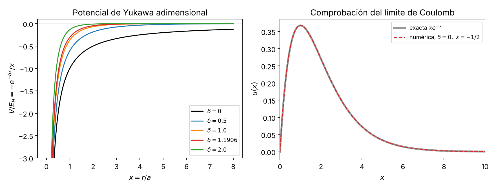

# 1. Adimensionalización de la ecuación radial con potencial de Yukawa

**Proyecto 05: umbral de enlace en el potencial de Yukawa** · Fase 1 (parte analítica) · Bloque 01
Script de verificación: `fase1/codigo/01_adimensionalizacion.py` (sympy + scipy). Figura: `fase1/figuras/01_potencial_adimensional.png`.

## 1.1 Planteamiento dimensional

Partícula de masa $m$ (masa reducida si es un sistema de dos cuerpos) en el potencial central
$$V(r) = -g\,\frac{e^{-\mu r}}{r},\qquad g>0,\ \mu\ge 0 .$$
Unidades: $[g] = \text{energía}\times\text{longitud} = M L^3 T^{-2}$; $[\mu] = L^{-1}$; $\lambda = 1/\mu$ es el **alcance** (longitud de apantallamiento).

Con $\psi(\mathbf r) = \frac{u_l(r)}{r}Y_{lm}(\theta,\phi)$, la ecuación radial es
$$-\frac{\hbar^2}{2m}\,u''(r) + \left[-g\frac{e^{-\mu r}}{r} + \frac{\hbar^2 l(l+1)}{2m r^2}\right]u(r) = E\,u(r). \tag{1.1}$$

Parámetros dimensionales: $\hbar, m, g, \mu$ (y $E$ como incógnita). Hay 3 dimensiones básicas ($M, L, T$) y 4 parámetros, por lo que (teorema $\Pi$ de Buckingham) existe **exactamente un** grupo adimensional independiente. Lo construimos a continuación.

## 1.2 Escalas naturales (sin el apantallamiento)

Igualando energía cinética típica y potencial de Coulomb, $\hbar^2/(m a^2) = g/a$:
$$a = \frac{\hbar^2}{m g}\quad(\text{radio de Bohr generalizado}),\qquad E_H = \frac{g}{a} = \frac{m g^2}{\hbar^2}\quad(\text{energía de Hartree generalizada}).$$
Comprobación dimensional (sympy): $[a] = \frac{(ML^2T^{-1})^2}{M\cdot ML^3T^{-2}} = L$; $[E_H] = ML^2T^{-2}$. ✔
Identidades útiles: $E_H = g/a = \hbar^2/(m a^2)$ (verificadas simbólicamente).
Para el hidrógeno ($g = e^2/4\pi\varepsilon_0$, $m = m_e$): $a = a_0 = 0.529\,177\,210\,903\times10^{-10}$ m (valor recomendado CODATA 2018; cita no verificada en la fuente primaria en esta revisión, ver sección 6) y $E_H = 27.211$ eV.

## 1.3 Cambio de variables, paso a paso

Definimos
$$x = \frac{r}{a},\qquad \varepsilon = \frac{E}{E_H},\qquad \delta = \mu a = \frac{\mu\hbar^2}{m g},\qquad w(x) = u(a x).$$

**Paso 1 (derivadas).** $\dfrac{d}{dr} = \dfrac1a\dfrac{d}{dx}\Rightarrow u''(r) = \dfrac{1}{a^2}w''(x)$.

**Paso 2 (cada término).**
- Cinético: $-\dfrac{\hbar^2}{2m a^2}w'' = -\dfrac{E_H}{2}w''$ (usando $\hbar^2/(m a^2) = E_H$).
- Yukawa: $-g\dfrac{e^{-\mu a x}}{a x} = -\dfrac{g}{a}\dfrac{e^{-\delta x}}{x} = -E_H\dfrac{e^{-\delta x}}{x}$.
- Centrífugo: $\dfrac{\hbar^2 l(l+1)}{2m a^2x^2} = \dfrac{E_H}{2}\dfrac{l(l+1)}{x^2}$.
- Energía: $E = \varepsilon E_H$.

**Paso 3 (sustituir en 1.1).**
$$-\frac{E_H}{2}w'' + E_H\left[-\frac{e^{-\delta x}}{x} + \frac{l(l+1)}{2x^2}\right]w = \varepsilon E_H\,w.$$

**Paso 4 (dividir entre $-E_H/2$ y reordenar).**
$$\boxed{\,w''(x) + \left[\frac{2\,e^{-\delta x}}{x} - \frac{l(l+1)}{x^2} + 2\varepsilon\right]w(x) = 0\,} \tag{1.2}$$

Comprobación de los factores de (1.2): el 2 delante de $e^{-\delta x}/x$ y de $\varepsilon$ procede de dividir entre $E_H/2$; el término centrífugo no lleva 2. **Verificación sympy:** se aplicó literalmente la sustitución a (1.1), se multiplicó por $-2/E_H$ y se restó (1.2): diferencia $= 0$ exactamente.

Equivalentemente, (1.2) es la ecuación en **unidades atómicas** $\hbar = m = g = 1$ con $V(x) = -e^{-\delta x}/x$, $\mu \to \delta$ (sympy: $V/E_H = -e^{-\delta x}/x$). Así, las convenciones "$\hbar=m=g=1$" de la presentación previa y "distancias en radios de Bohr" son la misma cosa.

**Consecuencia:** el espectro solo depende de $\delta$: $E_{nl} = E_H\,\varepsilon_{nl}(\delta)$. El umbral de enlace es un número puro $\delta_c$; un $\mu_c$ suelto no tiene sentido, pues $\mu_c = \delta_c\, m g/\hbar^2$.

## 1.4 Condiciones de frontera

**Origen.** Serie (sympy): $\dfrac{e^{-\delta x}}{x} = \dfrac1x - \delta + \dfrac{\delta^2 x}{2} - \dots$; la singularidad es $1/x$ (como Coulomb), más débil que $1/x^2$. Con $w\sim x^s$ el término dominante da $s(s-1) = l(l+1)$, raíces $s = l+1$ y $s = -l$. La regular es
$$w(x) \sim x^{l+1},\quad w(0) = 0 .$$
(Para $l=0$ la raíz $s=0$ daría $\psi\sim1/r$, cuya laplaciana produce $\delta^3(\mathbf r)$ y no resuelve la ecuación original: se descarta.) Para $l=0$ con más precisión: $w = x - x^2 + O(x^3)$ (condición de cúspide de Kato, $w''(0) = -2w'(0)$).

**Infinito.** Para $x\to\infty$, $e^{-\delta x}/x$ y $1/x^2$ se anulan ($\delta>0$ más rápido que cualquier potencia), y $w'' \approx -2\varepsilon w$. Con $\varepsilon<0$, $w\sim e^{-\kappa x}$, $\kappa = \sqrt{-2\varepsilon}$; normalizabilidad exige $w(x)\to 0$, eliminando $e^{+\kappa x}$. Para $\delta>0$ no aparece el factor $x^{1/\kappa}$ de Coulomb (cola de corto alcance).

**Umbral.** Cuando $\delta\to\delta_c^-$, $\varepsilon\to0^-$ y $\kappa\to0$: la longitud de decaimiento $1/\kappa$ diverge y el estado se deslocaliza (por eso el tamaño de caja numérica será crítico en fases posteriores).

## 1.5 Interpretación física de $\delta$

$$\delta = \mu a = \frac{a}{\lambda} = \frac{\text{tamaño del átomo (radio de Bohr)}}{\text{alcance del potencial}} .$$
- $\delta\ll1$: el alcance es mucho mayor que la órbita; el electrón "ve" Coulomb ($\delta=0$ recupera hidrógeno exactamente).
- $\delta\sim1$: el apantallamiento corta el potencial a la escala de la propia órbita; el pozo se debilita y la energía sube hacia 0.
- $\delta>\delta_c\approx1.19$: el pozo es demasiado corto/estrecho para retener un estado ligado (a diferencia de Coulomb, Yukawa tiene un número **finito** de estados ligados).

También: $\delta = \dfrac{\hbar^2\mu^2/m}{g\mu}\,$ = (energía cinética de confinamiento en la longitud $\lambda$)/(profundidad típica del potencial a esa distancia). El enlace se pierde cuando la cinética de localizar la partícula dentro del alcance supera la atracción.

Ejemplo (plasma, apantallamiento de Debye y Hückel del hidrógeno; Debye y Hückel 1923, cita no verificada en la fuente primaria, ver sección 6; el modelo estático solo vale en un plasma débilmente acoplado): $\delta = a_0/\lambda_D$; $\lambda_D = 1$ nm $\to\delta = 0.053$; $\lambda_D = 0.1$ nm $\to \delta = 0.529$; el estado fundamental desaparece para $\lambda_D \approx a_0/1.1906 \approx 0.0444$ nm. (El valor $\delta_c\approx 1.1906$ se acota en los bloques 3 y 4, se calcula en el 5 y su procedencia bibliográfica se discute en el 6.)

## 1.6 Comprobaciones (salida del script)

| Comprobación | Resultado |
|---|---|
| (1.1) con $r=ax$, $E=\varepsilon E_H$, $\mu=\delta/a$, $\times(-2/E_H)$ − (1.2) | $0$ (sympy, exacto) |
| Dimensión de $\delta$ | $[\delta]=1$ |
| $\delta=0,\ l=0,\ w=xe^{-x},\ \varepsilon=-1/2$: residuo de (1.2) | $0$ (exacto) |
| $\langle x\rangle$ del 1s hidrogenoide | $3/2$ |
| Raíces indiciales | $s=l+1,\ s=-l$ |
| Integración numérica (RK45, $\delta=0$, $\varepsilon=-1/2$) vs. $xe^{-x}$ en $[0,12]$ | error máx. $3.7\times10^{-7}$ |
| Ejemplo $\hbar=1.3,m=0.7,g=2.1,\mu=0.45$: $V$ dimensional vs. $E_H\cdot V_{\rm adim}$ | $8.9\times10^{-16}$ |

*Figura 1.1. Izquierda: $V/E_H=-e^{-\delta x}/x$ para varios $\delta$ (incluido $\delta_c\approx1.1906$). Derecha: solución numérica de (1.2) con $\delta=0$, $\varepsilon=-1/2$ frente a la exacta $xe^{-x}$.*

## 1.7 Resumen
1. Escalas: $a=\hbar^2/(mg)$, $E_H=mg^2/\hbar^2$.
2. Parámetro único: $\delta=\mu a=\mu\hbar^2/(mg)$ = tamaño atómico / alcance.
3. Ecuación: $w''+[2e^{-\delta x}/x-l(l+1)/x^2+2\varepsilon]w=0$, $w(0)=0$ ($w\sim x^{l+1}$), $w(\infty)=0$ ($w\sim e^{-\sqrt{-2\varepsilon}x}$).
4. $E=\varepsilon(\delta)\,E_H$; el umbral es el número puro $\delta_c$.

## Registro de revisión
- Revisión adversarial (corrección matemática), hecha por IA (Claude, agente revisor, 12-10-2026; decisión del equipo sobre el resultado: aprobado por Lucho el 21-10-2026 tras la verificación independiente de ese día, decisión 1 de `decisiones_pendientes.md`): se rehicieron independientemente el cambio de variables, los factores 2 de (1.2), las raíces indiciales, la condición de cúspide ($w=x-x^2+\dots$, independiente de $\delta$ a ese orden), el comportamiento asintótico, el conteo $\Pi$ de Buckingham y los valores numéricos del ejemplo de Debye ($a_0/1.1906\approx0.0444$ nm). Se ejecutó el script: todas las verificaciones pasan. Sin errores encontrados; sin cambios de contenido.
- Revisión adversarial (física y consistencia numérica), hecha por IA (Claude, agente revisor, 12-10-2026; decisión del equipo sobre el resultado: aprobado por Lucho el 21-10-2026 tras la verificación independiente de ese día, decisión 1 de `decisiones_pendientes.md`): se ejecutó de nuevo `01_adimensionalizacion.py` (todas las verificaciones pasan; error RK45 $3.68\times10^{-7}$, ejemplo dimensional $8.9\times10^{-16}$). Se comprobó: $a_0/\lambda_D$ para 1 nm y 0.1 nm, $\lambda_D^{c}=a_0/1.1906\approx0.0444$ nm, consistencia con unidades atómicas ($E_0=-1/2$, $\langle r\rangle=3/2$), y que $\delta_c\approx1.1906$ es compatible con la literatura ($\delta_c\approx1.19$ en Rogers et al. 1970; $1.19061242106$ en Gebremedhin y Weatherford 2023, ver sección 6). Sin errores encontrados; sin cambios de contenido.
- Corrección posterior (ronda 2 de auditoría, Claude, 12-10-2026): se quitó la expresión "factores del enunciado", porque la guía del profesor no da la ecuación (1.2) (comprobado en `enunciado/guia_texto.txt`); se marcaron como no verificadas las citas de CODATA 2018 y de Debye y Hückel; se quitó una raya larga del encabezado. Sin cambios en las fórmulas ni en los números.
