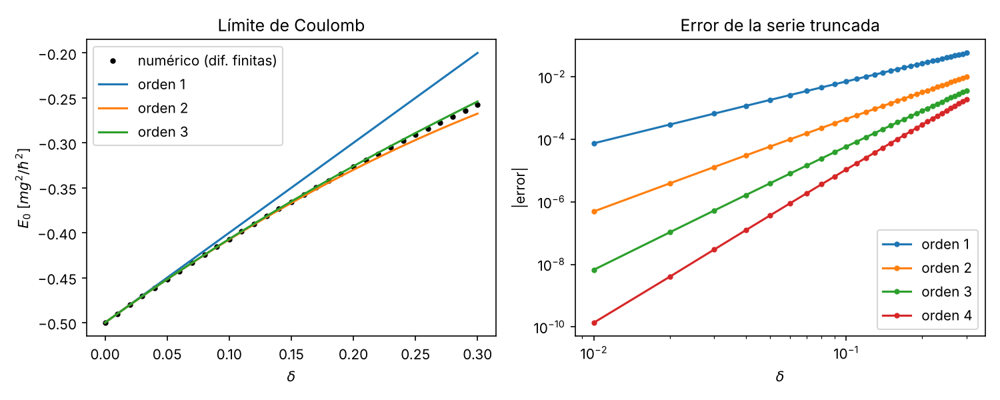

# 2. Límite de Coulomb ($\delta \to 0$) y expansión perturbativa de $E_0(\delta)$

**Unidades.** $\hbar = m = g = 1$: distancias en $a=\hbar^2/(mg)$, energías en $mg^2/\hbar^2$. La ecuación radial adimensional para $u(r)=rR(r)$ es
$$-\tfrac12 u''(r) + \Big[\tfrac{\ell(\ell+1)}{2r^2} - \tfrac{e^{-\delta r}}{r}\Big]u(r) = E\,u(r),\qquad u(0)=0,\; u(\infty)=0 .$$
Código: `fase1/codigo/02_limite_coulomb.py` (sympy + scipy). Figura: `fase1/figuras/02_limite_coulomb.png`.

## 2.1 El límite $\delta\to0$ es el hidrógeno

Para todo $r$ fijo, $e^{-\delta r}\to 1$, así que $V(r)\to -1/r$: potencial de Coulomb en unidades atómicas. Por tanto
$$E_n = -\frac{1}{2n^2}\quad\big(\text{en dimensiones: } E_n=-\tfrac{mg^2}{2\hbar^2 n^2}\big),\qquad E_1=-\tfrac12 .$$

**Estado 1s.** Probamos $u_1 = 2r e^{-r}$:
- $u_1' = 2e^{-r}(1-r)$, $u_1'' = 2e^{-r}(r-2)$.
- $-\tfrac12 u_1'' - u_1/r = -e^{-r}(r-2) - 2e^{-r} = -r e^{-r} = -\tfrac12 u_1$ ⇒ $E_1=-\tfrac12$. ✔ (sympy)
- Normalización: $\int_0^\infty 4r^2e^{-2r}dr = 4\cdot \frac{2!}{2^3}=1$. ✔ Así $\psi_{1s}=\frac{1}{\sqrt\pi}e^{-r}$.

Se verificó también con sympy que $u_{n0}=r e^{-r/n}L^{(1)}_{n-1}(2r/n)$ cumple $E=-1/(2n^2)$ para $n=1,2,3$.

**Momentos** (con $\int_0^\infty r^k e^{-2r}dr = k!/2^{k+1}$):
$$\langle r\rangle = 4\cdot\frac{3!}{2^4}=\frac32,\qquad \langle r^2\rangle = 4\cdot\frac{4!}{2^5}=3,\qquad \langle r^3\rangle = 4\cdot\frac{5!}{2^6}=\frac{15}{2}.$$
$\langle r\rangle = 3/2$ radios de Bohr. ✔ (sympy)

## 2.2 Serie perturbativa de $E_0(\delta)$

Expandimos el potencial:
$$V(r) = -\frac{e^{-\delta r}}{r} = -\frac1r + \delta - \frac{\delta^2}{2}r + \frac{\delta^3}{6}r^2 - \frac{\delta^4}{24}r^3 + O(\delta^5).$$
Entonces $H = H_0 + W$, con $W = \delta - \tfrac{\delta^2}{2}r + \tfrac{\delta^3}{6}r^2 - \tfrac{\delta^4}{24}r^3+\dots$

**Primer orden de perturbaciones** ($\langle W\rangle$ en el 1s):
$$\langle W\rangle = \delta - \frac{\delta^2}{2}\cdot\frac32 + \frac{\delta^3}{6}\cdot 3 - \frac{\delta^4}{24}\cdot\frac{15}{2} = \delta - \frac34\delta^2 + \frac12\delta^3 - \frac{5}{16}\delta^4 .$$

**Segundo orden.** El término $\delta$ es una constante: desplaza todos los niveles igual y no mezcla estados, su contribución de segundo orden es cero. La primera contribución de segundo orden es la de $W_2=-\tfrac{\delta^2}{2}r$, que entra a orden $\delta^4$. Se calcula exactamente con el método de Dalgarno–Lewis: buscamos $F(r)$ con $[F,H_0]u_1 = (W_2-\langle W_2\rangle)u_1$, i.e. $(H_0-E_1)(Fu_1) = -(W_2-\langle W_2\rangle)u_1$ (para $F(r)$ radial: $\tfrac12(F''+2F'/r-2F')=W_2-\langle W_2\rangle$ por unidad de $\delta^2$). Con el ansatz $F = a_0 + a_1 r + a_2 r^2$ sympy da $a_1=0$, $a_2=\tfrac14$ y deja $a_0$ libre, porque una constante multiplicada por $u_1$ es solución de la ecuación homogénea. La constante se fija ortogonalizando, $\langle F\rangle_{1s}=0$, lo que da $a_0=-\tfrac34$; no afecta a la energía (sympy: $E^{(2)}$ con $a_0$ libre vale $-\tfrac38$). Así $F = \tfrac{r^2}{4}-\tfrac34$ y
$$E^{(2)}[W_2] = \langle (W_2-\langle W_2\rangle)F\rangle = -\tfrac38\,\delta^4 .$$

**Resultado:**
$$\boxed{E_0(\delta) = -\frac12 + \delta - \frac34\delta^2 + \frac12\delta^3 - \frac{11}{16}\delta^4 + O(\delta^5)}$$
con $-\tfrac{11}{16} = -\tfrac5{16}-\tfrac38$. Se confirma la pendiente anunciada en la presentación previa del equipo (`guion_presentacion.md`, 5 de octubre de 2026): primer orden $+\delta$ (pendiente $1$); el segundo orden es $-\tfrac34\delta^2 = -\tfrac{\delta^2}{2}\langle r\rangle$.

Interpretación: a primer orden el apantallamiento sólo sube la energía en $\delta$ (en dimensiones, $g\mu$) porque, a ese orden, el apantallamiento equivale a sumar la constante $+\delta$ al potencial de Coulomb (válido donde $\delta r\ll1$, que es donde vive el orbital); el término $-\tfrac34\delta^2$ refleja el tamaño finito del orbital ($\langle r\rangle=3/2$).

## 2.3 Verificación numérica

Método: diferencias finitas de segundo orden en $r\in(0,60]$ con $u(0)=u(60)=0$, autovalor más bajo con `scipy.sparse.linalg.eigsh` (shift-invert), pasos $h=0.004$ y $0.002$ y extrapolación de Richardson $E=(4E_{h/2}-E_h)/3$ (error $O(h^4)$). Para $\delta=0$ reproduce $-0.5$ con error $\sim10^{-11}$.

| $\delta$ | $E_0$ numérico | orden 1 | orden 2 | orden 3 | orden 4 | $\lvert E_{num}-E_{(2)}\rvert$ |
|---|---|---|---|---|---|---|
| 0.000 | −0.50000000 | −0.500000 | −0.50000000 | −0.50000000 | −0.50000000 | 7e−12 |
| 0.005 | −0.49501869 | −0.495000 | −0.49501875 | −0.49501869 | −0.49501869 | 6.2e−08 |
| 0.010 | −0.49007451 | −0.490000 | −0.49007500 | −0.49007450 | −0.49007451 | 4.9e−07 |
| 0.020 | −0.48029611 | −0.480000 | −0.48030000 | −0.48029600 | −0.48029611 | 3.9e−06 |
| 0.050 | −0.45181643 | −0.450000 | −0.45187500 | −0.45181250 | −0.45181680 | 5.9e−05 |
| 0.100 | −0.40705803 | −0.400000 | −0.40750000 | −0.40700000 | −0.40706875 | 4.4e−04 |
| 0.150 | −0.36546080 | −0.350000 | −0.36687500 | −0.36518750 | −0.36553555 | 1.4e−03 |
| 0.200 | −0.32680851 | −0.300000 | −0.33000000 | −0.32600000 | −0.32710000 | 3.2e−03 |
| 0.300 | −0.25763859 | −0.200000 | −0.26750000 | −0.25400000 | −0.25956875 | 9.9e−03 |

- El error de la serie truncada a orden 2 escala como $\approx\tfrac12\delta^3$ (p. ej. $\delta=0.01$: $4.9\times10^{-7}\approx 0.5\times10^{-6}$), como se espera del siguiente término.
- Ajuste polinómico de grado 4 a 12 puntos en $\delta\in[0.002,0.05]$: $c_0=-0.5000000$, $c_1=0.9999991$, $c_2=-0.74988$, $c_3=0.494$ (coeficientes analíticos: $-\tfrac12,\,1,\,-\tfrac34,\,\tfrac12$). $c_4$ ajustado ($-0.54$) está contaminado por órdenes superiores y no es fiable; la verificación de $-\tfrac{11}{16}$ se ve en que la columna "orden 4" coincide con el numérico a $<10^{-8}$ hasta $\delta=0.02$.
- La serie es asintótica/útil sólo para $\delta\ll1$: en $\delta=0.3$ el error de la serie truncada a orden 2 ya es $9.86\times10^{-3}$ en valor absoluto (3.8 % de $E_0$), y el de la serie a orden 4 es $1.93\times10^{-3}$ (0.75 %), según la salida del script. No sirve para estimar $\delta_c\approx1.19$; para eso están las cotas (bloque 03) y la parte numérica (fase 2).

*Figura 2.1. Izq.: $E_0(\delta)$ numérico vs. serie truncada a órdenes 1–3. Der.: error absoluto de la serie truncada a órdenes 1–4 (escala log–log; pendientes $\approx k+1$).*

## 2.4 Conclusiones del bloque
1. $\delta\to0$ recupera exactamente el hidrógeno: $E_n=-1/(2n^2)$, $\psi_{1s}=e^{-r}/\sqrt\pi$, $\langle r\rangle=3/2$.
2. $E_0(\delta)=-\tfrac12+\delta-\tfrac34\delta^2+\tfrac12\delta^3-\tfrac{11}{16}\delta^4+O(\delta^5)$, verificada con sympy (primer orden + Dalgarno–Lewis) y numéricamente.
3. Prueba de control para la fase 2: cualquier solucionador debe reproducir $E_0(0)=-0.5$ y la pendiente $dE_0/d\delta|_0=1$.

*Referencias de este bloque:* resultados estándar de mecánica cuántica (hidrógeno, teoría de perturbaciones, método de Dalgarno–Lewis); no se citan artículos específicos aquí, todo se derivó y verificó en el script. Las referencias bibliográficas del proyecto se verifican en el bloque correspondiente.

## Registro de revisión
- Revisión adversarial (corrección matemática), hecha por IA (Claude, agente revisor, 12-10-2026; decisión del equipo sobre el resultado: aprobado por Lucho el 21-10-2026 tras la verificación independiente de ese día, decisión 1 de `decisiones_pendientes.md`): se rehicieron independientemente $E_1$, normalización, $\langle r^k\rangle$, expansión de $V$, primer orden, Dalgarno–Lewis ($E^{(2)}=-\tfrac38\delta^4$) y los valores de la tabla de órdenes; todo correcto. Coeficiente $-\tfrac{11}{16}$ coincide con la serie conocida del potencial de Yukawa/Debye–Hückel.
- Corregido: la ecuación de Dalgarno–Lewis estaba escrita como $[H_0,F]u_1=(W_2-\langle W_2\rangle)u_1$, inconsistente en signo con la forma equivalente $(H_0-E_1)(Fu_1)=-(W_2-\langle W_2\rangle)u_1$ y con $F=r^2/4-3/4$; se cambió a $[F,H_0]$ y se añadió la EDO radial explícita.

- Revisión adversarial (física y consistencia numérica), hecha por IA (Claude, agente revisor, 12-10-2026; decisión del equipo sobre el resultado: aprobado por Lucho el 21-10-2026 tras la verificación independiente de ese día, decisión 1 de `decisiones_pendientes.md`): se re-ejecutó `02_limite_coulomb.py` y reproduce exactamente la tabla, momentos, $F$ y el ajuste polinómico; las afirmaciones de escalado del error ($\approx\tfrac12\delta^3$) y de acuerdo de orden 4 ($<10^{-8}$ hasta $\delta=0.02$) se confirmaron. Corregido además: la interpretación del término $+\delta$ decía "cerca del origen"; a primer orden el desplazamiento es una constante global (válida donde $\delta r\ll1$). Se reformuló.
- Corrección posterior (ronda 2 de auditoría, Claude, 12-10-2026): el texto decía que el ansatz $F=a_1r+a_2r^2$ daba $F=r^2/4-3/4$, lo que es incoherente (ese ansatz no tiene término constante). Se cambió a $F=a_0+a_1r+a_2r^2$ en el texto y en `02_limite_coulomb.py`, que ahora imprime la solución general $a_0+r^2/4$ y comprueba que $E^{(2)}=-3/8$ no depende de $a_0$. Se sustituyó "coeficientes del encargo" (no existe tal encargo en la guía del profesor) por la referencia a la presentación previa, y se añadieron los errores relativos en $\delta=0.3$ que imprime el script. Script re-ejecutado; tabla y figura sin cambios.
