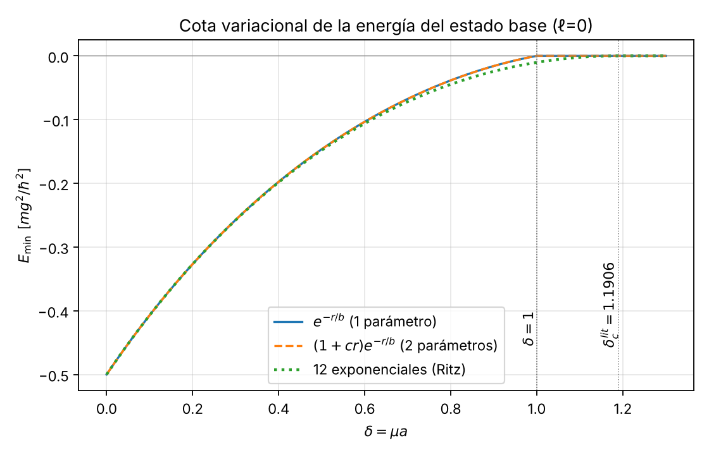

# 3. Cota inferior del umbral por el método variacional

**Script:** `fase1/codigo/03_cota_variacional.py` (sympy + numpy/scipy) · **Figura:** `fase1/figuras/03_Emin_vs_delta.png`

## 3.1 Planteamiento

En unidades adimensionales ($\hbar=m=g=1$: distancias en radios de Bohr $a=\hbar^2/(mg)$, energías en $mg^2/\hbar^2$) el hamiltoniano es

$$H=-\tfrac12\nabla^2-\frac{e^{-\delta r}}{r},\qquad \delta=\mu a=\frac{\mu\hbar^2}{mg}.$$

**Principio variacional (Rayleigh–Ritz).** Para cualquier $\psi$ normalizable, $E[\psi]=\langle\psi|H|\psi\rangle/\langle\psi|\psi\rangle\ge E_0$. Como el continuo empieza en $E=0$, si encontramos **una** $\psi$ con $E[\psi]<0$, el espectro tiene un autovalor discreto negativo: **existe estado ligado**. Así, todo $\delta$ para el que alguna prueba da $E<0$ cumple $\delta<\delta_c$: el método da **cotas inferiores de $\delta_c$**.

Para funciones con simetría esférica ($\ell=0$), con el factor $4\pi$ cancelándose entre numerador y denominador:
$$\langle\psi|\psi\rangle=\int_0^\infty\psi^2r^2dr,\quad \langle T\rangle=\tfrac12\int_0^\infty(\psi')^2r^2dr,\quad \langle V\rangle=-\int_0^\infty\psi^2e^{-\delta r}\,r\,dr .$$

Integral básica usada en todo el bloque: $\displaystyle\int_0^\infty r^n e^{-sr}dr=\frac{n!}{s^{n+1}}$ ($s>0$).

## 3.2 Prueba hidrogenoide $\psi=e^{-r/b}$

**Norma:** $\int_0^\infty r^2e^{-2r/b}dr=\dfrac{2}{(2/b)^3}=\dfrac{b^3}{4}.$

**Cinética:** $\psi'=-\tfrac1b e^{-r/b}$, así $\tfrac12\int\frac{1}{b^2}r^2e^{-2r/b}dr=\frac{1}{2b^2}\cdot\frac{b^3}{4}=\frac{b}{8}$, y $\langle T\rangle=\dfrac{b/8}{b^3/4}=\dfrac{1}{2b^2}.$

**Potencial:** $-\int_0^\infty r\,e^{-(2/b+\delta)r}dr=-\dfrac{1}{(2/b+\delta)^2}=-\dfrac{b^2}{(2+\delta b)^2}$, luego $\langle V\rangle=-\dfrac{b^2}{(2+\delta b)^2}\cdot\dfrac{4}{b^3}=-\dfrac{4}{b(2+\delta b)^2}.$

$$\boxed{E(b,\delta)=\frac{1}{2b^2}-\frac{4}{b\,(2+\delta b)^2}}$$

Con $\beta=1/b$ (notación de la presentación previa del equipo (`guion_presentacion.md`, 5 de octubre de 2026)): $E(\beta)=\beta^2/2-4\beta^3/(2\beta+\delta)^2$. *(sympy: verificado; integral numérica con `quad` en $b=1.7,\ \delta=0.6$: $-0.0849762401910$ en ambos.)*

**Límite de Coulomb ($\delta=0$):** $E=\frac1{2b^2}-\frac1b$, $dE/db=0\Rightarrow b^*=1$, $E^*=-\tfrac12$: la prueba es exacta (hidrógeno).

### 3.2.1 Existencia de estado ligado para $\delta<1$

Como $b>0$, multiplicando por $2b^2(2+\delta b)^2>0$:
$$E<0\iff (2+\delta b)^2<8b\iff P(b)\equiv \delta^2b^2+(4\delta-8)\,b+4<0 .$$
$P$ es una parábola convexa en $b$ con $P(0)=4>0$; toma valores negativos sii tiene dos raíces reales distintas positivas. Discriminante:
$$\Delta=(4\delta-8)^2-16\delta^2=64-64\delta=-64(\delta-1).$$
- $\delta<1$: $\Delta>0$, raíces $b_\pm=\dfrac{2\,(2-\delta\pm2\sqrt{1-\delta})}{\delta^2}>0$ (ambas positivas pues el producto es $4/\delta^2>0$ y la suma $(8-4\delta)/\delta^2>0$). Para todo $b\in(b_-,b_+)$, $E(b,\delta)<0$ ⇒ **hay estado ligado**.
- $\delta=1$: $P(b)=(b-2)^2\ge0$; el mínimo toca cero en $b=2$: $E(2,1)=\tfrac18-\tfrac{4}{2\cdot16}=0$ y $\partial_bE(2,1)=0$.
- $\delta>1$: $P>0$ siempre, $E>0$ para todo $b$; el ínfimo es $0^+$ cuando $b\to\infty$ (la prueba se dispersa al continuo).

$$\boxed{\delta_c\ \ge\ 1}$$

### 3.2.2 Por qué exactamente $\delta=1$

Escribiendo $x=\delta b$ (cociente entre el tamaño de la prueba y el alcance $1/\mu$), la condición $E<0$ es
$$\delta< g_1(x)=\frac{8x}{(x+2)^2},\qquad g_1'(x)=\frac{8(2-x)}{(x+2)^3}=0\Rightarrow x=2,\quad g_1(2)=\frac{16}{16}=1 .$$
La función $e^{-r/b}$ tiene una sola escala: el mejor compromiso entre la cinética ($\propto 1/b^2$) y un potencial efectivo apantallado sucede cuando el radio de la prueba es $b=2/\delta$, es decir, la "longitud de decaimiento" de $\psi^2$ ($b/2$) coincide con el alcance $1/\delta$. El número 1 sale de que la integral de $\langle V\rangle$ involucra $(2/b+\delta)^{-2}$, todo racional en $x$: es una propiedad de la familia de prueba, no del potencial. La función de onda real cerca del umbral tiene **dos** escalas (núcleo de tamaño $\sim1$ y cola $e^{-\kappa r}$ con $\kappa\to0$), que un exponencial simple no puede representar; por eso la cota no es óptima.

### 3.2.3 Comportamiento para $\delta$ pequeño (control)

De $\partial_bE=0\iff(2+\delta b)^3=4b(2+3\delta b)$ se obtiene, por serie (sympy),
$$b^*(\delta)=1+\tfrac34\delta^2-\delta^3+\dots,\qquad E^{(1)}_{\min}(\delta)=-\tfrac12+\delta-\tfrac34\delta^2+\tfrac12\delta^3+O(\delta^4).$$
Esto coincide con la teoría de perturbaciones de primer orden ($V\simeq-1/r+\delta-\delta^2r/2+\delta^3r^2/6$, con $\langle r\rangle=3/2$, $\langle r^2\rangle=3$): las correcciones de segundo orden aparecen recién en $O(\delta^4)$. Pendiente inicial $+1$, como se anunciaba en la presentación previa del equipo (`guion_presentacion.md`, 5 de octubre de 2026).

| $\delta$ | $b^*$ | $E^{(1)}_{\min}$ |
|---|---|---|
| 0 | 1.0000 | −0.500000 |
| 0.5 | 1.1448 | −0.146509 |
| 0.9 | 1.6243 | −0.015969 |
| 0.99 | 1.9438 | −0.001287 |
| 1 | 2.0000 | 0 (mínimo marginal: raíz doble de $P(b)=(b-2)^2$) |
| >1 | $b\to\infty$ | ínfimo $0^+$, no alcanzado (sin ligado en esta familia) |

## 3.3 Prueba mejorada $\psi=(1+cr)e^{-r/b}$

Integrales (sympy, verificadas):
$$N=\tfrac{b^3}{4}(1+3bc+3b^2c^2),\quad \tfrac12\!\int\!\psi'^2r^2=\tfrac b8(1+bc+b^2c^2),$$
$$-\!\int\!\psi^2e^{-\delta r}r\,dr=-\frac{b^2\left[(2+\delta b)^2+4bc(2+\delta b)+6b^2c^2\right]}{(2+\delta b)^4}.$$
Con $x=\delta b$ y $t=cb$, $E<0\iff\delta<g_2(x,t)$,
$$g_2(x,t)=\frac{8x\left[(x+2)^2+4t(x+2)+6t^2\right]}{(x+2)^4\,(1+t+t^2)} ,\qquad g_2(x,0)=g_1(x).$$
**Resultado:** maximizando numéricamente (Nelder–Mead desde 16 puntos iniciales) $\max g_2=1.000000$ en $x=2,\ t=0$. **No mejora la cota.** Explicación:

1. $\partial_c E|_{c=0}=-\dfrac{(2+\delta b)^3-4b(2+3\delta b)}{b(2+\delta b)^3}$: sympy muestra que es **idéntico** (salvo el factor $b^2$) a $\partial_bE^{(1)}$. Razón: $\partial_b e^{-r/b}=\frac{r}{b^2}e^{-r/b}$, así que añadir $cr\,e^{-r/b}$ es, a primer orden, lo mismo que cambiar $b$. En el óptimo de un parámetro el término nuevo es estacionario.
2. En $x=2$: $g_2(2,t)=\dfrac{1+t+\frac38t^2}{1+t+t^2}=1-\dfrac{5t^2/8}{1+t+t^2}\le1$. El polinomio solo añade estructura cerca del origen, no una segunda escala de cola.

Numéricamente, en 34 valores de $\delta\in[0,0.99]$ el script da $\max|E^{(2)}_{\min}-E^{(1)}_{\min}|=9.8\times10^{-15}$ y $|t^*|=|c^*b^*|\le2.3\times10^{-5}$ (el mínimo en $t$ es cuadrático y plano, así que $t^*$ queda peor determinado que la energía). Es un resultado "negativo" pero útil: **la mejora debe venir de añadir escalas, no polinomios**.

## 3.4 Prueba mejorada eficaz: combinación de exponenciales (Ritz lineal)

$u(r)=r\psi=\sum_{i=1}^N c_i\,r\,e^{-a_ir}$, con $a_i=a_1\rho^{\,i-1}$ (serie geométrica; parámetros no lineales $a_1,\rho$, coeficientes $c_i$ lineales). Con $s=a_i+a_j$ (sympy verificado):
$$S_{ij}=\frac{2}{s^3},\quad T_{ij}=\frac12\left[\frac1s-\frac{a_i+a_j}{s^2}+\frac{2a_ia_j}{s^3}\right]=\frac{a_ia_j}{s^3},\quad V_{ij}=-\frac{1}{(s+\delta)^2}.$$
Se resuelve $(T+V)\mathbf c=E\,S\,\mathbf c$ (ortogonalización canónica para evitar dependencia lineal), se minimiza el menor autovalor en $(a_1,\rho)$ y se busca con `brentq` el $\delta$ donde $E_{\min}=0$. Cada autovalor es cota superior de $E_0$ (teorema de Hylleraas–Undheim/MacDonald), luego $E_{\min}<0$ ⇒ ligado.

Control: $N=10$, $\delta=0$ da $E=-0.5000000000000$.

| $N$ (exponenciales) | cota inferior de $\delta_c$ |
|---|---|
| 1 ($e^{-r/b}$) | 1.000000 (analítica) |
| 1 + polinomio $(1+cr)$ | 1.000000 |
| 2 | 1.147636 |
| 4 | 1.184635 |
| 8 | 1.190195 |
| 12 | **1.190550** |
| 16 | 1.190546 (optimización no lineal limitada a base geométrica; no mejora) |

Ya con **dos** exponenciales (dos escalas: núcleo y cola) la cota sube a 1.1476. La mejor cota obtenida es
$$\boxed{\delta_c\ \ge\ 1.19055}$$
por debajo, como debe ser una cota inferior, del valor de referencia $\delta_c=1.19061242106$ (Gebremedhin y Weatherford 2023; el estado de la cita está en la sección 6) y del valor propio de la sección 5 ($1.1906124211$). Junto con la cota de Schwinger del bloque 04 ($\delta_c\le1.24305$), el mejor intervalo riguroso es $1.19055\le\delta_c\le1.24305$; el intervalo elemental, con la prueba $e^{-r/b}$ y Bargmann, es $1\le\delta_c\le2$.

Tabla de $E_{\min}(\delta)$:

| $\delta$ | $e^{-r/b}$ | $(1+cr)e^{-r/b}$ | 12 exponenciales |
|---|---|---|---|
| 0 | −0.500000 | −0.500000 | −0.500000 |
| 0.2 | −0.326729 | −0.326729 | −0.326809 |
| 0.4 | −0.197576 | −0.197576 | −0.198376 |
| 0.6 | −0.103354 | −0.103354 | −0.106136 |
| 0.8 | −0.038471 | −0.038471 | −0.044704 |
| 1.0 | 0 | 0 | −0.010286 |
| 1.1 | 0 | 0 | −0.002287 |

*Figura 3.1.* Energía variacional mínima vs. $\delta$. La prueba hidrogenoide llega a cero en $\delta=1$ con pendiente suave; la base de exponenciales sigue ligada hasta $\delta\approx1.1906$, donde $E\to0^-$ de forma aproximadamente cuadrática, típica de un umbral de onda $s$.

## 3.5 Conclusiones del bloque
- $E(b,\delta)=\frac1{2b^2}-\frac4{b(2+\delta b)^2}$; existe ligado si $\delta<1$ (discriminante $-64(\delta-1)$) ⇒ $\delta_c\ge1$.
- El valor 1 es el máximo de $8x/(x+2)^2$ en $x=\delta b=2$; refleja la única escala de la prueba.
- $(1+cr)e^{-r/b}$ no mejora (la dirección $c$ es degenerada con $b$ en el óptimo).
- Una base de exponenciales da $\delta_c\ge1.19055$; con $N=2$ ya $1.1476$.
- Verificaciones: todas las integrales con sympy; chequeos numéricos con `quad`; límite de Coulomb exacto; serie en $\delta$ coincide con perturbaciones hasta $O(\delta^3)$.

## Registro de revisión (corrección matemática, revisor adversarial hecha por IA (Claude, agente revisor, 12-10-2026; decisión del equipo sobre el resultado: aprobado por Lucho el 21-10-2026 tras la verificación independiente de ese día, decisión 1 de `decisiones_pendientes.md`))
Rehechos de forma independiente (sympy + numpy), sin errores encontrados:
- Norma $b^3/4$, $\langle T\rangle=1/(2b^2)$, $\langle V\rangle=-4/(b(2+\delta b)^2)$: correctos.
- $P(b)$, discriminante $-64(\delta-1)$, raíces $b_\pm$, caso $\delta=1$ ($P=(b-2)^2$): correctos ⇒ $\delta_c\ge1$.
- Serie: $b^*=1+\tfrac34\delta^2-\delta^3$, $E_{\min}=-\tfrac12+\delta-\tfrac34\delta^2+\tfrac12\delta^3-\tfrac{19}{32}\delta^4+\dots$ (coincide; el término $\delta^4$ añadido aquí como control).
- Integrales de $(1+cr)e^{-r/b}$ y $\partial_cE|_{c=0}=b^2\,\partial_bE^{(1)}$: confirmados; $\max g_2=1$ (Nelder–Mead independiente).
- Elementos $S_{ij},T_{ij},V_{ij}$ de la base exponencial: confirmados; $E_{\min}(\delta=1,N=12)=-0.010286$ reproducido independientemente.
- Tabla de $b^*$, $E^{(1)}_{\min}$: reproducida por barrido en malla (6 cifras).
Observación menor (sin cambio): en `minimize_scalar` acotado con intervalo amplio el mínimo puede escapar a $b\to\infty$; el script debe partir de un intervalo/semilla cercana a $b^*$ (los valores publicados son correctos).

## Registro de revisión (física y consistencia numérica, revisor adversarial hecha por IA (Claude, agente revisor, 12-10-2026; decisión del equipo sobre el resultado: aprobado por Lucho el 21-10-2026 tras la verificación independiente de ese día, decisión 1 de `decisiones_pendientes.md`))
- Script `03_cota_variacional.py` reejecutado: reproduce todas las cifras de las tablas (cotas N=2…16, $E_{\min}(\delta)$, control $\delta=0$). Sin discrepancias.
- Contraste independiente por diferencias finitas (40 000 nodos, $R=400$): $E(\delta=1.1)=-0.002285$ frente a $-0.002287$ (Ritz, cota superior de $E_0$ como debe ser); $E(0)=-0.49999$.
- La mejor cota $1.19055$ queda por debajo de $\delta_c\approx1.19061$ (literatura), coherente con ser cota inferior. El valor N=16 ligeramente menor que N=12 se explica por la base geométrica restringida (ya anotado).
- Física: la anulación cuadrática $E\propto-(\delta_c-\delta)^2$ es la esperada para un umbral de onda $s$ en potencial de corto alcance; perturbaciones hasta $O(\delta^3)$ verificadas a mano ($\langle r\rangle=3/2,\ \langle r^2\rangle=3$); $g_2(2,t)$ verificado.
- Observación menor (sin cambio): avisos de overflow de `lambdify` en el barrido de $(1+cr)e^{-r/b}$ para $b$ grande; no afectan resultados.

## Corrección posterior (ronda 2 de auditoría, Claude, 12-10-2026)
- La fila "$\ge1$: $b^*=\infty$, $0^+$" de 3.2.3 copiaba un artefacto numérico: en $\delta=1$ el mínimo es $E=0$ en $b=2$ (raíz doble), y solo para $\delta>1$ el ínfimo es $0^+$ con $b\to\infty$. Se separó la fila en dos. En `03_cota_variacional.py` la búsqueda de $b$ se acota ahora a $[0.5,\,4/\delta]$; con ello $\delta=1$ da $b^*=2.0000$, $E=-1.4\times10^{-17}$ (antes $b^*=1.6\times10^5$).
- La afirmación "$E^{(2)}_{\min}=E^{(1)}_{\min}$ a $10^{-9}$, $c^*\sim10^{-9}$" no salía de ninguna salida del script. Se añadió al script el cálculo de $\max|E^{(2)}_{\min}-E^{(1)}_{\min}|$ y de $|t^*|$, y se reescribió la frase con esas cifras.
- Se unificó el intervalo: el mejor es $1.19055\le\delta_c\le1.24305$; antes este bloque daba $1.19055\le\delta_c\le2$.
- Las cotas de Ritz ($N=2,\dots,16$) y la tabla de $E_{\min}$ se reprodujeron sin cambios al re-ejecutar el script (figura 03 regenerada).
