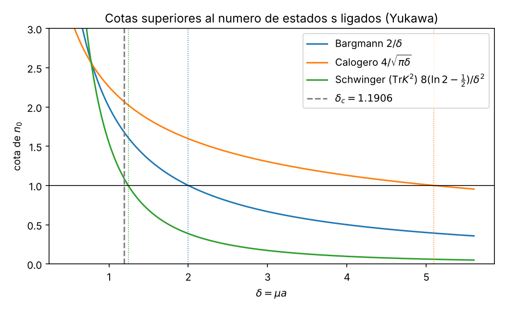

# 4. Cotas superiores del umbral: Bargmann, Calogero y Schwinger

## 4.1 Planteamiento adimensional

Usamos unidades de Bohr: $x=r/a$ con $a=\hbar^2/(mg)$ y energías en unidades de $mg^2/\hbar^2$, con $\delta=\mu a$. La ecuación radial para $u(x)=x\,R(x)$ queda

$$-\tfrac12 u'' + \Big[-\frac{e^{-\delta x}}{x}+\frac{l(l+1)}{2x^2}\Big]u = E\,u
\;\Longleftrightarrow\;
u''=\Big[-U(x)+\frac{l(l+1)}{x^2}-2E\Big]u,\qquad U(x)\equiv\frac{2m}{\hbar^2}|V|\,a^2=\frac{2\,e^{-\delta x}}{x}.$$

**Comprobación de factores.** En unidades físicas $\frac{2m}{\hbar^2}|V(r)|=\frac{2mg}{\hbar^2}\frac{e^{-\mu r}}{r}$. Con $r=ax$, $dr=a\,dx$: $\frac{2m}{\hbar^2}\int_0^\infty r|V|\,dr=\frac{2mg}{\hbar^2}\,a\int_0^\infty e^{-\delta x}dx=2\cdot\frac{1}{\delta}$, porque $mg\,a/\hbar^2=1$. El factor 2 procede de $2m/\hbar^2$ y **no** debe omitirse. Comprobación propia de que importa: sin él se obtendría $1/\delta$ y la "cota" $\delta_c\le1$, que es falsa, porque en $\delta=1$ todavía hay estado ligado ($E_0=-0.0103$, sección 5). La presentación previa del equipo (`guion_presentacion.md`, 5 de octubre de 2026) ya usaba $2/\delta$.

## 4.2 Teorema de Bargmann (1952)

Para un potencial central con $\int_0^\infty r|V|\,dr<\infty$, el número $n_l$ de estados ligados con momento angular $l$ cumple

$$n_l<\frac{1}{2l+1}\,\frac{2m}{\hbar^2}\int_0^\infty r\,|V(r)|\,dr .$$

(Formulación estándar; la desigualdad estricta es la de Bargmann.)

**Aplicación a Yukawa ($l=0$), paso a paso:**
1. $\int_0^\infty x\,U(x)\,dx=\int_0^\infty x\cdot\frac{2e^{-\delta x}}{x}dx=2\int_0^\infty e^{-\delta x}dx$.
2. $\int_0^\infty e^{-\delta x}dx=\big[-e^{-\delta x}/\delta\big]_0^\infty=1/\delta$.
3. Luego $n_0<2/\delta$, y en general $n_l<\dfrac{2}{(2l+1)\delta}$.
4. Si $\delta\ge 2$, $n_0<1\Rightarrow n_0=0$: **no hay estado ligado para $\delta\ge2$**. Por tanto $\delta_c\le 2$.

Verificado con sympy (`integrate(x*U,(x,0,oo)) = 2/delta`) y numéricamente (para $\delta=0.7$: cuadratura $2.857142857$ vs $2/0.7=2.857142857$).

## 4.3 Cota de Calogero (1965)

Para potenciales atractivos monótonos no decrecientes ($V'\ge0$, que Yukawa cumple): $n_0<\frac{2}{\pi}\int_0^\infty\sqrt{U(x)}\,dx$.

1. $\sqrt{U}=\sqrt2\,x^{-1/2}e^{-\delta x/2}$ (¡el exponente se divide entre 2!).
2. $\int_0^\infty x^{-1/2}e^{-\delta x/2}dx=\Gamma(\tfrac12)(\delta/2)^{-1/2}=\sqrt{2\pi/\delta}$.
3. $n_0<\frac{2}{\pi}\sqrt2\sqrt{2\pi/\delta}=\dfrac{4}{\sqrt{\pi\delta}}$.
4. $n_0<1$ si $\delta\ge16/\pi\approx5.093$: $\delta_c\le 16/\pi$. **Mucho peor que Bargmann** para este potencial, porque la singularidad $1/x$ hace grande $\int\sqrt U$ cerca del origen.

Sympy: `4/(sqrt(pi)*sqrt(delta))`, raíz $16/\pi=5.09296$.

## 4.4 Cota de Schwinger / Birman–Schwinger (1961)

A energía cero, la existencia de un estado $s$ ligado equivale a que el operador integral simétrico
$$K(x,y)=\sqrt{U(x)}\;\min(x,y)\;\sqrt{U(y)}$$
($\min(x,y)$ es la función de Green de $-d^2/dx^2$ con $u(0)=0$) tenga un autovalor $\lambda\ge1$; $n_0$ = número de autovalores $\ge1$. Como $\lambda_{\max}^p\le\operatorname{Tr}K^p$, se obtiene la familia de cotas $n_0\le\operatorname{Tr}K^p$. Con $p=1$ se recupera exactamente Bargmann ($\operatorname{Tr}K=\int xU$). Con $p=2$ (forma de Schwinger):

$$\operatorname{Tr}K^2=\int_0^\infty\!\!\int_0^\infty U(x)U(y)\min(x,y)^2\,dx\,dy=8\int_0^\infty\frac{e^{-\delta y}}{y}\Big[\int_0^y x\,e^{-\delta x}dx\Big]dy .$$

1. $\int_0^y xe^{-\delta x}dx=\frac{1-(1+\delta y)e^{-\delta y}}{\delta^2}$.
2. $\operatorname{Tr}K^2=\frac{8}{\delta^2}\Big[\int_0^\infty\frac{e^{-\delta y}-e^{-2\delta y}}{y}dy-\delta\int_0^\infty e^{-2\delta y}dy\Big]$.
3. Frullani: $\int_0^\infty\frac{e^{-\delta y}-e^{-2\delta y}}{y}dy=\ln2$; y $\delta\int e^{-2\delta y}=\tfrac12$.
4. $\operatorname{Tr}K^2=\dfrac{8(\ln2-\tfrac12)}{\delta^2}=\dfrac{4(2\ln2-1)}{\delta^2}$.
5. Sin estado ligado si $\operatorname{Tr}K^2<1$: $\delta_c\le2\sqrt{2\ln2-1}\approx1.24305$.

Sympy da exactamente `4*(-1+2*log(2))/delta**2`, raíz $2\sqrt{\ln4-1}=1.243052$; la discretización numérica de $K$ (cuadratura de Gauss–Legendre con 1500 nodos, la que usa el script) reproduce $1.243053$.

Potencias mayores (numérico): $\operatorname{Tr}K^3=1\Rightarrow\delta\le1.19838$; $\operatorname{Tr}K^4=1\Rightarrow\delta\le1.19205$. En el límite $p\to\infty$ la condición $\lambda_{\max}(K)=1$ da $\delta_c=1.1906134$ con 1500 nodos; la diferencia de $1\times10^{-6}$ con el disparo ($1.1906124$) es error de discretización de $K$.

## 4.5 Comparación con el umbral exacto

Comprobación independiente por disparo a $E=0$ (integrar $u''=-U u$, $u(0)=0$, y buscar el $\delta$ donde $u'(\infty)$ cambia de signo): $\delta_c=1.190612$, en acuerdo con el valor de referencia $1.19061242106$ (Gebremedhin y Weatherford 2023, ver sección 6) y con el autovalor de $K$.

| Cota | Expresión para $n_0$ | $\delta_{\max}$ | Exceso sobre $\delta_c$ |
|---|---|---|---|
| Calogero | $4/\sqrt{\pi\delta}$ | $16/\pi=5.0930$ | +328 % |
| Bargmann ($\operatorname{Tr}K$) | $2/\delta$ | $2$ | +68 % |
| Schwinger ($\operatorname{Tr}K^2$) | $4(2\ln2-1)/\delta^2$ | $1.24305$ | +4.4 % |
| $\operatorname{Tr}K^3$ (numérico) | n/d | $1.1984$ | +0.65 % |
| $\operatorname{Tr}K^4$ (numérico) | n/d | $1.1920$ | +0.12 % |
| Exacto ($\lambda_{\max}(K)=1$, disparo) | n/d | $1.19061$ | 0 |

**Conclusión:** de las cotas analíticas cerradas, la **de Schwinger ($\operatorname{Tr}K^2$) es la más ajustada**: $\delta_c\le2\sqrt{2\ln2-1}\approx1.243$. La de Bargmann ($\delta_c\le2$) es la más simple y la que usaba la presentación previa del equipo (`guion_presentacion.md`, 5 de octubre de 2026); la guía del profesor solo pide derivar un criterio de estado ligado y no menciona Bargmann. La de Calogero no sirve aquí. Junto con la mejor cota inferior (Ritz con 12 exponenciales, bloque 3, $\delta_c\ge1.19055$), el mejor intervalo es $1.19055\le\delta_c\le1.24305$; el intervalo elemental (prueba $e^{-r/b}$ y Bargmann) es $1\le\delta_c\le2$.

*Figura 4.1. Cotas de $n_0$ frente a $\delta$; el cruce con $n_0=1$ marca cada $\delta_{\max}$ (líneas punteadas en $1.243$, $2$ y $16/\pi\approx5.09$). La curva de Calogero es $4/\sqrt{\pi\delta}$, que vale $2.257$ en $\delta=1$.*
Código: `codigo/04_cota_bargmann.py`.

## 4.6 Referencias

Metadatos comprobados en la web el 12-10-2026 (el estado definitivo y las fuentes de la comprobación están en la sección 6):
- V. Bargmann, “On the number of bound states in a central field of force”, *Proc. Natl. Acad. Sci. USA* **38**(11), 961–966 (1952). doi:10.1073/pnas.38.11.961. VERIFICADA.
- J. Schwinger, “On the bound states of a given potential”, *Proc. Natl. Acad. Sci. USA* **47**(1), 122–129 (1961). doi:10.1073/pnas.47.1.122. VERIFICADA (Europe PMC, PMID 16590804).
- F. Calogero, “Upper and lower limits for the number of bound states in a given central potential”, *Commun. Math. Phys.* **1**(1), 80–88 (1965). doi:10.1007/BF01649591. VERIFICADA (Crossref).
- F. J. Rogers, H. C. Graboske, D. J. Harwood, *Phys. Rev. A* **1**(6), 1577–1586 (1970). doi:10.1103/PhysRevA.1.1577. Metadatos VERIFICADOS (Crossref); la cifra que da el artículo para el 1s no se comprobó en el texto: se cita como $\delta_c\approx1.19$.

## Registro de revisión

- Revisión adversarial (corrección matemática), hecha por IA (Claude, agente revisor, 12-10-2026; decisión del equipo sobre el resultado: aprobado por Lucho el 21-10-2026 tras la verificación independiente de ese día, decisión 1 de `decisiones_pendientes.md`): rehechas de forma independiente las cotas de Bargmann ($n_0<2/\delta$, $\delta_c\le2$), Calogero ($4/\sqrt{\pi\delta}$, $16/\pi$) y Schwinger ($\operatorname{Tr}K^2=4(2\ln2-1)/\delta^2$, $\delta\le1.24305$, incluido el factor 8 $=2\cdot2^2$ por simetría de $\min(x,y)^2$ y la integral de Frullani). Disparo independiente a $E=0$ (solve_ivp, rtol $10^{-11}$): $\delta_c=1.1906124$. Porcentajes de la tabla comprobados. No se encontraron errores.
- Revisión adversarial (física y consistencia numérica), hecha por IA (Claude, agente revisor, 12-10-2026; decisión del equipo sobre el resultado: aprobado por Lucho el 21-10-2026 tras la verificación independiente de ese día, decisión 1 de `decisiones_pendientes.md`): reejecutado `codigo/04_cota_bargmann.py`. Reproduce $2/\delta$, $16/\pi=5.09296$, $2\sqrt{\ln4-1}=1.243052$ (numérico 1.243053), $\operatorname{Tr}K^3\to1.198384$, $\operatorname{Tr}K^4\to1.192046$, $\lambda_{\max}(K)=1\to1.190613$ y disparo $\to1.190612$; concuerda con $\delta_c\approx1.1906$. Porcentajes de exceso recalculados (+328 %, +68 %, +4.4 %, +0.65 %, +0.12 %): correctos. Monotonía de las cotas $\operatorname{Tr}K^p$ decreciente hacia $\delta_c$ coherente con $\lambda_{\max}^p\le\operatorname{Tr}K^p$. Hipótesis de Calogero ($V$ atractivo y no decreciente) se cumple para Yukawa. No se encontraron errores; sin cambios en el contenido.
- Corrección posterior (ronda 2 de auditoría, Claude, 12-10-2026):
  1. Se eliminaron la frase de 4.1 según la cual "el $1/\delta$ del enunciado olvida ese 2" y la nota de este registro según la cual ese $1/\delta$ "es correcto si se factoriza...". Las dos se contradecían y ninguna tenía respaldo: la guía del profesor (`enunciado/guia_texto.txt`) no menciona Bargmann, ni $1/\delta$, ni el intervalo $[1,2]$, y la presentación previa del equipo ya escribía $2/\delta$. El factor 2 se conserva como comprobación propia.
  2. La figura dibujaba la cota de Calogero como $\sqrt{8/(\pi\delta)}$ (falta un factor $\sqrt2$), que corta $n_0=1$ en $8/\pi\approx2.55$ y no en $16/\pi\approx5.09$. Se corrigió `04_cota_bargmann.py` a $4/\sqrt{\pi\delta}$, se amplió el eje hasta $\delta=5.6$ y se regeneró la figura; el script imprime el cruce $16/\pi=5.0930$ y el valor $2.257$ en $\delta=1$.
  3. El texto de 4.4 decía 400 nodos; el script usa 1500. Se corrigió y se añadió que $\lambda_{\max}(K)=1$ da $1.1906134$ con esa discretización.
  4. Se unificó el intervalo ($1.19055\le\delta_c\le1.24305$) y se quitaron las rayas largas de la tabla y de las referencias.
