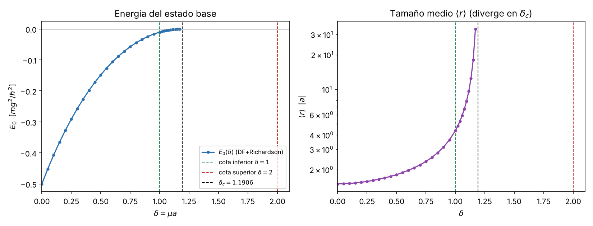

# 5. Referencia numérica independiente del umbral $\delta_c$ (chequeo de sanidad)

**Objetivo.** Comprobar numéricamente, con métodos independientes entre sí, que el umbral de enlace del estado $1s$ cae dentro de las cotas analíticas (intervalo elemental $1\le\delta_c\le 2$; mejor intervalo $1.19055\le\delta_c\le1.24305$, secciones 3 y 4) y reproducir el valor de referencia de alta precisión $\delta_c = 1.19061242106$ (Gebremedhin y Weatherford, Phys. Rev. E **108**, 045301 (2023); valor tomado de una cita secundaria, ver sección 6). Rogers, Graboske y Harwood (Phys. Rev. A **1**, 1577 (1970)) dan $\delta_c\approx1.19$. *No es la Fase 2*: es solo una validación.

**Unidades** (igual que en las secciones 1–2): $\hbar=m=g=1$, distancias en $a=\hbar^2/(mg)$, energías en $mg^2/\hbar^2$, $\delta=\mu a$. Ecuación radial ($\ell=0$, $u=rR$):
$$-\tfrac12 u''(r) - \frac{e^{-\delta r}}{r}\,u(r) = E\,u(r),\qquad u(0)=0,\quad u(\infty)=0.$$
Código: `fase1/codigo/05_referencia_numerica.py` (numpy/scipy, ~10 s). Figura: `fase1/figuras/05_E0_r_vs_delta.png`.

## 5.1 Método A: diferencias finitas + extrapolación de Richardson

**Malla.** Caja $[0,R]$ con $u(R)=0$, malla uniforme $r_j = jh$, $h=R/(N+1)$, $j=1,\dots,N$.
**Discretización.** $u''(r_j)\approx (u_{j+1}-2u_j+u_{j-1})/h^2$ con error $O(h^2)$; resulta la matriz tridiagonal simétrica
$$H_{jj} = \frac{1}{h^2} - \frac{e^{-\delta r_j}}{r_j},\qquad H_{j,j\pm1} = -\frac{1}{2h^2},$$
cuyo menor autovalor es $E_0$ (`scipy.linalg.eigh_tridiagonal`, solo el índice 0).
**Richardson.** Como $E_h = E + Ch^2 + \dots$, con $h$ y $h/2$: $E \approx (4E_{h/2}-E_h)/3$. Lo mismo para $\langle r\rangle = \sum r_j u_j^2/\sum u_j^2$.
**Caja.** La cola es $u\sim e^{-\kappa r}$ con $\kappa=\sqrt{-2E_0}$; se toma $R=\max(60,\,25/\kappa)$ (error de caja $\sim e^{-50}$), $h=1/40$.

| $\delta$ | $R$ | $N$ | $E_0$ | $\langle r\rangle$ | $\lvert E_h-E_{h/2}\rvert$ |
|---|---|---|---|---|---|
| 0.0 | 60 | 2400 | −0.499999994 | 1.50000 | 5.9e−5 |
| 0.2 | 60 | 2400 | −0.326808505 | 1.54972 | 5.7e−5 |
| 0.4 | 60 | 2400 | −0.198376077 | 1.69137 | 5.1e−5 |
| 0.6 | 60 | 2400 | −0.106135901 | 1.96686 | 4.3e−5 |
| 0.8 | 84 | 3344 | −0.044704298 | 2.54916 | 3.2e−5 |
| 1.0 | 174 | 6972 | −0.010285784 | 4.36670 | 1.8e−5 |
| 1.1 | 370 | 14795 | −0.002287239 | 8.27764 | 8.8e−6 |

**Validación Coulomb:** en $\delta=0$ se recupera $E_0=-1/2$ (error $6\times10^{-9}$ tras Richardson) y $\langle r\rangle = 3/2$, exactamente los valores de la sección 2. Además $E_0(1)=-0.01029<0$: **en $\delta=1$ todavía hay estado ligado**, consistente con la cota variacional inferior $\delta_c\ge1$.

## 5.2 Método B: Numerov con disparo (malla logarítmica)

Cambio $r=e^{x}$, $u=\sqrt r\,y$. Como $u' = e^{-x/2}(y'+y/2)$ y $u''=e^{-3x/2}(y''-y/4)$, la ecuación queda
$$y''(x) = f(x)\,y,\qquad f = \tfrac14 + 2r^2\big(V(r)-E\big),\quad V=-e^{-\delta r}/r,$$
que es de la forma de Numerov: $c_i=1-\tfrac{h^2}{12}f_i$, $\;y_{i+1}=\big[(12-10c_i)y_i - c_{i-1}y_{i-1}\big]/c_{i+1}$ (error local $O(h^6)$).
Arranque: $u\simeq r(1-r)$ cerca del origen (de la serie de Frobenius, $u''/u\to-2/r$), $r_{\min}=10^{-6}$; 40 000 nodos en $x$ hasta $R = \max(40,30/\kappa)$. Se busca con `brentq` el $E$ que anula $y(R)$.

| $\delta$ | $E_0$ Numerov | $E_0$ DF+Richardson | diferencia |
|---|---|---|---|
| 0.0 | −0.4999999999 | −0.4999999939 | 6.0e−9 |
| 0.5 | −0.1481170219 | −0.1481170192 | 2.7e−9 |
| 1.0 | −0.0102857900 | −0.0102857842 | 5.7e−9 |

Dos discretizaciones distintas concuerdan en $\sim10^{-8}$: la precisión de las energías del método A es $\lesssim10^{-8}$.

## 5.3 Método C: condición de umbral a energía cero (determinación directa de $\delta_c$)

En el umbral el estado ligado llega a $E=0$. Para $E=0$:
$$u''(r) = -\frac{2e^{-\delta r}}{r}\,u(r).$$
Para $r\gg1/\delta$ el potencial es despreciable y $u\simeq A + Br$. 
- Si $B\neq0$, la solución no es normalizable ni "plana": con $\delta<\delta_c$ el pozo ya giró la función más allá (hay estado ligado, $B<0$); con $\delta>\delta_c$, $B>0$.
- El umbral ($\ell=0$) es exactamente $B(\delta_c)=0$, es decir $u'(\infty)=0$ (resonancia de energía cero; longitud de dispersión infinita).

Se integra con `solve_ivp` (DOP853, $\text{rtol}=10^{-13}$) desde $r=10^{-8}$ con $u=r$, $u'=1$ hasta $R$, y se resuelve $u'(R;\delta)=0$ con `brentq` ($\text{xtol}=10^{-13}$):

| $R$ | $\delta_c$ | $\delta_c - 1.19061242106$ |
|---|---|---|
| 200 | 1.1906124211 | 6×10⁻¹³ |
| 400 | 1.1906124211 | 6×10⁻¹³ |
| 800 | 1.1906124211 | 6×10⁻¹³ |

Independencia de $R$ ⇒ error de caja nulo a esta precisión ($e^{-200\delta}$). **$\delta_c = 1.1906124211$ coincide con el valor de referencia $1.19061242106$ dentro de $6\times10^{-13}$.** Este acuerdo respalda el número de forma independiente, pero no verifica la cita (sección 6).

## 5.4 Método D: extrapolación $E_0\to0$

Cerca del umbral, para $\ell=0$, $\kappa=\sqrt{-2E_0}$ se anula **linealmente**: $\kappa \simeq c\,(\delta_c-\delta)$, así $E_0\simeq -\tfrac{c^2}{2}(\delta_c-\delta)^2$ (cuadrático; por eso $E_0$ se acerca a 0 tangencialmente en la figura). Se ajusta un polinomio $\kappa(\delta)$ a 11 puntos $\delta\in[1.05,1.15]$ (método A, $R=\min(40/\kappa,8000)$, $h=1/20$) y se busca su raíz:

| $\delta$ | 1.05 | 1.07 | 1.09 | 1.11 | 1.13 | 1.15 |
|---|---|---|---|---|---|---|
| $\kappa$ | 0.105375 | 0.090241 | 0.075158 | 0.060122 | 0.045134 | 0.030193 |

Pendiente secante $\Delta\kappa/\Delta\delta\approx -0.752$ en $[1.05,1.15]$ (casi constante, confirma la ley lineal). Esa pendiente sobreestima el coeficiente asintótico: más cerca del umbral $\kappa/(\delta_c-\delta)$ baja a $0.7421$ y extrapola a $c\approx0.741$ (sección 7, límite L10).
- Ajuste grado 2: $\delta_c = 1.190618$ (dif. $+5.7\times10^{-6}$).
- Ajuste grado 3: $\delta_c = 1.190605$ (dif. $-7.2\times10^{-6}$).

La extrapolación da $\delta_c = 1.19061\pm0.00001$, de acuerdo con el método C; su precisión está limitada por extrapolar ~0.04 en $\delta$.

## 5.5 Tamaño $\langle r\rangle(\delta)$ y figura

$\langle r\rangle$ crece de 1.5 ($\delta=0$) a 4.37 ($\delta=1$), 17.97 ($\delta=1.151$) y 33.5 ($\delta=1.170$): diverge como $\langle r\rangle\sim 1/(2\kappa)\propto(\delta_c-\delta)^{-1}$, el estado "se escapa" al aproximarse al umbral (halo).

## 5.6 Conclusión

| Cantidad | Valor | Fuente |
|---|---|---|
| Cota inferior elemental (prueba $e^{-r/b}$) | $\delta_c\ge 1$ | Sec. 3 |
| Mejor cota inferior (Ritz, 12 exponenciales) | $\delta_c\ge 1.19055$ | Sec. 3 |
| Método C (E=0) | $1.1906124211$ | este bloque |
| Método D (extrapolación) | $1.19061\pm10^{-5}$ | este bloque |
| Referencia de alta precisión | $1.19061242106$ | Gebremedhin y Weatherford 2023 (vía arXiv:2510.10420; ver sec. 6) |
| Literatura, primer cálculo | $\approx1.19$ | Rogers et al. 1970 |
| Mejor cota superior (Schwinger, $\operatorname{Tr}K^2$) | $\delta_c\le 1.24305$ | Sec. 4 |
| Cota superior elemental (Bargmann) | $\delta_c\le 2$ | Sec. 4 |

$1.19055 < 1.1906124 < 1.24305$ ✔ (y por tanto también $1<\delta_c<2$). Las cotas elementales están a 16 % (variacional) y 68 % (Bargmann) del valor numérico; la mejor cota inferior queda $6\times10^{-5}$ (absoluto) por debajo y la mejor superior 4.4 % por encima. Las citas se verifican en la sección de referencias de la bitácora (no se re-verifican aquí).

## Registro de revisión

- **Revisión adversarial (corrección matemática), hecha por IA (Claude, agente revisor, 12-10-2026; decisión del equipo sobre el resultado: aprobado por Lucho el 21-10-2026 tras la verificación independiente de ese día, decisión 1 de `decisiones_pendientes.md`).** Se rehicieron de forma independiente: (i) el cambio $r=e^x$, $u=\sqrt r\,y$ ⇒ $u''=e^{-3x/2}(y''-y/4)$ y $f=\tfrac14+2r^2(V-E)$, correcto; (ii) la serie de Frobenius $u=r+ar^2$ con $u''=-(2/r)u$ ⇒ $a=-1$, correcto; (iii) la matriz DF ($H_{jj}=1/h^2+V_j$, $H_{j,j\pm1}=-1/(2h^2)$) y la fórmula de Richardson $(4E_{h/2}-E_h)/3$, correctas; (iv) $\langle r\rangle\simeq1/(2\kappa)$ para la cola $e^{-\kappa r}$ (con $E_0(1.170)=-1.1685\times10^{-4}$, $1/(2\kappa)=32.7$ frente a 33.5), consistente; (v) porcentajes 16 % y 68 %, correctos. Se re-ejecutó `05_referencia_numerica.py`: todas las cifras de las tablas 5.1–5.4 se reproducen exactamente. No se encontraron errores; no se hicieron cambios al contenido.
- Matiz (no error): el signo $B<0$ para $\delta<\delta_c$ en 5.3 vale en el intervalo entre $\delta_c$ y el umbral del segundo estado $s$; el criterio usado ($B=0$ más cercano, con `brentq` en un intervalo que acota $\delta_c$) no se ve afectado.

- **Revisión adversarial (física y consistencia numérica), hecha por IA (Claude, agente revisor, 12-10-2026; decisión del equipo sobre el resultado: aprobado por Lucho el 21-10-2026 tras la verificación independiente de ese día, decisión 1 de `decisiones_pendientes.md`).** Se re-ejecutó `05_referencia_numerica.py`: todas las cifras de las tablas 5.1–5.4 y de la sección 5.5 se reproducen exactamente. Se comprobó: (i) $\delta_c$ del método C difiere de la literatura en $6\times10^{-11}$ e independiente de $R$ *(valor actualizado: $6\times10^{-13}$ con la constante $1.19061242106$; ver la corrección posterior)*; (ii) signo de $B$: con un estado ligado la solución de energía cero tiene un nodo y pendiente final negativa ($B<0$), correcto; (iii) $\langle r\rangle(1.170)=33.5$ frente a $1/(2\kappa)=32.7$, consistente con la ley de halo; (iv) porcentajes 16 % y 68 % = $(\delta_c-1)/\delta_c$ y $(2-\delta_c)/\delta_c$. No se encontraron errores; no se hicieron cambios al contenido.
- **Corrección posterior (ronda 2 de auditoría, Claude, 12-10-2026).** (i) El valor de 10 cifras se atribuía también a Rogers et al. (1970), que solo se cita como $\delta_c\approx1.19$; ahora se atribuye solo a Gebremedhin y Weatherford (2023), con la salvedad de la sección 6. (ii) En `05_referencia_numerica.py` la constante de comparación pasó de $1.190612421$ a $1.19061242106$; la columna de diferencias del método C pasa de $6\times10^{-11}$ a $6\times10^{-13}$ (salida re-ejecutada; el resto de cifras no cambia). (iii) Se unificó el intervalo con las secciones 3 y 4 y se añadieron a la tabla 5.6 las filas de Ritz y Schwinger. (iv) En 5.4 se aclaró que $0.752$ es una pendiente secante y que el coeficiente asintótico es $c\approx0.741$ (sección 7).
