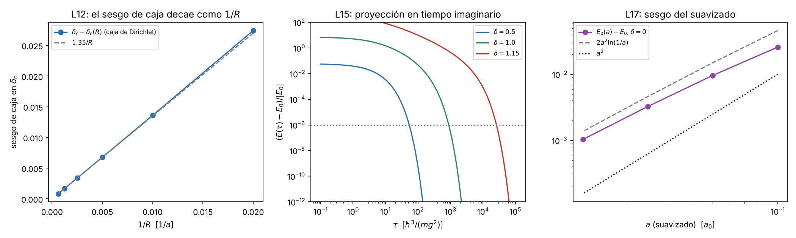

# 7. Límites físicos que debe cumplir el algoritmo (consulta a la IA y verificación)

**Objetivo.** Cumplir el encargo de la Fase 1: "pedir a la IA una lista de límites físicos que el algoritmo debe cumplir y verificarla". El algoritmo es doble: el solucionador radial y la formulación en tiempo imaginario que se construirán en la Fase 2. Aquí la lista se pide, se verifica ítem por ítem y se registra qué afirmaciones de la IA resultaron exactas, cuáles imprecisas y cuáles incompletas.

**Unidades** (como en las secciones 1 a 5): $\hbar=m=g=1$, distancias en $a=\hbar^2/(mg)$, energías en $mg^2/\hbar^2$, $\delta=\mu a$. Ecuación radial con $\ell=0$:
$$-\tfrac12 u''(r)-\frac{e^{-\delta r}}{r}\,u(r)=E\,u(r),\qquad u(0)=0,\quad u(\infty)=0 .$$
Código: `fase1/codigo/07_limites_fisicos.py` (numpy, scipy y sympy; unos 15 s). Figura: `fase1/figuras/07_limites_fisicos.png`. Todos los números de esta sección salen de ese script.

## 7.1 Consulta (tal como se formuló)

Se siguió el formato de "consulta de derivación" de la guía del profesor: pregunta delimitada, hipótesis explícitas y sin pedir código.

> Para la ecuación radial $-\tfrac12u''-e^{-\delta r}u/r=Eu$ en unidades $\hbar=m=g=1$, con $\ell=0$, $u(0)=0$ y $u(\infty)=0$, dame una lista numerada de límites físicos y propiedades exactas que deben cumplir (a) un solucionador radial en caja finita y (b) una formulación en tiempo imaginario (integral de camino) para el estado fundamental. Para cada ítem indica: el enunciado, sus hipótesis, si es una condición necesaria o una prueba de falsación, y cómo se comprobaría. No escribas código. Indica explícitamente si el peso que se pretende muestrear es real, positivo y normalizable.

IA consultada: Claude (Anthropic), 12 de octubre de 2026. La respuesta se guardó antes de verificar nada, para que la verificación no la contaminara.

## 7.2 Respuesta de la IA (primera versión, sin editar en contenido)

N indica condición necesaria (si falla, el algoritmo está mal); F indica prueba de falsación (diseñada para detectar un artefacto que podría pasar por resultado).

1. **Escalamiento (N).** $E_0=(mg^2/\hbar^2)\,\varepsilon(\delta)$: el resultado solo depende de $\delta=\mu\hbar^2/(mg)$. Cambiar $m$ y $g$ a $\delta$ fijo no debe cambiar $\varepsilon$.
2. **Límite de Coulomb (N).** En $\delta=0$: $E_0=-1/2$, $\langle r\rangle=3/2$, $\langle r^2\rangle=3$.
3. **Serie perturbativa (N).** $E_0=-\tfrac12+\delta-\tfrac34\delta^2+\tfrac12\delta^3-\tfrac{11}{16}\delta^4+O(\delta^5)$; pendiente 1 en el origen.
4. **Cotas rigurosas (N).** $-\tfrac12\le E_0(\delta)\le-\tfrac12+\delta$, porque $-1/r\le-e^{-\delta r}/r\le-1/r+\delta$.
5. **Hellmann y Feynman (N).** $dE_0/d\delta=\langle e^{-\delta r}\rangle\in(0,1]$: $E_0$ crece con $\delta$. Además $E_0(\delta)$ es cóncava, porque el potencial es cóncavo en $\delta$ punto a punto y el ínfimo de funciones cóncavas es cóncavo.
6. **Teorema del virial (N).** $2\langle T\rangle=\langle rV'\rangle=-\langle V\rangle+\delta\langle e^{-\delta r}\rangle$.
7. **Origen (N).** $u(0)=0$, $u=r-r^2+\dots$; la cúspide $R'(0)/R(0)=-1$ no depende de $\delta$.
8. **Infinito (N).** $u\sim e^{-\kappa r}$ con $\kappa=\sqrt{-2E_0}$, sin el factor $r^{1/\kappa}$ de Coulomb.
9. **Positividad (N).** El estado fundamental no tiene nodos: $u>0$ en $(0,\infty)$.
10. **Umbral (N/F).** $\delta_c\in[1,2]$, referencia $1.19061242106$; cerca del umbral $E_0\simeq-\tfrac{c^2}{2}(\delta_c-\delta)^2$ con $c\approx0.75$, es decir $\kappa$ lineal.
11. **Extensión (F).** $\langle r\rangle\simeq1/(2\kappa)\propto(\delta_c-\delta)^{-1}$ y $\langle r^2\rangle\simeq1/(2\kappa^2)$.
12. **Caja de Dirichlet (F).** $E_0(R)\ge E_0$ y decrece con $R$; el umbral de caja cumple $\delta_c(R)<\delta_c$ con $\delta_c-\delta_c(R)\propto1/R$; lejos del umbral, $E_0(R)-E_0\sim e^{-2\kappa R}$.
13. **Estado no ligado en caja (F).** Si $\delta>\delta_c$, $E_0(R)>0$, $E_0R^2\to\pi^2/2$ y $\langle r\rangle\approx R/2$. Un $E_0(R)>0$ en una caja pequeña no prueba que el estado no exista.
14. **Estados $s$ excitados (N).** Hay un número finito; el $2s$ se desliga en $\delta\approx0.31$.
15. **Proyección en tiempo imaginario (N/F).** $E(\tau)=-\partial_\tau\ln\langle\phi|e^{-H\tau}|\phi\rangle$ decrece monótonamente hacia $E_0$ con error $\sim e^{-\Delta\tau}$; cerca del umbral $\Delta\to|E_0|$, luego el tiempo de proyección crece como $1/|E_0|\propto(\delta_c-\delta)^{-2}$.
16. **Propagador libre de tiempo corto (N).** En la semirrecta, $K_0(r,r';\tau)=(2\pi\tau)^{-1/2}\big[e^{-(r-r')^2/2\tau}-e^{-(r+r')^2/2\tau}\big]$ (método de imágenes): positivo, tiende a $\delta(r-r')$ y conserva la norma salvo la absorción en $r=0$.
17. **Peso a muestrear (N).** Es real y positivo. Con la acción primitiva **no es normalizable**: el factor $e^{+\varepsilon/r}$ hace divergir la integral en $r\to0$. Remedio: potencial suavizado $V_a=-e^{-\delta r}/\sqrt{r^2+a^2}$ con $a$ declarado, sesgo $O(a^2\ln(1/a))$ a primer orden, y extrapolación $a\to0$ (o acción de pares exacta).
18. **Error de Trotter (Fase 2).** $O(\varepsilon^2)$ solo con potencial suave o regularizado; con la singularidad $1/r$ no está garantizado.
19. **Apantallamiento fuerte (N).** Para $\delta\ge2$ no hay estados ligados (Bargmann).

## 7.3 Tabla de verificación

| Ítem | Tipo | Cómo se verificó | Resultado | Estado |
|---|---|---|---|---|
| L01 escalamiento | N | DF con $(\hbar,m,g)=(1,2,3)$ y $\mu=\delta mg/\hbar^2$, $\delta=0.5$ | $\varepsilon=-0.1481144672$ en ambos casos, diferencia $8\times10^{-13}$ | Confirmado |
| L02 Coulomb | N | DF + Richardson, $R=60$ | $E_0=-0.500000000$, $\langle r\rangle=1.50000$, $\langle r^2\rangle=3.00001$ | Confirmado |
| L03 serie | N | residuo $\lvert E_{num}-E_{(4)}\rvert$ en $\delta=0.02$ y $0.04$ | $4.0\times10^{-9}$ y $1.2\times10^{-7}$; cociente 30.5 (se espera $2^5=32$) | Confirmado |
| L04 cotas | N | sympy: $f=e^{-x}-1+x$, $f(0)=0$, $f'\ge0$; 24 valores de $\delta\in[0,1.15]$ | 0 violaciones; margen inferior mínimo $10^{-7}$ (en $\delta=0$ la cota es igualdad) | Confirmado |
| L05 Hellmann y Feynman, concavidad | N | derivada centrada frente a $\langle e^{-\delta r}\rangle$ en la misma malla; segundas diferencias | $0.640437$, $0.236839$, $0.050722$ coinciden en 6 cifras ($\delta=0.3,0.8,1.1$); segunda diferencia máxima $-1.4\times10^{-3}<0$; pendientes entre 0.037 y 0.964 | Confirmado |
| L06 virial | N | $2\langle T\rangle+\langle V\rangle-\delta\langle e^{-\delta r}\rangle$ con $h=1/40$ y $1/80$ | residuo $\sim10^{-5}$, baja exactamente $\times4$ al dividir $h$ (error de malla, no de física) | Confirmado |
| L07 cúspide | N | Frobenius con sympy; ajuste de $u/r$ en $r<0.05$ | $a_2=-1$, $a_3=(1+\delta-E)/3$; ajuste: $-0.9998$, $-0.9997$, $-0.9995$ | Confirmado |
| L08 cola | N | $r(\,d\ln u/dr+\kappa)$ en $r=10,20$ | Coulomb: $0.9998$, $0.9999$ ($=1/\kappa$); $\delta=0.5$: $0.008$, $0.0001$ | Confirmado |
| L09 sin nodos | N | puntos con $u<0$ | 0 en $\delta=0,0.5,1,1.15$ | Confirmado |
| L10 umbral | N/F | condición de energía cero ($u'(R)=0$, $R=600$); $\kappa/(\delta_c-\delta)$ en 1.13, 1.15, 1.17 | $\delta_c=1.1906124211$; $\kappa/(\delta_c-\delta)=0.7446,\,0.7434,\,0.7421$, extrapolado $c=0.7409$ | Confirmado; **precisado** ($c\approx0.741$, no 0.75) |
| L11 extensión | F | $2\kappa\langle r\rangle$ y $2\kappa^2\langle r^2\rangle$ | $\delta=1.0$: 1.252 y 1.303; $\delta=1.15$: 1.052 y 1.055; $\delta=1.18$: 1.013 y 1.013 | Confirmado solo como ley asintótica; **precisado** |
| L12 caja | F | $\delta_c(R)$ con $u(R;E=0)=0$, $R=50\ldots1600$; $E_0(R)$ en $\delta=1$ | $R(\delta_c-\delta_c(R))=1.371\to1.350$ (constante); $E_0(R)-E_0\approx0.05\,e^{-2\kappa R}$ | Confirmado |
| L13 no ligado en caja | F | $E_0R^2$ y $\langle r\rangle/R$ con $\delta=1.3$ y $2.0$; $\delta=1.18$ con $R=20,40,400$ | $\delta=1.3$: $E_0R^2=4.028$ ($R=100$) y $4.672$ ($R=400$), lejos de $\pi^2/2=4.935$; $\delta=1.18$: $E_0=+2.95\times10^{-3}$, $+5.9\times10^{-4}$, $-3.1\times10^{-5}$ | **Corregido** (falta la longitud de dispersión) |
| L14 umbral $2s$ | N | condición de energía cero, segundo cero de $u'(R)$ | $\delta_c(2s)=0.310209$ | Confirmado |
| L15 proyección | N/F | descomposición espectral exacta en caja ($R=400$ u 800), función de prueba $re^{-r}$ | $E(\tau)$ monótona en los tres casos; brecha $\approx\lvert E_0\rvert$; $\tau$ para error relativo $10^{-6}$: 54.6, 901, $2.68\times10^4$, con $\tau\lvert E_0\rvert=8.0,\,8.8,\,8.9$ | Confirmado en caja; la versión estocástica se prueba en Fase 2 |
| L16 propagador libre | N | sympy | $\partial_\tau K-\tfrac12K''=0$; $K(0,r')=0$; $\int_0^\infty K\,dr=\operatorname{erf}(r'/\sqrt{2\tau})$; $(r+r')^2-(r-r')^2=4rr'>0$ | Confirmado |
| L17 peso y suavizado | N | sympy: $\lim_{r\to0}r^2e^{\varepsilon/r}$; integrales parciales; $E_0(a)$ y $\delta_c(a)$ | límite $=\infty$; $\int_{r_0}^1r^2e^{0.1/r}dr=0.39,\,4.3,\,222$ para $r_0=0.01,0.005,0.004$; $\Delta E=a^2[2\ln(1/a)+C]$ con $C=-2.154$; $\delta_c(a)-\delta_c=-4.7\times10^{-2}$ ($a=0.1$) a $-2.1\times10^{-3}$ ($a=0.0125$) | Confirmado; **precisado** (término $a^2$ grande) |
| L18 Trotter | N | requiere el propagador de la Fase 2 | no verificable en Fase 1 | Solo Fase 2 |
| L19 $\delta\ge2$ | N | DF en $R=200$ | $E_0(2)=+1.22\times10^{-4}>0$ y $E_0R^2=4.908$ en $R=400$ (estado de caja) | Confirmado |

Balance: 14 ítems confirmados tal cual, 3 confirmados pero precisados (L10, L11, L17), 1 corregido (L13) y 1 que solo puede probarse en la Fase 2 (L18). El ítem L17 responde a la exigencia del protocolo: **el peso es real y positivo, pero con la acción primitiva y el $1/r$ desnudo no es normalizable**.

*Figura 7.1. Izquierda: sesgo de la caja de Dirichlet en el umbral, lineal en $1/R$ con pendiente 1.35. Centro: convergencia de $E(\tau)$ hacia $E_0$ para tres valores de $\delta$; el tiempo necesario crece como $1/\lvert E_0\rvert$. Derecha: sesgo del potencial suavizado en $\delta=0$, comparado con $2a^2\ln(1/a)$ y con $a^2$.*

## 7.4 Errores e imprecisiones de la IA detectados

1. **L13, corrección.** La IA afirmó que, sin estado ligado, $E_0R^2\to\pi^2/2$. Es cierto solo para $R\to\infty$; a tamaños accesibles falta la longitud de dispersión $a_s$. Con $u(r)=A+Br$ a energía cero, $a_s=-A/B$, y la ley correcta es $E_0(R)\simeq\pi^2/[2(R-a_s)^2]$. El script da $a_s=-11.58$ en $\delta=1.3$, lo que predice $E_0R^2=3.964$ y $4.661$ en $R=100$ y $400$, frente a $4.028$ y $4.672$ medidos; en $\delta=2$, $a_s=-1.10$ y el acuerdo es de tres cifras. La consecuencia práctica es importante: cerca del umbral $\lvert a_s\rvert$ diverge, así que la prueba "$E_0R^2\approx\pi^2/2$" no sirve para declarar "no ligado" a menos que $R\gg\lvert a_s\rvert$.
2. **L10, precisión.** La IA dio $c\approx0.75$, que proviene de la pendiente secante de la sección 5.4 en $[1.05,1.15]$. El cociente $\kappa/(\delta_c-\delta)$ baja al acercarse al umbral y extrapola a $c=0.741$.
3. **L11, precisión.** $\langle r\rangle\simeq1/(2\kappa)$ es una ley asintótica: en $\delta=1$ el producto $2\kappa\langle r\rangle$ vale 1.25, no 1; solo a $0.01$ del umbral el error baja al 1 %. Usarla para extrapolar exige quedarse muy cerca de $\delta_c$ o incluir correcciones.
4. **L17, precisión.** El término dominante $2a^2\ln(1/a)$ es correcto, pero el término siguiente $Ca^2$ con $C=-2.154$ es grande: en $a=0.0125$ el cociente $\Delta E/(2a^2\ln(1/a))$ es solo 0.75. Una extrapolación $a\to0$ que use solo $a^2$ o solo $a^2\ln a$ queda sesgada. Además el suavizado desplaza el umbral de forma apreciable ($\delta_c(0.1)$ es $0.047$ menor), lo que confirma la advertencia del enunciado: un resultado suavizado no se identifica con el Yukawa original sin extrapolar.
5. **Lo que la IA no dijo y apareció al verificar.** En $\delta=1.18$, ligado, una caja $R=20$ da $E_0=+2.95\times10^{-3}$: un "no ligado" falso con error de signo. Y el sesgo de caja en el umbral es algebraico ($1.35/R$), no exponencial: con $R=400$ el umbral aparente es $1.18723$, que coincide con el $1.187$ de la sección 6.

No se detectaron errores en las fórmulas exactas (L02 a L09, L16).

## 7.5 Cómo se usará cada límite en la Fase 2

| Prueba en Fase 2 | Ítems | Criterio de aceptación |
|---|---|---|
| Arranque de cualquier código | L01, L02, L03 | $E_0(0)=-0.5$ y $\langle r\rangle=1.5$ a la precisión declarada; residuo de la serie que escale como $\delta^5$ |
| Comparación en un punto fuertemente ligado (primera exposición) | L04, L05, L06, L09 | solucionador radial y tiempo imaginario dentro de las cotas, con $dE_0/d\delta=\langle e^{-\delta r}\rangle$ y virial cumplido; el virial sirve además como estimador de energía en el tiempo imaginario |
| Condiciones de frontera del solucionador | L07, L08 | pendiente $u'/u\to-\kappa$ sin término $1/r$; arranque $u\simeq r-r^2$ |
| Prueba de caja (segunda exposición) | L11, L12, L13 | barrer $R$; ligado si $E_0(R)$ converge y $\langle r\rangle$ se estabiliza; no ligado si $E_0\simeq\pi^2/[2(R-a_s)^2]$ y $\langle r\rangle/R\to1/2$; corregir el umbral con la ley $1.35/R$ |
| Intervalo para $\delta_c$ | L10, L14, L19 | intervalo compatible con $1.19061242106$; ley $\kappa\simeq0.741(\delta_c-\delta)$ |
| Convergencia temporal | L15, L18 | $E(\tau)$ monótona; $\tau\gtrsim9/\lvert E_0\rvert$ para error relativo $10^{-6}$; estudio de $\Delta\tau\to0$ |
| Singularidad | L16, L17 | declarar si se usa el propagador de imágenes, $V_a$ con $a$ declarado (extrapolando con $a^2[2\ln(1/a)+C]$) o una acción de pares; nunca la acción primitiva con $1/r$ desnudo |

**Fuente para L17 y L18.** Kleinert, cap. 2 (archivo `fuentes/md/09_Kleinert_Ch2_ElementaryProperties.md`, línea 227): para el potencial de Coulomb atractivo la fórmula de Trotter es válida, pero "Feynman's time-sliced formula, however, diverges even for two time slices"; el remedio se trata en su cap. 12 (no transcrito, solo en PDF). El estimador virial en PIMC aparece en Saporiti (archivo `10_Saporiti_PIMC_HydrogenBond.md`, línea 252), en una dimensión. Ambas citas se comprobaron en los Markdown de fuentes.

## Registro de IA

- **Fecha:** 12-10-2026. **IA:** Claude (Anthropic).
  **Consulta:** la de la sección 7.1 (lista de límites físicos para el solucionador radial y la formulación en tiempo imaginario, con tipo de prueba y estado del peso).
  **Respuesta utilizada:** la lista L01 a L19 de la sección 7.2, guardada antes de verificar.
  **Decisión humana:** adoptar la lista como batería de pruebas de la Fase 2 con las correcciones de 7.4; aprobado por Lucho el 21-10-2026 (decisión 3 de `decisiones_pendientes.md`).
  **Comprobación:** `fase1/codigo/07_limites_fisicos.py`, tabla 7.3 (sympy para L04, L07, L16, L17; diferencias finitas, integración a energía cero y descomposición espectral para el resto).
  **Corrección posterior:** L13 (se añade la longitud de dispersión, $E_0\simeq\pi^2/[2(R-a_s)^2]$); L10 ($c=0.741$); L11 (ley solo asintótica); L17 (término $Ca^2$ con $C=-2.154$). L18 queda abierto para la Fase 2.
