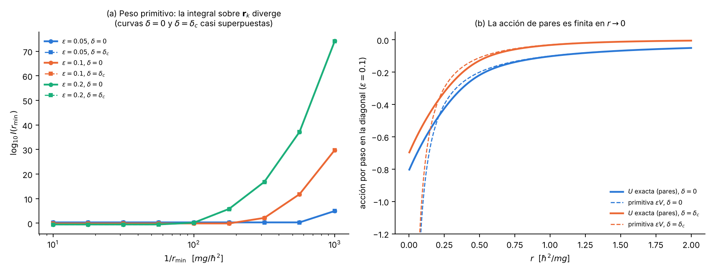
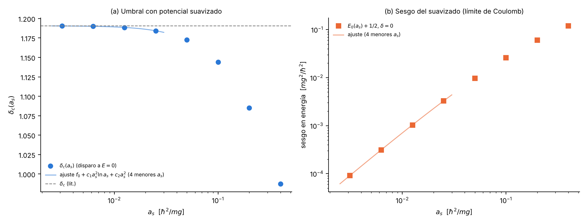
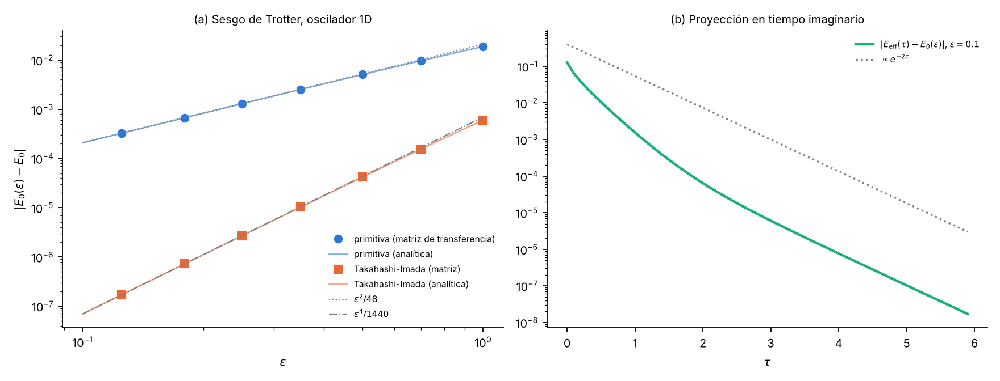
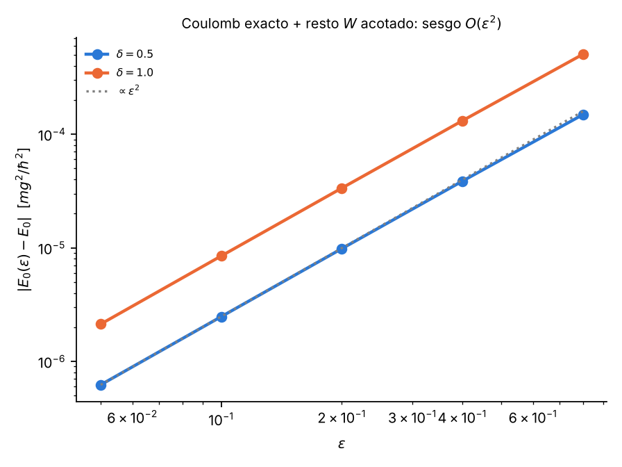

# 8. Acción euclídea, análisis del peso y toy model

**Proyecto 05, Umbral de enlace en el potencial de Yukawa** · Fase 1 · Bloque 08
Script: `fase1/codigo/08_accion_euclidea.py` (sympy, mpmath, numpy, scipy; de 50 s con la máquina poco cargada a 217 s con la máquina cargada, según dos ejecuciones del 12 de octubre de 2026). Figuras: `fase1/figuras/08_divergencia_peso.png`, `08_toy_trotter.png`, `08_suavizado.png`, `08_pares_coulomb.png`. Todas las cifras de este bloque salen de ese script.

## 8.0 Objetivo, régimen de validez y criterio de cierre

**Objetivo.** Escribir la integral de camino euclídea discreta para
$$\hat H = -\tfrac12\nabla^2 + V(r),\qquad V(r) = -\frac{e^{-\delta r}}{r},$$
decidir si el peso que habría que muestrear es real, positivo y normalizable, y elegir con evidencia la acción que se usará en la Fase 2.

**Régimen.** Una partícula (o la coordenada relativa de dos cuerpos) sin espín, en 3D, $\delta\ge 0$, tiempo imaginario $\tau$; unidades $\hbar=m=g=1$ de la sección 1 (longitudes en $\hbar^2/(mg)$, energías en $mg^2/\hbar^2$, tiempos en $\hbar^3/(mg^2)$).

**Criterio de cierre.** (i) Acción, medida, fronteras y estimadores escritos sin saltos; (ii) veredicto sobre el peso demostrado analíticamente y comprobado numéricamente; (iii) un toy model donde la proyección recupere $E_0$ exacto y el sesgo de Trotter escale como $\epsilon^2$; (iv) un remedio para el núcleo de Yukawa probado al menos en un caso con sesgo controlado.

## 8.1 Punto de salida, hipótesis y notación

Se da por conocido: la ecuación radial y las unidades (sección 1), los valores de referencia de $E_0(\delta)$ y $\delta_c$ (sección 5) y la fórmula de Trotter. El cálculo arranca del operador $e^{-\beta\hat H}$.

- **H1.** $\hat H=\hat T+\hat V$ con $\hat T=-\tfrac12\nabla^2$ y $\hat V$ multiplicativo; $\hat H$ es autoadjunto y acotado inferiormente (se demuestra en 8.4.4).
- **H2.** Fórmula de Trotter: $e^{-\beta\hat H}=\lim_{M\to\infty}\big(e^{-\epsilon\hat V/2}e^{-\epsilon\hat T}e^{-\epsilon\hat V/2}\big)^M$, $\epsilon=\beta/M$. Kleinert (cap. 2, sec. 2.1.4) afirma que vale para operadores acotados inferiormente y que está probada para el Coulomb atractivo.
- **H3.** El estado fundamental es una onda $s$ ($\ell=0$) sin nodos, por lo que basta el sector radial $\ell=0$ cuando se quiere $E_0$.
- **H4.** Para $Z(\beta)$ se trabaja en una caja finita de radio $R$ (ver 8.2.6); para $E_0$ se usa proyección.

Notación fija: $\mathbf r_k\in\mathbb R^3$ posición del eslabón $k$; $M$ número de pasos; $\epsilon=\beta/M$; $K_0(\mathbf r,\mathbf r';\epsilon)=(2\pi\epsilon)^{-3/2}e^{-|\mathbf r-\mathbf r'|^2/(2\epsilon)}$ núcleo libre; $\rho(\mathbf r,\mathbf r';\epsilon)=\langle\mathbf r|e^{-\epsilon\hat H}|\mathbf r'\rangle$ núcleo exacto; $U=-\ln(\rho/K_0)$ acción de pares.

## 8.2 Deducción de la integral de camino euclídea

**8.2.1 Propagador euclídeo.** Se define $G(\mathbf r_b,\mathbf r_a;\beta)=\langle\mathbf r_b|e^{-\beta\hat H}|\mathbf r_a\rangle$. Cumple $\partial_\beta G=-\hat H_b G$ con $G\to\delta^3(\mathbf r_b-\mathbf r_a)$ cuando $\beta\to0$. Desarrollando en autoestados, $G=\sum_n\psi_n(\mathbf r_b)\psi_n^*(\mathbf r_a)e^{-\beta E_n}$ (más la integral sobre el continuo).

**8.2.2 Factorización.** Se escribe $e^{-\beta\hat H}=(e^{-\epsilon\hat H})^M$ y se insertan $M-1$ resoluciones de la identidad $\int d^3r_k\,|\mathbf r_k\rangle\langle\mathbf r_k|$:
$$G(\mathbf r_M,\mathbf r_0;\beta)=\int\prod_{k=1}^{M-1}d^3r_k\ \prod_{k=0}^{M-1}\rho(\mathbf r_{k+1},\mathbf r_k;\epsilon).$$
Hasta aquí todo es exacto.

**8.2.3 Aproximación primitiva.** Con H2 (versión simétrica) y $\langle\mathbf r|e^{-\epsilon\hat T}|\mathbf r'\rangle=K_0(\mathbf r,\mathbf r';\epsilon)$ (integral gaussiana en el momento),
$$\rho(\mathbf r_{k+1},\mathbf r_k;\epsilon)\approx e^{-\epsilon V(\mathbf r_{k+1})/2}\,K_0(\mathbf r_{k+1},\mathbf r_k;\epsilon)\,e^{-\epsilon V(\mathbf r_k)/2}.$$
Su error por paso es $O(\epsilon^3)$ si $V$ es suave (conmutadores $[\hat T,[\hat T,\hat V]]$, $[\hat V,[\hat T,\hat V]]$ acotados); en el total aparece $M\cdot O(\epsilon^3)=O(\epsilon^2)$.

**8.2.4 Acción discreta y medida.** Multiplicando los $M$ factores:
$$G\approx\int\prod_{k=1}^{M-1}\frac{d^3r_k}{(2\pi\epsilon)^{3/2}}\ \frac{e^{-S_E}}{(2\pi\epsilon)^{3/2}},\qquad S_E=\sum_{k=0}^{M-1}\left[\frac{|\mathbf r_{k+1}-\mathbf r_k|^2}{2\epsilon}+\frac{\epsilon}{2}\big(V(\mathbf r_k)+V(\mathbf r_{k+1})\big)\right].$$
Con traza periódica los términos de potencial se reagrupan y queda la forma primitiva pedida
$$S_E=\sum_{k=0}^{M-1}\left[\frac{|\mathbf r_{k+1}-\mathbf r_k|^2}{2\epsilon}+\epsilon V(\mathbf r_k)\right],\qquad \mathbf r_M\equiv\mathbf r_0 .$$
La medida es $\prod_k d^3r_k/(2\pi\epsilon)^{3/2}$: un factor $(2\pi\epsilon)^{-3/2}$ por cada eslabón cinético. En el límite continuo $S_E\to\int_0^\beta d\tau\,[\tfrac12\dot{\mathbf r}^2+V(\mathbf r)]$, que coincide con la acción euclídea de Kleinert (ec. 2.378) con $M\to m=1$, $\hbar=1$.

**8.2.5 Condiciones de frontera.**
- *Propagador*: extremos fijos $\mathbf r_0=\mathbf r_a$, $\mathbf r_M=\mathbf r_b$; se integra sobre $\mathbf r_1,\dots,\mathbf r_{M-1}$ y en los extremos se usa el peso $e^{-\epsilon V/2}$.
- *Función de partición*: $Z(\beta)=\int d^3r\,G(\mathbf r,\mathbf r;\beta)=\mathrm{Tr}\,e^{-\beta\hat H}$; caminos cerrados $\mathbf r_M=\mathbf r_0$ y se integra sobre los $M$ eslabones (Kleinert, ec. 2.377). Por ciclicidad de la traza, la factorización simétrica y la no simétrica dan la misma $Z_M$.

**8.2.6 Relación de Feynman-Kac.** En el límite $M\to\infty$,
$$G(\mathbf r_b,\mathbf r_a;\beta)=K_0(\mathbf r_b,\mathbf r_a;\beta)\ \mathbb E_{\text{puente}}\Big[\exp\Big(-\int_0^\beta V(\mathbf X_\tau)\,d\tau\Big)\Big],$$
donde $\mathbf X_\tau$ es un puente browniano de $\mathbf r_a$ a $\mathbf r_b$ con varianza $\tau$ por componente. Es la versión probabilística de 8.2.4: el factor cinético es la densidad del puente y $e^{-\int V}$ es un peso multiplicativo. Para $V=-e^{-\delta r}/r$ la esperanza es finita (8.4.4), aunque cada aproximación primitiva de tiempo finito no lo sea (8.4.2).

*Advertencia sobre $Z$.* En volumen infinito $\hat H$ tiene espectro continuo $[0,\infty)$ y $\mathrm{Tr}\,e^{-\beta\hat H}=\infty$ (la parte libre crece con el volumen). Por eso H4: o caja de radio $R$ con $u(R)=0$, o proyección desde una función de prueba.

**8.2.7 Estimadores de energía.**
1. *Termodinámico*: $E(\beta)=-\partial_\beta\ln Z_M$ a $M$ fijo. Derivando $S_E$ y la medida ($\epsilon=\beta/M$):
$$E_T=\frac{3}{2\epsilon}-\frac{1}{M}\sum_k\frac{|\mathbf r_{k+1}-\mathbf r_k|^2}{2\epsilon^2}+\frac1M\sum_k V(\mathbf r_k).$$
Su varianza crece como $1/\epsilon$. Ojo: el $F_K$ de Saporiti (2020, ec. 24), tal como aparece en el Markdown, tiene el término cinético con signo $+$ y sin la constante $d/(2\epsilon)$; así escrito su promedio crece como $1/\epsilon$ (ver 8.9). El $E_T$ de arriba se comprobó en el toy model (8.6).
2. *Virial*: usando $\langle\hat T\rangle=\tfrac12\langle\mathbf r\cdot\nabla V\rangle$ en un estado ligado (Saporiti 2020, ec. 25),
$$E_V=\frac1M\sum_k\Big[V+\tfrac12\,r V'(r)\Big]_{\mathbf r_k}=-\frac1M\sum_k\frac{e^{-\delta r_k}(1-\delta r_k)}{2r_k}\quad(\text{sympy, A5}).$$
Para $\delta=0$ da $-\langle 1/r\rangle/2=-1/2$. Vale solo para $\beta\to\infty$ y estado ligado en volumen infinito; en caja aparece un término de pared.
3. *Proyección*: $E_0=-\lim_{\beta\to\infty}\partial_\beta\ln Z$, o con una prueba $\psi_T$ no ortogonal al fundamental,
$$E_{\rm eff}(\tau)=-\frac1\epsilon\ln\frac{\langle\psi_T|e^{-(\tau+\epsilon)\hat H}|\psi_T\rangle}{\langle\psi_T|e^{-\tau\hat H}|\psi_T\rangle}=E_0+O\big(e^{-(E_1-E_0)\tau}\big).$$

## 8.3 Versión radial $\ell=0$ y método de imágenes

Para $\psi=u(r)/(\sqrt{4\pi}\,r)$ el problema es unidimensional en $r>0$ con $\hat H_{\rm rad}=-\tfrac12\partial_r^2+V(r)$ y $u(0)=0$. El núcleo libre en la semirrecta con Dirichlet es el de imágenes:
$$K_D(r,r';\epsilon)=\frac{1}{\sqrt{2\pi\epsilon}}\left[e^{-(r-r')^2/2\epsilon}-e^{-(r+r')^2/2\epsilon}\right].$$
**Comprobación (sympy, A1).** Promediando $K_0$ 3D sobre el ángulo entre $\mathbf r$ y $\mathbf r'$ se obtiene exactamente $r r'\cdot\int d\Omega\,K_0=K_D$ (diferencia simbólica $=0$). Así que la imagen no es un truco sino la proyección exacta del núcleo libre 3D en la onda $s$.

La acción radial primitiva es $\prod_k K_D(r_{k+1},r_k;\epsilon)\,e^{-\epsilon V(r_k)}$ con $r_k>0$, caminos cerrados en $r$ para $Z_{\ell=0}$.

**Cuándo es válida.** (a) Solo en el sector $\ell=0$ de un potencial central; para $\ell>0$ aparece la barrera $\ell(\ell+1)/2r^2$, otra singularidad que Kleinert señala como problemática para el corte primitivo. (b) $K_D$ es exacto solo para la parte libre; con potencial el producto sigue siendo aproximado. (c) $K_D>0$ para $r,r'>0$, así que el peso es positivo; esto es compatible con H3 (fundamental sin nodos) pero no sirve para estados $s$ excitados con nodos. (d) $Z_{\ell=0}$ es la traza en un sector, no la $Z$ completa.

## 8.4 ¿El peso es real, positivo y normalizable?

**Veredicto.** El peso primitivo $e^{-S_E}$ es **real y positivo** para todo camino, pero **no es normalizable**: la integral sobre cualquier coordenada intermedia diverge en $r\to0$, para todo $\epsilon>0$ y todo $\delta\ge0$. El núcleo exacto, en cambio, sí es normalizable. El problema es de la discretización, no de la física.

**8.4.1 Real y positivo.** $K_0>0$ y $e^{-\epsilon V}=\exp(+\epsilon e^{-\delta r}/r)>0$; no hay fase (tiempo imaginario, sin campo magnético, partícula sola sin estadística de fermiones). No hay problema de signo.

**8.4.2 No normalizable: demostración.** Fijemos los vecinos $\mathbf r_{k\pm1}$ y miremos la integral sobre $\mathbf r_k$ cerca del origen. $K_0\le(2\pi\epsilon)^{-3/2}$ es acotado y en $\mathbf r_k=0$ vale $(2\pi\epsilon)^{-3/2}e^{-r_{k\pm1}^2/2\epsilon}>0$. Entonces existe $c>0$ tal que, para $r<r_1$ pequeño,
$$\int_{r<r_1}d^3r_k\,K_0K_0\,e^{\epsilon e^{-\delta r_k}/r_k}\ \ge\ c\,4\pi\int_0^{r_1}r^2e^{\epsilon e^{-\delta r_1}/r}\,dr=\infty,$$
porque con $x=1/r$, $\int^{\infty}x^{-4}e^{\epsilon' x}dx$ diverge (sympy A2: $\lim_{r\to0^+}r^2e^{\epsilon/r}=\infty$; A3: la integral da $\infty$). El factor $r^2$ de la medida y cualquier potencia que aporte el núcleo cinético pierden frente a $e^{\epsilon/r}$; el gaussiano no compensa porque es acotado: su supresión actúa a distancias $\sim\sqrt\epsilon$ del vecino, no en el origen. Basta una coordenada intermedia (dos pasos de tiempo), en acuerdo con Kleinert: "Feynman's time-sliced formula, however, diverges even for two time slices" (cap. 2, sec. 2.1.4).

**Comprobación numérica (parte B).** Con vecinos en $|\mathbf r_{k\pm1}|=1$ e $I(r_{\min})=\int_{r>r_{\min}}d^3r\,K_0K_0\,e^{-\epsilon V}$ (mpmath, 30 dígitos):

| $\epsilon$ | $\log_{10}I(r_{\min}=0.1)$ | $\log_{10}I(r_{\min}=10^{-3})$ | $I$/asíntota en $10^{-3}$ |
|---|---|---|---|
| 0.05 | 0.32 | 4.98 | 1.089 |
| 0.10 | −0.11 | 29.81 | 1.042 |
| 0.20 | −0.51 | 74.20 | 1.021 |

(valores para $\delta=0$; con $\delta=\delta_c$, en $r_{\min}=10^{-3}$ difieren en casi exactamente $\log_{10}e^{-\epsilon\delta_c}$: $-0.026$, $-0.052$ y $-0.104$ para $\epsilon=0.05$, $0.1$ y $0.2$, es decir, el cambio llega a la primera cifra decimal en $\epsilon=0.2$; en $r_{\min}=0.1$ el cambio es algo menor, de $-0.015$ a $-0.059$. Ver 8.4.3). La asíntota es $I\simeq4\pi g(0)\,r_{\min}^4e^{\epsilon e^{-\delta r_{\min}}/r_{\min}}/\epsilon$ y el cociente tiende a 1. La divergencia se hace visible cuando $\epsilon/r_{\min}$ llega a unas decenas: con $\epsilon=0.1$, $I$ no cambia entre $r_{\min}=0.1$ y $0.01$ y luego explota (2.75, 29.76, 71.97 en $\log_{10}$ para $r_{\min}=3\times10^{-3},10^{-3},5\times10^{-4}$). Una simulación que solo mire $r\gtrsim0.01$ no lo notaría, que es justamente el peligro. Figura 8.1(a).

**8.4.3 El apantallamiento no ayuda.** $V=-1/r+\delta-\delta^2r/2+O(r^2)$ (sympy A6). Por tanto $e^{-\epsilon V}=e^{\epsilon/r}e^{-\epsilon\delta}(1+O(r))$: Yukawa solo cambia la constante. Numéricamente, $I(\delta_c)/I(0)=0.88782$ en $r_{\min}=10^{-3}$, $\epsilon=0.1$, frente a $e^{-\epsilon\delta_c}=0.88775$. El pantallamiento actúa a $r\sim1/\delta$, lejos de donde está la divergencia.

**8.4.4 El núcleo exacto sí es normalizable.** Por la desigualdad de Hardy en 3D, $\|\psi/r\|\le2\|\nabla\psi\|$, luego para $\|\psi\|=1$ y $k=\|\nabla\psi\|$:
$$\langle\psi|\hat H_{\delta=0}|\psi\rangle\ge\tfrac12k^2-\|\psi/r\|\ge\tfrac12k^2-2k\ge-2 .$$
Como $0<e^{-\delta r}/r\le1/r$, también $\hat H_\delta\ge\hat H_0\ge-2$ (el valor exacto es $-1/2$). Con $\hat H$ acotado inferiormente, $e^{-\epsilon\hat H}$ es un operador acotado y positivo, $\rho(\mathbf r,\mathbf r';\epsilon)$ es finito y $\int d^3r'\,\rho(\mathbf r,\mathbf r';\epsilon)\,\rho(\mathbf r',\mathbf r'';\epsilon)=\rho(\mathbf r,\mathbf r'';2\epsilon)<\infty$. El resultado clásico de que $1/r$ es una perturbación pequeña de $-\nabla^2$ se atribuye a Kato (1951); **referencia no verificada** en las fuentes disponibles, por eso se dio la cota explícita.

**Comprobación numérica (parte C).** Se calculó $\rho_{\ell=0}(r,r;\epsilon=0.1)$ por descomposición espectral del $\hat H_{\rm rad}$ discretizado (caja $R=4$, $h=0.005$ y $0.0025$, que coinciden en $10^{-4}$) y la acción de pares $U=-\ln(\rho/K_D)$:

| $r$ | $U(\delta=0)$ | $\epsilon V(\delta=0)$ | $U(\delta_c)$ | $\epsilon V(\delta_c)$ |
|---|---|---|---|---|
| 0.02 | −0.769 | −5.000 | −0.662 | −4.882 |
| 0.10 | −0.630 | −1.000 | −0.524 | −0.888 |
| 0.50 | −0.218 | −0.200 | −0.128 | −0.110 |
| 1.50 | −0.067 | −0.067 | −0.012 | −0.011 |

$U$ es finita en $r\to0$ y se pega a $\epsilon V$ para $r\gg\sqrt\epsilon$; además $\rho(r,r)/r^2\approx55$ en $r=0.01,0.02$, es decir $\rho\sim r^2$, como pide $u(0)=0$. Figura 8.1(b).

*Figura 8.1.* (a) $\log_{10}I(r_{\min})$ frente a $1/r_{\min}$ para tres $\epsilon$ y $\delta\in\{0,\delta_c\}$ (curvas casi superpuestas: el pantallamiento no cambia nada). (b) Acción por paso en la diagonal: la exacta (pares) es finita en el origen; la primitiva $\epsilon V$ se va a $-\infty$.

**¿Por qué falla la primitiva?** Supone que $V$ es casi constante en una región de tamaño $\sqrt\epsilon$ alrededor de cada eslabón. Cerca de $r=0$ eso es falso: el núcleo exacto "sabe" que confinar la partícula en $r\lesssim\sqrt\epsilon$ cuesta energía cinética (principio de incertidumbre) y por eso $U$ satura; la primitiva separa cinética y potencial y premia sin límite el colapso de un eslabón sobre el centro. Es el análogo discreto del colapso clásico en $-1/r$.

## 8.5 Remedios y sus costos

| Remedio | Peso | Qué cuesta | Evidencia aquí |
|---|---|---|---|
| **R1. Acción de pares**: núcleo exacto de Coulomb $\rho_C$ más el resto $W=(1-e^{-\delta r})/r$ por Trotter simétrico | real, $>0$, normalizable | tabular $\rho_C(r,r';\epsilon)$ (espectral o por cuadrado de matrices); interpolación 2D | $W$ acotado ($0\le W\le\delta$, $W(0)=\delta$, sympy G1); sesgo $O(\epsilon^2)$, parte G |
| **R2. Kustaanheimo-Stiefel / Duru-Kleinert** | positivo tras la transformación | amplitud a energía fija, reparametrización del tiempo, espacio 4D con una ligadura; $E_0$ por búsqueda de raíces en $E$ | solo bibliográfica (ver abajo) |
| **R3. Suavizado** $V_{a_s}=-e^{-\delta r}/\sqrt{r^2+a_s^2}$ | normalizable ($e^{-\epsilon V}\le e^{\epsilon/a_s}$) | sesgo físico $\sim a_s^2\ln(1/a_s)$; exige extrapolar $a_s\to0$ y $\sqrt\epsilon\lesssim a_s$ (estimación heurística, no comprobada) | parte D, figura 8.3 |
| **R4. Orden superior** (Takahashi-Imada, Chin) | TI: $W_{TI}=V+\tfrac{\epsilon^2}{24}|\nabla V|^2$ sí es normalizable | el término $\epsilon^3/(24r^4)$ regulariza "por accidente" donde la expansión ya no vale; el orden $\epsilon^4$ no está garantizado para $1/r$ | integral TI estable ($\log_{10}I=-0.135083$ de $r_{\min}=0.1$ a $10^{-5}$); $\epsilon^4$ comprobado solo en el oscilador |
| **R5. Radial con imagen** | positivo; con $e^{-\epsilon V}$ primitivo **sigue divergiendo** | ninguno extra; es un marco, no un remedio | sympy A4: $K_D(\rho,r)^2\sim r^2$; $\log_{10}I$: −0.03, −0.03, 3.85, 30.86, 73.07 para $r_{\min}=0.1\ldots5\times10^{-4}$ |

**Sobre R2.** Fujikawa (1996) resume que Duru y Kleinert (Phys. Lett. B84, 1979, 185) resolvieron exactamente la función de Green del hidrógeno con un tiempo reescalado y la transformación de Kustaanheimo-Stiefel (J. Reine Angew. Math. 218, 1965, 204), y añade que esta transformación "is rather technical and it is not essential", pues basta un truco en coordenadas parabólicas (sec. 1 de su artículo). Kleinert (cap. 2) anuncia que estas transformaciones reducen el problema "back to a Feynman type formula with a bounded potential in an auxiliary space". Las dos referencias internas (Duru-Kleinert, KS) se tomaron de la lista de Fujikawa y **no se verificaron en la fuente primaria**. Observación propia, sin desarrollar: en las variables KS $r=|\mathbf u|^2$ y $r\,V(r)=-e^{-\delta|\mathbf u|^2}$, que es acotado y suave; el reescalado del tiempo con $r$ convertiría el Yukawa en un problema 4D sin singularidad. Falta derivar factores, ligadura y correcciones de corte temporal: pendiente.

**Sobre R3.** Resultados del disparo (parte D), con $a_s$ el radio de suavizado (no confundir con la unidad de longitud $\hbar^2/mg$):

| $a_s$ | $\delta_c(a_s)-\delta_c$ | $E_0(a_s)+\tfrac12$ ($\delta=0$) |
|---|---|---|
| 0.1 | $-4.7\times10^{-2}$ | $2.6\times10^{-2}$ |
| 0.025 | $-6.4\times10^{-3}$ | $3.3\times10^{-3}$ |
| 0.00625 | $-6.4\times10^{-4}$ | $3.1\times10^{-4}$ |
| 0.003125 | $-1.9\times10^{-4}$ | $9.2\times10^{-5}$ |

La forma del sesgo se justifica a primer orden: $\Delta E=\int|\psi|^2(V_{a_s}-V)\,d^3r$ y $1/r-1/\sqrt{r^2+a_s^2}\sim a_s^2/2r^3$ da una integral logarítmica, $\Delta E\approx4\pi|\psi(0)|^2\,\tfrac{a_s^2}{2}\ln(1/a_s)=2a_s^2\ln(1/a_s)$ para el hidrógeno. El cociente medido $\Delta E/(2a_s^2\ln(1/a_s))$ sube de 0.71 a 0.81 en los cuatro menores $a_s$ (se acerca lentamente a 1, como corresponde a una corrección $a_s^2$ frente a $a_s^2\ln a_s$). El ajuste $f_0+c_1a_s^2\ln a_s+c_2a_s^2$ con los cuatro menores $a_s$ da $E_0\to-0.49999988$ ($c_1=-1.998$, cerca del $-2$ predicho) y $\delta_c\to1.19061008$ (diferencia $-2.3\times10^{-6}$ con la literatura), mientras que el menor $a_s$ sin extrapolar se equivoca en $-1.9\times10^{-4}$. Conclusión: **$a_s$ debe declararse y el resultado no puede identificarse con el Yukawa sin la extrapolación $a_s\to0$**, que además requiere conocer la forma del sesgo (con un ajuste en $a_s^2$ puro el resultado sería peor; no se probó aquí).

*Figura 8.3.* (a) $\delta_c(a_s)$ y extrapolación; (b) sesgo de energía en el límite de Coulomb, con el ajuste en la región de $a_s$ pequeño.

**Recomendación para la Fase 2: R1 en la formulación radial (R5 como marco).** Razones: (1) el peso es real, positivo y normalizable sin parámetro artificial; (2) la singularidad entera se trata exactamente con un objeto que no depende de $\delta$ (el núcleo de Coulomb, problema resuelto e independiente del Yukawa, así que no hay circularidad); (3) el resto $W$ es acotado y suave, de modo que la factorización simétrica tiene su sesgo ordinario $O(\epsilon^2)$ y admite incluso TI con $|W'|^2$ acotado; (4) en $\delta=0$ el método es exacto para todo $\epsilon$, lo que da un control gratis. Costo: tabular $\rho_C$; una referencia clásica para tabular la matriz densidad de Coulomb sería el trabajo de Pollock (1988) y la revisión de Ceperley (Rev. Mod. Phys. 1995), **ambas no verificadas**. R3 queda como control cruzado, siempre con extrapolación.

## 8.6 Toy model: oscilador armónico 1D

Se eligió porque todo es gaussiano y hay solución discreta exacta. $V=x^2/2$, $E_0=1/2$.

**Solución analítica discreta (sympy, A7 a A9).** Con prueba $e^{-\alpha x^2/2}$ en la matriz de transferencia simétrica $T=e^{-\epsilon W/2}K_0e^{-\epsilon W/2}$ se resuelve $\alpha(\epsilon)$ y el autovalor $\lambda(\epsilon)$:
$$E_0^{\rm prim}(\epsilon)=-\frac{\ln\lambda}{\epsilon}=\frac12-\frac{\epsilon^2}{48}+\frac{3\epsilon^4}{1280}+\dots,\qquad E_0^{\rm TI}(\epsilon)=\frac12-\frac{\epsilon^4}{1440}+\dots$$
(TI: $W=V+\epsilon^2V'^2/24$). El estimador termodinámico a $\beta\to\infty$ tiende a $-\partial_\epsilon\ln\lambda=\tfrac12-\epsilon^2/16$: distinto coeficiente que el autovalor. Ambos son correctos en el límite $\epsilon\to0$, pero a $\epsilon$ finito no deben compararse entre sí sin extrapolar.

**Matriz de transferencia numérica (parte E).** Malla $x\in[-9,9]$, $dx\le\sqrt\epsilon/12$:
- Los autovalores coinciden con la fórmula analítica en las 10 cifras impresas para los 7 valores de $\epsilon\in[0.125,1]$.
- Pendiente log-log del sesgo: **1.989** (primitiva, esperado 2) y **3.985** (TI, esperado 4); coeficientes en $\epsilon=0.125$: $-0.02080$ frente a $-1/48=-0.02083$ y $-6.93\times10^{-4}$ frente a $-1/1440=-6.94\times10^{-4}$. Esto también confirma la fórmula de TI que se usó en 8.5.
- **Proyección** con $\psi_T=e^{-|x|}$, $\epsilon=0.1$: $E_{\rm eff}-E_0(\epsilon)=1.05\times10^{-2}$, $6.4\times10^{-5}$, $7.7\times10^{-7}$, $3.1\times10^{-10}$ en $\tau=0.5,2,4,7.9$. La tasa de convergencia medida es 2.0011 y la brecha discreta $E_2-E_0=1.9992$: la prueba par no tiene componente en $E_1$, así que la tasa es $2\omega$ y no $\omega$.
- **Energía a partir de $Z$: dos derivadas distintas.** (i) *Energía a $\epsilon$ fijo* (derivada en $\beta$ variando $M$, $-[\ln Z(M+1)-\ln Z(M-1)]/2\epsilon$): con $\epsilon=0.1$ vale 1.0853, 0.5523, 0.5023, 0.4998 para $\beta=1,3,6,10$. Esta derivada no es el estimador termodinámico de 8.2.7: a $\beta\to\infty$ tiende al autovalor $\theta/(2\epsilon)=0.49979$. (ii) *Estimador termodinámico* de 8.2.7 (derivada a $M$ fijo variando $\epsilon$): con $\lambda_n=e^{-(n+1/2)\theta}$, $\cosh\theta=1+\epsilon^2/2$ (el autovalor numérico coincide con $\theta/2\epsilon$ en las 8 cifras impresas), $Z_M=1/[2\sinh(M\theta/2)]$ y $E_{\rm termo}=\tfrac12\theta'(\epsilon)\coth(M\theta/2)$, que vale 1.0810, 0.5518, 0.5019, 0.4994 para $\beta=1,3,6,10$ (la diferencia finita en $\epsilon$ da lo mismo) y tiende a $\tfrac12\theta'(\epsilon)=0.499376$, es decir, a $\tfrac12-\epsilon^2/16=0.499375$, como se dijo arriba. El continuo es $\tfrac12\coth(\beta/2)=1.0820$, 0.5524, 0.5025, 0.5000: cada estimador a $\epsilon$ finito se compara con su propio valor discreto, no con el continuo.

**PIMC primitivo (parte F).** Metropolis con actualización par/impar y movimiento rígido aceptado por Metropolis, $\beta=10$, $M=40$, $\epsilon=0.25$, $2\times10^5$ barridos, error por bloques: $E_T=0.4957\pm0.0022$ (exacto discreto 0.4961) y $E_V=0.4950\pm0.0030$ (exacto discreto $\langle x^2\rangle_M=0.4962$). Ambos estimadores reproducen el valor discreto (a $0.2\sigma$ y $0.4\sigma$); el autovalor a ese $\epsilon$ es 0.4987.

*Figura 8.2.* (a) Sesgo $|E_0(\epsilon)-E_0|$: primitiva $\propto\epsilon^2$, TI $\propto\epsilon^4$; puntos numéricos sobre las curvas analíticas. (b) Convergencia de la proyección $\propto e^{-2\tau}$.

## 8.7 Prueba de concepto del remedio recomendado (parte G)

Matriz de transferencia radial $T=e^{-\epsilon W/2}\rho_C(\epsilon)e^{-\epsilon W/2}$, con $\rho_C$ espectral del Coulomb puro en la misma malla y $W=(1-e^{-\delta r})/r$. Se compara con el autovalor exacto en la misma malla, para aislar el sesgo de Trotter del error de malla:

| $\epsilon$ | $E_0(\epsilon)$, $\delta=0.5$ | $E_0(\epsilon)$, $\delta=1.0$ |
|---|---|---|
| 0.8 | −0.14822503 | −0.01074614 |
| 0.2 | −0.14808597 | −0.01027349 |
| 0.05 | −0.14807677 | −0.01024207 |
| malla, exacto | −0.14807615 | −0.01023994 |

Pendiente del sesgo: **1.99** en ambos casos. El peso nunca diverge y el sesgo es $O(\epsilon^2)$ con coeficiente pequeño ($2.5\times10^{-6}$ y $8.5\times10^{-6}$ en $\epsilon=0.1$). El sesgo relativo crece hacia el umbral (en $\delta=1$ es $8\times10^{-4}$ de $|E_0|$ a $\epsilon=0.1$). La diferencia entre "malla, exacto" y los valores de la sección 5 ($-0.14811702$ y $-0.01028579$) es error de la malla gruesa usada aquí ($h=0.02$ y $0.035$), no de Trotter.

*Figura 8.4.* Sesgo de la acción de pares de Coulomb más el resto $W$, para dos $\delta$.

## 8.8 Plan de cómputo para la Fase 2

1. **Observable**: $E_0(\delta)$ por proyección y $\delta_c$ por extrapolación de $\kappa=\sqrt{-2E_0}$ a cero (ley casi lineal de la sección 5); control en $\delta=0$ ($E_0=-1/2$ exacto con R1 para todo $\epsilon$).
2. **Acción**: radial $\ell=0$, $u(0)=0$, núcleo $\rho_C$ tabulado, resto $W$ en factorización simétrica. Referencia independiente: tabla de la sección 5.
3. **Escala de tiempo**: en volumen infinito la brecha al continuo es $|E_0|$. Con $\tau=9/|E_0|$ (lo que exige la sección 7, L15, para un error relativo de $10^{-6}$, y lo que fija 9.4) y $\epsilon=0.1$ hacen falta $M\approx610$ ($\delta=0.5$), $8.75\times10^3$ ($\delta=1.0$) y $3.9\times10^4$ ($\delta=1.1$; $1/|E_0|=437$). El costo por barrido, extrapolado linealmente en $M$, es de 67 a 141 ms en $\delta=1.0$ y de 302 a 636 ms en $\delta=1.1$ (sección 9.9), sin contar la autocorrelación, que crece con $M$ y no está medida. Este es el costo dominante cerca del umbral, y obliga a una caja $R\gg\langle r\rangle$ o a una función de prueba con la cola $e^{-\kappa r}$.
4. **Estimadores**: termodinámico con la acción de pares (derivada de $\ln\rho_C$ respecto a $\epsilon$) y virial $E_V$; comparar ambos solo tras extrapolar $\epsilon\to0$ (lección del toy model).
5. **Validación en cadena**: oscilador (hecho) → Coulomb → Yukawa con $\delta=0.5,1.0$ → cerca de $\delta_c$.

## 8.9 Límites, consistencia y auditoría

- **Límites.** $\delta\to0$: $W\to0$, R1 exacto. $\epsilon\to0$: sesgos $\to0$ con las potencias predichas. $a_s\to0$: $\delta_c(a_s)\to\delta_c$ desde abajo, porque suavizar debilita el pozo y $\delta_c(a_s)<\delta_c$.
- **Dimensiones.** Restaurando constantes, los términos son $m|\Delta\mathbf r|^2/(2\hbar\epsilon)$ y $\epsilon V/\hbar$, ambos adimensionales ($\epsilon$ es un tiempo); con $\hbar=m=g=1$ se recupera $S_E$ de 8.2.4.
- **Supuestos implícitos en las fuentes.** Saporiti (2020) escribe que la densidad $\omega(\tilde{\mathbf x})=e^{-S_E}/\int e^{-S_E}$ "whose multi-variable integral is 1": presupone normalizabilidad, que aquí falla. Kleinert lo advierte explícitamente para Coulomb.
- **Posible error de transcripción.** En el Markdown de Kleinert (ec. 2.376) la medida aparece como $dx_n/\sqrt{2\pi\beta/M}$; por la integral gaussiana (2.351) debería ser $\sqrt{2\pi\hbar\epsilon/M}$. No se pudo verificar contra el PDF (no está disponible localmente): **pendiente**.
- **Posible error en una fuente.** Saporiti (2020, ec. 24) escribe $F_K=\frac1N\sum[\frac m2(\frac{\tilde x_k-\tilde x_{k-1}}{\delta\tau})^2+V]$. Con signo $+$ y sin la constante $1/(2\delta\tau)$ su promedio diverge como $1/\delta\tau$, no solo su varianza; el estimador correcto (8.2.7) lleva signo $-$ y la constante. No se pudo decidir si es error del original o de la transcripción por IA: pendiente de revisar en el PDF.
- **Anomalía resuelta.** La convergencia de TI en 8.4 no prueba que TI sea de orden 4 para $1/r$: el término correctivo domina justo donde la expansión en conmutadores no converge (Kleinert, sec. 2.1.4).
- **Anomalía abierta.** R5 (imagen) fue propuesto como remedio en el planteamiento de la tarea; el cálculo muestra que solo no lo es.

## 8.10 Fuentes de este bloque

- Kleinert, *Path Integrals...*, 5.ª ed., cap. 2: sec. 2.1.4 (Trotter, divergencia de Coulomb con dos cortes), ecs. 2.334 a 2.378 (integral euclídea). Verificado en `fuentes/md/09_Kleinert_Ch2_ElementaryProperties.md` (transcripción por IA).
- Fujikawa, arXiv:hep-th/9602080 (1996), sec. 1 y lista de referencias. Verificado en `fuentes/md/04_Fujikawa_1996_HydrogenPathIntegral.md`.
- Saporiti (2020), ecs. 22 a 25 (densidad de caminos, estimadores $F_K$, $F_V$). Verificado en `fuentes/md/10_Saporiti_PIMC_HydrogenBond.md`.
- No verificadas: Duru y Kleinert (1979), Kustaanheimo y Stiefel (1965) (solo a través de Fujikawa); Kato (1951); Takahashi e Imada (1984); Chin (1997); Pollock (1988); Ceperley (1995).

## Registro de IA

**Entrada 1.**
- *Fecha*: 12 de octubre de 2026.
- *Consulta*: tarea asignada a Claude por el flujo de revisión: deducir la integral de camino euclídea de $\hat H=-\tfrac12\nabla^2-e^{-\delta r}/r$, analizar si el peso es real, positivo y normalizable, listar remedios, resolver un toy model y escribir este bloque.
- *Respuesta utilizada*: toda la sección 8 y el script `08_accion_euclidea.py`.
- *Decisión humana*: aprobado por Lucho el 21-10-2026, con la elección de R1 (acción de pares) para la Fase 2 (decisión 4 de `decisiones_pendientes.md`).
- *Comprobación*: identidades con sympy (A1 a A9, G1); divergencia con mpmath en dos formulaciones (3D y radial); núcleo exacto con dos mallas; toy model contra solución analítica discreta y contra PIMC; R1 contra autovalor exacto en la misma malla; citas contrastadas con los Markdown de fuentes.
- *Corrección posterior* (errores de Claude detectados al ejecutar): (i) el ajuste del sesgo tomaba $\ln(E-\tfrac12)$ y daba NaN porque el sesgo primitivo es negativo ($-\epsilon^2/48$); se pasó a valor absoluto y la recta de referencia de $\epsilon^2/24$ a $\epsilon^2/48$. (ii) La primera versión del PIMC desplazaba el camino entero sin paso de aceptación y daba $E_T=0.95$, $E_V=1.42$; se añadió Metropolis al movimiento rígido. (iii) $E_0(a_s)$ se calculaba por diferencias finitas con $h=0.005$, comparable a $a_s$; se reemplazó por disparo. (iv) La tasa de proyección se ajustaba en una ventana contaminada por estados superiores (2.33); con la ventana $\tau\in[4,7.5]$ da 2.001. (v) El planteamiento incluía el método radial con imagen como remedio; el cálculo mostró que sin acción de pares no elimina la divergencia, y así se reporta.
