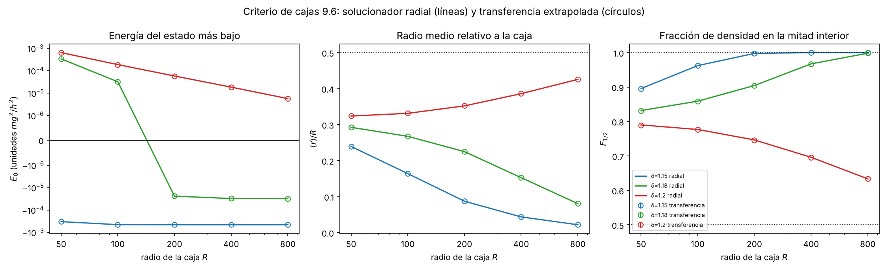
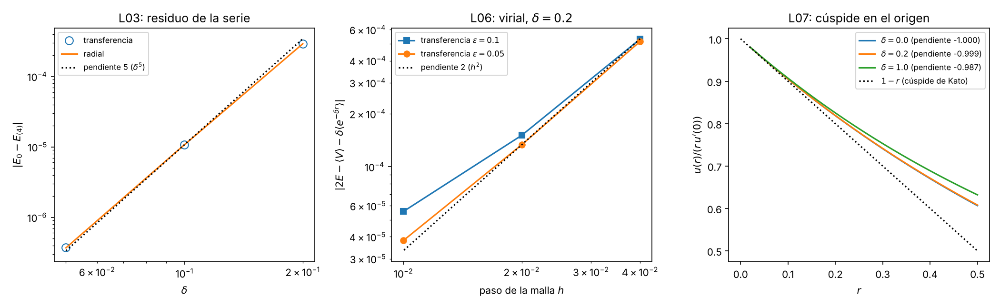

# Bitácora de la Fase 2: umbral de ligadura en el potencial de Yukawa

**Proyecto 05 · Introducción a la Investigación Teórica 2026-II · Universidad Nacional de Colombia**\
**Grupo:** Juan Sebastián Calixto y Luis Felipe Ramírez (grupo de dos integrantes).\
**Fecha:** 27 de octubre de 2026 · Fase 2 (solucionador radial, formulación de tiempo imaginario que trata la singularidad, primer gráfico, controles, bitácora de IA).

# Datos de la sesión

- **Fecha.** 27 de octubre de 2026, de 01:20 a ~03:30 UTC: todo el trabajo de la Fase 2 (código, producción, controles, dos verificaciones, correcciones, primer gráfico y esta bitácora). Antecedente del 26-10-2026: fuentes de control que pidió el profesor tras la presentación de la Fase 1 (`fuentes_control/fuentes_control.md`) y nota sobre una auditora de otra IA (`fuentes_control/auditor_otra_ia.md`).
- **Tarea (guía del profesor, proyecto 05, Fase 2).** "Construir un solucionador radial y una formulación de tiempo imaginario que trate correctamente la singularidad; la primera exposición compara ambos en un punto fuertemente ligado." Evidencia común de la Fase 2: código ejecutable, primer gráfico, bitácora de IA y primera presentación escalonada; se congelan las figuras de la primera ronda y se comprueba que el resultado mínimo ya tiene un caso de control. Para problemas con singularidades hay que declarar si el peso muestreado es real, positivo y normalizable.
- **Quién lo pidió.** Luis Felipe Ramírez (Lucho), el 27-10-2026 a las 01:20 UTC, en el hilo del proyecto: "Podrias lanzar agentes y wprkflows ára hacer toda la fase 2 completa verificando mejor dicho haciendo todo?" (ficha F2-03).
- **Quién lo ejecutó.** **La IA, de punta a punta**: Claude (Anthropic) en un flujo de agentes coordinados por un guion (radial, transferencia, PIGS, controles, cajas, verificación V1, auditoría V2, correcciones V3, presentación y esta bitácora). Ningún integrante revisó todavía los resultados de esta fase.
- **IA auditora.** Otras instancias de Claude (V1 y V2). No se usó otro modelo: las verificaciones son independientes en código, no en modelo (supuesto S1, Parte XII). Se recomienda una auditoría con otra IA según `fuentes_control/auditor_otra_ia.md`.
- **Roles de la Fase 2** (rotación de 9.12 de la Fase 1, aprobada por Lucho el 21-10-2026, decisión 6 de `fase1/decisiones_pendientes.md`). **Formulación física y verificación: Juan Sebastián Calixto. Implementación: Luis Felipe Ramírez.** Quien implementa no verifica en la misma fase.
- **Decisiones humanas.** Todas **pendiente de confirmar por el equipo**. Están agrupadas en diez decisiones en `decisiones_fase2.md`; la firma de verificación de la tabla de controles le toca a Juan Sebastián.
- **Material.** Código en `fase2/codigo/` (módulos `radial.py`, `pares.py`, `transferencia.py`, `pigs.py`; pruebas `test_*.py`; scripts 10 a 16), resultados en `fase2/resultados/` (JSON con todas las cifras y caché de tablas $U_C$), figuras en `fase2/figuras/`, secciones fuente en `fase2/secciones/` (10 a 15 y 17), salidas e informes de verificación en `fase2/verificacion/`. Todas las cifras de esta bitácora salen de esos scripts, de sus JSON o de sus salidas impresas; ninguna se escribió de memoria.

## Cómo leer esta bitácora

Las partes siguen la estructura sugerida en `enunciado/guia_bitacora.md` (sección 4), ampliada con lo que la Fase 2 exige. Las referencias "sección 11.4", "12.V3", etc., remiten a las secciones fuente de `fase2/secciones/`, que se reproducen completas en los anexos A a F. "9.6", "9.7" y "L01 a L19" remiten a la Fase 1.

| Parte | Contenido | Sección fuente |
|---|---|---|
| I | Objetivo, régimen de validez y criterio de cierre de la Fase 2 | nueva |
| II | Punto de salida e hipótesis numeradas | Fase 1 (0.4, 8, 9) y nueva |
| III | Genealogía del tema (lo nuevo de la Fase 2) | `fuentes_control.md` |
| IV | Toy models y controles exactos: Coulomb, Hulthén, pozo cuadrado | 13 |
| V | Desarrollo: solucionador radial, acción de pares, peso, transferencia, PIGS, primer gráfico, condición (c) de cajas | 10, 11, 12, 14, script 16 |
| VI | Límites y consistencia | 15 (parte D), `15_limites.py` |
| VII | Recálculo independiente (V1) | `verificacion/V1_recalculo_independiente.md` |
| VIII | Auditoría (V2) y correcciones (V3); anomalías | V2, V3 |
| IX | Conexión con otros campos y extensión | nueva |
| X | Tabla de controles | 15 |
| XI | Fuentes de la Fase 2 | `fuentes_control.md`, Fase 1 sección 6 |
| XII | Registro de IA | 17 |
| XIII | Qué pasa a la Fase 3 | `que_sigue_fase3.md` |
| XIV | Cierre contra el criterio, figuras congeladas y revisión final | nueva |
| Anexos A–F | Secciones 10 a 15 completas | 10 a 15 |

## Resumen de resultados

| Resultado | Valor | Dónde |
|---|---|---|
| Pregunta de la Fase 2 | ¿Reproduce una integral de camino en tiempo imaginario, con la singularidad $-1/r$ tratada de forma exacta, el $E_0$ y la extensión $\langle r\rangle$ del solucionador radial en un punto fuertemente ligado ($\delta=0.2$), con controles exactos? | I |
| Solucionador radial | $E_0(0.2)=-0.3268085110$ ($R=40$, $h=1/80,1/160$); $\langle r\rangle=1.54972190$; $\langle r^2\rangle=3.22593944$; $\delta_c=1.1906124210606$ | V.1 |
| Acción | núcleo libre con imagen $\times\,e^{-U_C}$ (Coulomb exacto, tabulado con Richardson) $\times\,e^{-\epsilon(W+W')/2}$, $W=(1-e^{-\delta r})/r\in[0,\delta]$ | V.2 |
| Peso | **real, positivo y normalizable** (0 elementos negativos, 0 no finitos; $U_C(0.01,0.01)=-1.132$ con $\epsilon=0.2$; la primitiva daría $e^{20}$) | V.2 |
| Transferencia en $\delta=0.2$ | $E-E_{\rm rad}=-4.5\times10^{-7}$, $-1.1\times10^{-7}$, $-2.5\times10^{-8}$ ($\epsilon=0.2,0.1,0.05$); extrapolada **$+4.4\times10^{-9}$**; orden de Trotter 1.958 | V.3 |
| PIGS en $\delta=0.2$ ($\tau=20$, 8 cadenas) | $E=-0.326725\pm0.000068$ ($+1.22\sigma$); $\langle r\rangle=1.55374\pm0.00711$ ($+0.56\sigma$); $\langle r^2\rangle=3.24260\pm0.03894$ ($+0.43\sigma$) | V.4 |
| Proyección | $E_{\rm mixto}(\tau)$ monótona; de $\tau=20$ a 30 cambia $2.5\times10^{-7}$; PIGS en $\tau=2,5,10,20$: 11 de 12 valores a $<2\sigma$; $E(\tau=5)$ a $-3.19\sigma$ (réplicas $+0.03\sigma$ y $+0.99\sigma$) | V.4 |
| Control Coulomb | transferencia $|E+0.5|\le2.2\times10^{-7}$; PIGS 8 cadenas $\langle r\rangle$ a $-1.35\sigma$ | IV, V |
| Control Hulthén (exacto) | energía extrapolada a $\le5.1\times10^{-9}$ del exacto en $\delta=0.2$, 1.0, 1.5; ley $\epsilon^2$ (orden 1.99) | IV |
| Control pozo cuadrado | con el salto, Trotter $\epsilon^{3/2}$ (medido) y Nyström $O(h)$; extrapolado a $\le3.5\times10^{-6}$ de brentq | IV |
| Criterio de cajas con (c) | $\delta=1.15$ ligado (50/100/200); $\delta=1.18$ ligado (200/400/800); $\delta=1.20$ no ligado (200/400/800); (c) en 9 de 9 ternas: **$\delta_c\in[1.18,\,1.20]$** por dos métodos | V.6 |
| Errores descubiertos y medidos | malla Nyström $h^4/\epsilon$ por la cúspide; pared en $R$ sin imagen ($+0.5826\sqrt\epsilon$); aproximación de extremos de $U_C$ ($\epsilon^2/6r^3$, corregida) | V, VIII |
| Tabla de controles | 88 filas: 70 pasan, 9 no pasan (con causa medida), 9 medidas; **sin firmar** | X |
| Recálculo V1 | 252 cifras; 227 coinciden; las 25 restantes explicadas; ningún veredicto cambia | VII |

**Lectura del resumen.** La pregunta de la Fase 2 queda respondida en $\delta=0.2$: la transferencia con la acción de pares coincide con el radial a $4\times10^{-9}$ tras extrapolar, y el PIGS a menos de $1.3\sigma$ en las tres magnitudes. Lo que la Fase 2 no cierra es lo humano: la firma de la tabla de controles, las diez decisiones y la primera presentación.

# Parte I. Objetivo, régimen de validez y criterio de cierre

*Guía de bitácora: [marco]. Fijado al comenzar la Fase 2 a partir de la guía del profesor y del plan aprobado (sección 9 de la Fase 1); la formulación de estos criterios es de la IA y está pendiente de confirmar por el equipo.*

## I.1 Objetivo: la pregunta de la Fase 2

> En el punto fuertemente ligado $\delta=0.2$ (y en el control de Coulomb $\delta=0$), ¿la integral de camino en tiempo imaginario con la acción de pares de Coulomb, evaluada como matriz de transferencia y como PIGS, reproduce el $E_0$, el $\langle r\rangle$ y el $\langle r^2\rangle$ del solucionador radial dentro de sus errores, y pasa los controles exactos (Coulomb, Hulthén, pozo cuadrado)?

Magnitudes: $E_0$, $\langle r\rangle$, $\langle r^2\rangle$, $E_{\rm mixto}(\tau)$; cerca del umbral, $\langle r\rangle/R$ y $F_{1/2}$ en las cajas de 9.6. La pregunta de todo el proyecto (el umbral $\delta_c$ y la extensión del estado) sigue siendo la de la sección 0.1 de la Fase 1.

## I.2 Régimen de validez

1. Las hipótesis H1 a H8 de la Fase 1 (no relativista, central, $\ell=0$, caja de Dirichlet, $\hat H$ acotado inferiormente).
2. Discretización: paso de tiempo $\epsilon\in\{0.2,0.1,0.05\}$ (más 0.025 y 0.0125 en controles); malla Nyström $h\in\{0.04,0.02,0.01\}$ (y 0.005 en el pozo); tabla $U_C$ en $r,r'\le10$, banda $|r-r'|\le7\sqrt\epsilon$. Los resultados valen tras extrapolar $h\to0$ y $\epsilon\to0$, con los órdenes medidos.
3. PIGS: $\delta\le1.0$ (riesgo 1 de 9.10). La autocorrelación crece con $M$ y no se midió cerca del umbral.
4. Caja: $R=40$ en $\delta=0.2$ (el $E_0$ de $R=40$ y $R=60$ coincide a $2\times10^{-12}$); $R$ de 50 a 800 cerca del umbral, con la pared en $R$ corrida $0.5826\sqrt\epsilon$ (V.6).
5. Fuera de régimen: potenciales con saltos (el pozo da $\epsilon^{3/2}$), cajas de radio comparable a la extensión del estado (el código avisa), y cualquier conclusión sobre el umbral sin extrapolar en $\epsilon$ (sesgo de hasta 20 % de $|E_0|$ con $\epsilon=0.2$).

## I.3 Criterio de cierre de la Fase 2

La Fase 2 se da por cerrada cuando se cumplen todas estas condiciones (de la guía del profesor y del plan 9.7):

| # | Condición | Origen |
|---|---|---|
| K1 | Código ejecutable: módulos con pruebas que pasan; scripts que reproducen cada cifra | guía, evidencia común |
| K2 | Comparación radial frente a tiempo imaginario en $\delta=0.2$, con los criterios de 9.7 | guía, proyecto 05 |
| K3 | El resultado mínimo tiene caso de control (Coulomb, y Hulthén aprobado el 21-10-2026) | guía, evidencia común; decisión 5 de la Fase 1 |
| K4 | Bitácora de IA con fecha, consulta, respuesta, **decisión humana**, comprobación y corrección | guía, evidencia común |
| K5 | Primer gráfico y figuras congeladas; primera presentación (semana 7, 9 + 5 min) | guía, evidencia común |
| K6 | Tabla de controles 9.7 completa y firmada por quien verifica | tarea 6 de `que_sigue_fase2.md` |
| K7 | Declaración del peso (real, positivo, normalizable) | guía, protocolo de singularidades |
| K8 | Proyección desde una función de prueba no exacta y su dependencia con $\tau$ | plan 9.4 y 9.7 |

El cumplimiento se comprueba en la Parte XIV.

# Parte II. Punto de salida e hipótesis numeradas

*Guía: [consejo, formalismo].*

**Se da por conocido (Fase 1, aprobado el 21-10-2026).** La ecuación radial adimensional con $\hbar=m=g=1$ y $V=-e^{-\delta r}/r$, $\delta=\mu\hbar^2/(mg)$; el umbral de referencia $\delta_c=1.1906124211$ (sección 5); la lista de límites L01 a L19 (sección 7); que el peso de la acción primitiva **no es normalizable** con $-1/r$ (sección 8.4); la elección de la acción de pares (decisión 4); el plan de cómputo con sus parámetros, el criterio de cajas 9.6 y los controles 9.7 (decisión 5); el código que ya funcionaba (`fase1/codigo/09_prueba_costos.py`, partes A, C, E y F).

**Notación.** La de 0.5 de la Fase 1: $r$ en unidades de $a=\hbar^2/(mg)$, $E$ en unidades de $mg^2/\hbar^2$, $\epsilon$ paso de tiempo, $\tau=M\epsilon$, $h$ malla espacial, $R$ caja, $\kappa=\sqrt{-2E_0}$, $F_{1/2}$ fracción de densidad en $r<R/2$. Nuevas: $h_{\rm tab}$ (malla de la tabla $U_C$), $R_{\rm TAB}=10$ (fin de la tabla), $\beta=0.5826$ (corrimiento de la pared).

**Hipótesis numéricas de la Fase 2** (se suman a H1 a H8):

- **N1.** Factorización simétrica $T=K_D\,e^{-U_C}\,e^{-\epsilon[W(r)+W(r')]/2}$, con $U_C=-\ln(\rho_C/K_D)$ y $\rho_C$ el núcleo exacto de Coulomb. Como $W$ es acotado y suave, el sesgo es $O(\epsilon^2)$ (L18); en $\delta=0$ el método es exacto para todo $\epsilon$.
- **N2.** $\rho_C$ se obtiene de forma espectral en una caja $R_B=14$ con diferencias finitas de paso $h_{\rm tab}=0.01$ y $0.005$ y Richardson; para $r>10$, aproximación de extremos con el término de Wigner-Kirkwood (desde V3).
- **N3.** La transferencia es una cuadratura de Nyström (trapecio) en $r_i=ih$; $E_0(\epsilon)=-\ln\lambda_0/\epsilon$.
- **N4.** La condición de Dirichlet en $R$ se impone solo en los nodos de tiempo (no hay imagen en $R$); la pared efectiva es $R+0.5826\sqrt\epsilon$ (medido, V.6).
- **N5.** PIGS: caminos abiertos $r_0,\dots,r_M$ con peso $u_T(r_0)\prod T\,u_T(r_M)$, $u_T=re^{-r}$ (cumple la cúspide; no es exacta para $\delta>0$). Energía por el estimador mixto en los extremos; $\langle r\rangle$ y $\langle r^2\rangle$ por el puro en el eslabón central.
- **N6.** Error estadístico: el mayor entre el de bloques (20 por cadena) y el de la dispersión entre cadenas (regla 9.7).

# Parte III. Genealogía del tema: lo nuevo de la Fase 2

*Guía: [investigativo]. La genealogía del problema (Debye y Hückel, Yukawa, Bargmann, Schwinger, Calogero, Feynman y Hibbs, Rogers et al., Duru y Kleinert, Kleinert, Edwards et al., Gebremedhin y Weatherford) está en 0.7 de la Fase 1 y no se repite; el estado de esas fuentes es el de la sección 6 de la Fase 1 (`fase1/secciones/06_fuentes.md`). El estado de las fuentes que usa la Fase 2 está en la Parte XI.*

Después de la presentación de la Fase 1 el profesor pidió **fuentes para los dos controles**, que en la Fase 1 aparecían resueltos sin referencia. La búsqueda del 26-10-2026 (F2-01) dio esta genealogía:

- **Hulthén (1942)** introduce su potencial [H5, CITA SECUNDARIA]; **Hulthén y Laurikainen (1951)** lo usan para aproximar la ecuación del Yukawa [H4, VERIFICADA (APS, metadatos)]: es el origen de "Hulthén como control del Yukawa".
- **Lam y Varshni (1971)** [H7, VERIFICADA (APS, resumen)] y **Varshni (1990)** [H2, VERIFICADA (APS, resumen)]: los métodos aproximados (perturbación, variacional de un parámetro) fallan cerca del apantallamiento crítico, el mismo aviso de nuestra Fase 1.
- **Cai, Cai e Inomata (1986)** [H1, VERIFICADA (APS, resumen)]: **Hulthén es exacto dentro de la integral de camino** (cambio de variable y reescalamiento local del tiempo), con discusión de los límites Yukawa y Coulomb. Es la referencia teórica más cercana a nuestro formalismo; el artículo es de pago y no se ha leído completo.
- **Stubbins (1993)** [H3, VERIFICADA (APS, resumen)] y **Roy** [H9, VERIFICADA (PDF de arXiv), revista NO confirmada]: Hulthén y Yukawa se prueban juntos; Roy confirma $\delta_c(1s)=2$ y $\delta_c(2s)=0.5$. **Roy** [H10] trata el Hulthén dentro de una caja de paredes duras, nuestro problema de caja.
- **Pozo cuadrado:** condición de empalme $k\cot ka=-\kappa$ [P2, VERIFICADA (página web)]; umbral comprobado numéricamente por Jugdutt y Marsiglio [P1, VERIFICADA (PDF de arXiv), revista NO confirmada]; en el umbral $s$ el estado no es normalizable [P3, VERIFICADA (PDF de arXiv), revista NO confirmada]. Landau y Lifshitz [P4, NO VERIFICADA].
- **Técnicas de integral de camino para Coulomb:** Kole y De Raedt [PI1] y Myrheim [PI2] (ambas VERIFICADAS, revista NO confirmada) **suavizan** la singularidad; nosotros no la suavizamos: la absorbe la acción de pares exacta. Dluhy y Gangopadhyaya [PI3, VERIFICADA (PDF de arXiv)] ponen paredes con imágenes, que es justo lo que nos falta en $R$ (V.6).
- **del Valle y Nader (2018)** [Y1]: existencia, autores y contenido VERIFICADOS (PDF de arXiv), revista NO confirmada, $\delta_c$ no leído. El 27-10-2026 la página de arXiv mostró el DOI 10.1063/1.5050621 (sin nombre de revista); el estado no cambia.

**Lo que no tiene fuente.** El orden $\epsilon^{3/2}$ del pozo (medido, sección 13.3) y la corrección de la pared $\beta=-\zeta(1/2)/\sqrt{2\pi}=0.5826$, atribuida en la sección 14.4 a Broadie, Glasserman y Kou: esa atribución es de memoria de la IA y la fuente **no se consultó** (NO VERIFICADA, Parte XI).

# Parte IV. Toy models y controles exactos

*Guía: [consejo, creativo]. Sección fuente: 13 (anexo D), y los controles de Coulomb de las secciones 11 y 12.*

## IV.1 Coulomb ($\delta=0$): el toy model que el método resuelve exactamente

Con $\delta=0$ el resto $W$ es cero y el eslabón es el núcleo exacto: el método no tiene sesgo de Trotter. Lo que queda es error de tabla y de malla. Transferencia ($R=40$, $h=0.02$): $|E+0.5|=5.4\times10^{-8}$, $1.09\times10^{-7}$, $2.18\times10^{-7}$ con $\epsilon=0.2,0.1,0.05$; $|\langle r\rangle-1.5|\le6.6\times10^{-7}$. Sin Richardson en $h_{\rm tab}$ falla por $2.6$–$3.1\times10^{-5}$: la tabla con Richardson es necesaria. PIGS: con 8 cadenas ($\tau=10$), $\langle r\rangle=1.49027\pm0.00720$ ($-1.35\sigma$) y $\langle r^2\rangle=2.96787\pm0.03430$ ($-0.94\sigma$); el histograma de $r_{M/2}$ frente a la densidad de la transferencia da $p=0.004$ (pasa $p>10^{-3}$ por poco). El control $E_L\equiv-0.5$ es **tautológico** (con $W=0$ vale para cualquier camino; V2, H7).

## IV.2 Hulthén: el control exacto con la misma singularidad y la misma cola

$V_H=-\delta/(e^{\delta r}-1)=V_C+W_H$, con $W_H\in[0,\delta/2]$ decreciente (comprobado en $\delta=0.2$, 1.0, 1.5 y 2.0). Pasa por la **misma** transferencia sin cambiar nada del método. Exactos: $E=-\tfrac12(1-\delta/2)^2$ y $\langle r\rangle=(12-\delta^2)/[2(4-\delta^2)]$ (sympy, residuo 0).

| $\delta$ | $E$ exacta | sesgo de Trotter con $\epsilon=0.2$ (Richardson en $h$) | orden de Trotter | extrapolada − exacta | $\langle r\rangle$ extrapolado − exacto |
|---|---|---|---|---|---|
| 0.2 | −0.405 | $-1.71\times10^{-8}$ | 1.38 (no significativo) | $+5.1\times10^{-9}$ | $+1.7\times10^{-8}$ |
| 1.0 | −0.125 | $-8.31\times10^{-6}$ | 1.990 | $+2.5\times10^{-9}$ | $+4.9\times10^{-8}$ |
| 1.5 | −0.03125 | $-2.42\times10^{-5}$ | 1.991 | $-1.8\times10^{-9}$ | $-3.4\times10^{-8}$ |

**Lectura.** La acción de pares con un resto acotado reproduce las energías exactas a $\sim10^{-9}$ aun a 3/4 del camino al umbral exacto ($\delta_c^H=2$). El sesgo de Trotter crece hacia el umbral ($8\times10^{-4}$ de $|E|$ en $\delta=1.5$, $\epsilon=0.2$): la extrapolación $\epsilon\to0$ es imprescindible cerca del umbral. En $\delta=0.2$ el orden 1.38 es residuo de tabla (V1 da 1.99 con el operador continuo).

## IV.3 Pozo esférico cuadrado: el control sin singularidad y con salto

Transferencia sin $U_C$ (potencial completo), salto en un nodo con valor medio. Exactos por brentq: $E=-0.20355074182$ ($V_0=2$) y $-0.00211469915$ ($V_0=1.3$, a 5 % del umbral $\pi^2/8$).

- **Trotter de orden $\epsilon^{3/2}$, no $\epsilon^2$** (medido): 1.497, 1.499, 1.502 en $V_0=2$; 1.672 → 1.523 en $V_0=1.3$. Explicación plausible no demostrada: una capa de anchura $\sqrt\epsilon$ alrededor del salto.
- **Malla Nyström de orden ~1** (no 4).
- Con los órdenes medidos y $h$ hasta 0.005: extrapolado a $+3.5\times10^{-6}$ ($V_0=2$) y $-4.2\times10^{-7}$ ($V_0=1.3$) de brentq (B3, pasa $10^{-5}$). El ajuste de robustez a 5 puntos con la ley fija $\epsilon^{3/2}$ (B3b) pasa en $V_0=2$ ($+9.7\times10^{-7}$) y **no pasa** en $V_0=1.3$ ($+2.2\times10^{-5}$).
- Con la receta del plan ($\epsilon^2$ con 0.2/0.1/0.05) el error sería $10^{-3}$ y $7\times10^{-5}$.

**Lectura.** El pozo no valida la ley $\epsilon^2$ (el salto la rompe), pero separa dos problemas: si el algoritmo funcionara con el pozo y no con Hulthén, el culpable sería la singularidad; ocurre lo contrario, y el problema está en la **regularidad del potencial**, no en la caja ni en la detección del umbral. Se propone usarlo como control cualitativo y a Hulthén como cuantitativo (decisión 4).

# Parte V. Desarrollo principal

*Guía: [formalismo]. Secciones fuente: 10, 11, 12 y 14 (anexos A, B, C y E), y el script 16.*

## V.1 Solucionador radial de referencia (sección 10)

$-\tfrac12u''+Vu=Eu$, $u(0)=u(R)=0$; diferencias finitas de tres puntos, matriz tridiagonal simétrica, $h=1/40$ y $1/80$ con Richardson $p=2$. Para los umbrales: integración a $E=0$ con DOP853 y búsqueda de $u'(R)=0$ con brentq.

| Prueba | Valor | Referencia | Diferencia |
|---|---|---|---|
| Coulomb $E_0$, $E_1$ ($R=60$) | −0.4999999939; −0.1249999999 | −0.5; −0.125 | $6.1\times10^{-9}$; $9.5\times10^{-11}$ |
| Orden aparente (Coulomb) | 1.9986, 1.9997, 1.9999 | 2 | la cúspide no baja el orden de $E_0$ |
| $\delta=0.2$, $E_0$ ($h=1/40,1/80$) | −0.3268085052 | exacto −0.3268085113692 (V1) | $6.2\times10^{-9}$: **no pasa** $5\times10^{-9}$ |
| $\delta=0.2$, $E_0$ ($h=1/80,1/160$) | −0.3268085110 | ídem | $4.0\times10^{-10}$: pasa |
| $\delta_c$ (energía cero, $R=200$, 400, 800) | 1.1906124210606 | 1.1906124211 | $3.9\times10^{-11}$ |
| Hulthén $E_0$ ($\delta=0.2$, 1.0, 1.5) | | exacto | $\le6.4\times10^{-9}$ |
| Tablas 5.1 y 9.6 de la Fase 1 | 7/7 filas; 15/15 celdas | Fase 1 | con una errata de la Fase 1: $E_0(1.18,400)=-3.07\times10^{-5}$, no $-3.08\times10^{-5}$ |

Pruebas: 7 de 7. **Ojo:** con el pozo y $V(a)=0$ el orden baja a 1 y Richardson con $p=2$ empeora el resultado; con el salto en un nodo y valor medio vuelve a 2.

## V.2 Acción de pares y declaración del peso (sección 11.1 y 11.2)

**Deducción.** Se parte de $e^{-\epsilon\hat H}$ con $\hat H=\hat H_C+W$, $\hat H_C=-\tfrac12\partial_r^2-1/r$ en $\ell=0$. La factorización simétrica $e^{-\epsilon W/2}e^{-\epsilon\hat H_C}e^{-\epsilon W/2}$ tiene error $O(\epsilon^3)$ por eslabón ($O(\epsilon^2)$ en $E_0$) porque $W$ es acotado y suave. El núcleo exacto de Coulomb $\rho_C(r,r';\epsilon)=\langle r|e^{-\epsilon\hat H_C}|r'\rangle$ se escribe como el libre con imagen por un factor:
$$T(r,r';\epsilon)=K_D(r,r';\epsilon)\,e^{-U_C(r,r';\epsilon)}\,e^{-\epsilon[W(r)+W(r')]/2},\qquad K_D=\frac{e^{-(r-r')^2/2\epsilon}-e^{-(r+r')^2/2\epsilon}}{\sqrt{2\pi\epsilon}},$$
$$W(r)=\frac{1-e^{-\delta r}}{r}\in[0,\delta],\qquad U_C=-\ln\frac{\rho_C}{K_D}.$$
Toda la singularidad $-1/r$ queda dentro de $\rho_C$. La imagen en $K_D$ impone $u(0)=0$.

**Peso que se muestrea (PIGS)**:
$$P[r_0,\dots,r_M]=u_T(r_0)\,\prod_{k=0}^{M-1}T(r_k,r_{k+1};\epsilon)\,u_T(r_M),\qquad u_T=r\,e^{-r}.$$

**Declaración (pedida por la guía para problemas con singularidades).** El peso es:

- **Real:** todos los factores son exponenciales reales; no hay fases.
- **Positivo:** $K_D>0$ para $r,r'>0$; $e^{-U_C}>0$; $e^{-\epsilon W/2}>0$; $u_T>0$. En la matriz de $\delta=0.2$ ($R=40$, $h=0.02$) hay **0 elementos negativos y 0 no finitos**; el menor no nulo es $3\times10^{-13}$ (borde de la banda). V2 lo comprobó en casos raros ($\epsilon$ hasta 2, $h$ hasta 0.5, $R$ desde 2): 0 negativos, 0 no finitos.
- **Normalizable:** $U_C$ es finita y acotada en el origen: $U_C(0.01,0.01)=-1.132354$, $-0.788269$, $-0.548446$ con $\epsilon=0.2$, 0.1, 0.05 (V1 da $-1.132354446$), así que $e^{-U_C}\le e^{1.14}$ y cada eslabón es un núcleo integrable. La mayor suma de fila de $T$ es 1.191, 1.123 y 1.081. La acción primitiva con $1/r$ desnudo daría en $r=0.01$ el factor $e^{\epsilon/r}=e^{20},e^{10},e^{5}$ y diverge en $r\to0$ (sección 8.4 de la Fase 1): sigue **prohibida**. No se usó suavizado.

Con Hulthén el resto es $W_H\in[0,\delta/2]$ y las tres propiedades se mantienen (IV.2). Con el pozo (sin $U_C$) el peso es $hK_De^{-\epsilon(V+V')/2}$, positivo y acotado.

## V.3 Matriz de transferencia en banda (sección 11.3 a 11.5)

$T_{ij}=h\,T(r_i,r_j;\epsilon)$ en $r_i=ih$, simétrica y en banda ($|r-r'|\le7\sqrt\epsilon$; fuera, cero). $E_0(\epsilon)=-\ln\lambda_0/\epsilon$ por `eigsh`.

**Resultado en $\delta=0.2$** ($R=40$; radial $-0.3268085110$):

| $\epsilon$ | $E$ ($h=0.02$) | $E$ (Richardson en $h$, exponente 4) | $E-E_{\rm rad}$ (Richardson) | $\langle r\rangle$ ($h=0.02$) |
|---|---|---|---|---|
| 0.2 | −0.3268089106 | −0.3268089611 | $-4.5\times10^{-7}$ | 1.549776 |
| 0.1 | −0.3268085215 | −0.3268086227 | $-1.1\times10^{-7}$ | 1.549736 |
| 0.05 | −0.3268083330 | −0.3268085356 | $-2.5\times10^{-8}$ | 1.549726 |
| $\epsilon\to0$ | | −0.3268085066 | **$+4.4\times10^{-9}$** | |

Orden de Trotter con Richardson en $h$: 1.958 (V1 con el operador continuo: 1.9895, extrapolado a $1.8\times10^{-10}$ del radial exacto). En $\delta=1.0$ ($R=174$), donde el sesgo es 70 veces mayor: orden 1.978 (1.983 con Richardson en $h$), extrapolado a $-1.2\times10^{-8}$.

**Lo que no pasa y por qué (sección 11.4).** La estabilidad 0.02→0.04 a $10^{-6}$ que pedía 9.7 falla con $\epsilon\le0.1$ en $\delta=0$ y 0.2 ($1.5$–$3.2\times10^{-6}$). Medido: $\epsilon\,\Delta E$ es constante (error por eslabón), el orden en $h$ es 4.00, el error es proporcional a $u'(0)^2$ (cociente $4.00$, $3.99$, $3.86\times10^{-8}$ en los tres $\delta$), y el oscilador armónico, sin cúspide, no cambia con $h$ ($4.7\times10^{-13}$). Es el error de extremo del trapecio en la cúspide de Coulomb; V1 lo reproduce con un núcleo exacto propio. Remedio: Richardson en $h$ con exponente 4 (decisión 1). Por la misma causa el orden de Trotter sin Richardson en $h$ sale 1.05 en $\delta=0.2$.

**Proyección determinista** ($\epsilon=0.1$, $u_T=re^{-r}$): $E_{\rm mixto}(\tau)-$límite vale $2.27\times10^{-4}$ ($\tau=1$), $4.60\times10^{-5}$ (5), $7.64\times10^{-6}$ (10), $2.62\times10^{-7}$ (20), $1.0\times10^{-8}$ (30): monótona, desde arriba. De $\tau=20$ a 30 cambia $2.5\times10^{-7}<10^{-6}$. El límite del mixto queda a $-1.3\times10^{-9}$ de $E_0(T)$ con Richardson en $h$ (el $1.05\times10^{-7}$ de $h=0.02$ era error de malla; V1, H7).

## V.4 PIGS (sección 12)

Movimientos de Metropolis con balance detallado: rebrote por puentes brownianos ($L=10$), rebrote de extremos y escala global (jacobiano $\lambda^{M+1}$). $U_C$ interpolada con spline bicúbico (error $9\times10^{-9}$; la bilineal, $5\times10^{-5}$). Aceptaciones en $\delta=0.2$, $\tau=20$: 0.819, 0.728, 0.715. Semillas $20262000+k$.

**Producción** ($\delta=0.2$, $\tau=20$, $M=200$, 8 cadenas de $5\times10^4$ barridos, semillas 20262000–20262007):

| | PIGS | error bloques | error cadenas | $\tau_{\rm int}$ | radial | desviación |
|---|---|---|---|---|---|---|
| $E$ (mixto) | −0.326725 ± 0.000068 | $5.15\times10^{-5}$ | $6.82\times10^{-5}$ | 5.3 | −0.32680851 | $+1.22\sigma$ |
| $\langle r\rangle$ (puro) | 1.55374 ± 0.00711 | $7.11\times10^{-3}$ | $7.04\times10^{-3}$ | 11.7 | 1.54972 | $+0.56\sigma$ |
| $\langle r^2\rangle$ (puro) | 3.24260 ± 0.03894 | $3.58\times10^{-2}$ | $3.89\times10^{-2}$ | 14.2 | 3.22594 | $+0.43\sigma$ |

**Dependencia con $\tau$** (8 cadenas por punto, frente a la transferencia con el mismo $\epsilon$):

| $\tau$ | $E_{\rm PIGS}$ | $E_{\rm transf}$ | desviación | $\langle r\rangle$ desv. | $\langle r^2\rangle$ desv. |
|---|---|---|---|---|---|
| 2 | −0.326713 ± 0.000071 | −0.326660 | $-0.74\sigma$ | $+0.58\sigma$ | $+0.61\sigma$ |
| 5 | −0.326955 ± 0.000060 | −0.326763 | **$-3.19\sigma$** | $+1.58\sigma$ | $+1.55\sigma$ |
| 10 | −0.326789 ± 0.000064 | −0.326801 | $+0.19\sigma$ | $-0.97\sigma$ | $-0.92\sigma$ |
| 20 | −0.326725 ± 0.000068 | −0.326808 | $+1.22\sigma$ | $+0.73\sigma$ | $+0.59\sigma$ |

El criterio "todos a menos de $2\sigma$" **no pasa** por $E(\tau=5)$. Réplica 1 (16 cadenas, semillas 20262050–65): $-0.326761\pm0.000053$ ($+0.03\sigma$). Réplica 2 (16 cadenas, 20262070–85): $-0.326718\pm0.000045$ ($+0.99\sigma$). Las 40 cadenas: $-0.83\sigma$ (ponderada). Pero las tres corridas no concuerdan del todo entre sí ($\chi^2=11.13$, 3 g.l., $p=0.011$). La anomalía queda **abierta** (decisión 2).

**Qué resuelve el PIGS de la proyección.** El mixto cambia $1.48\times10^{-4}$ de $\tau=2$ a 20 (unos 1.5 errores): el PIGS no lo resuelve. El puro $\langle r\rangle$ cambia $-0.031$: el PIGS lo resuelve ($-0.0327$, a $-3.6\sigma$ de cero). El sesgo de proyección del puro es $-1.18\times10^{-3}$ en $\tau=20$ y decae como $e^{-(E_1-E_0)\tau/2}$: para $\langle r\rangle$ a $10^{-3}$ hace falta $\tau\ge30$.

**Interpolación.** Repesado correlacionado bilineal − bicúbica: $+5.72\times10^{-7}\pm9.1\times10^{-9}$ en $E$, 100 veces menor que el error estadístico; el riesgo de 9.10 queda cerrado.

## V.5 Primer gráfico de la primera exposición (script 16)

`fase2/codigo/16_primer_grafico.py` lee los JSON de los scripts 11, 12, 12b y 12c (no calcula nada nuevo, no usa números aleatorios) y produce la figura congelada `fase2/figuras/16_primer_grafico.png`. Salida impresa: `fase2/verificacion/16_primer_grafico_salida.txt`; cifras: `fase2/resultados/16_primer_grafico.json`.


Lo que muestra la figura, con las cifras de su salida: radial $E_0=-0.3268085110$, $\langle r\rangle=1.54972190$, $\langle r^2\rangle=3.22593944$; transferencia extrapolada $+4.4\times10^{-9}$; PIGS $+1.22\sigma$, $+0.56\sigma$, $+0.43\sigma$ del radial ($+0.73\sigma$ y $+0.59\sigma$ del puro determinista en $\tau=20$); la proyección con el punto de $\tau=5$ de producción a $-3.19\sigma$ y sus réplicas a $+0.03\sigma$ y $+0.99\sigma$. El riesgo principal para la exposición (caja y pared) se muestra con `14_cajas.png`.

## V.6 Condición (c) del criterio de cajas (sección 14)

En la Fase 1 el criterio 9.6 se aplicó solo con el radial (condiciones (a), (a') y (b)). Faltaba (c): *la integral de camino da el mismo signo y la misma tendencia en las mismas cajas, dentro de sus errores*. Se calcularon con la transferencia $E_0$, $\langle r\rangle/R$ y $F_{1/2}$ en $\delta\in\{1.15,1.18,1.20\}$ y $R\in\{50,100,200,400,800\}$, con $\epsilon\in\{0.2,0.1,0.05\}$ y $h\in\{0.02,0.04\}$ en todas las cajas: 90 autovalores ($N$ hasta 39999, 2.3 a 8 s cada uno con desplazamiento-inversión; Perron-Frobenius comprobado en los 90).

**Resultados.**

- Las 15 celdas son compatibles con el radial; tras V3, $|{\rm dif}|\le{\rm err}_{\rm tr}$ en 15/15 incluyendo el sesgo de pared (6/15 sin él).
- Sesgo de Trotter sin extrapolar: hasta 5.7 % de $|E_0|$ con $\epsilon=0.1$ y 20 % con $\epsilon=0.2$ ($\delta=1.18$, $R=100$), siempre hacia abajo: un $\epsilon$ grueso podría dar un "ligado" falso. **Cerca del umbral solo vale la transferencia extrapolada.**
- **Pared sin imagen.** $K_D$ solo tiene imagen en $r=0$; en $R$ el camino puede salir y volver entre dos eslabones. La pared efectiva queda en $R+0.5826\sqrt\epsilon$. Comparando con el radial en esa caja, el orden de Trotter vuelve de 1.49–1.84 a 1.98–2.00 y la diferencia baja de 12 a 16 veces. No cambia ningún signo ni tendencia.

| $\delta$ | terna decisiva | radial (a), (a'), (b) | transferencia | (c) | veredicto |
|---|---|---|---|---|---|
| 1.15 | 50, 100, 200 | sí (saturación 0.010) | sí (0.010) | sí | **ligado** |
| 1.18 | 200, 400, 800 | sí (0.008; $F_{1/2}(800)=0.9982$) | sí | sí | **ligado** |
| 1.20 | 200, 400, 800 | no ligado: $E>0$, $\langle r\rangle/R\to0.4256$, $F_{1/2}\to0.6334$; ley de caja con $a_s=-142.93$, desviación 0.382, 0.101, 0.021 | igual | sí | **no ligado** |

En las 9 ternas la transferencia reproduce exactamente el patrón de pasa / no pasa del radial. Con el signo solo en $R=50$ o 100, $\delta=1.18$ se habría declarado "no ligado": el error que el criterio está hecho para evitar. Queda **$\delta_c\in[1.18,\,1.20]$ por dos métodos independientes**, compatible con 1.1906124211. El umbral 0.1 de la ley de caja lo fijó la IA (decisión 3).



# Parte VI. Límites y consistencia

*Guía: [crítico, estrategia]. Fuente: `15_limites.py` y tabla 15, parte D.*

**Análisis dimensional.** Todo el código trabaja en unidades reducidas: longitudes en $a=\hbar^2/(mg)$, energías en $mg^2/\hbar^2$, tiempo imaginario en $\hbar^3/(mg^2)$. Comprobaciones: $\epsilon W$ y $U_C$ son adimensionales (exponentes); $K_D$ tiene unidades de 1/longitud y $hK_D$ es adimensional (matriz $T$); $E_0=-\ln\lambda_0/\epsilon$ tiene unidades de energía. $\delta$ es el único parámetro; L01 (escalamiento con $m$ y $g$) se comprobó con el radial en la Fase 1 y no se repite con la transferencia (haría falta reintroducir $m$ y $g$).

**Límites L01 a L19 con la integral de camino** (pedido de V2, H5; hecho en V3):

| Límite | Prueba con la transferencia | Valor | ¿Pasa? |
|---|---|---|---|
| L02 Coulomb | $|E+0.5|$, $|\langle r\rangle-1.5|$ | $\le2.2\times10^{-7}$; $\le6.6\times10^{-7}$ | sí |
| L03 serie perturbativa | orden del residuo de la serie a $\delta^4$ | 4.844 (radial 4.862); $|$res$_{\rm tr}-$res$_{\rm rad}|\le4.7\times10^{-9}$ | sí |
| L04 cotas $-1/2\le E_0\le-1/2+\delta$ | 5 valores de $\delta$ | 0 violaciones | sí |
| L05 Hellmann-Feynman $dE/d\delta=\langle e^{-\delta r}\rangle$ | $\delta=0.2$, 0.5, 1.0 | dif. $5.6$, $2.7$, $1.3\times10^{-6}$ | sí |
| L06 virial ($\delta=0.2$) | residuo extrapolado en $h$ y $\epsilon$ | $-1.33\times10^{-4}$ ($h=0.02$) → $-5.9\times10^{-7}$ | sí |
| L07 cúspide $u\approx r-r^2$ | $a_2/a_1$ en $\delta=0$, 0.2, 1.0 | −0.99987, −0.99937, −0.98740 | sí |
| L08 cola | Coulomb $1/\kappa$; $\delta=0.5$ | 1.0000; 0.0001 | sí |
| L09 sin nodos | 4 valores de $\delta$ | min/max $\ge-1.2\times10^{-15}$ | sí |
| L12 caja decreciente | $\delta=1.0$, $R=10$ a 174 | decreciente | sí |
| L14 estado 2s | $\delta=0.2$ ligado; $\delta=0.35$ no | dif. $2.1\times10^{-10}$; $E_1=+1.637\times10^{-4}$ | sí |
| L15 proyección | mixto monótono | $2.5\times10^{-7}$ de $\tau=20$ a 30 | sí |
| L16 propagador libre | $h\sum_jK_D$ frente a erf a $10^{-10}$ | $8.1\times10^{-5}$ a $3.2\times10^{-4}$ (error de extremo $O(h^2)$) | **no** (criterio mal planteado por la IA) |
| L18 Trotter | ley $\epsilon^2$ | Yukawa y Hulthén sí; pozo $\epsilon^{3/2}$ | sí, con matiz |
| L19 $\delta=2$ no ligado | $E>0$ y ley de caja | $E(200)=+1.219\times10^{-4}$; desv. $-1.0\times10^{-3}$ | sí |

L10 y L11 (umbral y extensión) son de las Fases 3 y 4; L13 queda cubierto por el veredicto de $\delta=1.20$; L17 (suavizado) no aplica porque no se suaviza.

**Cancelaciones sospechosas revisadas.** (1) $E_L\equiv-0.5$ en Coulomb parecía una prueba perfecta del PIGS: era una identidad (IV.1). (2) El mixto convergía a $10^{-7}$ de $E_0(T)$: no era una propiedad del estimador sino error de malla (V.3). (3) La "compatibilidad" de las 15 cajas se apoyaba en el error conservador del radial y en un factor 2; con el error de la transferencia sola fallaban 11 de 15 (V.6). (4) El orden 1.38 de Hulthén en $\delta=0.2$ no es un orden: el sesgo es del tamaño del residuo de tabla.

**Gráfica que recorre el espacio de parámetros.** `14_cajas.png` ($\delta$ y $R$), `13_controles.png` ($\epsilon$, $h$, $\delta$ y $V_0$), `11_trotter.png` ($\epsilon$) y `15_limites.png` ($\delta$).



# Parte VII. Recálculo independiente (V1)

*Guía: [consejo, crítico]. Fuente: `verificacion/V1_recalculo_independiente.md` y `verificacion/codigo_independiente/`.*

Un agente de verificación recalculó las cifras **sin importar ni copiar código** del proyecto, con otros métodos: disparo con DOP853 y FEDVR para el radial; operador de Trotter continuo (límite $h\to0$ exacto de la transferencia) en base FEDVR; núcleo $\rho_C$ propio con Nyström propio; reanálisis de las series del PIGS. Su base converge a $3\times10^{-12}$.

**Resultado:** 252 cifras recalculadas, **227 coinciden** y **25 no**; todas las discrepancias se explican y **ninguna cambia los veredictos ni $\delta_c$**. Lo más importante:

- Radial: $\delta_c=1.1906124210606408$ (diferencia $4\times10^{-14}$); $\delta_c(2s)=0.3102092827$; $E_0(0.2)$ exacto $-0.3268085113692$; 15/15 celdas de cajas; $a_s(1.20)=-142.9348653412$ frente a $-142.9348653387$.
- Peso: $U_C$ a $\sim10^{-9}$.
- El error de Nyström $h^4/\epsilon$ reaparece igual con el núcleo exacto: **viene del trapecio, no de la tabla**.
- Trotter: orden 1.9895 en $\delta=0.2$; Hulthén extrapolado a $\le1.8\times10^{-9}$.
- PIGS: medias y errores reproducidos desde las series.
- Veredictos 9.6 idénticos con radial y transferencia propios.

Hallazgos (H1 a H7 de V1): error de la transferencia en cajas subestimado (pared); pozo no convergido en $h$; aproximación de extremos de $U_C$; criterio radial a $5\times10^{-9}$ que solo pasaba frente al valor redondeado; réplica de $\tau=5$ que no cerraba la anomalía; $u'(0)^2$ sesgado 1.25 %; residuo del mixto que era error de malla. V3 los reprodujo todos (Parte VIII).

# Parte VIII. Auditoría de la IA (V2), correcciones (V3) y anomalías

*Guía: [crítico, investigativo]. Fuentes: `verificacion/V2_auditoria_adversarial.md`, `verificacion/V3_respuesta_hallazgos.md`.*

**V2, auditoría adversarial.** Reejecutó las pruebas (7/7, 5/5, 9/9) y los scripts sin caché (diferencias $\le4.3\times10^{-7}$ relativo; PIGS bit a bit); probó el peso en casos raros; comprobó con 24 cadenas nuevas (semillas 20269000+k) que el estimador puro muestrea $[T^{M/2}u_T]^2$ (histograma $p=0.95$) y que el error es honesto ($\chi^2$ por cadena 22.9/23). Trece hallazgos (H1 a H13), cuatro de gravedad media: la lista falsa de celdas fuera de error (H1), la aproximación de extremos (H2), la pared sin aviso (H3) y los entregables que faltaban (H4: presentación, bitácora de IA, tabla firmada, figuras congeladas).

**V3, respuesta.** Cada hallazgo se reprodujo con un cálculo propio antes de corregirlo, con copia previa de todo en `resultados/archivo_pre_V3/`. **19 de 20 reproducidos**; H10 de V2 (JSON guardado como texto) no se reprodujo y se rechazó con evidencia. Lo corregido:

| Qué | Antes | Después |
|---|---|---|
| $U_C$ fuera de $r=10$ (Wigner-Kirkwood) | error $-2.29\times10^{-6}$ en $r=9$ | $8.1\times10^{-9}$; $\delta=1.0$: $E(\epsilon)$ sube $+1.5$, $+0.50$, $+0.17\times10^{-7}$ |
| Error de la transferencia en cajas | sin pared; texto decía 5 celdas fuera | con pared: 15/15; texto corregido (11/15 sin pared antes, 9/15 tras Wigner-Kirkwood) |
| Aviso de pared en `transferencia.resolver` | ninguno | estima $-\beta\sqrt\epsilon\,u'(R)^2/2$ y avisa; $R=5$: real $-1.08\times10^{-3}$, estimado $-1.31\times10^{-3}$ |
| Pozo, mallas | $h$ hasta 0.01 | hasta 0.005 (Cholesky en banda); B3 $+6.2\to+3.5\times10^{-6}$ |
| $u'(0)^2$ (Coulomb) | 3.9502 | 3.99992 (exacto 4) |
| Límite del mixto − $E_0(T)$ | $1.05\times10^{-7}$ | $-1.3\times10^{-9}$ con Richardson en $h$ |
| Coulomb PIGS | 1 cadena, $E_L$ tautológico | 8 cadenas e histograma ($p=0.004$) |
| $\tau=5$ | una réplica | dos réplicas y combinación ($p=0.011$ entre corridas) |
| Pruebas | 7, 5, 9 | 7, 7, 14 (todas pasan) |
| Límites con la integral de camino | no hechos | script 15 (L16 no pasa) |
| Tabla de controles | no existía | sección 15, sin firmar |

**Lo que la IA hizo mal y se detectó (resumen; detalle en la Parte XII).** Cifras: un docstring con una cota de error falsa; una lista de celdas que contradecía su propio JSON; un criterio que pasaba solo contra un valor redondeado; un control tautológico presentado como prueba; una réplica presentada como cierre de una anomalía. Código: signo del desplazamiento espectral; extrapolación del spline; truncamiento silencioso de $M$; ruta fija. Criterios: dos tolerancias o pruebas cambiadas **después** de ver el resultado (Hulthén $\langle r^2\rangle$ en 10.3, prueba de potencia del histograma en V3), las dos declaradas; un criterio inventado ("proyección visible") retirado antes de producir; L16 mal planteado, dejado como "no pasa".

**Anomalías y discrepancias** (lista completa en 17.5): estabilidad Nyström (explicada); $\tau=5$ (abierta, $p\approx1$ %); histograma de Coulomb $p=0.004$ (al borde); orden $\epsilon^{3/2}$ del pozo (medido, sin fuente); bordes medio y estricto del pozo que aún difieren $2$–$3\times10^{-5}$; orden de Nyström 1.36 y 2.29 cerca del umbral (sin explicar); residuo de volumen $-8\times10^{-9}$ en $\delta=1.15$ (sin explicar); errata de la tabla 9.6 de la Fase 1; dos figuras de "primer gráfico" hechas por dos agentes (16 y 18).

**Supuestos implícitos** (lista completa en 17.4). El más importante: **S1, que V1 y V2 sean independientes**. Son otras instancias de Claude: independencia de código, no de modelo. Hace falta una auditoría con otra IA (Fase 3).

# Parte IX. Conexión con otros campos y extensión

*Guía: [creativo].*

- **Finanzas cuantitativas: opciones con barrera de monitoreo discreto.** La pared en $R$ sin imagen (V.6) es el mismo problema que una opción con barrera que solo se vigila en fechas discretas: el camino browniano puede cruzar la barrera y volver entre dos observaciones. La corrección conocida corre la barrera $\beta\sigma\sqrt{\Delta t}$ con $\beta=-\zeta(1/2)/\sqrt{2\pi}\approx0.5826$, que es el número que medimos (orden de Trotter de vuelta a 1.97–1.99 con la pared corrida). *La atribución a Broadie, Glasserman y Kou es de memoria de la IA; fuente NO VERIFICADA.* Qué hipótesis se relaja: la vigilancia continua de la frontera; parámetro nuevo: $\sqrt\epsilon/R$.
- **Análisis numérico: cuadratura con singularidades en el extremo.** El error $h^4/\epsilon$ de la transferencia es el término de extremo de Euler-Maclaurin para un integrando con un término par (la cúspide $u\approx r-r^2$): el trapecio solo es espectral si el integrando se extiende de forma suave e impar. La misma idea explica el orden 1 del pozo (salto dentro de la regla).
- **Física de plasmas y de excitones** (0.8 de la Fase 1): el umbral es la ionización por presión de un átomo apantallado; nada nuevo en esta fase.
- **Extensión (0.9 de la Fase 1).** `transferencia.resolver` acepta cualquier resto $W$ acotado: la familia de Hulthén $V_H(\lambda\delta)$ (E1) o el perfil exponencial-coseno (E2) se calculan cambiando una función. Hulthén ya pasó por el mismo código (IV.2). Cuál se hace en la Fase 4 sigue pendiente de confirmar por el equipo.

# Parte X. Tabla de controles

*Fuente: `secciones/15_tabla_controles.md` (anexo F), generada por `16_tabla_controles.py` desde los JSON. **Estado: sin firmar.***

**Resumen:** 88 filas; **70 pasan, 9 no pasan, 9 medidas o informativas.**

| Parte | Filas | Pasan | No pasan | Medidas |
|---|---|---|---|---|
| A. Criterios 9.7 (transferencia, PIGS, Trotter, proyección, límites) | 29 | 22 | 4 (A5, A7, A13, A16) | 3 |
| B. Hulthén y pozo | 28 | 22 | 1 (B27) | 5 |
| C. Cajas 9.6 con (c) | 8 | 6 | 2 (C4, C5) | 0 |
| D. Límites L03 a L19 | 21 | 19 | 1 (D19, L16) | 1 |
| E. Referencia radial | 2 | 1 | 1 (E1) | 0 |

Los 9 que no pasan, tal cual: (1) $\delta=0.2$ con la malla de control $h=0.04$ ($1.5$ y $3.2\times10^{-6}$); (2) ley $\epsilon^2$ en $\delta=0.2$ sin Richardson en $h$ (1.046); (3) estabilidad Nyström 0.02→0.04 (4 de 9 casos); (4) PIGS frente a transferencia en cada $\tau$ ($\tau=5$ a $-3.19\sigma$); (5) B3b del pozo en $V_0=1.3$ ($+2.16\times10^{-5}$); (6) orden de Trotter en $R=50$ y 100 (pared); (7) orden de Nyström cerca del umbral (1.36, 2.29); (8) L16 (criterio mal planteado); (9) radial $\delta=0.2$ con $h=1/40,1/80$ frente al exacto ($6.2\times10^{-9}>5\times10^{-9}$). Todos tienen la causa medida. Ninguno toca el resultado principal de la Fase 2 (V.3, V.4) ni los veredictos de cajas.

**Decisiones pendientes de firma** (de la tabla 15, en `decisiones_fase2.md`): control de tabulación con Richardson $h^4$; anomalía de $\tau=5$; umbral 0.1 de la ley de caja; pozo con $\epsilon^{3/2}$; imagen en $R$; corrección de Wigner-Kirkwood.

# Parte XI. Fuentes de la Fase 2

*Estados copiados **exactamente** como constan en `fase2/fuentes_control/fuentes_control.md` (26-10-2026) y en la sección 6 de la Fase 1 (12 y 21-10-2026). Ninguno se subió a VERIFICADA en esta fase. La única consulta web de este agente (27-10-2026) se anota en Y1.*

**Cómo se verificó (26-10-2026).** VERIFICADA: contrastada en la página del editor (APS) o en el PDF de arXiv (autores, título, revista, volumen, página, año y resumen). CITA SECUNDARIA: solo consta porque otros la citan. NO VERIFICADA: de memoria. No se usa Wikipedia. No se pudo bajar ningún PDF (proxy).

## XI.1 Fuentes de los controles (tabla de `fuentes_control.md`)

| # | Referencia | Enlace | Para qué se usa en la Fase 2 | Estado |
|---|---|---|---|---|
| H1 | Cai, J. M., Cai, P. Y., Inomata, A., *Path-integral treatment of the Hulthén potential*, Phys. Rev. A **34**(6), 4621 (1986) | doi:10.1103/PhysRevA.34.4621 | Hulthén exacto dentro de la integral de camino | VERIFICADA (APS, resumen). Pago |
| H2 | Varshni, Y. P., *Eigenenergies and oscillator strengths for the Hulthén potential*, Phys. Rev. A **41**(9), 4682 (1990) | doi:10.1103/PhysRevA.41.4682 | apantallamiento crítico; fallo de los métodos aproximados | VERIFICADA (APS, resumen). Pago |
| H3 | Stubbins, C., *Bound states of the Hulthén and Yukawa potentials*, Phys. Rev. A **48**(1), 220 (1993) | doi:10.1103/PhysRevA.48.220 | Hulthén y Yukawa con el mismo método | VERIFICADA (APS, resumen). Pago |
| H4 | Hulthén, L., Laurikainen, K. V., *Approximate eigensolutions of $d^2\varphi/dx^2+[a+b(e^{-x}/x)]\varphi=0$*, Rev. Mod. Phys. **23**(1), 1 (1951) | doi:10.1103/RevModPhys.23.1 | origen de "Hulthén como control del Yukawa" | VERIFICADA (APS, metadatos; la página no trae resumen). Pago |
| H5 | Hulthén, L., Ark. Mat. Astron. Fys. **28A**, no. 5 (1942); **29B**, no. 1 (1942) | n/d | origen del potencial | CITA SECUNDARIA (la citan H8, H9 y Mancini et al. 2014). No se vio el original |
| H6 | Flügge, S., *Practical Quantum Mechanics*, Springer (1974) | libro | solución exacta del estado $s$ | CITA SECUNDARIA (citado por H8 y H9). Que sea el problema 67 es de memoria: NO VERIFICADO |
| H7 | Lam, C. S., Varshni, Y. P., *Energies of s eigenstates in a static screened Coulomb potential*, Phys. Rev. A **4**(5), 1875 (1971) | doi:10.1103/PhysRevA.4.1875 | métodos aproximados fallan cerca del umbral | VERIFICADA (APS, resumen). Pago |
| H8 | Gönül, B., Özer, O., Cançelik, Y., Koçak, M., *Hamiltonian hierarchy and the Hulthén potential*, Phys. Lett. A **275**, 238 (2000) | arXiv:nucl-th/0106002 | $E_n$ exactas de los estados $s$ | VERIFICADA (PDF de arXiv; revista según el propio PDF). Abierto |
| H9 | Roy, A. K., *The generalized pseudospectral approach to the bound states of Hulthén and Yukawa potentials* | arXiv:1312.5900 | umbrales 2 y 0.5; Yukawa $\lambda_c=1.19061227\pm4\times10^{-8}$ | VERIFICADA (PDF de arXiv). Revista NO confirmada. Abierto |
| H10 | Roy, A. K., *Spherical confinement of Coulombic systems inside an impenetrable box: H atom and the Hulthén potential* | arXiv:1802.04373 | Hulthén en caja de paredes duras | VERIFICADA (ar5iv). Revista NO confirmada. Abierto |
| P1 | Jugdutt, B. A., Marsiglio, F., *Solving for three-dimensional central potentials using matrix mechanics* (2013) | arXiv:1211.5236 | pozo como prueba, luego Yukawa | VERIFICADA (PDF de arXiv). Revista NO confirmada. Abierto. Por comprobar que $b$ sea el radio del pozo |
| P2 | Branson, J., *Bound States in a Spherical Potential Well*, apuntes Physics 130A, UC San Diego | quantummechanics.ucsd.edu/ph130a/130_notes/node227.html | condición $k\cot ka=-\kappa$ | VERIFICADA (página web). No deduce la profundidad mínima |
| P3 | Daboul, J., Nieto, M. M., *Quantum bound states with zero binding energy* | arXiv:hep-th/9405154 | estado de energía cero $s$ no normalizable | VERIFICADA (PDF de arXiv). Revista NO confirmada |
| P4 | Landau, L. D., Lifshitz, E. M., *Quantum Mechanics*, §33 | libro | $V_0a^2>\pi^2\hbar^2/(8m)$ | NO VERIFICADA (de memoria). Alternativa Sakurai y Napolitano, también NO VERIFICADA |
| PI1 | Kole, J. S., De Raedt, H., *Quantum Monte Carlo method for attractive Coulomb potentials* | arXiv:physics/0102015 | suavizado de Coulomb (no usado) | VERIFICADA (ar5iv). Revista NO confirmada |
| PI2 | Myrheim, J., *Numerical path integration with Coulomb potential* | arXiv:physics/0306168 | Coulomb × erf (no usado) | VERIFICADA (PDF de arXiv). Revista NO confirmada |
| PI3 | Dluhy, P., Gangopadhyaya, A., *Sharp and infinite boundaries in the path integral formalism* (2011) | arXiv:1112.3674 | paredes con imágenes (la que falta en $R$) | VERIFICADA (PDF de arXiv) |
| Y1 | del Valle, J. C., Nader, D. J., *Towards the theory of the Yukawa potential* (2018) | arXiv:1807.11898 | ref. 12 de la Fase 1; umbrales críticos | Existencia, autores y contenido VERIFICADOS (PDF de arXiv). Revista NO confirmada. Su valor de $\delta_c$ no se leyó todavía. **Nota del 27-10-2026:** este agente abrió la página de resumen de arXiv con la herramienta de consulta web; confirma título y autores y lista el DOI 10.1063/1.5050621 sin nombrar la revista; el resumen no da el valor de $\delta_c$. El estado no cambia |

## XI.2 Fuentes de la Fase 1 que usa la Fase 2

| # (Fase 1) | Referencia | Uso en la Fase 2 | Estado (sección 6 de la Fase 1) |
|---|---|---|---|
| 2 | Bargmann, PNAS **38**(11), 961 (1952) | cota $\delta_c\le2$ (L19) | VERIFICADA |
| 4 | Edwards et al., PTEP **2017**(8), 083A01 | valor de literatura que difiere $2\times10^{-7}$ | VERIFICADA (arXiv/ar5iv; DOI en Crossref) |
| 5 | Gebremedhin y Weatherford, Phys. Rev. E **108**(4), 045301 (2023) | $\delta_c=1.19061242106\ldots$ con que se compara | Datos bibliográficos VERIFICADOS (Crossref); valor de $\delta_c$ NO VERIFICADO en la fuente primaria (tomado de arXiv:2510.10420, tabla II) |
| 10 | Feynman y Hibbs (1965) | proyección en tiempo imaginario | VERIFICADA (catálogo) |
| 11 | Song y Zhou, arXiv:2510.10420 (2025) | fuente secundaria del valor de la ref. 5 | Metadatos VERIFICADOS; tabla II cotejada el 21-10-2026 |
| 12 | Jiao et al. (2021) y del Valle y Nader (2018) | valores de alta precisión | NO VERIFICADAS (del Valle y Nader: ver Y1) |
| curso | Kleinert (2009), cap. 2 (Markdown del curso) | la fórmula primitiva diverge con Coulomb atractivo | leído en una transcripción por IA; ecuaciones críticas pendientes de cotejar con el PDF |
| curso | Fujikawa (1996), arXiv:hep-th/9602080 | Duru-Kleinert (alternativa no usada) | leído en el Markdown local; Duru y Kleinert, no verificado en la fuente primaria |

## XI.3 Afirmaciones de la Fase 2 sin fuente

| Afirmación | Dónde | Estado |
|---|---|---|
| Corrección de la pared $\beta=-\zeta(1/2)/\sqrt{2\pi}=0.5826$ (Broadie, Glasserman y Kou) | 14.4, IX | NO VERIFICADA (de memoria de la IA). El número se **midió** (orden de Trotter recuperado) |
| Término de Wigner-Kirkwood $\frac{V''}{12}[\epsilon^2-\epsilon(r-r')^2]$ en la acción de pares | 11.1 | sin fuente citada; comprobado numéricamente contra la tabla ($-\epsilon^2/6r^3$ exacto en la diagonal) |
| Orden $\epsilon^{3/2}$ con un salto en el potencial | 13.3 | medido; sin fuente encontrada |
| Ventana automática de Sokal para $\tau_{\rm int}$ | 12.1 | NO VERIFICADA (método citado de memoria, sin referencia consultada); comprobada numéricamente con un AR(1): 4.51 frente a 4.5 exacto |

# Parte XII. Registro de IA

*Archivo propio: `fase2/secciones/17_registro_ia.md` (se reproduce completo).*

**Proyecto 05, umbral de ligadura en el potencial de Yukawa** · Fase 2 · Bloque 17 · 27 de octubre de 2026

Formato del profesor: "la bitácora mínima conserva fecha, consulta, respuesta utilizada, decisión humana, comprobación y corrección posterior". Formato del grupo: el del registro de la Fase 1 (`fase1/secciones/10_registro_ia.md`): tabla resumen, fichas, correcciones posteriores, supuestos implícitos, anomalías, modificaciones de los prompts y pendientes.

**Reglas de este registro.** (1) Solo se registra lo que consta en la carpeta del proyecto (secciones, salidas, informes V1 a V3, archivos de `fuentes_control/`) o en el encargo que recibió el agente que escribe este registro. (2) Los encargos de los agentes del flujo los escribió un guion de orquestación a partir del pedido de Lucho; no se guardaron como archivos en la carpeta. Aquí se resumen con fidelidad a partir de lo que consta (el contexto común que recibió cada agente y su informe final); donde algo no consta, se dice. (3) Donde no consta una decisión humana se escribe **"pendiente de confirmar por el equipo"**; no se inventa ninguna. (4) Todo el trabajo de la Fase 2 lo ejecutó la IA. Los roles humanos (formulación física y verificación, Juan Sebastián Calixto; implementación, Luis Felipe Ramírez) son los aprobados el 21-10-2026, pero ningún humano revisó todavía lo que hizo la IA en esta fase.

## 17.1 Datos de la sesión y roles

| Campo | Valor |
|---|---|
| Fechas | 26-10-2026 (fuentes de control pedidas por el profesor tras la presentación de la Fase 1; nota sobre una auditora de otra IA). 27-10-2026, de 01:20 a ~03:30 UTC (flujo de agentes de toda la Fase 2) |
| IA | Claude (Anthropic), modelo Claude Opus 5.5 en este agente. Varios agentes (instancias separadas) coordinados por un guion de flujo de trabajo: radial, transferencia, PIGS, controles, cajas, verificación V1, auditoría V2, correcciones V3, presentación y bitácora |
| IA auditora | Claude (otras instancias del mismo modelo: V1 y V2). **No se usó otro modelo** (supuesto S1, 17.4). Se recomienda una auditoría con otra IA según `fase2/fuentes_control/auditor_otra_ia.md` |
| Integrantes | Juan Sebastián Calixto y Luis Felipe Ramírez (grupo de dos desde el 13-10-2026) |
| Roles humanos en la Fase 2 | Formulación física y verificación: Juan Sebastián Calixto. Implementación: Luis Felipe Ramírez (rotación de 9.12, aprobada por Lucho el 21-10-2026, decisión 6 de `fase1/decisiones_pendientes.md`) |
| Quién lo pidió | Luis Felipe Ramírez (Lucho), mensaje del 27-10-2026 a las 01:20 UTC en el hilo del proyecto (ficha F2-03) |
| Quién ejecutó | La IA, de punta a punta. Las decisiones humanas están todas pendientes (`decisiones_fase2.md`) |

## 17.2 Registro de consultas

### Tabla resumen

| ID | Fecha | Consulta (resumen) | Respuesta utilizada | Decisión humana | Comprobación | Corrección posterior |
|---|---|---|---|---|---|---|
| F2-01 | 26-10-2026 | Lucho: "descargar esa base" de fuentes para Hulthén y el pozo cuadrado, que pidió el profesor | `fuentes_control/fuentes_control.md`, `verificacion_hulthen_2s.py`, `descargar_fuentes.ps1` | "Pendiente de revisión por el equipo" (consta en el archivo) | metadatos y resúmenes leídos en APS y arXiv el mismo día; 2s de Hulthén con sympy (residuo 0) | Y1: el 27-10-2026 se vio en arXiv el DOI 10.1063/1.5050621 (sin cambiar su estado) |
| F2-02 | 26-10-2026 | Si es viable usar otra IA (no Claude) como auditora | `fuentes_control/auditor_otra_ia.md` (plantilla de prompt y forma de registrarlo) | pendiente de confirmar por el equipo | n/d (es una propuesta de procedimiento) | n/d |
| F2-03 | 27-10-2026 | Pedido de Lucho: lanzar agentes y flujos para hacer toda la Fase 2, verificando | Plan del flujo: tareas 1 a 10 de `fase1/que_sigue_fase2.md`, dos verificaciones y una respuesta | el pedido mismo es la decisión de abrir la fase; lo demás, pendiente de confirmar por el equipo | n/d | n/d |
| F2-04 | 27-10-2026 | Agente radial: módulo `radial.py`, pruebas y cifras de referencia (tarea 1) | sección 10; `radial.py`, `test_radial.py`, `10_radial_controles.py` | pendiente de confirmar por el equipo | 7/7 pruebas; exactos de Coulomb, Hulthén y pozo; tablas 5.1 y 9.6 de la Fase 1 | V3: criterio δ = 0.2 a 5×10⁻⁹ no pasa frente al exacto (H4 de V1); ruta fija (H9 de V2) |
| F2-05 | 27-10-2026 | Agente transferencia: `pares.py`, `transferencia.py`, controles (tareas 2, 3 y 7) | sección 11 | pendiente de confirmar por el equipo | 5/5 pruebas (7/7 tras V3); 28 de 35 criterios; peso con 0 negativos | V3: Wigner-Kirkwood en U_C (H2 de V2), aviso de pared (H3 de V2), u'(0) (H6 de V1), proyección (H7 de V1) |
| F2-06 | 27-10-2026 | Agente PIGS: `pigs.py`, producción y τ (tareas 4 y parte de 8) | sección 12 | pendiente de confirmar por el equipo | 9/9 pruebas (14/14 tras V3); 10 de 11 criterios; réplica de τ = 5 | V3: Coulomb con 8 cadenas e histograma, segunda réplica, `ValueError` (H5, H7, H8, H12) |
| F2-07 | 27-10-2026 | Agente controles: Hulthén y pozo por la misma transferencia (tarea 5) | sección 13 | "pendiente de revisión por Juan Sebastián" (consta en la sección) | 21 pasan, 0 fallan, 5 medidos (22/1/5 tras V3) | V3: mallas del pozo con h = 0.005 (H2 de V1); errata −1.53e−6 (H11 de V2) |
| F2-08 | 27-10-2026 | Agente cajas: condición (c) de 9.6 con la transferencia | sección 14 | pendiente de confirmar por el equipo (umbral 0.1 de la ley de caja) | 90 autovalores; Perron en los 90; 15/15 celdas compatibles | V3: lista de celdas fuera de su error corregida (5 → 11 de 15; H1 de V1 y V2); término de pared en el error |
| F2-09 | 27-10-2026 | Verificación V1: recálculo independiente con código propio | `verificacion/V1_recalculo_independiente.md` | pendiente de confirmar por el equipo | 252 cifras: 227 coinciden, 25 no (explicadas); 7 hallazgos | V3 los reprodujo todos |
| F2-10 | 27-10-2026 | Auditoría V2: adversarial (reproducibilidad, casos raros, honestidad del error, entregables) | `verificacion/V2_auditoria_adversarial.md` | pendiente de confirmar por el equipo | reejecución de pruebas y scripts; Monte Carlo con 24 cadenas nuevas | V3 reprodujo 12 de 13; H10 rechazado |
| F2-11 | 27-10-2026 | Correcciones V3: responder a los 20 hallazgos recalculando | `verificacion/V3_respuesta_hallazgos.md`; scripts 12c, 15 y 16_tabla; tabla 15 | pendiente de confirmar por el equipo (tabla 15 sin firmar) | reejecución de 10 a 15 y de las tres pruebas | n/d |
| F2-12 | 27-10-2026 | Agente de presentación (constatado solo por sus archivos) | `codigo/18_figura_presentacion.py`, `figuras/18_primer_grafico.png`, `presentacion/diapositivas_fase2.pptx` y `.pdf`, `presentacion/guion_fase2.md` | pendiente de confirmar por el equipo | no comprobado por este registro | n/d |
| F2-13 | 27-10-2026 | Este agente: primer gráfico congelado, bitácora, registro de IA, qué sigue y hoja de decisiones | `16_primer_grafico.py`, `bitacora_fase2.md` y `.pdf`, este archivo, `que_sigue_fase3.md`, `decisiones_fase2.md` | pendiente de confirmar por el equipo | cifras leídas de los JSON y de una ejecución del script 16 (dos veces: misma huella) | ver 17.3, C14 a C16 |
| F2-14 | 27-10-2026 | Revisor final de coherencia: cotejar cifras de bitácora, guion, diapositivas y tabla 15 con los JSON; volver a ejecutar las pruebas; lista de revisión; estado de las citas; PDF; `LEEME.md` | correcciones en las secciones 11 a 15 y 17 y en la bitácora (17.3, C17 a C22); `fase2/LEEME.md`; PDF regenerado | pendiente de confirmar por el equipo | cotejo automático de unas 2700 cifras contra los JSON actuales y los de `archivo_pre_V3/`; tabla 15 regenerada en una copia (idéntica); pruebas 7/7, 7/7, 14/14 | n/d |

### Fichas

**F2-01. Fuentes para los potenciales de control (26-10-2026).**
- *Consulta:* de Lucho: "descargar esa base" de fuentes para Hulthén y el pozo esférico cuadrado que pidió el profesor después de la presentación de la Fase 1. Es lo que consta en el registro del propio archivo; el texto completo del pedido no está en la carpeta.
- *Respuesta utilizada:* la tabla de 10 referencias de Hulthén (H1 a H10), 4 del pozo (P1 a P4), 3 de técnicas (PI1 a PI3) y Y1, con estado VERIFICADA / CITA SECUNDARIA / NO VERIFICADA; la comprobación simbólica del 2s de Hulthén ($A=(1+\delta)/(\delta-1)$, $\delta_c(ns)=2/n^2$); un script para bajar los PDF de arXiv.
- *Decisión humana:* "pendiente de revisión por el equipo" (registro del archivo).
- *Comprobación:* metadatos y resúmenes leídos en APS o arXiv el 26-10-2026; no se pudo bajar ningún PDF (el proxy bloqueó arXiv y Crossref).
- *Corrección posterior:* el 27-10-2026 este agente abrió la página de resumen de arXiv de Y1 (1807.11898) con la herramienta de consulta web: confirma título y autores, y la página lista el DOI 10.1063/1.5050621 sin nombrar la revista; el resumen no da el valor de $\delta_c$. **No se cambió el estado** de Y1 (revista NO confirmada; $\delta_c$ no leído).

**F2-02. Auditora de otra IA (26-10-2026).**
- *Consulta:* texto literal no conservado. Por la respuesta ("Respuesta corta: sí es viable y es buena idea"), se preguntó si se podía usar otra IA como auditora.
- *Respuesta utilizada:* `auditor_otra_ia.md`: elegir una IA que ejecute código, darle bloques cerrados sin decirle el resultado esperado, plantilla de prompt, guardar prompt y respuesta literales, resolver desacuerdos calculando, ficha A-01.
- *Decisión humana:* pendiente de confirmar por el equipo. **No se hizo todavía ninguna auditoría con otro modelo.**

**F2-03. Pedido de la Fase 2 completa (27-10-2026, 01:20 UTC).**
- *Consulta (literal, con su ortografía):* "Podrias lanzar agentes y wprkflows ára hacer toda la fase 2 completa verificando mejor dicho haciendo todo?" (Lucho, en el hilo del proyecto "Investigacion Torica"). Leído: "¿Podrías lanzar agentes y workflows para hacer toda la Fase 2 completa, verificando; mejor dicho, haciendo todo?".
- *Respuesta utilizada:* un flujo de agentes con un **contexto común** para todos: método aprobado sin cambios (acción de pares de Coulomb tabulada con $h_{\rm tab}=0.01$ y $0.005$ y Richardson, resto $W\in[0,\delta]$, prohibida la acción primitiva, suavizado solo como control), dos evaluaciones (transferencia en banda y PIGS desde $u_T=re^{-r}$), referencia radial, punto $\delta=0.2$ y control $\delta=0$, semillas $20262000+k$, scripts numerados desde 10 que imprimen sus cifras y guardan JSON y figuras, módulos con nombres fijos, máximo 4 procesos, "cada cifra que reportes debe salir de un script ejecutado" y "si algo falla o no cumple un criterio, dilo tal cual; no lo maquilles". Encargos: F2-04 a F2-13.
- *Decisión humana:* el pedido es la decisión de abrir la fase y delegar la ejecución. Sobre los resultados: pendiente de confirmar por el equipo.

**F2-04. Agente radial (tarea 1).**
- *Consulta (resumen del encargo):* convertir el método A de la sección 5 de la Fase 1 en un módulo `radial.py` para cualquier $V(r)$, con Richardson y observables $E_0$, $E_1$, $\langle r\rangle$, $\langle r^2\rangle$, $F_{1/2}$, $\langle r\rangle/R$; pruebas con Coulomb y la tabla 5.1; cifras de referencia de $\delta=0.2$, Hulthén, pozo y cajas.
- *Respuesta utilizada:* sección 10; `radial.py`, `test_radial.py` (7/7), `10_radial_controles.py`, `10_radial.json`.
- *Decisión humana:* pendiente de confirmar por el equipo.
- *Comprobación:* Coulomb a $6.1\times10^{-9}$; $\delta_c=1.1906124210606$ (a $3.9\times10^{-11}$ de la Fase 1); Hulthén exacto a $6\times10^{-9}$; orden 2 medido (1 en el pozo con $V(a)=0$).
- *Errores propios corregidos (del informe del agente):* Richardson $p=2$ con el pozo de orden 1 (corregido con el salto en un nodo con valor medio); caja $R=80$ demasiado chica para el pozo en $V_0=1.3$; aviso de raíz de un número negativo en `r_rms`; tolerancia de Hulthén en $\langle r^2\rangle$ **fijada después de ver el resultado** (de $10^{-6}$ absoluto, que fallaba por $2.0\times10^{-6}$, a $2\times10^{-7}$ relativo), declarada en 10.3; errata de la tabla 9.6 de la Fase 1 encontrada (no corregida en `fase1/`).
- *Corrección posterior:* V3 (H4 de V1): el criterio de $\delta=0.2$ a $5\times10^{-9}$ solo pasaba frente a la referencia redondeada; frente al exacto falla ($6.2\times10^{-9}$) y se dejó como "no pasa". H9 de V2: ruta absoluta fija cambiada a relativa.

**F2-05. Agente transferencia (tareas 2, 3 y 7).**
- *Consulta (resumen):* módulos `pares.py` (tabla $U_C$ con caché) y `transferencia.py` (matriz en banda para un resto $W$ acotado cualquiera); controles 9.7 en $\delta=0$, 0.2 y 1.0; ley $\epsilon^2$; proyección; declaración del peso.
- *Respuesta utilizada:* sección 11 y sus scripts.
- *Decisión humana:* pendiente de confirmar por el equipo (redefinición del control de tabulación, 11.4; tratamiento del pozo, 11.7).
- *Comprobación:* Coulomb a $\le2.2\times10^{-7}$; $\delta=0.2$ extrapolado a $4.4\times10^{-9}$; peso con 0 elementos negativos y 0 no finitos; 28 de 35 criterios, los 7 que fallan con causa medida (error $h^4/\epsilon$ de la cúspide).
- *Errores propios corregidos:* signo del desplazamiento espectral en la primera `pares.py` ($U(9,9)=+0.0939$ frente a $-0.0111$ de la Fase 1); NaN en la banda con $\epsilon=0.05$; el spline de FITPACK no extrapolaba bajo el primer nodo (error $9.8\times10^{-3}$, luego $1.7\times10^{-4}$); un `assert` demasiado amplio.
- *Corrección posterior (V3):* el docstring decía error $<10^{-7}$ en $r\ge10$ y era $\epsilon^2/(6r^3)$ ($1.7\times10^{-6}$): se añadió el término de Wigner-Kirkwood. $u'(0)^2$ sesgado un 1.25 % (3.9502 en vez de 4). El residuo de $1.05\times10^{-7}$ del mixto era error de malla de $E_0(T)$, no del estimador.

**F2-06. Agente PIGS (tarea 4 y parte de la 8).**
- *Consulta (resumen):* `pigs.py` con la acción aprobada, estimadores mixto ($E$) y puro ($\langle r\rangle$, $\langle r^2\rangle$), errores por bloques y entre cadenas, producción en $\delta=0$ y 0.2, dependencia con $\tau$, sesgo de la interpolación.
- *Respuesta utilizada:* sección 12 y sus scripts.
- *Decisión humana:* pendiente de confirmar por el equipo (anomalía de $\tau=5$).
- *Comprobación:* $\delta=0.2$ a $+1.22\sigma$, $+0.56\sigma$, $+0.43\sigma$; repesado bilineal/bicúbico; réplica de $\tau=5$.
- *Errores propios corregidos:* un criterio inventado ("proyección visible en PIGS") que no se podía cumplir; se pasó a informativo **antes** de la producción. Probabilidad del $-3.19\sigma$ recalculada con scipy (0.14 % y 1.7 %, no 0.3 % y 3 %).
- *Corrección posterior (V3):* el control $E_L\equiv-0.5$ de Coulomb es tautológico (H7 de V2); se añadieron 8 cadenas e histograma ($p=0.004$); segunda réplica de $\tau=5$; $M$ ya no se trunca en silencio.

**F2-07. Agente controles (tarea 5).**
- *Consulta (resumen):* pasar Hulthén y el pozo cuadrado por la **misma** transferencia y por el radial, con criterios fijados antes de ejecutar, citando las fuentes con su estado sin cambiarlo.
- *Respuesta utilizada:* sección 13.
- *Decisión humana:* "pendiente de revisión por Juan Sebastián" (consta en la sección).
- *Comprobación:* Hulthén extrapolado a $\le5\times10^{-9}$ del exacto; orden de Trotter 1.99; pozo con orden medido $\approx1.5$.
- *Errores propios corregidos:* nombre de clave con puntos que rompía el script; Lanczos demasiado lento en $R=385$ (cambiado a desplazamiento-inversión y comprobado); $\langle r\rangle$ del pozo sin extrapolar.
- *Corrección posterior (V3):* el valor $h\to0$ del pozo no estaba convergido (H2 de V1); con $h=0.005$ B3 pasa de $+6.2\times10^{-6}$ a $+3.5\times10^{-6}$ y el nuevo B3b falla en $V_0=1.3$.

**F2-08. Agente cajas (condición (c) de 9.6).**
- *Consulta (resumen):* calcular con la transferencia $E_0$, $\langle r\rangle/R$ y $F_{1/2}$ en $\delta\in\{1.15,1.18,1.20\}$ y $R\in\{50,\dots,800\}$, comparar celda a celda con el radial y aplicar el criterio completo.
- *Respuesta utilizada:* sección 14.
- *Decisión humana:* pendiente de confirmar por el equipo (umbral 0.1 de la ley de caja, que fijó la IA).
- *Comprobación:* 90 autovalores con Perron-Frobenius; mismos veredictos que el radial en las 9 ternas.
- *Errores propios corregidos:* `which='LA'` sin desplazamiento no terminaba; hipótesis de la pared sin imagen formulada y comprobada contra el radial en $R+0.5826\sqrt\epsilon$; tiempos por autovalor corregidos a los de la ejecución final.
- *Corrección posterior (V3):* el texto decía que la transferencia salía de su error solo en 5 celdas; eran 11 de 15 (H1 de V1 y V2). Corregido y añadido el término de pared al error (15/15).

**F2-09. Verificación V1 (recálculo independiente).**
- *Consulta (resumen):* recalcular las cifras de las secciones 10 a 14 sin importar código del proyecto, con métodos distintos.
- *Respuesta utilizada:* el informe y `verificacion/codigo_independiente/` (disparo DOP853, FEDVR, operador de Trotter continuo, Nyström con núcleo propio, reanálisis de las series).
- *Decisión humana:* pendiente de confirmar por el equipo.
- *Comprobación:* 252 cifras, 227 coinciden; las 25 discrepancias se explican y ninguna cambia veredictos ni $\delta_c$. Siete hallazgos (H1 a H7).
- *Limitación:* es otra instancia de Claude (S1).

**F2-10. Auditoría V2 (adversarial).**
- *Consulta (resumen):* buscar lo que el proyecto no vio: reproducibilidad, casos raros del peso, honestidad del error del Monte Carlo, entregables que faltan.
- *Respuesta utilizada:* el informe y `verificacion/V2_auditoria/`. Trece hallazgos (H1 a H13).
- *Decisión humana:* pendiente de confirmar por el equipo.
- *Comprobación:* reejecución de pruebas y scripts (diferencias $\le4.3\times10^{-7}$ relativo); 24 cadenas nuevas (semillas 20269000+k).
- *Corrección posterior:* H10 (JSON guardado como texto) no se reprodujo en V3 y se rechazó.

**F2-11. Correcciones V3.**
- *Consulta (resumen):* reproducir cada hallazgo de V1 y V2 con un cálculo propio antes de tocar nada; corregir lo real sin cambiar tolerancias; reejecutar; tabla de controles consolidada sin firmar.
- *Respuesta utilizada:* `V3_respuesta_hallazgos.md`; 19 de 20 hallazgos reproducidos; scripts nuevos 12c, 15 y 16_tabla; sección 15 (88 filas: 70 pasan, 9 no, 9 medidas).
- *Decisión humana:* pendiente de confirmar por el equipo (firma de Juan Sebastián).
- *Errores propios corregidos:* estimación del sesgo de pared 250 veces de más en su primera versión; prueba de potencia del histograma **cambiada después de ver el resultado** (declarado); L14 tomaba $E_2$ en lugar de $E_1$; criterio L16 mal planteado (se dejó como "no pasa"); dos errores de programación en 16_tabla; LU sin memoria (Cholesky en banda).

**F2-12. Agente de presentación.**
- *Consulta:* no consta en la carpeta ni en el encargo de este agente. Solo constan sus archivos: `18_figura_presentacion.py` (lee los JSON de 10 a 12c y dibuja E, ⟨r⟩ y E_mixto(τ) en δ = 0.2) y `18_primer_grafico.png`, escritos a las 03:08 UTC; y en `presentacion/` las diapositivas, su PDF, el guion y el script que las genera, escritos a las 03:16 UTC.
- *Decisión humana:* pendiente de confirmar por el equipo; la decisión 8 de `decisiones_fase2.md` pide elegir una sola figura para la exposición.

**F2-13. Este agente: primer gráfico, bitácora y hojas de cierre.**
- *Consulta (resumen fiel del encargo):* escribir el script `16_primer_grafico.py` con la figura congelada de la primera exposición ($\delta=0.2$: radial frente a transferencia y PIGS con barras de error en $E$, $\langle r\rangle$, $\langle r^2\rangle$, y $E_{\rm mixto}(\tau)$ determinista y PIGS), anotar el sha256 de cada figura y su script; escribir la bitácora de la Fase 2 según `enunciado/guia_bitacora.md` y el estilo de la Fase 1, con fuentes marcadas exactamente como constan, este registro de IA, `que_sigue_fase3.md`, `decisiones_fase2.md` y el PDF de la bitácora (pandoc y Chromium de Playwright), revisando las páginas renderizadas.
- *Respuesta utilizada:* esos archivos.
- *Decisión humana:* pendiente de confirmar por el equipo.
- *Comprobación:* el script 16 no calcula nada nuevo: lee los JSON; se ejecutó dos veces con la misma huella de la figura; cifras impresas en `verificacion/16_primer_grafico_salida.txt`. Las cifras de la bitácora salen de esa salida, de los JSON y de las secciones 10 a 15 (que remiten a sus scripts).
- *Errores propios corregidos:* ver 17.3 (C14 a C16).

**F2-14. Revisor final de coherencia (27-10-2026).**
- *Consulta (resumen fiel del encargo):* cotejar cada cifra de `bitacora_fase2.md`, `presentacion/guion_fase2.md`, el texto de `presentacion/diapositivas_fase2.pptx` y `secciones/15_tabla_controles.md` con `resultados/*.json` y corregir los documentos (no los JSON); volver a ejecutar todas las pruebas; recorrer la lista de revisión final de la guía y la evidencia de la Fase 2; comprobar que cada cita tiene su estado; regenerar el PDF si cambia la bitácora; escribir `fase2/LEEME.md`.
- *Respuesta utilizada:* un cotejo automático (cada cifra de 3 o más cifras significativas debe coincidir, al redondeo impreso, con algún número de los JSON actuales; las que solo coinciden con los JSON de antes de V3 se marcan como viejas) y revisión a mano de las que no coincidían. Se encontraron cifras de antes de V3 en las secciones 11 ($\delta=1.0$), 12 (valores deterministas a 10 cifras y tiempos) y 14 (tabla de la pared y órdenes de Nyström), y un doble redondeo en el pozo ($+3.55\times10^{-6}$ escrito como $+3.6\times10^{-6}$). Las correcciones están en 17.3 (C17 a C22).
- *Decisión humana:* pendiente de confirmar por el equipo.
- *Comprobación:* la tabla 15 regenerada en una copia con `16_tabla_controles.py` sale idéntica (solo añadiría dos filas de figuras, 16 y 18); el guion y las diapositivas no tienen ninguna cifra que no salga de los JSON; pruebas 7/7, 7/7 y 14/14 en la reejecución.
- *Errores propios corregidos:* el primer cotejo no leía los exponentes en superíndice (×10⁻⁴) y daba falsos avisos; se corrigió el lector antes de usar sus resultados.

## 17.3 Correcciones posteriores (qué se afirmó, por qué estaba mal, cómo se corrigió)

| # | Afirmación | Por qué estaba mal | Corrección | Dónde |
|---|---|---|---|---|
| C1 | "error < 1e-7 en r ≥ 10" de la aproximación de extremos | el error es $\epsilon^2/(6r^3)$, $1.7\times10^{-6}$ en $r=10$ | término de Wigner-Kirkwood; $8\times10^{-9}$ | V2 H2, V1 H3; 11.1 |
| C2 | La transferencia sale de su error solo en 5 celdas de cajas | con los números del JSON eran 11 de 15 | texto corregido; término de pared en el error (15/15) | V1 H1, V2 H1; 14.4 |
| C3 | El criterio radial $\delta=0.2$ a $5\times10^{-9}$ pasa | solo frente a la referencia redondeada a 8 cifras | se reporta "no pasa" ($6.2\times10^{-9}$); $h=1/80,1/160$ pasa | V1 H4; 10.7 |
| C4 | $B3$ del pozo: $+6.2\times10^{-6}$, con $h\to0$ convergido | la extrapolación en $h$ (orden ~1) no estaba convergida | mallas hasta $h=0.005$: $+3.5\times10^{-6}$; B3b no pasa en $V_0=1.3$ | V1 H2; 13.3 |
| C5 | La réplica de $\tau=5$ cierra la anomalía | producción y réplica difieren $2.4\sigma$ | segunda réplica; χ² de las tres $p=0.011$; anomalía abierta | V1 H5, V2 H6; 12.V3 |
| C6 | $u'(0)^2=3.9502$ en Coulomb | sesgo $(1-r_1)^2$ | $u'(0)=\lim u/r$: 3.99992 | V1 H6; 11.4 |
| C7 | El límite del mixto difiere $1.05\times10^{-7}$ de $E_0(T)$ (propiedad del estimador) | es error de malla de $E_0(T)$ | con Richardson en $h$: $-1.3\times10^{-9}$ | V1 H7; 11.5 |
| C8 | $E_L\equiv-0.5$ prueba el muestreo de Coulomb | tautológico: con $W=0$ vale para cualquier camino | Coulomb con 8 cadenas e histograma | V2 H7; 12.V3 |
| C9 | (código) $M$ se trunca a múltiplo de $L$ y se guarda el $\tau$ pedido | podía dar un $\tau$ falso | `ValueError` y `tau_ef` | V2 H8 |
| C10 | (código) ruta fija en el script 10 | sobrescribió resultados al reejecutar desde una copia | ruta relativa | V2 H9 |
| C11 | $-1.53\times10^{-6}$ en la tabla de Hulthén | el JSON daba $-1.5249\times10^{-6}$ | $-1.52\times10^{-6}$ | V2 H11 |
| C12 | Los límites L04 a L09 se cumplen (sin comprobarlos con la integral de camino) | no había script | `15_limites.py`: pasan (L16 mal planteado, no pasa) | V2 H5 |
| C13 | Error del radial en $\langle r\rangle/R$ y $F_{1/2}$ igual a 0 | faltaba el error de malla | $|X_{\rm Rich}-X_{1/80}|$ | V2 H13 |
| C14 | (este agente) primera versión de la figura 16 | leyendas encima de barras de error y de la línea radial; diferencias de la transferencia invisibles en (a) sin aviso | leyendas y escalas recolocadas; nota con el tamaño de las diferencias; figura revisada como imagen | `16_primer_grafico.py` |
| C15 | (este agente) línea que leía una clave inexistente (`juntas`) del JSON de la réplica | error de programación, sin efecto en la salida | quitada antes de congelar | `16_primer_grafico.py` |
| C16 | (este agente) mapa figura → script sin la figura 18 | otro agente creó `18_primer_grafico.png` durante esta tarea | añadida con su script `18_figura_presentacion.py` | `16_primer_grafico.json` |
| C17 | Tabla de Trotter en $\delta=1.0$ (sección 11.3): $E=-0.0103195580$, $-0.0102943089$, $-0.0102878904$ | eran las cifras de antes de V3; el JSON actual (con Wigner-Kirkwood) da otras | $-0.0103194084$, $-0.0102942585$, $-0.0102878731$ y sus diferencias; nota de que suben $+1.5\times10^{-7}$, $+5.0\times10^{-8}$, $+1.7\times10^{-8}$ | revisión final; `11_transferencia.json` |
| C18 | Sección 12.2: $\langle r\rangle$, $\langle r^2\rangle$ deterministas a 10 cifras ($1.5497354681$, $3.2259787933$, $1.5485514376$, $3.2195166547$) y tiempos (11.9 min; 1.66 y 2.80 ms por barrido) | de la primera ejecución; el JSON es de la reejecución de V3 | $1.5497354673$, $3.2259787857$, $1.5485514370$, $3.2195166492$; 9.3 min y 1.46/2.00 ms (con los de la primera ejecución al lado) | revisión final; `12_pigs.json` |
| C19 | Sección 14.4: tabla de la pared corrida (órdenes 1.832/1.976, …) y "baja de 10 a 40 veces" | de antes de V3 | órdenes 1.837/1.985, 1.647/1.984, 1.919/1.991, 1.491/1.984, 1.787/1.991, 1.915/2.003; "de 12 a 16 veces"; residuo $0.8$–$2.1\times10^{-7}$ ($\le4.6\times10^{-4}$ de $|E_0|$) | revisión final; `14_cajas.json` (pared, celdas) |
| C20 | Orden Nyström cerca del umbral: 1.360 y 2.281 (y "1.36 y 2.28") | de antes de V3 | 1.361 y 2.287 ("1.36 y 2.29"), también en la tabla 15 y en su script | revisión final; `14_cajas.json` (orden_nystrom) |
| C21 | Pozo $V_0=2$, B3: $+3.6\times10^{-6}$ | doble redondeo de $+3.5486\times10^{-6}$ ($\to3.55\to3.6$) | $+3.5\times10^{-6}$ en las secciones 13, 17 y la bitácora (la presentación ya decía 3.5) | revisión final; `13_controles.json` |
| C22 | Citas sin estado: Broadie, Glasserman y Kou (en el texto de 14.4) y la ventana de Sokal (12.1) | faltaba el estado junto a la cita | marcadas NO VERIFICADA; Sokal añadido a XI.3 | revisión final |

## 17.4 Supuestos implícitos de la IA y de las fuentes

| # | Supuesto | De quién | Cómo se comprobó | Estado |
|---|---|---|---|---|
| S1 | Que V1 y V2 son verificaciones independientes | flujo de la Fase 2 | son otras instancias de Claude: comparten sesgos de entrenamiento. Usaron código propio (V1 sin importar nada del proyecto), lo que da independencia de **código**, no de **modelo** | abierto: auditoría con otra IA (`auditor_otra_ia.md`) en la Fase 3, que la guía pide para autovalores cercanos a cero |
| S2 | Que la malla Nyström es de orden alto | sección 11 (plan de 9.7) | medido: $h^4$ en $\delta\le1$ por la cúspide; 1.36 y 2.29 cerca del umbral; $h^1$ con el salto del pozo | falso en general; declarado |
| S3 | Que la ley de Trotter es $\epsilon^2$ siempre | plan 9.7, L18 | sí con resto suave (Yukawa, Hulthén); $\epsilon^{3/2}$ con el salto del pozo; se rebaja con la pared sin imagen | precisado; decisión 4 |
| S4 | Que la pared en $R$ la impone $K_D$ | sección 11 | solo en los nodos de tiempo: pared efectiva $R+0.5826\sqrt\epsilon$ | falso; decisión 5 |
| S5 | Que la aproximación de extremos vale $<10^{-7}$ fuera de $r=10$ | docstring de `pares.py` | V2: $\epsilon^2V''/12$ | falso; C1 |
| S6 | Que el error del Monte Carlo está bien estimado | sección 12 | V2 (24 cadenas, χ² 22.9/23) y V3 (40 cadenas, χ² 50.2/39) | razonable; dispersión entre corridas de $\tau=5$ con $p=0.011$ |
| S7 | Que el orden 3/2 del pozo viene de una capa $\sqrt\epsilon$ en el salto | sección 13 | no demostrado; sin fuente | plausible, no verificado |
| S8 | Que $\beta=0.5826$ (corrección de Broadie, Glasserman y Kou) se aplica aquí | sección 14 | medido contra el radial (orden vuelve a 1.97–1.99); la fuente **no se consultó** | dato de memoria de la IA; fuente NO VERIFICADA |
| S9 | Que $u_T=re^{-r}$ basta como función de prueba no exacta | plan 9.4 | cumple la cúspide; cola equivocada para $\delta>0$; mixto converge en $\tau=20$ a $2.6\times10^{-7}$ | cierto en $\delta=0.2$ |
| S10 | Que la tabla $U_C$ es independiente del radial | 9.10 de la Fase 1 | no: dentro de $r\le10$ usa la misma discretización por diferencias finitas (circularidad). Hulthén exacto y V1 (núcleo propio, FEDVR) rompen la circularidad | declarado |
| S11 | Que las fuentes de control dicen lo que su resumen dice | F2-01 | se leyeron resúmenes o lecturas automáticas del PDF, no los artículos completos | abierto; "antes de citar un número, verificarlo en el PDF" |
| S12 | Que una figura con huella sha256 queda congelada | este agente | regenerarla con el mismo script en este contenedor dio la misma huella dos veces; pero el archivo cambió de bytes (no de píxeles) cuando otro proceso volvió a ejecutar el script | **falso a nivel de bytes**: para la figura 16 se anota también la huella de los píxeles (XIV.2) |

## 17.5 Anomalías y discrepancias

| # | Anomalía | Dónde | Explicación o estado |
|---|---|---|---|
| B1 | Estabilidad Nyström 0.02→0.04 falla ($1.5$–$3.2\times10^{-6}$) | 11.4 | error $h^4/\epsilon$ de la cúspide; V1 lo reproduce con núcleo exacto |
| B2 | Orden de Trotter 1.05 en $\delta=0.2$ sin Richardson en $h$ | 11.4 | el sesgo de Trotter es del tamaño del error de Nyström |
| B3 | E(τ = 5) del PIGS a $-3.19\sigma$ | 12.4 | réplicas $+0.03\sigma$ y $+0.99\sigma$; corridas en desacuerdo $p=0.011$; abierta |
| B4 | Histograma de Coulomb con $p=0.004$ | 12.V3 | pasa el umbral $10^{-3}$ por poco |
| B5 | Orden 1.38 de Hulthén en $\delta=0.2$ | 13.2 | residuo de tabla; V1 da 1.99 con el operador continuo |
| B6 | Pozo: orden $\epsilon^{3/2}$ y Nyström $O(h)$ | 13.3 | medido; sin fuente |
| B7 | Bordes medio y estricto del pozo aún difieren $2$–$3\times10^{-5}$ y $\sim10^{-4}$ | 13.3 | no está probado que tengan el mismo límite con estas mallas |
| B8 | Orden de Trotter 1.49–1.84 en $R=50$, 100 | 14.4 | pared sin imagen |
| B9 | Orden Nyström 1.36 y 2.29 en $\delta=1.18$ | 14.4 | no explicado; para la Fase 4, $h=0.02$ y 0.01 |
| B10 | Residuo de volumen $-8\times10^{-9}$ en $\delta=1.15$, $R\ge200$ | 14.4 | origen no identificado (del orden del residuo del radial) |
| B11 | Errata de la tabla 9.6 de la Fase 1: $E_0(1.18,400)$ | 10.3 | $-3.07\times10^{-5}$, no $-3.08\times10^{-5}$; confirmada por V1; `fase1/` no se tocó |
| B12 | La transferencia en cajas chicas ($R=2$) da $-0.0376$ frente a $+0.0589$ del radial | V2 H3 | pared sin imagen; ahora el código avisa |
| B13 | Dos figuras de "primer gráfico" (16 y 18) | este registro | dos agentes del mismo flujo; el equipo elige (decisión 8) |

## 17.6 Modificaciones de los prompts y motivo

| Paso | Cambio respecto a la Fase 1 | Motivo |
|---|---|---|
| 1 | Un contexto común idéntico para todos los agentes, con método, parámetros, estilo y reglas | evitar que cada agente reinterprete el método aprobado |
| 2 | "Cada cifra debe salir de un script ejecutado, nunca de memoria" y "si algo no cumple, dilo tal cual" | en la Fase 1 hubo cifras sin salida de script (K8) |
| 3 | Criterios de aceptación fijados **antes** de ejecutar (los agentes de controles y V3 lo hicieron explícito) | evitar ajustar tolerancias a los resultados; las dos excepciones se declaran |
| 4 | Dos verificaciones con enfoques distintos: V1 recálculo con código propio; V2 auditoría adversarial | en la Fase 1 las revisiones solo comprobaban coherencia interna |
| 5 | Una respuesta V3 que reproduce cada hallazgo antes de aceptarlo, con copia previa en `archivo_pre_V3/` | no aceptar un hallazgo solo porque la IA auditora lo afirma |
| 6 | Pedido de un campo `registro_ia` (errores propios) en el informe de cada agente | alimentar este registro |
| 7 | **Falta todavía:** guardar los prompts literales de cada agente en la carpeta | recomendación de `auditor_otra_ia.md`; hoy solo hay resúmenes |

## 17.7 Pendientes para el equipo

1. Firmar `decisiones_fase2.md` (10 decisiones) y la tabla de controles (sección 15). Hasta entonces, toda "decisión humana" de este registro sigue pendiente.
2. Auditoría con otra IA (S1), siguiendo `fuentes_control/auditor_otra_ia.md`, en la Fase 3.
3. Primera presentación (semana 7, 9 + 5 min): al empezar este registro `fase2/presentacion/` estaba vacía; otro agente del mismo flujo dejó a las 03:16 UTC un borrador (`diapositivas_fase2.pptx` y `.pdf`, `guion_fase2.md`); este registro no lo revisó y el equipo no lo ha aprobado.
4. Guardar desde ahora los prompts literales en la carpeta.
5. Revisar la tabla de fuentes de control (F2-01).


# Parte XIII. Qué pasa a la Fase 3

Detalle en `fase2/que_sigue_fase3.md`. La guía pide para la Fase 3: "barrer μ y tamaño de caja, estudiar convergencia temporal, y solicitar a la IA una auditoría adversarial de autovalores cercanos a cero"; evidencia: borrador del artículo, figuras con barras de error y tabla de controles. Los roles se invierten (verifica Luis Felipe, implementa Juan Sebastián).

Lo que pasa con un riesgo **medido**:

1. **Pared en $R$ sin imagen** ($+0.5826\sqrt\epsilon$): decidir la imagen en $R$ antes de producir (decisión 5).
2. **Malla Nyström cerca del umbral**: orden 1.36 y 2.29, no 4: usar $h=0.02$ y 0.01 con el orden medido.
3. **Trotter cerca del umbral**: hasta 20 % de $|E_0|$ con $\epsilon=0.2$; solo vale la transferencia extrapolada.
4. **PIGS**: $\tau_{\rm int}$ de $\langle r\rangle$ crece con $M$ (4.4 con $M=20$, 11.7 con $M=200$); medirlo antes de llevar el PIGS más allá de $\delta=1.0$; anomalía de $\tau=5$ abierta.
5. **Auditoría con otra IA** (S1), centrada en autovalores cercanos a cero, como pide la guía.
6. **Fuentes**: H1 en la biblioteca; revistas de los preprints; una fuente para $\beta=0.5826$ y para el orden $\epsilon^{3/2}$.

# Parte XIV. Cierre

## XIV.1 Cierre contra el criterio de la Parte I

| # | Condición | Estado | Evidencia |
|---|---|---|---|
| K1 | Código ejecutable | **cumplida** | módulos con pruebas 7/7, 7/7, 14/14 (vueltas a ejecutar en la revisión final del 27-10-2026: pasan todas, 5 s, 1 s y 34 s); scripts 10 a 16 reejecutados en V3 (y 16 aquí, dos veces con la misma huella) |
| K2 | Comparación radial frente a tiempo imaginario en $\delta=0.2$ | **cumplida** | transferencia $+4.4\times10^{-9}$; PIGS $+1.22\sigma$, $+0.56\sigma$, $+0.43\sigma$ (V.3, V.4) |
| K3 | Caso de control | **cumplida** | Coulomb, Hulthén (exacto a $10^{-9}$) y pozo (IV) |
| K4 | Bitácora de IA con decisión humana | **parcial** | registro completo (Parte XII); **todas las decisiones humanas pendientes** (`decisiones_fase2.md`) |
| K5 | Primer gráfico, figuras congeladas, primera presentación | **parcial** | figura 16 y huellas (XIV.2); presentación hecha por otro agente en `presentacion/` (11 láminas + 5 de respaldo, PDF y guion; 1180 palabras, unos 7 min 52 s estimados a 150 palabras por minuto). En la revisión final de coherencia (27-10-2026) se cotejaron sus cifras con los JSON y no se encontró ninguna discrepancia. Falta lo humano: elegir entre las figuras 16 y 18, ensayar con cronómetro y aprobarla (decisiones 8 y 10) |
| K6 | Tabla de controles firmada | **no cumplida** | tabla hecha (70/9/9), **sin firma** de Juan Sebastián |
| K7 | Declaración del peso | **cumplida** | V.2 |
| K8 | Proyección desde función de prueba no exacta | **cumplida** | V.3, V.4 y panel (d) del primer gráfico |

**Veredicto.** La parte técnica de la Fase 2 está cerrada (K1, K2, K3, K7, K8). La Fase 2 **no está cerrada** hasta que el equipo firme `decisiones_fase2.md` y la tabla de controles (K4, K6) y apruebe la primera presentación (K5). No se maquilla: los 9 criterios que no pasan quedan en la tabla con su causa.

## XIV.2 Figuras congeladas (sha256)

Huellas calculadas por `16_primer_grafico.py` el 27-10-2026 tras las ejecuciones de V3 (la lista completa está en `resultados/16_primer_grafico.json`). Las huellas de las figuras 10 a 15 coinciden con los 16 primeros caracteres anotados en la sección 15. Si una figura se regenera y su huella cambia, la figura cambió.

| Figura | sha256 de la figura | Script | sha256 del script |
|---|---|---|---|
| `figuras/10_radial_convergencia.png` | `491ff66a7544f6085ba9bfac584a36258d37c4ed2a60899319325230add2d6e5` | `codigo/10_radial_controles.py` | `e22f54d7f5b70924d85cc0a6bbedab3a5aeaa4cdf6a2f0a2b42668e378f5d4a1` |
| `figuras/11_proyeccion.png` | `b809c40644529191a435f26b19401219a8ec0dfd48879a47335ebb8a8e5e2b76` | `codigo/11_transferencia_controles.py` | `c400e03cd0d236a0432fab5e03136a68a25341379f6008c29e39b058f46784fa` |
| `figuras/11_trotter.png` | `476702c17f0e58371fcdabe7c84db8519ef4822c2a9a84304784525abcec30b9` | `codigo/11_transferencia_controles.py` | `c400e03cd0d236a0432fab5e03136a68a25341379f6008c29e39b058f46784fa` |
| `figuras/12_pigs_delta02.png` | `e3d5f2cca7fff770d501da0198e668f97ffd51b980fe41fe6036b367f4765f30` | `codigo/12_pigs_produccion.py` | `f308e4987bec5ebbcb7bb5f2836e82eb38b9a762416cc6ef132c49e6e4edf4d2` |
| `figuras/12_pigs_tau.png` | `7399461fe6fa5c709b431dcdaeaaa0f005f0d6f10d18fb7906d05eefd8a73f16` | `codigo/12_pigs_produccion.py` | `f308e4987bec5ebbcb7bb5f2836e82eb38b9a762416cc6ef132c49e6e4edf4d2` |
| `figuras/13_controles.png` | `75701285ebfd3c6a1319b71b7f6156a9f3bc54cc2d39125dc80e9572d5e6ee1a` | `codigo/13_controles_hulthen_pozo.py` | `9c06120303a1780c55ea7c7e4feccb48c01d2e6932e89124ed6c33162272b94b` |
| `figuras/14_cajas.png` | `034fa76e59c81b8b4d958cf8d330b3734f61193ef2f0a8871b2c463255144475` | `codigo/14_criterio_cajas.py` | `6de67158fd52b0e71a9688c0509f6a054b88f7b90cdd80509d449742fe97ac70` |
| `figuras/15_limites.png` | `9fb3fa2123810162a6d3e6a40345e5d4f9140882377fdf347ebdf192af23f105` | `codigo/15_limites.py` | `6e7480e6a73ca589e94a22f81bc4af939268d93491d4dfa83c7990676292d662` |
| `figuras/16_primer_grafico.png` | `8c0a7ee69dba6a186a0afaf34c3df99800422ce031812967c4003a755c87b9f6` | `codigo/16_primer_grafico.py` | `001121a1dad167b3b772a70e35b338b587f5d62252bf1ba157e6608bd5854095` |
| `figuras/18_primer_grafico.png` | `593691614a22d9c37ff7806a8aa1d2f843fd064105acb4199d508f262bd219cd` | `codigo/18_figura_presentacion.py` | `d8867a87e60321aca936f7c2a9bc5bf66bab1d8747200ad58f5ecc752f31081e` |

**Advertencia sobre la huella de la figura 16 (observada, 27-10-2026, 03:19–03:20 UTC).** Mientras se cerraba esta bitácora el archivo `16_primer_grafico.png` cambió de bytes tres veces en un minuto (sha256 `8c0a7ee6…`, `54329dc4…`, `ab0b8084…`) sin que este agente lo regenerara en dos de esas ocasiones: todo indica que otro proceso del flujo (el agente de presentación usa esa figura) volvió a ejecutar `16_primer_grafico.py`. Los **píxeles** son idénticos en las versiones comprobadas (sha256 de los píxeles RGBA decodificados, 1290×1725×4: `ef843a838f7c69bca410d154cb5bdcabf032c040134071fe0fc2f02ad0f76bce`); cambian solo los bytes del PNG. La huella de la tabla (`8c0a7ee6…`) es la que calculó el script en este contenedor dos veces seguidas. **Para congelar la figura 16 conviene usar la huella de los píxeles**, o volver a calcular el sha256 del archivo cuando el equipo lo apruebe (decisión 8).

**Revisión final (27-10-2026).** El archivo `16_primer_grafico.png` que queda en la carpeta tiene sha256 `ab0b808403fe78434b0e1e97fc1cae6faebb9b166124d2c951448a4d064e3b34` (es la tercera huella de arriba) y sus píxeles dan `ef843a838f7c69bca410d154cb5bdcabf032c040134071fe0fc2f02ad0f76bce`, la misma huella de píxeles anotada: la figura no cambió. Los sha256 de los dos scripts (16 y 18) coinciden con los de la tabla. Las figuras 10 a 15 coinciden con los prefijos de la sección 15.

La figura 18 la produjo otro agente del mismo flujo (presentación) mientras se escribía esta bitácora; su huella es la del momento del cálculo y puede cambiar si ese agente la regenera.

## XIV.3 Revisión final (guía de bitácora, sección 5)

- [x] **El objetivo está escrito como una pregunta concreta.** I.1.
- [x] **El régimen de validez está explícito, con sus límites.** I.2 (parámetros, $\delta\le1.0$ para el PIGS, potenciales con saltos y cajas chicas fuera de régimen).
- [x] **El criterio de cierre está definido y se comprueba al final.** I.3 y XIV.1 (K4 a K6 no cumplidas, dicho tal cual).
- [x] **El punto de salida y las hipótesis están numerados.** Parte II (H1 a H8 de la Fase 1; N1 a N6).
- [x] **Hay al menos un toy model resuelto.** Parte IV: Coulomb, Hulthén y pozo por la misma transferencia.
- [x] **Se examinaron los límites de cada parámetro.** Parte VI ($\delta\to0$, $\delta$ grande, $R$, $\epsilon\to0$, $h\to0$, $\tau\to\infty$).
- [x] **Se hizo análisis dimensional.** Parte VI.
- [x] **El resultado principal se recalculó por un camino independiente.** Parte VII (V1, código propio; 227 de 252 cifras coinciden, el resto explicado).
- [x] **Se listaron los supuestos implícitos de la IA y de las fuentes.** 17.4 (S1 a S12).
- [x] **Se revisó cualquier simplificación sospechosa.** Parte VI, "cancelaciones sospechosas" (cuatro).
- [x] **Se registraron las anomalías y discrepancias encontradas.** 17.5 (B1 a B13) y Parte VIII.
- [x] **Está la genealogía del tema, con fuentes verificadas.** Parte III y Parte XI, con el estado de cada fuente sin cambiar.
- [x] **Hay una conexión con otro campo o una extensión planteada.** Parte IX (barreras discretas en finanzas, cuadratura con singularidades; extensión E1/E2).
- [x] **Hay al menos una gráfica que recorre el espacio de parámetros.** `14_cajas.png`, `13_controles.png`, `15_limites.png`.

# Anexos: secciones fuente de la Fase 2

Se reproducen tal como están en `fase2/secciones/` después de las correcciones de V3. Los títulos se bajaron un nivel.

## Anexo A. 10. Solucionador radial de referencia (módulo `radial.py`)

*Archivo: `fase2/secciones/10_solucionador_radial.md`.*

**Fase 2, tarea 1 de `fase1/que_sigue_fase2.md`.** 27-10-2026. Rol: verificación y referencia.
Código: `fase2/codigo/radial.py` (módulo), `fase2/codigo/test_radial.py` (pruebas con `assert`), `fase2/codigo/10_radial_controles.py` (cifras de referencia).
Resultados: `fase2/resultados/10_radial.json` (todas las cifras), `fase2/resultados/10_radial_u_delta02.npz` (u(r) de δ = 0.2), `fase2/figuras/10_radial_convergencia.png`. Salida de las pruebas: `fase2/verificacion/test_radial_salida.txt`.
Todas las cifras de esta sección salen de esos dos scripts (unos 4 s y 6 s en un núcleo).

### 10.1 Qué hace

Es el método A de la sección 5 de la Fase 1, convertido en un módulo que sirve para **cualquier** potencial V(r) (se le pasa como función). Resuelve, para ℓ = 0 y en unidades ħ = m = 1,

$$-\tfrac12 u''(r) + V(r)\,u(r) = E\,u(r),\qquad u(0)=0,\quad u(R)=0 .$$

- **Malla y matriz.** $r_j = j\,h$, $j=1,\dots,N$, $h=R/(N+1)$. La segunda derivada con tres puntos da una matriz tridiagonal simétrica: diagonal $1/h^2+V(r_j)$, fuera de la diagonal $-1/(2h^2)$. Sus menores autovalores son $E_0, E_1$ (`scipy.linalg.eigh_tridiagonal`).
- **Richardson.** Se resuelve con $h$ y con $h/2$ (N y 2N+1 puntos, mismo R) y se extrapola: $X = (2^p X_{h/2} - X_h)/(2^p-1)$, con $p=2$ por defecto. Se aplica a $E_0$, $E_1$, $\langle r\rangle$, $\langle r^2\rangle$, $F_{1/2}$ y $\langle r\rangle/R$. Por defecto $h = 1/40$ y $1/80$, como en el plan (9.4).
- **Autovector.** $u$ normalizado con $\int_0^R u^2\,dr = 1$ (trapecio; como $u(0)=u(R)=0$ es $h\sum u_j^2$).
- **Observables.** $\langle r\rangle$, $\langle r^2\rangle$, $\langle r^2\rangle^{1/2}$, $\langle r\rangle/R$ y $F_{1/2}=\int_0^{R/2}u^2/\int_0^R u^2$. Cambio respecto a la Fase 1: el punto $r=R/2$ entra con medio peso (trapecio) y no con peso entero, para que $F_{1/2}$ también tenga error $O(h^2)$ y Richardson tenga sentido. Las cifras de la tabla 9.6 no cambian a la precisión impresa (prueba 7).
- **Condición de energía cero.** `pendiente_energia_cero(V, R)` integra $u''=2V(r)u$ a $E=0$ desde $r_0=10^{-8}$ ($u=r_0$, $u'=1$) con DOP853 (rtol $10^{-13}$) y devuelve $u'(R)$. Fuera del alcance del potencial $u=A+Br$; un nuevo estado ligado aparece cuando $B=u'(\infty)=0$. `umbral(familia, a, b, R)` busca con `brentq` el parámetro donde $u'(R)=0$. Si V tiene saltos se le dan los puntos (`quiebres`) y se integra por tramos.
- **Soluciones exactas incluidas** para las pruebas: `hulthen_exacto(δ, n)` y `pozo_exacto(V0, a)` (sympy para los momentos).
- **Caja.** `caja_recomendada(E0)` = $\max(60, 25/\kappa)$, $\kappa=\sqrt{-2E_0}$ (receta 5.1); con `entera=True` redondea R hacia arriba a un entero para que $r=1$ sea nodo de todas las mallas (se usa en el pozo).

Uso mínimo:
```python
import radial as rd
o = rd.resolver_rich(rd.V_yukawa(0.2), R=40.0)        # h=1/40 y 1/80, Richardson
o["E0"], o["E1"], o["r_med"], o["r_rms"], o["F12"], o["r_sobre_R"], o["dE"]
dc = rd.umbral(rd.V_yukawa, 1.1, 1.3, R=200.0)          # 1.1906124210606
```

### 10.2 Controles exactos usados

- **Coulomb** ($\delta=0$): $E_n=-1/(2n^2)$, $\langle r\rangle_{1s}=3/2$, $\langle r^2\rangle_{1s}=3$.
- **Hulthén**, $V=-\delta/(e^{\delta r}-1)$ (se comporta como $-1/r+\delta/2$ cerca de 0): $E_n=-\tfrac12(1/n-n\delta/2)^2$, umbral del estado $n$ en $\delta=2/n^2$ (2 para el 1s, 0.5 para el 2s). Estado base $u_1=(1-e^{-\delta r})e^{-\kappa r}$ con $\kappa=1-\delta/2$; sympy confirma que el residuo de la ecuación es 0 y da
  $$\langle r\rangle = \frac{12-\delta^2}{2\,(4-\delta^2)}$$
  (en $\delta=0$ da 3/2, el de Coulomb). $\langle r^2\rangle$ también se calcula en forma cerrada (en el JSON).
- **Pozo esférico cuadrado**, $V=-V_0$ para $r<a$, $a=1$: $E$ exacta por $k\cot(ka)=-\kappa$ con $k=\sqrt{2(V_0+E)}$, $\kappa=\sqrt{-2E}$ (`brentq`); umbral $V_0a^2=\pi^2/8=1.2337005501$. $\langle r\rangle$, $\langle r^2\rangle$ con $u=\sin kr$ dentro y $\sin(ka)\,e^{-\kappa(r-a)}$ fuera (sympy).

### 10.3 Tabla de pruebas (`test_radial.py`: 7 de 7 pasan; la prueba 3 tiene un control más desde V3)

Las cifras numéricas son las de Richardson con h = 1/40 y 1/80, salvo que se diga otra cosa.

| # | Prueba | Numérico | Referencia | Diferencia | Tolerancia | Resultado |
|---|---|---|---|---|---|---|
| 1 | Coulomb, R=60: $E_0$ | −0.4999999939 | −0.5 | 6.1e−9 | 1e−8 | pasa |
| | $E_1$ | −0.1249999999 | −0.125 | 9.5e−11 | 1e−8 | pasa |
| | $\langle r\rangle$; $\langle r^2\rangle$ | 1.4999999939; 3.0000000000 | 1.5; 3 | 6.1e−9; 7e−13 | 1e−7 | pasa |
| | orden aparente de $E_0$ (h = 1/20 … 1/160) | 1.9986, 1.9997, 1.9999 | 2 | | ±0.01 | pasa |
| 2 | Tabla 5.1 de la Fase 1 (7 filas, δ = 0 a 1.1, misma receta de R y N) | las 7 filas iguales en las 9 cifras de $E_0$, las 5 de $\langle r\rangle$ y las 2 de $\lvert E_h-E_{h/2}\rvert$ | tabla 5.1 | ≤ media unidad de la última cifra | idem | pasa |
| 3 | δ = 0.2, R=60: $E_0$ | −0.3268085052 | −0.32680851 | 4.8e−9 | 5e−9 | pasa (solo frente a la referencia redondeada; ver 10.7) |
| | $E_0$ frente al exacto −0.3268085113692 (V3) | −0.3268085052 (h=1/40) | exacto | 6.2e−9 | 5e−9 | **no pasa** con h=1/40, 1/80 |
| | ídem con h=1/80, 1/160 (V3) | −0.3268085110 | exacto | 3.9e−10 | 1e−9 | pasa |
| | $E_1$ (R=60) | −0.0121078621 | −0.012108 | 1.4e−7 | 5e−7 | pasa |
| | $\langle r\rangle$; $\langle r^2\rangle^{1/2}$ | 1.5497218981; 1.7960900429 | 1.5497; 1.7961 | 2.2e−5; 1.0e−5 (redondeo) | 5e−5 | pasa |
| 4 | $\delta_c$ por energía cero, R = 200 y 400 | 1.1906124210606 | 1.1906124211 | 3.9e−11 | 1e−8 | pasa |
| | $\delta_c(2s)$, R=400 | 0.3102092827 | 0.310209 | 2.8e−7 (redondeo) | 5e−7 | pasa |
| 5 | Hulthén δ=0.2, R=60: $E_0$; $\langle r\rangle$; $\langle r^2\rangle$ | −0.4049999939; 1.5101010042; 3.0456586062 | −0.405; 1.5101010101; 3.0456586063 | 6.1e−9; 5.9e−9; 2e−11 | 1e−8; 2e−7 rel. | pasa |
| | Hulthén δ=1.0, R=60 | −0.1249999936; 1.8333333280; 4.7222221795 | −0.125; 1.8333333333; 4.7222222222 | 6.4e−9; 5.3e−9; 4.3e−8 | idem | pasa |
| | Hulthén δ=1.5, R=100 | −0.0312499936; 2.7857141688; 12.0918347332 | −0.03125; 2.7857142857; 12.0918367347 | 6.4e−9; 1.2e−7; 2.0e−6 | idem (2.4e−6 en $\langle r^2\rangle$) | pasa (justo en $\langle r^2\rangle$) |
| | Hulthén 2s, δ=0.2, R=84: $E_1$ | −0.0449999999 | −0.045 | 9.9e−11 | 1e−8 | pasa |
| | umbrales 1s y 2s por energía cero | 2.0000000000000; 0.5000000000000 | 2; 0.5 | 3e−14; 5e−15 | 1e−8 | pasa |
| 6 | Pozo: umbral por energía cero (R=50) | 1.2337005501362 | π²/8 | 2e−14 | 1e−8 | pasa |
| | $V_0=2$, R=60, borde medio: $E_0$; $\langle r\rangle$ | −0.2035507435; 1.2836437153 | −0.2035507418; 1.2836437276 | 1.7e−9; 1.2e−8 | 1e−8; 1e−5 | pasa |
| | $V_0=1.3$, R=385, borde medio: $E_0$; $\langle r\rangle$ | −0.0021146965; 8.1882959 | −0.0021146991; 8.1883069 | 2.6e−9; 1.1e−5 | 2e−8; 1e−4 | pasa |
| | orden aparente (ver 10.4) | | | | | pasa |
| 7 | Tabla 9.6 de la Fase 1 (15 celdas, δ = 1.15, 1.18, 1.20; R = 50 a 800) | todas iguales en las 3 cifras de $E_0$ y de $\langle r\rangle/R$, $F_{1/2}$ (h = 1/80) | tabla 9.6 | | media unidad de la última cifra | pasa con **una errata** (abajo) |

**Sobre las tolerancias.** El residuo después de Richardson es de orden $h^4$: en Hulthén, al pasar de h = 1/40 a 1/80 el error de $\langle r\rangle$ y $\langle r^2\rangle$ baja 16.0 veces (la prueba exige más de 8). Con h = 1/40 ese residuo es unos $6\times10^{-9}$ en $E_0$ en todos los casos, y llega a $1.7\times10^{-7}$ relativo en $\langle r^2\rangle$ de Hulthén δ = 1.5, donde la función es más extendida. La tolerancia de 2e−7 relativo de la prueba 5 se fijó **después** de ver ese número (con 1e−6 absoluto la prueba fallaba en $\langle r^2\rangle$ por $2.0\times10^{-6}$). Lo que la justifica es que el error baja como $h^4$, no un ajuste a ojo. Si alguien necesita más cifras en $\langle r^2\rangle$, debe usar h = 1/80 y 1/160 (error 16 veces menor).

**Errata en la Fase 1 (tabla 9.6).** En δ = 1.18, R = 400 la tabla 9.6 dice $E_0=-3.08\times10^{-5}$. El código de la propia Fase 1 (`09_prueba_costos.py`, función `radial`) y este módulo dan $-3.0746\times10^{-5}$, que redondea a $-3.07\times10^{-5}$. El código está bien; el error está en el redondeo del documento. No se tocó `fase1/`; la prueba usa el valor corregido y lo avisa en pantalla. El texto de 9.6 ("cambia $6.7\times10^{-6}$ entre 200 y 400") sí es correcto: $3.0746-2.4060=0.669$.

### 10.4 Orden de convergencia medido

Error de $E_0$ **sin** Richardson frente al exacto, con h = 1/20, 1/40, 1/80, 1/160 (y 1/320 en el pozo). Orden aparente $p=\log_2(\text{err}_h/\text{err}_{h/2})$. Figura: `fase2/figuras/10_radial_convergencia.png`.

| Caso | Orden aparente | Comentario |
|---|---|---|
| Coulomb δ = 0 (R = 60) | 1.9986, 1.9997, 1.9999 | la singularidad $-1/r$ en el origen **no** degrada el orden 2 de $E_0$ |
| Yukawa δ = 0.2 (sin exacto, tres mallas) | 1.9982, 1.9996 | orden 2 |
| Pozo $V_0=2$, $V(a)=0$ (convención $r<a$) | 0.974, 0.987, 0.994, 0.997 | **orden 1**: el salto en $r=a$ degrada el orden |
| Pozo $V_0=1.3$, $V(a)=0$ | 0.468, 0.798, 0.910, 0.957 | orden 1, todavía lejos del régimen asintótico con h = 1/20 |
| Pozo $V_0=2$ y $1.3$, $V(a)=-V_0/2$ ($a$ nodo de la malla) | 2.000 (todos); 2.005, 2.001, 2.000, 2.000 | poner el valor medio del salto en el nodo devuelve el **orden 2** |

**Qué significa para el pozo.** Con la convención estricta $V(a)=0$ la red ve un pozo efectivo más angosto (el salto queda, en promedio, media celda antes), y el error es $O(h)$. Con $h=1/40$ es $1.7\times10^{-2}$ en $V_0=2$. Richardson con $p=2$ entonces **empeora** el resultado ($5.8\times10^{-3}$ en $V_0=2$; $6.6\times10^{-4}$ en $V_0=1.3$). Con $p=1$ queda $1.5\times10^{-4}$ y $2.3\times10^{-4}$, todavía malo. Cerca del umbral ($V_0=1.3$) la convención estricta con h = 1/40 da $E_0=-5.9\times10^{-4}$ frente a $-2.1\times10^{-3}$ exacto, y aun con Richardson $p=1$ el $\langle r\rangle$ sale 6.02 frente a 8.19 exacto, porque la red está más cerca de su propio umbral que el pozo real. Con el valor medio en el nodo y Richardson $p=2$ el error es $1.7\times10^{-9}$ ($V_0=2$) y $2.6\times10^{-9}$ ($V_0=1.3$) en $E_0$. **Regla:** para un V con saltos, el salto debe caer en un nodo y llevar el valor medio, o bien medir el orden y usar el $p$ medido. El Yukawa no tiene saltos, así que esto no afecta al problema principal; sí afectaría a cualquier control con el pozo en la matriz de transferencia.

### 10.5 Cifras de referencia para los demás módulos (`10_radial.json`)

Richardson con h = 1/40 y 1/80. Lista completa con todas las cifras en el JSON.

| Caso | R | $E_0$ | $E_1$ | $\langle r\rangle$ | $\langle r^2\rangle^{1/2}$ |
|---|---|---|---|---|---|
| Coulomb | 40 | −0.499999993900 | — | 1.4999999939 | — |
| Coulomb | 60 | −0.499999993899 | −0.124999999905 | 1.4999999939 | 1.7320508 |
| Yukawa δ = 0.2 | 40 | −0.326808505154 | −0.0121063582 | 1.5497218981 | 1.7960900429 |
| Yukawa δ = 0.2 | 60 | −0.326808505156 | −0.0121078621 | 1.5497218981 | 1.7960900429 |
| Yukawa δ = 0.2 | 161 (caja del 2s) | −0.326808505155 | −0.012107865091 | | |
| Hulthén δ = 0.2 (exacto) | ∞ | −0.405 | −0.045 | 1.510101010101 | 1.745181540 |
| Hulthén δ = 1.0 (exacto) | ∞ | −0.125 | — | 1.833333333333 | 2.173067468 |
| Hulthén δ = 1.5 (exacto) | ∞ | −0.03125 | — | 2.785714285714 | 3.477331841 |
| Hulthén δ = 0.2 / 1.0 / 1.5 (numérico) | 40 | −0.404999993880 / −0.124999993567 / −0.031249993233 | | | |
| Pozo $V_0=2$ (exacto) | ∞ | −0.2035507418207 | — | 1.2836437276 | 1.5191300 |
| Pozo $V_0=1.3$ (exacto) | ∞ | −0.0021146991476 | — | 8.1883069057 | 11.2341281 |

Brecha 1s–2s en δ = 0.2: 0.3147006 (R = 60 y R = 161). En R = 40 el 2s todavía siente la caja ($E_1$ cambia en el sexto decimal, 0.3147021), pero el $E_0$ de R = 40 y R = 60 coincide en $2\times10^{-12}$, así que R = 40 basta para el estado base, que es el que compara la transferencia.

**Cajas cerca del umbral** (tabla 9.6, ahora con más cifras y con δ = 1.25). $E_0$ con Richardson; $\langle r\rangle/R$ y $F_{1/2}$ también con Richardson (los de h = 1/80 están en el JSON):

| δ | | R = 50 | 100 | 200 | 400 | 800 |
|---|---|---|---|---|---|---|
| 1.15 | $E_0$ | −3.308191e−4 | −4.511743e−4 | −4.558735e−4 | −4.558844e−4 | −4.558844e−4 |
| | $\langle r\rangle/R$; $F_{1/2}$ | 0.23931; 0.89549 | 0.16394; 0.96220 | 0.08717; 0.99756 | 0.04362; 0.99999 | 0.02181; 1.00000 |
| 1.18 | $E_0$ | +3.380133e−4 | +3.213296e−5 | −2.405950e−5 | −3.074584e−5 | −3.098118e−5 |
| | $\langle r\rangle/R$; $F_{1/2}$ | 0.29245; 0.83168 | 0.26744; 0.85887 | 0.22490; 0.90440 | 0.15266; 0.96727 | 0.08046; 0.99818 |
| 1.20 | $E_0$ | +6.437030e−4 | +1.868654e−4 | +5.798061e−5 | +1.843915e−5 | +5.668561e−6 |
| | $\langle r\rangle/R$; $F_{1/2}$ | 0.32379; 0.78994 | 0.33128; 0.77665 | 0.35194; 0.74636 | 0.38592; 0.69591 | 0.42557; 0.63338 |
| 1.25 | $E_0$ | +1.114049e−3 | +3.444757e−4 | +1.008586e−4 | +2.774569e−5 | +7.305354e−6 |
| | $\langle r\rangle/R$; $F_{1/2}$ | 0.38128; 0.70618 | 0.41600; 0.64988 | 0.45004; 0.59250 | 0.47332; 0.55097 | 0.48639; 0.52655 |

El cociente $|E_h-E_{h/2}|/|E_0|$ queda entre 0.000 y 0.057 en todas las celdas, por debajo del 0.1 del criterio (a') de 9.6. Ley $\kappa=0.7421(\delta_c-\delta)$: $-4.5416\times10^{-4}$ (δ = 1.15) y $-3.1012\times10^{-5}$ (δ = 1.18), frente a los valores saturados −4.5588e−4 y −3.0981e−5.

**Umbral.** $\delta_c=1.1906124210606$ con R = 200, 400 y 800 (igual en las 13 cifras), a $3.9\times10^{-11}$ del 1.1906124211 de la Fase 1; $\delta_c(2s)=0.3102092827$.

### 10.6 Limitaciones

- El residuo de Richardson es $\sim6\times10^{-9}$ en $E_0$ con h = 1/40 y 1/80. Para comparar con la transferencia a $10^{-6}$ (criterio 9.7) sobra; para pedirle más cifras al radial hay que bajar a h = 1/80 y 1/160.
- $E_1$ con R = 40 o 60 todavía depende de la caja en el sexto o séptimo decimal; para el 2s hay que usar la caja propia ($R=161$ en δ = 0.2).
- El pozo cuadrado solo da orden 2 con el salto en un nodo y valor medio (10.4).
- Las pruebas comparan contra la propia Fase 1 (tablas 5.1 y 9.6) y contra soluciones exactas (Coulomb, Hulthén, pozo). Las exactas son la parte independiente; las de la Fase 1 solo comprueban que el módulo reproduce lo que ya había.


### 10.7 Correcciones tras la verificación (V3, 27-10-2026)

Respuesta a los hallazgos de `fase2/verificacion/V1_recalculo_independiente.md` y `V2_auditoria_adversarial.md`; el detalle está en `fase2/verificacion/V3_respuesta_hallazgos.md`.

- **H4 de V1 (reproducido).** El criterio $|E_0+0.32680851|<5\times10^{-9}$ pasaba solo frente a la referencia redondeada a 8 cifras. Con Richardson en mallas más finas ($R=40$; `10_radial.json`, clave `yukawa_0.2/V3_referencia_fina`) el valor converge a $-0.3268085113851$ ($h=1/320$), a $1.6\times10^{-11}$ del exacto de V1 ($-0.3268085113692$, disparo y FEDVR). Frente a él, el error con $h=1/40,1/80$ es $6.2\times10^{-9}$: **ese criterio no pasa** frente al valor exacto. Con $h=1/80,1/160$ el error baja a $4.0\times10^{-10}$ y pasa. No se cambió la tolerancia; se añadió la prueba con $h=1/80$ a `test_radial.py`. Para cifras de $10^{-9}$ hay que usar $h=1/80$ y $1/160$ (ya se decía en el problema 5).
- **H9 de V2 (corregido).** `10_radial_controles.py` tenía la ruta del proyecto fija; ahora es relativa a `__file__`. Se volvió a ejecutar: las claves `cajas_9_6` y `yukawa_0.2/R40` son idénticas a las de antes (comparadas con la copia en `resultados/archivo_pre_V3/`).


## Anexo B. 11. Acción de pares de Coulomb y matriz de transferencia en banda

*Archivo: `fase2/secciones/11_accion_pares_transferencia.md`.*

**Proyecto 05, umbral de ligadura en el potencial de Yukawa** · Fase 2 · Bloque 11 · 27 de octubre de 2026
Implementación: Luis Felipe Ramírez (rol de implementación en la Fase 2, con Claude como asistente). Verifica: Juan Sebastián Calixto.
Tareas 2, 3 y 7 de `fase1/que_sigue_fase2.md`.

Código (en `fase2/codigo/`):

- `pares.py`: tabla de $U_C$.
- `transferencia.py`: matriz de transferencia.
- `test_transferencia.py`: pruebas con `assert`. Las cinco pasan.
- `11_transferencia_controles.py`: controles de este bloque.

Resultados en `fase2/resultados/11_transferencia.json`. Figuras: `fase2/figuras/11_trotter.png` y `fase2/figuras/11_proyeccion.png`. Las tablas de $U_C$ quedan en caché en `fase2/resultados/tablas/UC_*.npz`. Todas las cifras de este bloque salen de la ejecución del 27-10-2026 del script 11. El script es determinista, no usa números aleatorios y tarda 27 s con la carga de la máquina entre 0.5 y 0.9.

La referencia radial es `fase2/codigo/radial.py` (`resolver_rich`, diferencias finitas con Richardson), que ya estaba escrito. Se usó con $h=1/80$ y $1/160$:

| $\delta$ | $R$ | $E_0$ radial | $\langle r\rangle$ radial | diferencia con $h=1/40$ y $1/80$ |
|---|---|---|---|---|
| 0.2 | 40 | −0.32680851098 | 1.5497219 | $5.8\times10^{-9}$ |
| 1.0 | 174 | −0.01028578963 | 4.3667048 | $5.4\times10^{-9}$ |

### 11.1 Formulación

Unidades $\hbar=m=g=1$ y $V=-e^{-\delta r}/r$. Sector $\ell=0$, con $u(0)=0$. Se separa $V=V_C+W$, donde $V_C=-1/r$ y
$$W(r)=\frac{1-e^{-\delta r}}{r}\in[0,\delta].$$
El eslabón de la integral de camino es
$$T(r,r';\epsilon)=K_D(r,r';\epsilon)\,e^{-U_C(r,r';\epsilon)}\,e^{-\epsilon[W(r)+W(r')]/2},\qquad
K_D=\frac{e^{-(r-r')^2/2\epsilon}-e^{-(r+r')^2/2\epsilon}}{\sqrt{2\pi\epsilon}},\qquad U_C=-\ln\frac{\rho_C}{K_D}.$$
Aquí $\rho_C$ es el núcleo exacto $\langle r|e^{-\epsilon H_C}|r'\rangle$ del Coulomb puro. Toda la singularidad $-1/r$ queda dentro de $\rho_C$, y el resto $W$ es acotado y suave. Por eso la factorización simétrica tiene sesgo $O(\epsilon^2)$, y en $\delta=0$ el método es exacto para todo $\epsilon$.

**Tabla de $U_C$ (`pares.py`).** Sigue la receta de la parte C de `09_prueba_costos.py`:

- Se calcula de forma espectral: se diagonaliza el hamiltoniano de Coulomb tridiagonal en una caja de Dirichlet $R_B=14$ con paso $h_{\rm tab}$.
- El resultado se divide por el núcleo libre de la **misma** red.
- Se tabula en $r,r'\le R_{\rm TAB}=10$, dentro de la banda $|r-r'|\le7\sqrt\epsilon$. Fuera de la banda, el peso gaussiano es menor que $e^{-24.5}$ del valor en la diagonal.
- Se usan $h_{\rm tab}=0.01$ y $0.005$ y se combinan con Richardson en los nodos comunes: $U_R=(4U_{0.005}-U_{0.01})/3$.
- Para $r>10$ se usa (desde V3) la aproximación de extremos **con el término de Wigner-Kirkwood**, $U_C\approx\frac\epsilon2[V_C(r)+V_C(r')]+\frac{V_C''(m)}{12}[\epsilon^2-\epsilon(r-r')^2]$, con $m=(r+r')/2$ y $V_C''=-2/m^3$. En $r=r'=9$ la tabla da $-0.0111134$, frente a $-\epsilon/9=-0.0111111$ con $\epsilon=0.1$: la diferencia, $-2.29\times10^{-6}$, es exactamente $-\epsilon^2/(6r^3)$ (hallazgo H2 de V2; la versión anterior decía "error $<10^{-7}$ en $r\ge10$", y era falso). Con el término nuevo el error en la diagonal baja a $8.1\times10^{-9}$ ($r=9$, $\epsilon=0.1$) y a $6.5\times10^{-8}$ ($\epsilon=0.2$); prueba `test_extremos_wk` en `test_transferencia.py`. Efecto en la energía: en $\delta=0.2$ ($R=40$) nada visible ($<10^{-11}$); en $\delta=1.0$ ($R=174$) sube $E(\epsilon)$ en $+1.5\times10^{-7}$, $+5.0\times10^{-8}$ y $+1.7\times10^{-8}$ ($\epsilon=0.2,0.1,0.05$), lo mismo que V1 midió con el núcleo exacto (H3 de V1).
- Fuera de la banda no se tabula: esos valores son NaN.

La tabla guarda solo la banda y se lee de la caché en 0.1 s. Calcularla de nuevo cuesta 0.5 s con $h_{\rm tab}=0.01$ y 2.1 s con $0.005$, para $\epsilon=0.1$. Hay dos interpolaciones en $r$ continuo para el PIGS, `bilineal` y `bicubica` (spline bicúbico interpolante). Por debajo del primer nodo ($r<0.01$) se extrapola de forma lineal.

**Transferencia (`transferencia.py`).** Se aplica la regla del trapecio (Nyström) en $r_i=ih$, con $T_{ij}=h\,T(r_i,r_j;\epsilon)$:

- $U_C$ se toma en los nodos de la tabla, sin interpolar. Por eso $h$ tiene que ser múltiplo de 0.01.
- Los elementos fuera de la banda o no finitos valen **cero** (corrección (iii) del registro de la Fase 1).
- La matriz es simétrica y está en banda. $E_0(\epsilon)=-\ln\lambda_0/\epsilon$ sale de `eigsh`.
- El autovector da $\langle r\rangle$, $\langle r^2\rangle$, $F_{1/2}$ (con medio peso en $r=R/2$) y $\langle r\rangle/R$.
- La opción sin $U_C$ (argumento `V=`) usa $h\,K_D\,e^{-\epsilon[V_i+V_j]/2}$ con el potencial completo. Es para potenciales sin singularidad.
- `proyeccion_mixta` calcula $E_{\rm mixto}(\tau)=\langle Hu_T|T^M|u_T\rangle/\langle u_T|T^M|u_T\rangle$, con $Hu_T$ evaluado con el hamiltoniano **continuo**.

### 11.2 Declaración del peso

Se pide declarar si el peso muestreado es real, positivo y normalizable. El peso es

$$P[r_0,\dots,r_M]=u_T(r_0)\prod_k T(r_k,r_{k+1};\epsilon)\,u_T(r_M),$$

y cumple las tres condiciones:

- **Real.** No hay fases: todos los factores son exponenciales reales.
- **Positivo.** $K_D>0$ para $r,r'>0$, y $e^{-U_C}$ y $e^{-\epsilon W/2}$ son positivos. En la matriz de $\delta=0.2$ con $R=40$ y $h=0.02$ hay 0 elementos negativos y 0 no finitos. El menor elemento no nulo está entre $3\times10^{-13}$ y $8\times10^{-13}$, en el borde de la banda.
- **Normalizable.** $U_C$ es finita y acotada en el origen (tabla siguiente), así que $e^{-U_C}\le e^{1.14}$ y cada eslabón es un núcleo integrable. La mayor suma de fila de $T$ es 1.191, 1.123 y 1.081 para $\epsilon=0.2$, $0.1$ y $0.05$. La acción primitiva con $1/r$ desnudo daría en $r=0.01$ el factor $e^{\epsilon/r}=e^{20},e^{10},e^{5}$, y diverge en $r\to0$ (sección 8.4.2). Por eso queda prohibida.

**Valores de $U_C$ cerca del origen** (tabla con Richardson):

| $\epsilon$ | $U(0.01,0.01)$ | $U(0.02,0.02)$ | $U(0.05,0.05)$ | $U(0.1,0.1)$ | $U(0.01,0.5)$ | mín. de la tabla |
|---|---|---|---|---|---|---|
| 0.2 | −1.132354 | −1.112839 | — | −0.967488 | −0.792800 | −1.132354 |
| 0.1 | −0.788269 | −0.768975 | −0.713749 | −0.629703 | −0.491808 | −0.788269 |
| 0.05 | −0.548446 | −0.529460 | — | −0.398042 | −0.297280 | −0.548446 |

Con $\epsilon=0.1$, $U(0.02,0.02)=-0.76898$ coincide con el $-0.7689$ de la Fase 1. La mayor diferencia entre las dos redes, $|U_{0.01}-U_{0.005}|$ en $|r-r'|\le1$, es $4.4\times10^{-5}$, $5.2\times10^{-5}$ y $1.0\times10^{-4}$ para $\epsilon=0.2$, $0.1$ y $0.05$. Ese es el error de tabulación que elimina Richardson. Ningún elemento de $\rho$ sale $\le0$ dentro de la banda.

### 11.3 Controles

$R=40$ salvo que se diga otra cosa. Las energías usan la tabla con Richardson en $h_{\rm tab}$.

| # | Control | Criterio | Valor | ¿Pasa? |
|---|---|---|---|---|
| 1a | Coulomb $\delta=0$, $h=0.02$, $\epsilon=0.2$ | $\|E+0.5\|<10^{-6}$ | $5.4\times10^{-8}$ | sí |
| 1b | ídem, $\epsilon=0.1$ | ídem | $1.09\times10^{-7}$ | sí |
| 1c | ídem, $\epsilon=0.05$ | ídem | $2.18\times10^{-7}$ | sí |
| 1d | Coulomb, $\langle r\rangle$, $\epsilon=0.2,0.1,0.05$ | $\|\langle r\rangle-1.5\|<10^{-4}$ | $1.7\times10^{-7}$, $3.3\times10^{-7}$, $6.6\times10^{-7}$ | sí |
| 2a | $\delta=0.2$, $h=0.02$, $E$, con $\epsilon=0.2,0.1,0.05$ | $\|E-E_{\rm rad}\|<10^{-6}$ | $-4.0\times10^{-7}$, $-1.0\times10^{-8}$, $+1.8\times10^{-7}$ | sí |
| 2b | $\delta=0.2$, $h=0.02$, $\langle r\rangle$ | $<10^{-3}$ | $5.4\times10^{-5}$, $1.4\times10^{-5}$, $4.1\times10^{-6}$ | sí |
| 2c | $\delta=0.2$, $h=0.04$ (control), $E$ | $<10^{-6}$ | $+3.6\times10^{-7}$, $+1.51\times10^{-6}$, $+3.22\times10^{-6}$ | **no** con $\epsilon=0.1$ y $0.05$ (ver 11.4) |
| 2d | $\delta=0.2$, $h=0.04$, $\langle r\rangle$ | $<10^{-3}$ | $5.7\times10^{-5}$, $1.9\times10^{-5}$, $1.5\times10^{-5}$ | sí |
| 2e | Ley $\epsilon^2$ en $\delta=0.2$ con $h=0.02$ sin Richardson en $h$ | orden en $[1.8,2.2]$ | 1.05 | **no** (ver 11.4) |
| 2f | Ley $\epsilon^2$ en $\delta=0.2$ con Richardson en $h$ ($h^4$, 0.02 y 0.04) | orden en $[1.8,2.2]$; extrapolado a $<10^{-6}$ | 1.958; $+4.4\times10^{-9}$ | sí |
| 2g | Ley $\epsilon^2$ en $\delta=1.0$, $R=174$, $h=0.02$ | ídem | 1.978; $+4.5\times10^{-8}$ (antes de V3: 1.976; $+3.9\times10^{-8}$) | sí |
| 2h | Ley $\epsilon^2$ en $\delta=1.0$ con Richardson en $h$ | ídem | 1.983; $-1.2\times10^{-8}$ (antes de V3: 1.981; $-1.8\times10^{-8}$) | sí |
| 3 | Estabilidad de Nyström: $\|E(0.04)-E(0.02)\|$ ($\delta=0$; $0.2$; $1.0$), con $\epsilon=0.2,0.1,0.05$ | $<10^{-6}$ | $\delta=0$: $0.80$, $1.60$, $3.20\times10^{-6}$; $\delta=0.2$: $0.76$, $1.52$, $3.04\times10^{-6}$; $\delta=1.0$: $0.17$, $0.36$, $0.73\times10^{-6}$ | **no** con $\epsilon\le0.1$ en $\delta=0$ y $0.2$; sí en los otros cinco casos |
| 4a | Proyección: $\|E_{\rm mixto}(30)-E_{\rm mixto}(20)\|$ | $<10^{-6}$ | $2.5\times10^{-7}$ | sí |
| 4b | Límite del mixto frente a $E_0(T)$ | $<10^{-6}$ | $1.05\times10^{-7}$ con $h=0.02$; $1.3\times10^{-9}$ con Richardson en $h$ (V3: es error de malla de $E_0(T)$, no del estimador) | sí |

En total pasan 28 de 35 criterios (en el json se cuentan uno por uno). Los 7 que fallan son:

- 2c con $\epsilon=0.1$ y $0.05$ (2 criterios);
- 2e (1 criterio);
- 3 en $\delta=0$ y $\delta=0.2$ con $\epsilon=0.1$ y $0.05$ (4 criterios).

Los siete tienen la misma causa, explicada en 11.4. Ninguno afecta a la malla de producción $h=0.02$ en $\delta=0.2$, donde 2a y 2b pasan para los tres $\epsilon$.

**Valores con $\delta=0.2$ y $h=0.02$** (tabla con Richardson):

| $\epsilon$ | $E$ | $\langle r\rangle$ | $F_{1/2}$ |
|---|---|---|---|
| 0.2 | −0.3268089106 | 1.549776 | 1.000000 |
| 0.1 | −0.3268085215 | 1.549736 | 1.000000 |
| 0.05 | −0.3268083330 | 1.549726 | 1.000000 |

Hacer Richardson sobre $E$ en lugar de sobre la tabla cambia el resultado en $\le1.3\times10^{-9}$. Sin Richardson en $h_{\rm tab}$, Coulomb falla por $2.6$ a $3.1\times10^{-5}$ con $h_{\rm tab}=0.01$ y por $6.5$ a $8.0\times10^{-6}$ con $0.005$.

**Trotter en $\delta=1.0$.** Con $\epsilon=0.2$, $0.1$ y $0.05$ y $h=0.02$, se obtiene:

| $\epsilon$ | $E$ | $E-E_{\rm rad}$ | $\langle r\rangle-\langle r\rangle_{\rm rad}$ |
|---|---|---|---|
| 0.2 | −0.0103194084 | $-3.36\times10^{-5}$ | $-5.3\times10^{-3}$ |
| 0.1 | −0.0102942585 | $-8.47\times10^{-6}$ | $-1.4\times10^{-3}$ |
| 0.05 | −0.0102878731 | $-2.08\times10^{-6}$ | $-3.3\times10^{-4}$ |

Antes de V3 esto reproducía la Fase 1 ($-0.01031956$, $-0.01029431$, $-0.01028789$; orden 1.98). Con el término de Wigner-Kirkwood de V3 los tres valores suben $+1.5\times10^{-7}$, $+5.0\times10^{-8}$ y $+1.7\times10^{-8}$, como predijo V1 (H3), y el orden queda en 1.978 (tabla actualizada desde `11_transferencia.json` en la revisión final del 27-10-2026). Ojo: en $\delta=1.0$ el sesgo de Trotter de $\langle r\rangle$ pasa de $10^{-3}$ con $\epsilon\ge0.1$. Para $\langle r\rangle$ cerca del umbral habrá que extrapolar también en $\epsilon$.

### 11.4 Lo que no pasa: error de Nyström $\propto h^4/\epsilon$ que nace en la cúspide del origen

El control 3 (estabilidad de la tabulación de 0.02 a 0.04 a $10^{-6}$) **no se cumple** con $\epsilon\le0.1$ en $\delta=0$ y $0.2$. Lo medido es lo siguiente:

1. **La diferencia escala como $1/\epsilon$.** $\epsilon\,[E(0.04)-E(0.02)]$ vale $1.60\times10^{-7}$ en $\delta=0$, $1.52\times10^{-7}$ en $\delta=0.2$ y $3.6\times10^{-8}$ en $\delta=1.0$, igual para los tres $\epsilon$. Es decir, el error es un error **por eslabón**, independiente de $\epsilon$. Al dividir por $\epsilon$ para pasar de $\lambda$ a $E$, crece cuando $\epsilon$ baja.
2. **Es de orden $h^4$.** Con $h=0.04$, $0.02$ y $0.01$, el orden aparente en $h$ es 4.00 en los seis casos ($\delta=0$ y $0.2$; tres $\epsilon$). En Coulomb con $\epsilon=0.1$ el error baja de $1.7\times10^{-6}$ a $1.1\times10^{-7}$ y luego a $8.8\times10^{-9}$.
3. **Nace en el origen.** El error por eslabón dividido por $u'(0)^2$ (tomado del radial) es casi el mismo en los tres $\delta$: $4.00$, $3.99$ y $3.86\times10^{-8}$. (V3, hallazgo H6 de V1: antes se tomaba $u'(0)^2\approx(u_1/r_1)^2$ con $r_1=1/160$, que está sesgado por $(1-r_1)^2=0.9875$; daba 3.9502 en Coulomb y los cocientes 4.05, 4.04 y $3.91\times10^{-8}$. Ahora $u'(0)=\lim u/r$ por ajuste cúbico de $u/r$ en los 6 primeros nodos: $u'(0)^2=3.99992$ en Coulomb, exacto 4; 3.80321 en $\delta=0.2$ y 0.92904 en $\delta=1.0$, como el disparo de V1.) Para comparar, el oscilador armónico con la opción sin $U_C$, cuya $u$ es impar y suave en el origen, no cambia con $h$ (variación $4.7\times10^{-13}$ entre $h=0.08$, $0.04$ y $0.02$).

**Interpretación.** El trapecio con $u(0)=0$ es espectral si el integrando se extiende de forma suave e impar a $r<0$. La función de Coulomb $u\approx r-r^2+\dots$ tiene un término par, la cúspide ($\rho_C$ la hereda), y eso deja un error de extremo de orden $h^4$, proporcional al peso en el origen $u'(0)^2$.

**Consecuencias.**

- (a) En la malla de producción $h=0.02$, el error es $1.1\times10^{-7}/(\epsilon/0.1)$ en $\delta\le0.2$. Está por debajo de $10^{-6}$ para los tres $\epsilon$, y por eso 1 y 2a pasan.
- (b) $h=0.04$ es mala malla de control para $\epsilon\le0.1$: es 16 veces peor.
- (c) **Remedio:** Richardson en $h$ con exponente 4, $E_h^{(R)}=(16E_{h}-E_{2h})/15$. Con eso el orden de Trotter en $\delta=0.2$ sale 1.958 y el extrapolado queda a $4.4\times10^{-9}$ del radial (2f).
- (d) El control 2e falla por la misma razón. En $\delta=0.2$ el sesgo de Trotter es pequeño ($-4.5\times10^{-7}$ a $\epsilon=0.2$ tras Richardson en $h$) y del mismo tamaño que el error de Nyström a $h=0.02$, que crece como $1/\epsilon$. Sin quitar este último, la serie no muestra la ley $\epsilon^2$: el orden aparente sale 1.05. Por eso, como se pidió, el orden se midió también en $\delta=1.0$ con $R=174$, donde el sesgo de Trotter es 70 veces mayor: 1.978 sin Richardson en $h$ y 1.983 con él (1.976 y 1.981 antes de la corrección de Wigner-Kirkwood de V3).

**Propuesta para que la valide quien verifica.** Redefinir el control de tabulación de 9.7 como: "Richardson en $h$ con exponente 4 entre 0.02 y 0.04 (o 0.01 y 0.02, como prevé 9.4 para la Fase 3), y estabilidad $<10^{-6}$ del valor extrapolado". Mientras no se apruebe, el control de 9.7 tal como está escrito **no pasa** en $\delta\le0.2$ con $\epsilon\le0.1$.

### 11.5 Proyección determinista desde $u_T=r\,e^{-r}$

Datos: $\delta=0.2$, $\epsilon=0.1$, $h=0.02$, $R=40$, tabla con Richardson. $Hu_T=(W-\tfrac12)u_T$ es exacto porque $u_T$ cumple la cúspide. La función de prueba no es exacta para $\delta>0$. La transferencia da $E_0(T)=-0.3268085215$ y $E_1(T)=-0.012107$, con brecha 0.31470. El límite del mixto, $\tau\to\infty$, es $-0.3268086269$: queda a $-1.05\times10^{-7}$ de $E_0(T)$ y a $-1.16\times10^{-7}$ del radial.

| $\tau$ | 1 | 2 | 3 | 4 | 5 | 6 | 8 | 10 | 15 | 20 | 30 |
|---|---|---|---|---|---|---|---|---|---|---|---|
| $E_{\rm mixto}-$límite | $2.27\times10^{-4}$ | $1.48\times10^{-4}$ | $9.91\times10^{-5}$ | $6.71\times10^{-5}$ | $4.60\times10^{-5}$ | $3.18\times10^{-5}$ | $1.54\times10^{-5}$ | $7.64\times10^{-6}$ | $1.38\times10^{-6}$ | $2.62\times10^{-7}$ | $1.0\times10^{-8}$ |

- La serie es monótona decreciente: el mixto llega a su límite desde arriba.
- De $\tau=20$ a $30$ cambia $2.52\times10^{-7}$, menos que $10^{-6}$. Por eso $\tau=20$ basta en $\delta=0.2$, como en 9.5 D.
- La diferencia entre el límite del mixto y $E_0(T)$, que en la Fase 1 era $4.9\times10^{-5}$ (error de malla del núcleo de Coulomb sin tabla Richardson), baja ahora a $1.05\times10^{-7}$. **Ese residuo es error de malla de $E_0(T)$, no una propiedad del estimador mixto** (V3, hallazgo H7 de V1, reproducido): con $h=0.04$ la diferencia es $-1.67\times10^{-6}$, y con Richardson $h^4$ (0.02 y 0.04) baja a $-1.3\times10^{-9}$; $E_0(T)$ con $h=0.02$ está $+1.01\times10^{-7}$ por encima de su valor extrapolado, mientras que el límite del mixto (que usa $Hu_T$ continuo) solo se mueve $2.9\times10^{-9}$. V1 obtuvo $8\times10^{-10}$ con el operador continuo. Cifras en `11_transferencia.json`, `proyeccion/V3_malla`.

Figura: `fase2/figuras/11_proyeccion.png`.

### 11.6 Interpolación de $U_C$ para el PIGS

Para medir el error de interpolación se tomó la red $h_{\rm tab}=0.005$ submuestreada a la malla 0.01. Se interpoló en los puntos medios y se comparó con los valores reales de la red 0.005, con $\epsilon=0.1$:

| zona | bilineal (máx.; rms) | bicúbica (máx.; rms) |
|---|---|---|
| $r\in[0.05,9]$, $\|r-r'\|\le1$ | $5.1\times10^{-5}$; $5.3\times10^{-6}$ | $9.2\times10^{-9}$; $3.8\times10^{-10}$ |
| $r\in[0.01,0.1]$, $\|r-r'\|\le0.1$ | $5.8\times10^{-5}$; $4.0\times10^{-5}$ | $1.3\times10^{-8}$; $2.7\times10^{-9}$ |
| $r=r'=0.005$ (por debajo del primer nodo, extrapolación lineal) | $1.7\times10^{-4}$ | $1.7\times10^{-4}$ |

La bilineal comete un error del mismo tamaño que el de tabulación que Richardson elimina. **Recomendación para el PIGS:** usar la bicúbica (`TablaPares.valor(a, b, "bicubica")`). La zona $r<0.01$ tiene probabilidad de orden $r^3\sim10^{-6}$.

### 11.7 Opción sin $U_C$ con el pozo cuadrado (informativo, no es criterio)

Caso: $V_0=2$, $a=1$, $R=20$, convención de valor medio en el salto. El radial da $E_0=-0.20355074$. La transferencia sin $U_C$ da:

| $h$ | $E$ con $\epsilon=0.2$ | $\epsilon=0.1$ | $\epsilon=0.05$ | orden aparente en $\epsilon$ | extrapolado (ley $\epsilon^2$) | diferencia con el radial |
|---|---|---|---|---|---|---|
| 0.02 | −0.22279726 | −0.21014307 | −0.20575596 | 1.53 | −0.20429359 | $-7.4\times10^{-4}$ |
| 0.01 | — | — | — | 1.51 | −0.20443912 | $-8.9\times10^{-4}$ |

Con el salto, la ley $\epsilon^2$ no se cumple: sale orden 1.5, y la extrapolación $\epsilon^2$ falla en $\sim10^{-3}$. **Así como está, la opción sirve para el pozo solo como control cualitativo.** Para usarlo como control cuantitativo en la tarea 5 haría falta otro tratamiento del salto, por ejemplo la acción de pares exacta del pozo o un ajuste con $\epsilon^{3/2}$. Se lo dejo a quien verifica; no lo resolví aquí.

### 11.8 Registro de IA (implementación)

- *Consulta*: Lucho pidió, vía el flujo de agentes del 27-10-2026, implementar las tareas 2, 3 y 7.
- *Errores propios detectados y corregidos al ejecutar*:
  - (i) El primer `pares.py` tenía el desplazamiento espectral con el signo cambiado ($U$ salía $+2\epsilon(w_0^{\rm libre}-w_0^C)$ desplazada). Lo detectó la comparación con la Fase 1: $U(9,9)$ daba $+0.0939$ frente a $-0.0111$. Se corrigió antes de cualquier resultado.
  - (ii) Con $\epsilon=0.05$, el redondeo de la banda dejaba sin pareja en $h_{\rm tab}=0.005$ la última columna de la tabla Richardson (NaN). Se recorta la banda común.
  - (iii) El spline de FITPACK no extrapola: por debajo del primer nodo devolvía el valor del borde, con error $9.8\times10^{-3}$ en $r=0.005$. Se añadió la extrapolación lineal, y el error bajó a $1.7\times10^{-4}$.
- *Comprobación*: todas las cifras salen del script 11 y de `test_transferencia.py`.
- *Decisión humana pendiente*: la redefinición del control de tabulación (11.4) y el tratamiento del pozo (11.7).


### 11.9 Correcciones tras la verificación (V3, 27-10-2026)

Detalle en `fase2/verificacion/V3_respuesta_hallazgos.md`. Cambios en el código: `pares.U_extremos` con el término de Wigner-Kirkwood (H2 de V2 / H3 de V1); `transferencia.resolver` estima el sesgo de la pared en $R$ sin imagen, $\Delta E\approx-\beta\sqrt\epsilon\,u'(R)^2/2$ con $\beta=0.5826$ y $u'(R)$ tomada a $2\sqrt\epsilon$ de la pared, lo guarda como `sesgo_pared_est` y avisa (`RuntimeWarning`) cuando pasa de $\min(10^{-7},10^{-3}|E_0|)$ (H3 de V2). Comprobación: con $\delta=0.2$, $\epsilon=0.1$, el sesgo real (radial en $R+\beta\sqrt\epsilon$ menos radial en $R$) es $-1.08\times10^{-3}$, $-5.5\times10^{-7}$ en $R=5$ y 10, y la estimación da $-1.31\times10^{-3}$, $-7.2\times10^{-7}$; en $\delta=1.18$, $R=50$: $-3.22\times10^{-6}$ real frente a $-3.20\times10^{-6}$. En $R=40$ no hay aviso. Prueba `test_aviso_pared`. **No se puso imagen en $R$** (cambiaría el método aprobado; decisión del equipo). `11_transferencia_controles.py` se volvió a ejecutar: siguen pasando 28 de 35 criterios, los mismos.


## Anexo C. 12. PIGS radial: módulo, producción y comparación con la transferencia

*Archivo: `fase2/secciones/12_pigs.md`.*

Fase 2, tarea 4 (y parte de la 8). Fecha: 27-10-2026. Responsable de la implementación: Luis Felipe Ramírez; verificación: Juan Sebastián Calixto.

Código:
- `fase2/codigo/pigs.py`: el módulo.
- `fase2/codigo/test_pigs.py`: sus pruebas; pasan las 9 (salida en `verificacion/test_pigs_salida.txt`).
- `fase2/codigo/12_pigs_produccion.py`: la producción (salida en `verificacion/12_pigs_salida.txt`).
- `fase2/codigo/12b_pigs_replica_tau5.py`: una réplica con semillas nuevas (salida en `verificacion/12b_pigs_replica_salida.txt`).

Resultados en `resultados/12_pigs.json`, `resultados/12b_pigs_replica.json` y `resultados/12_pigs_series.npz`. Figuras: `figuras/12_pigs_tau.png` y `figuras/12_pigs_delta02.png`.

Todas las cifras de esta sección salen de esos scripts ejecutados. Unidades: ħ = m = g = 1, V = −e^{−δr}/r. En toda la sección se usa ε = 0.1.

### 12.1 Algoritmo

**Peso.** Se muestrean caminos abiertos r_0, …, r_M, con M = τ/ε eslabones y r continuo y positivo. El peso es

P[r] ∝ u_T(r_0) · ∏_k T(r_k, r_{k+1}) · u_T(r_M),  con u_T(r) = r e^{−r},

T(a,b) = K_D(a,b;ε) · e^{−U_C(a,b;ε)} · e^{−ε[W(a)+W(b)]/2},  donde W = (1 − e^{−δr})/r ∈ [0, δ].

Es la misma acción aprobada que usa la transferencia (sección 11):
- núcleo libre con imagen K_D, que impone u(0) = 0;
- acción de pares exacta de Coulomb U_C, tomada de `pares.py` con Richardson entre h_tab = 0.01 y 0.005;
- resto acotado W.

El peso es real, positivo y normalizable. El exponente nunca contiene 1/r desnudo (no hay acción primitiva).

**Interpolación de U_C.** Como r es continuo, U_C se interpola en la tabla. La producción usa la interpolación bicúbica (spline de `TablaPares`, error máximo 9e-9 según la sección 11). La bilineal se usa como control. Respecto a la Fase 1 hay una corrección: por debajo del primer nodo (r < 0.01) la bilineal extrapola linealmente, en lugar de quedarse constante. Para r > 10 se usa la aproximación de extremos. Si |r − r'| supera la banda (7√ε), el movimiento se rechaza (peso < e^{−24.5}).

**Movimientos.** Todos son de Metropolis y cumplen balance detallado.
1. *Rebrote de segmentos por puente browniano (L = 10).* Los 9 puntos interiores se proponen con la parte gaussiana libre exacta: B_k = W_k − (k/L) W_L, con W una caminata de paso √ε. La aceptación usa solo el resto: imagen, U_C y W. Hay dos rejillas de segmentos, desplazadas L/2 entre sí.
2. *Rebrote de extremos.* Los L/2 = 5 eslabones de cada punta se proponen como caminata libre desde r_5 (o r_{M−5}). La aceptación usa el resto y el cociente de u_T en la punta.
3. *Escala global r → λr.* Se toma ln λ ~ N(0, (0.7/√M)²), una propuesta simétrica en ln λ. El jacobiano es λ^{M+1}. Se hacen 4 intentos por barrido.

Una propuesta con algún r ≤ 0 se rechaza. Cada barrido hace los tres tipos de movimiento. Se mide en todos los barridos, después de 500 de termalización. Aceptaciones medidas en δ = 0.2 y τ = 20: puentes 0.819, extremos 0.728, escala 0.715.

**Qué estimador es mixto y cuál puro.**
- **Energía: estimador MIXTO** en los extremos. Se usa E_L(r) = (H u_T)/u_T = W(r) − 1/2. Es exacto para u_T = r e^{−r}, porque −u''/(2u) = 1/r − 1/2 y V = −1/r + W. Se promedia en r_0 y r_M. Su valor es ⟨u_T|T^M H|u_T⟩/⟨u_T|T^M|u_T⟩, que tiende a E_0 cuando τ → ∞. Para δ = 0, u_T es exacta y E_L ≡ −1/2 sin varianza. Para δ > 0, u_T tiene la cola equivocada (no es exacta), como pide la guía.
- **⟨r⟩ y ⟨r²⟩: estimador PURO** en el eslabón central r_{M/2}. Allí la densidad es ψ_{τ/2}(r)², que tiende a |u_0|². No es el mixto ⟨u_T|r|u_0⟩/⟨u_T|u_0⟩. Su sesgo de proyección decae como e^{−(E_1−E_0)τ/2}, más despacio que el del mixto (ver 12.4).

**Errores.**
- Cada cadena se parte en 20 bloques.
- Error por bloques combinado: √(Σ e_i²)/n.
- Error entre cadenas: desviación de las n medias dividida por √n.
- **Se reporta siempre el mayor de los dos** (regla 9.7).

El tiempo de autocorrelación integrado se mide de dos formas:
- con la ventana automática de Sokal (c = 6; método citado de memoria, sin referencia consultada: NO VERIFICADA; la prueba con un AR(1) da 4.51 frente al 4.5 exacto);
- a partir del error por bloques.

### 12.2 Referencias deterministas con el mismo ε

`12_pigs_produccion.py` reconstruye, sin muestreo, lo mismo que mide el PIGS, con la transferencia en banda de la sección 11:
- R = 40, h = 0.02 y 0.04, Richardson en h con exponente 4;
- E_mixto(τ) = ⟨u_T|T^M H u_T⟩/⟨u_T|T^M u_T⟩;
- el puro ⟨r⟩(τ) = Σ r x²/Σ x², con x = T^{M/2} u_T.

En δ = 0.2 da:

| | E | ⟨r⟩ | ⟨r²⟩ |
|---|---|---|---|
| radial (R = 40, Richardson) | −0.3268085052 | 1.5497218981 | 3.2259394422 |
| transferencia τ → ∞ (autovector) | −0.3268086227 (E_0(T)); mixto límite −0.3268086240 | 1.5497354673 | 3.2259787857 |
| transferencia τ = 20 | −0.3268083624 (mixto) | 1.5485514370 (puro) | 3.2195166492 (puro) |

En δ = 0 la transferencia da E_mixto = −0.5 en todas las τ y ⟨r⟩_puro = 1.5000000 tras Richardson en h.

### 12.3 Producción

**(1) Control Coulomb, δ = 0** (τ = 10, M = 100; 1 cadena de 5×10⁴ + 500 barridos; semilla 20262008; 1.46 ms por barrido en la reejecución de V3):
- E_L ≡ −0.5 en los 5×10⁴ barridos: varianza 0 y máx |E_L + 0.5| = 0. **Este control es tautológico** (H7 de V2): con δ = 0, W ≡ 0 y E_L = W − 1/2 vale −1/2 para cualquier camino, se muestree bien o mal. El control real de Coulomb son ⟨r⟩ y ⟨r²⟩ (abajo) y la prueba de histograma de la sección 12.V3.
- ⟨r⟩ = 1.49277 ± 0.01626, a −0.44σ de 1.5.
- ⟨r²⟩ = 2.97503 ± 0.07873, a −0.32σ de 3.
- τ_int: 9.3 barridos en ⟨r⟩ y 11.4 en ⟨r²⟩.
- Con una sola cadena no hay error entre cadenas: el σ es solo el de bloques. El plan asigna una única semilla a este control.

**(2) Punto fuertemente ligado, δ = 0.2** (τ = 20, M = 200; 8 cadenas de 5×10⁴ + 500 barridos; semillas 20262000 a 20262007; interpolación bicúbica; 2.00 ms por barrido en la reejecución de V3, 2.80 ms en la primera):

| | PIGS | error bloques | error entre cadenas | (entre/bloques)² | τ_int Sokal | radial | desviación |
|---|---|---|---|---|---|---|---|
| E (mixto) | −0.326725 ± 0.000068 | 5.15e-5 | 6.82e-5 | 1.75 | 5.3 | −0.32680851 | +1.22σ |
| ⟨r⟩ (puro) | 1.55374 ± 0.00711 | 7.11e-3 | 7.04e-3 | 0.98 | 11.7 | 1.54972 | +0.56σ |
| ⟨r²⟩ (puro) | 3.24260 ± 0.03894 | 3.58e-2 | 3.89e-2 | 1.18 | 14.2 | 3.22594 | +0.43σ |

El cociente (entre cadenas/bloques)² queda por debajo de 2 en las tres magnitudes; en la Fase 1 era 2.69. Aun así, se toma el mayor de los dos errores.

**Tiempo.** La primera ejecución completa duró 11.9 min de reloj en 4 procesos; la reejecución de V3, que es la que guarda `12_pigs.json`, 9.3 min. Fueron 41 cadenas: producción, control bilineal y barrido en τ. La máquina estaba compartida, con una carga de 4.8 a 7 por los demás agentes en la primera ejecución (3.0 al empezar la reejecución). No hizo falta reducir barridos.

### 12.4 Dependencia con la duración de proyección (δ = 0.2)

Para τ = 2, 5 y 10 se corrieron 8 cadenas de 3×10⁴ + 500 barridos (semillas 20262020+k, 20262030+k y 20262040+k). Para τ = 20 se usa la producción. La comparación es con la transferencia en el mismo ε y la misma τ (figura `12_pigs_tau.png`):

| τ | M | E_PIGS | E_transf. | σ | ⟨r⟩_PIGS | ⟨r⟩_transf. | σ | ⟨r²⟩ σ |
|---|---|---|---|---|---|---|---|---|
| 2 | 20 | −0.326713 ± 0.000071 | −0.326660 | −0.74 | 1.5210 ± 0.0058 | 1.5176 | +0.58 | +0.61 |
| 5 | 50 | −0.326955 ± 0.000060 | −0.326763 | **−3.19** | 1.5440 ± 0.0075 | 1.5321 | +1.58 | +1.55 |
| 10 | 100 | −0.326789 ± 0.000064 | −0.326801 | +0.19 | 1.5353 ± 0.0078 | 1.5428 | −0.97 | −0.92 |
| 20 | 200 | −0.326725 ± 0.000068 | −0.326808 | +1.22 | 1.5537 ± 0.0071 | 1.5486 | +0.73 | +0.59 |

**Resultado sin maquillar.** De los 12 valores, uno queda fuera de 2σ: E(τ = 5), a −3.19σ. Por eso el criterio «todos a menos de 2σ» **falla** en la ejecución de producción.

Para ver si era sesgo o fluctuación, `12b_pigs_replica_tau5.py` repitió τ = 5 con 16 semillas nuevas (20262050 a 20262065, 2 tandas de 8 cadenas × 3×10⁴ barridos, 161 s):

| Tanda | E | Desviación |
|---|---|---|
| A | −0.326780 ± 0.000093 | −0.18σ |
| B | −0.326742 ± 0.000061 | +0.34σ |
| Las 16 juntas | −0.326761 ± 0.000053 | +0.03σ |

En las 16 juntas, ⟨r⟩ = 1.5285 ± 0.0048 (−0.76σ). La réplica coincide con la transferencia. Por tanto, el −3.2σ original se interpreta como una fluctuación estadística: su probabilidad es de ~0.14 % por valor y ~2 % de que ocurra en alguno de los 12. No hay indicio de sesgo del muestreador. El valor original se conserva en el JSON y en la figura.

**Qué resuelve el PIGS de la proyección.**
- En el mixto, E_mixto(2) − E_mixto(20) vale +1.48×10⁻⁴ en la transferencia. Eso es solo ~1.5 errores estadísticos, y el PIGS no lo resuelve: da +1.2×10⁻⁵ ± 1.0×10⁻⁴.
- En el puro, ⟨r⟩(2) − ⟨r⟩(20) vale −0.0309 en la transferencia, y el PIGS lo resuelve: −0.0327, a −3.6σ de cero.

**Sesgo de proyección del estimador puro** (transferencia, valor en τ menos el límite τ → ∞):

| τ | ⟨r⟩ | ⟨r²⟩ | E_mixto |
|---|---|---|---|
| 10 | −6.9×10⁻³ | −3.6×10⁻² | +7.6×10⁻⁶ |
| 20 | −1.18×10⁻³ | −6.5×10⁻³ | +2.6×10⁻⁷ |
| 30 | −2.2×10⁻⁴ | −1.2×10⁻³ | +1.0×10⁻⁸ |

El puro decae como e^{−(E_1−E_0)τ/2}: el cociente de 20 a 30 da una tasa de 0.17 por unidad de τ, frente a (E_1−E_0)/2 = 0.157. Con τ = 20, el sesgo de ⟨r⟩ (1.2×10⁻³) es 6 veces menor que el error estadístico de la producción (7×10⁻³), así que no afecta al criterio. **Si en la Fase 3 se quiere ⟨r⟩ a 10⁻³ o mejor, hay que usar τ ≥ 30 para el estimador puro.** El criterio de proyección de 9.7 (cambio < 10⁻⁶ de τ a 1.5τ) solo lo cumple el mixto.

### 12.5 PIGS frente a transferencia en el mismo ε: sesgo de interpolación

**Bicúbica frente a la transferencia en nodos** (mismo ε = 0.1 y τ = 20):

| Magnitud | PIGS − transferencia | Desviación |
|---|---|---|
| E | +8.3×10⁻⁵ ± 6.8×10⁻⁵ | +1.22σ |
| ⟨r⟩ | +5.2×10⁻³ ± 7.1×10⁻³ | +0.73σ |
| ⟨r²⟩ | +2.3×10⁻² ± 3.9×10⁻² | +0.59σ |

**Bilineal frente a bicúbica, medido por repesado.** En cada configuración de la producción bicúbica se guardó ΔS = Σ_k [U_bil − U_bic]. Su media es −5.17×10⁻⁴ y su desviación 2.36×10⁻⁴. Repesando con e^{−ΔS} se obtiene la media bilineal sobre las mismas configuraciones. Al estar correlacionadas, el error es muy pequeño (jackknife de 20 bloques; se toma el mayor entre ese y el error entre cadenas):

| | bilineal − bicúbica (repesado) | repesado inverso (bicúbica − bilineal, desde la corrida bilineal) |
|---|---|---|
| E | +5.72×10⁻⁷ ± 9.1×10⁻⁹ | −5.69×10⁻⁷ ± 1.3×10⁻⁸ |
| ⟨r⟩ | −7.65×10⁻⁵ ± 1.6×10⁻⁶ | +7.44×10⁻⁵ ± 2.1×10⁻⁶ |
| ⟨r²⟩ | −3.03×10⁻⁴ ± 9.6×10⁻⁶ | +2.95×10⁻⁴ ± 1.2×10⁻⁵ |

Lectura:
- El sesgo de la bilineal es real y está medido con precisión: 5.7×10⁻⁷ en E y 7.6×10⁻⁵ en ⟨r⟩.
- Es 100 veces menor que el error estadístico actual. Esto cierra el riesgo de 9.10 («interpolación bilineal… no resuelta»).
- Las dos direcciones del repesado coinciden.
- Una corrida directa bilineal (8 cadenas de 2.5×10⁴ barridos; semillas 20262010 a 20262017) da E = −0.326597 ± 0.000094, ⟨r⟩ = 1.5435 ± 0.0099 y ⟨r²⟩ = 3.2041 ± 0.0478.
- Su diferencia directa con la bicúbica (+1.28×10⁻⁴ ± 1.2×10⁻⁴ en E) es compatible con el repesado: 1.10σ.
- Ojo: la E bilineal directa queda a +2.2σ del radial. No es un criterio, y el repesado muestra que no se debe a la interpolación (5.7×10⁻⁷). Es estadística de una corrida con la mitad de barridos.

Decisión: la producción usa la bicúbica. La bilineal vale igual a la precisión actual; su sesgo pasará a importar con errores por debajo de ~10⁻⁶ en E o ~10⁻⁴ en ⟨r⟩.

### 12.6 Tabla de criterios

| # | Control | Criterio | Valor | ¿Pasa? |
|---|---|---|---|---|
| 1 | Coulomb PIGS, E_L | E_L = −0.5 con varianza nula | var = 0, máx\|E_L+0.5\| = 0 | sí (**tautológico**, ver 12.V3) |
| 2 | Coulomb PIGS, ⟨r⟩ puro | < 2σ de 1.5 | 1.49277 ± 0.01626 (−0.44σ) | sí |
| 3 | Coulomb PIGS, ⟨r²⟩ puro | < 2σ de 3 | 2.97503 ± 0.07873 (−0.32σ) | sí |
| 4 | δ = 0.2, E mixto | < 2σ del radial (σ el mayor de bloques y cadenas) | −0.326725 ± 0.000068 (+1.22σ) | sí |
| 5 | δ = 0.2, ⟨r⟩ puro | < 2σ del radial | 1.55374 ± 0.00711 (+0.56σ) | sí |
| 6 | δ = 0.2, ⟨r²⟩ puro | < 2σ del radial | 3.24260 ± 0.03894 (+0.43σ) | sí |
| 7 | E_mixto(τ), ⟨r⟩, ⟨r²⟩ puros, τ = 2, 5, 10, 20 | todos < 2σ de la transferencia | 11 de 12; E(τ = 5) a −3.19σ | **no** |
| 7b | Réplica de τ = 5 (16 semillas nuevas) | < 2σ | E +0.03σ, ⟨r⟩ −0.76σ | sí |
| 8 | Sesgo bilineal en E (repesado) | medido y < error estadístico | +5.72×10⁻⁷ ± 9.1×10⁻⁹ (error de producción 6.8×10⁻⁵) | sí |
| 9 | Repesado frente a corrida bilineal directa | compatibles a 2σ | 1.10σ | sí |
| 10 | PIGS bicúbica frente a transferencia, mismo ε y τ | E, ⟨r⟩, ⟨r²⟩ < 2σ | +1.22σ, +0.73σ, +0.59σ | sí |
| 11 | Tiempo de reloj | < 25 min | 11.9 min en la primera ejecución y 9.3 min en la de V3 (réplica: 2.7 y 2.3 min) | sí |
| 12 | Pruebas del módulo (`test_pigs.py`) | todas pasan | 9 de 9 | sí |

### 12.7 Limitaciones y pendientes

- El criterio 7 falla en la ejecución de producción por E(τ = 5). La réplica independiente pasa. Juan Sebastián debe decidir si basta la réplica o si prefiere más estadística en ese punto.
- El control de Coulomb usa una sola cadena: su σ es solo de bloques. Con 8 cadenas (semillas 20262008+) se aplicaría la regla completa.
- Errores actuales en δ = 0.2: 6.8×10⁻⁵ en E y 7×10⁻³ en ⟨r⟩. Bajar a 10⁻⁵ en E costaría ~46 veces más barridos.
- El estimador puro necesita τ ≥ 30 para ⟨r⟩ a ~2×10⁻⁴ (12.4).
- PIGS sigue limitado a δ ≤ 1.0 (riesgo 1 de 9.10). La autocorrelación en función de M aún no se ha medido cerca del umbral. Aquí τ_int de ⟨r⟩ pasa de 4.4 (M = 20) a 11.7 (M = 200), crece con M, y en δ = 1.0 hará falta M ~ 9000.
- Por debajo del primer nodo de la tabla (r < 0.01) la extrapolación tiene un error de 1.7×10⁻⁴ (sección 11). Los caminos casi no visitan esa zona (densidad ∝ r²), y el repesado no muestra efecto medible.

### 12.8 Registro de IA (esta tarea)

- Primera versión del criterio «proyección visible en PIGS» (exigía E_mixto(2) − E_mixto(20) > 2σ): lo escribí antes de comparar el tamaño de la señal (1.5×10⁻⁴) con el error (~10⁻⁴). En la prueba corta no se cumplía por pura estadística, así que lo pasé a magnitud informativa antes de la producción. No era un criterio aprobado en 9.7.
- La anomalía de τ = 5 (−3.2σ) apareció en la producción. No cambié el resultado ni la tolerancia: hice una réplica con semillas nuevas, que da +0.03σ, y reporto las dos.
- El módulo parte de la parte E de `fase1/codigo/09_prueba_costos.py`, con estos cambios:
  - extrapolación lineal de la bilineal bajo el primer nodo;
  - interpolación bicúbica para la producción;
  - el peso actual se recalcula una vez por barrido antes de los movimientos de escala (antes se recalculaba en cada intento; el resultado es el mismo);
  - se guarda ΔS para el repesado;
  - τ_int con ventana de Sokal.


### 12.V3 Correcciones y pruebas añadidas tras la verificación (27-10-2026)

Detalle en `fase2/verificacion/V3_respuesta_hallazgos.md`. Scripts nuevos o cambiados: `pigs.py`, `test_pigs.py`, `12c_pigs_coulomb_tau5.py` (resultados en `resultados/12c_pigs_coulomb_tau5.json`, salida en `verificacion/12c_pigs_coulomb_tau5_salida.txt`).

- **Reejecución.** `12_pigs_produccion.py` y `12b_pigs_replica_tau5.py` se volvieron a ejecutar con el código de V3 (U_C fuera de r = 10 con Wigner-Kirkwood). Las series de Monte Carlo salen **idénticas bit a bit** (mismas semillas; ningún camino cruzó r = 10 de modo que cambiara una aceptación) y las curvas deterministas de la transferencia cambian a lo sumo 2.4×10⁻⁹ en valor relativo. Todas las cifras de esta sección siguen valiendo; 12 tardó 9.3 min.
- **H8 de V2 (corregido).** `pigs.cadena` truncaba M en silencio a un múltiplo de L y guardaba el τ pedido. Ahora lanza `ValueError` si τ/ε no es un entero múltiplo de L y guarda `tau_ef = M ε`. En producción no cambia nada (todos los τ/ε eran múltiplos de 10).
- **H12 de V2 (corregido).** `test_pigs.py` tiene ahora 14 pruebas (antes 9), todas pasan: la antigua "caminos positivos y reproducibles" se separó en dos (reproducibilidad y positividad real de los caminos); prueba del `ValueError`; y una **prueba de la distribución**: con δ = 0.2, τ = 1, ε = 0.1 (M = 10), el histograma de r_{M/2} sigue [T^{M/2}u_T]² de la transferencia (χ² = 32.9 con 24 intervalos, p = 0.106), y la misma prueba rechaza una densidad con la escala de r cambiada un 5 % (p = 1.5×10⁻⁶²). La tolerancia 0.5–1.6 del error por bloques en el AR(1) no se cambió.
- **H7 de V2: Coulomb con 8 cadenas** (τ = 10, ε = 0.1, 3×10⁴ barridos, semillas 20262090–97). ⟨r⟩ = 1.49027 ± 0.00720 (−1.35σ de 1.5) y ⟨r²⟩ = 2.96787 ± 0.03430 (−0.94σ de 3); cocientes (cadenas/bloques)² 0.45 y 0.59. Histograma de r_{M/2} frente a x_{M/2}² de la transferencia: χ² = 57.7 con 32 intervalos, **p = 0.004**. Pasa el criterio fijado antes (p > 10⁻³), pero por poco; queda anotado.
- **H5 de V1 / H6 de V2: anomalía de τ = 5.** Segunda réplica (16 cadenas, semillas 20262070–85): E = −0.326718 ± 0.000045, **+0.99σ** de la transferencia (−0.326762633); ⟨r⟩ −0.45σ, ⟨r²⟩ −0.60σ. Por corrida: producción −3.19σ, réplica 1 +0.03σ, réplica 2 +0.99σ; χ² de las tres frente a E_det = 11.13 con 3 grados de libertad (**p = 0.011**): las corridas no concuerdan del todo entre sí. Las 40 cadenas juntas: −0.326785 ± 0.000027 (ponderada, −0.83σ) y −0.326783 ± 0.000033 (pesos iguales, −0.61σ); χ² por cadena 50.2 con 39 (p = 0.109); 20 de 40 cadenas por debajo de E_det. Con las 24 cadenas de la auditoría V2 (código anterior a V3, efecto despreciable en δ = 0.2): 64 cadenas, −0.97σ. **Lectura:** la combinación no muestra sesgo; la producción de τ = 5 sigue siendo un valor en la cola (p ≈ 1 % para la dispersión entre corridas). No se puede decir más sin más corridas; la decisión es de Juan Sebastián.


## Anexo D. 13. Controles exactos: Hulthén y pozo esférico cuadrado por la misma integral de camino

*Archivo: `fase2/secciones/13_controles_hulthen_pozo.md`.*

**Proyecto 05, umbral de ligadura en el potencial de Yukawa** · Fase 2 · Bloque 13 · 27 de octubre de 2026
Equipo: Juan Sebastián Calixto y Luis Felipe Ramírez (con Claude como asistente). Tarea 5 de `fase1/que_sigue_fase2.md`, ampliada a pedido del profesor después de la presentación de la Fase 1: controles con solución exacta, pasados por la **misma** formulación de tiempo imaginario que se usa para el Yukawa.

Código: `fase2/codigo/13_controles_hulthen_pozo.py`. Usa los módulos `transferencia.py`, `pares.py` y `radial.py`.
Resultados: `fase2/resultados/13_controles.json`. Salida completa de la ejecución: `fase2/verificacion/13_controles_salida.txt`. Figura: `fase2/figuras/13_controles.png`.
Todas las cifras salen de la ejecución del 27-10-2026. El script es determinista: no usa números aleatorios, así que las semillas 20262000+k no hacen falta. Tardó 110 s con la máquina compartida (carga entre 3 y 6), usando 3 procesos para el pozo.
Los criterios de aceptación se fijaron en el script (`CRIT_DECL`) **antes** de ejecutarlo. Resultado: **21 criterios pasan, 0 fallan y 5 se miden sin criterio** (los órdenes de Trotter del pozo y el de Hulthén en δ=0.2).

### 13.1 Por qué estos dos controles

Las fuentes se citan con el estado que tienen en `fase2/fuentes_control/fuentes_control.md`. En este bloque no se cambió ningún estado: no se volvió a consultar ninguna fuente.

- **Hulthén**, $V_H=-\delta/(e^{\delta r}-1)$. Es el control "gemelo" del Yukawa: igual que él, se comporta como $-1/r$ en el origen y cae como $e^{-\delta r}$ lejos. Hulthén y Laurikainen ya lo usaban para aproximar la ecuación del Yukawa [H4, VERIFICADA (APS, metadatos)].
  - Sus estados $s$ son exactos: $E_n=-\tfrac12(1/n-n\delta/2)^2$, con umbral $\delta_c(1s)=2$ [H8, VERIFICADA (PDF de arXiv); H9, VERIFICADA (PDF de arXiv), revista NO confirmada]. El origen histórico del potencial es [H5, CITA SECUNDARIA], y el libro de problemas que trae la solución $s$ es [H6, CITA SECUNDARIA; el número de problema, NO VERIFICADO].
  - Además es exacto **dentro de la propia integral de camino** [H1, Cai, Cai e Inomata 1986, VERIFICADA (APS, resumen)].
  - Los métodos aproximados fallan cerca del umbral [H2, VERIFICADA (APS, resumen); H7, VERIFICADA (APS, resumen)]. Por eso se incluye δ=1.5, que ya está a 3/4 del camino hacia el umbral exacto 2.
- **Pozo esférico cuadrado**, $V=-V_0$ para $r<1$. No tiene singularidad, pero sí un **salto** en $r=1$.
  - La condición de empalme es $k\cot k=-\kappa$ [P2, VERIFICADA (página web)] y el umbral es $V_0=\pi^2/8$. Este umbral lo comprueba numéricamente P1 [VERIFICADA (PDF de arXiv), revista NO confirmada]; la fuente de texto clásica es [P4, NO VERIFICADA].
  - En el umbral $s$ el estado no es normalizable [P3, VERIFICADA (PDF de arXiv), revista NO confirmada].
  - `fuentes_control.md` (2.2) deja dicho que el orden de convergencia en el paso de tiempo con el salto es **"algo a medir, no a afirmar"**. Aquí se mide (13.3).
- **Técnicas.** Las paredes de la caja con imágenes [PI3, VERIFICADA (PDF de arXiv)] no tratan escalones finitos. Los suavizados de Coulomb [PI1, PI2, VERIFICADAS] no se usan aquí: la singularidad la absorbe la acción de pares exacta.

### 13.2 Hulthén con la acción de pares de Coulomb

**Formulación (sin cambiar nada del método aprobado).** Se separa $V_H=V_C+W_H$, con $V_C=-1/r$ y
$$W_H(r)=\frac1r-\frac{\delta}{e^{\delta r}-1}=\frac{\delta}{2}-\frac{\delta^2 r}{12}+\frac{\delta^4r^3}{720}+\dots$$
El eslabón es el mismo de la sección 11: $T=K_D\,e^{-U_C}\,e^{-\epsilon[W_H(r)+W_H(r')]/2}$, con la tabla $U_C$ con Richardson en $h_{\rm tab}$. Solo cambia la función $W$ que recibe `transferencia.resolver`. Para $\delta r<10^{-3}$, $W_H$ se evalúa con la serie para evitar la cancelación.

**El resto está acotado (control A0).**
- sympy da $\lim_{r\to0}W_H=\delta/2$ y $\lim_{r\to\infty}W_H=0$.
- En una malla de $r\in[10^{-8},400]$, $W_H$ es decreciente (incremento máximo 0) y queda dentro de $[0,\delta/2]$ para δ = 0.2, 1.0, 1.5 y 2.0. Por ejemplo, el máximo es $0.749999998$ en δ=1.5.
- Entonces $W_H\in[0,\delta/2]$: el peso sigue siendo real, positivo y normalizable. El menor elemento no nulo de $T$ es $\sim10^{-13}$ y ninguno es negativo.

**Exactos.** $E=-\tfrac12(1-\delta/2)^2$ y $\langle r\rangle=(12-\delta^2)/[2(4-\delta^2)]$. Los da `radial.hulthen_exacto` con sympy, con residuo simbólico 0. La caja es $R=\max(60,25/\kappa)$, con $\kappa=1-\delta/2$.

**Parámetros.**
- $\epsilon\in\{0.2,0.1,0.05\}$ para la extrapolación del plan (ley $\epsilon^2$), y además $\epsilon=0.025$ para comprobar el orden. La tabla $U_C$ de $\epsilon=0.025$ es nueva y quedó en la caché.
- Mallas Nyström $h=0.04,\ 0.02,\ 0.01$.

**El error de Nyström vuelve a ser $h^4$ (lo mismo que en la sección 11.4).** El orden aparente en $h$ de $E$ es 3.99 a 4.00 en las 12 combinaciones de δ y ε. Por eso $E$ se combina con Richardson en $h$ de exponente 4: $(16E_{0.02}-E_{0.04})/15$. Hacerlo con $h=0.01$ y $0.02$ cambia el resultado en $\le10^{-10}$. El orden en $h$ de $\langle r\rangle$ también es 4.0.

| δ | $R$ | $E$ exacta | radial − exacta | $E(\epsilon)-E_{\rm ex}$, ε = 0.2 / 0.1 / 0.05 / 0.025 (Richardson en $h$) | orden de Trotter (ε 0.2/0.1/0.05) | extrapolado − exacta |
|---|---|---|---|---|---|---|
| 0.2 | 60 | −0.405 | $+3.8\times10^{-10}$ | $-1.71\times10^{-8}$ / $-2.4\times10^{-9}$ / $+3.2\times10^{-9}$ / $+8.6\times10^{-9}$ | 1.38 (no significativo) | $+5.1\times10^{-9}$ |
| 1.0 | 60 | −0.125 | $+4.1\times10^{-10}$ | $-8.31\times10^{-6}$ / $-2.09\times10^{-6}$ / $-5.20\times10^{-7}$ / $-1.24\times10^{-7}$ | **1.990** (con ε .1/.05/.025: 1.985) | $+2.5\times10^{-9}$ |
| 1.5 | 100 | −0.03125 | $+4.0\times10^{-10}$ | $-2.42\times10^{-5}$ / $-6.08\times10^{-6}$ / $-1.52\times10^{-6}$ / $-3.77\times10^{-7}$ | **1.991** (1.994) | $-1.8\times10^{-9}$ (antes de V3: $-3.3\times10^{-9}$) |

| δ | $\langle r\rangle$ exacto | radial: error relativo | transferencia ($h\to0$), $\langle r\rangle-\langle r\rangle_{\rm ex}$ con ε = 0.2 / 0.1 / 0.05 | orden en ε | extrapolado − exacto |
|---|---|---|---|---|---|
| 0.2 | 1.5101010101 | $-2.5\times10^{-10}$ | $+1.10\times10^{-5}$ / $+2.8\times10^{-6}$ / $+7.0\times10^{-7}$ | 2.00 | $+1.7\times10^{-8}$ |
| 1.0 | 1.8333333333 | $-1.8\times10^{-10}$ | $+2.08\times10^{-4}$ / $+5.2\times10^{-5}$ / $+1.3\times10^{-5}$ | 1.99 | $+5.5\times10^{-8}$ |
| 1.5 | 2.7857142857 | $-2.6\times10^{-9}$ | $-3.25\times10^{-4}$ / $-8.1\times10^{-5}$ / $-2.0\times10^{-5}$ | 2.00 | $+4.3\times10^{-7}$ |

**Lectura.**
- En δ=1.0 y 1.5 la ley $\epsilon^2$ sale limpia (orden 1.99), y la extrapolación cae a unos $3\times10^{-9}$ de la energía exacta. Pasan A2 y A3.
- El sesgo de Trotter crece hacia el umbral: en ε=0.2 es $8.3\times10^{-6}$ con δ=1.0 y $2.4\times10^{-5}$ con δ=1.5. En términos relativos son $7\times10^{-5}$ y $8\times10^{-4}$ de $|E|$. Cerca del umbral del Yukawa (Fase 3 y 4), la extrapolación $\epsilon\to0$ es imprescindible.
- En δ=0.2 el sesgo de Trotter ($\lesssim2\times10^{-8}$) es del tamaño del residuo de tabulación y de Nyström. Ese residuo crece como $1/\epsilon$, porque es un error por eslabón: de $-2.4\times10^{-9}$ en ε=0.1 pasa a $+8.6\times10^{-9}$ en ε=0.025. Por eso el orden aparente no significa nada en δ=0.2. Aun así la extrapolación queda a $5\times10^{-9}$. Lo mismo pasaba con el Yukawa en δ=0.2 (sección 11).
- $\langle r\rangle$ también tiene sesgo de Trotter de orden $\epsilon^2$: hasta $3\times10^{-4}$ en δ=1.5 con ε=0.2. Extrapolado, queda a $\le4.3\times10^{-7}$ del exacto. Pasa A4. Un $\langle r\rangle$ sin extrapolar en ε no vale como observable de localización fina cerca del umbral.
- **Conclusión del control.** La acción de pares de Coulomb, con un resto acotado $W\in[0,\delta/2]$, reproduce las energías exactas de Hulthén a unos $10^{-9}$ cuando se extrapola $h\to0$ y $\epsilon\to0$. Es la misma clase de resto que $W_Y\in[0,\delta]$ del Yukawa. Esto prueba que el método aprobado no tiene sesgo propio en un potencial con la misma singularidad y la misma cola, aun cerca de su umbral.

### 13.3 Pozo esférico cuadrado: transferencia sin $U_C$ y orden de Trotter medido

**Formulación.** Se usa la opción sin $U_C$ de `transferencia.py`: $T_{ij}=h\,K_D(r_i,r_j;\epsilon)\,e^{-\epsilon[V(r_i)+V(r_j)]/2}$. Es la factorización simétrica del potencial completo, con el núcleo libre con imagen.
- El salto en $r=1$ cae en un nodo de todas las mallas.
- Convención principal: $V(1)=-V_0/2$ (valor medio, "media"). Control: $V(1)=0$ ("estricta").
- Cajas: $R=60$ para $V_0=2$ ($\kappa=0.638$) y $R=385$ para $V_0=1.3$ ($\kappa=0.0650$, receta $25/\kappa=384.4$ redondeada hacia arriba).
- Exactos por brentq (`radial.pozo_exacto`): $E=-0.20355074182$ ($V_0=2$) y $-0.00211469915$ ($V_0=1.3$). El umbral es $\pi^2/8=1.2337$, así que $V_0=1.3$ está apenas un 5 % por encima.
- El autovalor se calcula por desplazamiento-inversión ($\sigma$ por encima del espectro). En los 60 casos se comprobó que $\sigma>\lambda_0$ y que el autovector no cambia de signo. Frente al Lanczos de `tr.resolver` la diferencia es $-2\times10^{-14}$ y $+1.5\times10^{-12}$ (B4).

**Radial (B1).** Con la convención media, el error frente a brentq es $-1.0\times10^{-10}$ ($V_0=2$) y $+1.7\times10^{-10}$ ($V_0=1.3$). Con la estricta es $+2.9\times10^{-3}$ y $+3.3\times10^{-4}$: el orden 1 que ya señaló la sección 10.

**Lo que se midió.**

1. **Error de malla Nyström del orden de $h^1$, no $h^2$ ni $h^4$.**
   - Convención media: órdenes aparentes en $h$ de 1.02 a 1.53 ($V_0=2$; crecen al bajar ε) y de 0.89 a 0.92 ($V_0=1.3$) con $h=0.04,0.02,0.01$; **con $h=0.02,0.01,0.005$ (V3) bajan a 1.01–1.37 y 0.95–0.96**, es decir, se acercan a 1.
   - Convención estricta: 0.98 a 0.99 ($V_0=2$) y 0.29 a 0.59 ($V_0=1.3$, sin asintótica clara); con las mallas de V3, 0.99–1.00 y 0.75–0.84.
   - El salto del potencial dentro de la regla del trapecio rompe el orden alto de Nyström. Por eso, para cada ε, primero se extrapola $h\to0$ con el orden medido. **Desde V3 (hallazgo H2 de V1) se usan las mallas $h=0.02,\,0.01,\,0.005$**; con $0.04,0.02,0.01$ el valor "$h\to0$" no estaba convergido: en $V_0=2$ el nuevo $E_{h0}$ difiere del anterior en $-0.86$, $-1.60$, $-1.70$, $-1.34$ y $-0.84\times10^{-5}$ (ε de 0.2 a 0.0125), en la dirección y en el 60–85 % del tamaño que V1 midió con el operador continuo ($-1.15$ a $-2.42\times10^{-5}$). Todavía no está convergido del todo.
2. **Orden de Trotter aparente con la discontinuidad.** Es $\approx1.5$ ($E-E_{\rm ex}\propto\epsilon^{3/2}$), no 2. Se dan los órdenes locales con ε = (0.2, 0.1, 0.05), (0.1, 0.05, 0.025) y (0.05, 0.025, 0.0125), tras $h\to0$:

| caso | órdenes locales de Trotter ($h\to0$) | con $h=0.01$ fijo |
|---|---|---|
| $V_0=2$, media | 1.497, 1.499, 1.502 (antes de V3: 1.497, 1.502, 1.511) | 1.513, 1.520, 1.530 |
| $V_0=2$, estricta | 1.497, 1.498, 1.500 (antes: 1.498, 1.500, 1.502) | 1.498, 1.499, 1.500 |
| $V_0=1.3$, media | 1.672, 1.567, 1.523 (antes: 1.671, 1.564, 1.517) | 1.684, 1.587, 1.555 |
| $V_0=1.3$, estricta | 1.684, 1.575, 1.529 (antes: 4.24, −1.64, 0.86, sin sentido) | 1.712, 1.586, 1.532 |

   En $V_0=1.3$ el orden se acerca a 1.5 desde arriba al bajar ε (régimen preasintótico). Es razonable: el estado casi todo está fuera del pozo y siente poco el salto. Una explicación plausible del 3/2, **no demostrada aquí**: en un paso ε el camino libre recorre una distancia $\sim\sqrt\epsilon$, así que el error de la factorización se concentra en una capa de anchura $\sqrt\epsilon$ alrededor del salto. Eso da un error por unidad de tiempo $\sim\epsilon\cdot\sqrt\epsilon$. Es un resultado **medido**, como pedía la fuente; no hemos encontrado una referencia que lo dé.

3. **Extrapolación y comparación con brentq (B3, convención media).**

| $V_0$ | $E(\epsilon)-E_{\rm ex}$ ($h\to0$), ε = 0.2 / 0.1 / 0.05 / 0.025 / 0.0125 | extrapolado con el orden medido | con ley $\epsilon^{3/2}$ | con ley $\epsilon^2$ (incorrecta) | plan (ε 0.2/0.1/0.05, ley $\epsilon^2$) |
|---|---|---|---|---|---|
| 2.0 | $-2.067\times10^{-2}$ / $-7.31\times10^{-3}$ / $-2.58\times10^{-3}$ / $-9.10\times10^{-4}$ / $-3.19\times10^{-4}$ | $+3.5\times10^{-6}$ (antes $+6.2\times10^{-6}$) | $+4.3\times10^{-6}$ (antes $+1.0\times10^{-5}$) | $-1.22\times10^{-4}$ | $-1.0\times10^{-3}$ |
| 1.3 | $-1.77\times10^{-3}$ / $-5.71\times10^{-4}$ / $-1.95\times10^{-4}$ / $-6.82\times10^{-5}$ / $-2.40\times10^{-5}$ | $-4.2\times10^{-7}$ (antes $-2.6\times10^{-7}$) | $+1.7\times10^{-7}$ | $-9.3\times10^{-6}$ | $-7.0\times10^{-5}$ |

   Pasan los dos (criterio $10^{-5}$). **V3:** con las mallas antiguas el $+6.2\times10^{-6}$ de $V_0=2$ era sobre todo error de la extrapolación en $h$ (H2 de V1); con $h=0.005$ baja a $+3.5\times10^{-6}$, y el ajuste $E_0+a\epsilon^{3/2}$ a los cinco puntos pasa de $+1.5\times10^{-5}$ a $+9.7\times10^{-7}$ (V1, con el operador continuo: $-5.8\times10^{-6}$). El control de robustez B3b (ajuste a 5 puntos, $<10^{-5}$), añadido en V3 antes de ejecutar, pasa en $V_0=2$ y **no pasa en $V_0=1.3$** ($+2.2\times10^{-5}$): allí el orden aún no es 1.5 (1.67 → 1.52) y la ley fija $\epsilon^{3/2}$ no vale para los ε grandes. El error de B3 lo domina la extrapolación en $h$, que sigue con orden ~1 no estabilizado. La exactitud alcanzable con el salto es de unos $10^{-5}$, tres a cuatro órdenes peor que con Hulthén. **Si se hubiera usado la receta del plan** (ε 0.2/0.1/0.05 con ley $\epsilon^2$), el error sería de $10^{-3}$ ($V_0=2$) y $7\times10^{-5}$ ($V_0=1.3$, es decir, 3 % de $|E|$).
   Con la convención estricta, $V_0=2$ queda a $-1.1\times10^{-4}$ y $V_0=1.3$ falla del todo ($-2.0\times10^{-3}$, del tamaño de $E$) con las mallas antiguas. **Con las de V3 los errores bajan a $-2.5\times10^{-5}$ y $-1.2\times10^{-4}$**: era error de Nyström, no una propiedad de la integral de camino, como dijo V1 (en el continuo el valor del potencial en un solo nodo no cuenta). Los $E_{h0}$ de las dos convenciones aún difieren en $2$–$3\times10^{-5}$ ($V_0=2$) y $\sim10^{-4}$ ($V_0=1.3$), así que la igualdad de los dos límites no está comprobada todavía con estas mallas.

4. **$\langle r\rangle$ del pozo (informativo, sin criterio).** El sesgo de Trotter de $\langle r\rangle$ cerca del umbral es enorme. En $V_0=1.3$ vale $-2.0$ en ε=0.2 (25 % de $\langle r\rangle=8.188$) y $-0.043$ en ε=0.0125. Extrapolado ($h\to0$, órdenes en ε 1.10, 1.34, 1.43), queda a $+2.6\times10^{-3}$. En $V_0=2$ queda a $+7.0\times10^{-6}$ de 1.28364.

**Conclusión del control.** El pozo no sirve para validar la ley $\epsilon^2$ del método aprobado, porque el salto la rompe: sale $\epsilon^{3/2}$, y además el error de Nyström es $O(h)$. Sí sirve para dos cosas:
- (i) Confirma que el problema está en la **regularidad del potencial** y no en la caja ni en la detección del umbral. El Yukawa y el Hulthén tienen un resto $W$ suave y acotado, y dan orden 2 y Nyström $h^4$.
- (ii) Con los órdenes medidos y $\epsilon$ hasta 0.0125, la transferencia reproduce el exacto de brentq a $\le10^{-5}$, también a un 5 % del umbral.

### 13.4 Tabla de criterios

| Control | Criterio (fijado antes de ejecutar) | Valor | ¿Pasa? |
|---|---|---|---|
| A0 resto $W_H$ (δ = 0.2, 1.0, 1.5, 2.0) | en $[0,\delta/2]$ y decreciente | máx. entre $\delta/2-3\times10^{-11}$ y $\delta/2-3\times10^{-9}$; incremento máx. 0 | sí (4/4) |
| A1 radial Hulthén | $\lvert E_0-E\rvert<10^{-8}$; $\langle r\rangle$ relativo $<2\times10^{-7}$ | $\le4.1\times10^{-10}$; $\le2.6\times10^{-9}$ | sí (3/3) |
| A2 transferencia Hulthén, extrapolada | $<10^{-6}$ | $+5.1\times10^{-9}$, $+2.5\times10^{-9}$, $-1.8\times10^{-9}$ | sí (3/3) |
| A3 orden de Trotter Hulthén | [1.8, 2.2] en δ = 1.0 y 1.5 | 1.990, 1.991 (δ=0.2: 1.38, informativo) | sí (2/2) |
| A4 $\langle r\rangle$ Hulthén extrapolado | $<10^{-4}$ | $1.7\times10^{-8}$, $4.9\times10^{-8}$, $-3.4\times10^{-8}$ | sí (3/3) |
| B1 radial pozo (media) | $<10^{-8}$ / $2\times10^{-8}$ | $-1.0\times10^{-10}$, $+1.7\times10^{-10}$ | sí (2/2) |
| B2 orden de Trotter del pozo | medir y declarar | ≈1.50 ($V_0=2$); 1.67 → 1.52 ($V_0=1.3$) | medido |
| B3 pozo extrapolado (orden medido; V3: mallas 0.02/0.01/0.005) | $<10^{-5}$ | $+3.5\times10^{-6}$, $-4.2\times10^{-7}$ | sí (2/2) |
| B3b (V3) ajuste $E_0+a\epsilon^{3/2}$ a 5 puntos | $<10^{-5}$ | $+9.7\times10^{-7}$, $+2.2\times10^{-5}$ | **no** (1/2) |
| B4 desplazamiento-inversión frente a Lanczos | $<10^{-10}$ | $2\times10^{-14}$, $1.5\times10^{-12}$ | sí (2/2) |

### 13.5 Limitaciones y lo que queda

- **PIGS de Hulthén (opcional): no se hizo.** Cuando se hizo este bloque `pigs.py` no existía; ya existe y queda para la Fase 3. El caso natural es δ=1.0 con $u_T=re^{-r}$, que no es exacta para Hulthén. Su energía local es $W_H-\tfrac12$, acotada.
- Las tablas $U_C$ dentro de $r\le10$ dependen de la misma discretización por diferencias finitas que el radial (la circularidad de 9.10). Los exactos de Hulthén y de brentq son independientes de las dos, y eso es justamente lo que aporta este bloque.
- En el pozo, el resultado depende de dos extrapolaciones seguidas con órdenes medidos con solo tres puntos cada una. La de $h$ tiene órdenes entre 0.9 y 1.5 que no son constantes. La cota de $10^{-5}$ en $V_0=2$ es justa, como se dijo en 13.3.
- El orden 3/2 del pozo está medido, no demostrado, y no tiene fuente.
- No se tocó nada de `fase1/` ni de `enunciado/`. No se cambió ningún estado de `fuentes_control.md`.

### Registro de IA de este bloque

| Campo | Valor |
|---|---|
| Fecha | 27-10-2026 |
| IA | Claude (Anthropic), agente de verificación del flujo de la Fase 2 |
| Qué hizo | Escribió y ejecutó `13_controles_hulthen_pozo.py`, la figura y esta sección |
| Errores propios corregidos | (1) La primera ejecución falló por un nombre de clave con puntos (`orden_trotter_eps_0.1_...`), que es un error de sintaxis en Python; se renombró. (2) La exploración del pozo con Lanczos (`tr.resolver`) en $R=385$ tardaba más de 95 s por malla, porque la brecha relativa es muy pequeña. Se cambió a desplazamiento-inversión y se comprobó contra Lanczos (B4). (3) El $\langle r\rangle$ del pozo se reportaba al principio solo en un punto ($h=0.01$, ε=0.0125). Se añadió su extrapolación con los órdenes medidos y se volvió a ejecutar el script entero |
| Decisión humana | Pendiente de revisión por Juan Sebastián (verificación) |


### 13.6 Correcciones tras la verificación (V3, 27-10-2026)

Detalle en `fase2/verificacion/V3_respuesta_hallazgos.md`. (1) Pozo: se añadió $h=0.005$ (con factorización de Cholesky en banda como inverso del desplazamiento, porque la LU de SuperLU no cabía en memoria con $V_0=1.3$, $N=76999$), $E_{h0}$ se extrapola con $0.02/0.01/0.005$ y el valor anterior queda en el JSON como `E_h0_anterior`. (2) Hulthén: los números cambian en $\le2\times10^{-9}$ por la corrección de Wigner-Kirkwood de $U_C$ fuera de $r=10$ (sección 11.9). (3) Erratas: en la tabla de Hulthén δ = 1.5, ε = 0.05 decía $-1.53\times10^{-6}$ cuando el JSON daba $-1.5249\times10^{-6}$ (H11 de V2); ahora el valor es $-1.521\times10^{-6}$. (4) El hallazgo H10 de V2 (parte del JSON guardada como texto) **no se reprodujo**: `A_hulthen/<δ>/transferencia` es un objeto JSON en los tres δ, en el archivo anterior y en el nuevo. (5) El script tarda ahora 133 s (80 autovalores del pozo en 108 s con 3 procesos). Pasan 22 criterios, falla 1 (B3b, nuevo) y 5 se miden.


## Anexo E. 14. Criterio de cajas (9.6) con la condición (c): la integral de camino en las mismas cajas

*Archivo: `fase2/secciones/14_criterio_cajas.md`.*

Fecha: 27-10-2026. Equipo: Juan Sebastián Calixto y Luis Felipe Ramírez. Unidades $\hbar=m=g=1$, $V=-e^{-\delta r}/r$, $\delta_c=1.1906124211$.

Script: `fase2/codigo/14_criterio_cajas.py` (95 s en total, determinista, sin números aleatorios). Resultados: `fase2/resultados/14_cajas.json`. Salida completa: `fase2/verificacion/14_criterio_cajas_salida.txt`. Figura: `fase2/figuras/14_cajas.png`.

### 14.1 Qué faltaba

En la Fase 1 el criterio de la sección 9.6 se aplicó solo con el solucionador radial, es decir, con las condiciones (a), (a') y (b). Faltaba la condición (c): *la integral de camino (transferencia) da el mismo signo y la misma tendencia en las mismas cajas, dentro de sus errores*. Aquí se calcula, para $\delta\in\{1.15,1.18,1.20\}$ y $R\in\{50,100,200,400,800\}$, $E_0$, $\langle r\rangle/R$ y $F_{1/2}$ con la matriz de transferencia, y se comparan celda a celda con el radial.

### 14.2 Cómo se calculó

- **Transferencia** (`transferencia.py`, sección 11): núcleo libre con imagen, acción de pares exacta de Coulomb $U_C$ tabulada con Richardson en $h_{\rm tab}=0.01/0.005$ (`pares.py`) y resto $W=(1-e^{-\delta r})/r$ en factorización simétrica.
- Se usaron **todas** las combinaciones $\epsilon\in\{0.2,0.1,0.05\}$ y $h\in\{0.02,0.04\}$ en **todas** las cajas, no solo en las decisivas. Eso suma 90 autovalores.
- **Malla:** Richardson en $h$ con exponente 4, $E_{hR}=(16E_{0.02}-E_{0.04})/15$, como propone la sección 11.4.
- **Trotter:** extrapolación con la ley $\epsilon^2$, $E=E_{hR}(0.05)+[E_{hR}(0.05)-E_{hR}(0.1)]/3$.
- **Error de la transferencia:** $|E_{\rm ext}(h{=}0.02)-E|$ (corrección de malla) más $|E-E_{\rm ext}(0.2,0.1)|$ (estabilidad de la extrapolación en $\epsilon$) **más, desde V3, el sesgo de la pared en $R$** (14.4): $|{\rm ext}_{\epsilon^2}[E_{\rm rad}(R+\beta\sqrt\epsilon)-E_{\rm rad}(R)]|$ con $\epsilon=0.1, 0.05$, $\beta=0.5826$.
- **Observables** $\langle r\rangle/R$ y $F_{1/2}$: se toman del autovector con $h=0.02$ y se extrapolan en $\epsilon^2$. Su error suma la diferencia con $h=0.04$ y la diferencia entre las dos extrapolaciones.
- **Autovalor:** `eigsh` en modo *shift-invert*, con $\sigma=e^{-\epsilon(E_{\rm guess}-2\times10^{-4})}$. `which='LA'` sin desplazamiento no terminó en más de 2 minutos con $R=800$ y se abandonó. Para no depender de $\sigma$ se comprueba Perron-Frobenius: como $T\ge0$, el único autovector de signo constante es el del mayor autovalor. En las 90 soluciones el autovector salió de signo constante (mínimo/máximo $\ge +3.5\times10^{-13}$) y el residuo $\|Tv-\lambda v\|$ quedó $<10^{-15}$.
- **Costo:** con $R=800$ y $h=0.02$ ($N=39999$, $8.8\times10^6$ elementos no nulos con $\epsilon=0.1$), cada autovalor tarda de 2.3 a 8.0 s en la ejecución final (hasta 8.4 s en una anterior, según la carga). **No hizo falta** sustituir $h=0.02$ por $h=0.04$ más Richardson.
- **Referencia:** `10_radial.json` (`cajas_9_6`), diferencias finitas con $h=1/40$ y $1/80$ y Richardson. Como error del radial se toma, de forma conservadora, $|E_{\rm Rich}-E_{1/80}|$.
- **"Compatible"** significa $|E_{\rm tr}-E_{\rm rad}|\le2(\text{err}_{\rm tr}+\text{err}_{\rm rad})$.

### 14.3 Tabla celda a celda

**Tabla rehecha en V3** (corrección de Wigner-Kirkwood de $U_C$ fuera de $r=10$ y sesgo de pared en el error; la tabla anterior está en `resultados/archivo_pre_V3/secciones/`). Columnas: $E_0$ del radial; $E_0$ de la transferencia extrapolada ± su error (que ahora incluye el sesgo de pared); la diferencia; el sesgo de pared extrapolado y la diferencia corregida por él; si $|{\rm dif}|\le{\rm err}_{\rm tr}$ (entre paréntesis, sin el término de pared); la transferencia con $\epsilon=0.1$, $h=0.02$ sin extrapolar y su desviación relativa a $|E_0|$; la misma desviación con $\epsilon=0.2$; la diferencia de malla 0.02→0.04 relativa a $|E_0|$; el orden aparente de Trotter; y $\langle r\rangle/R$ y $F_{1/2}$ (radial / transferencia).

| $\delta$ | $R$ | $E_0$ radial | $E_0$ transf. (extrap.) ± err (V3) | dif. | sesgo de pared extrap. | dif. corregida por la pared | $|$dif$|\le$ err | $E(\epsilon{=}0.1)$ | desv. $\epsilon{=}0.1$ | desv. $\epsilon{=}0.2$ | malla | orden | $\langle r\rangle/R$ | $F_{1/2}$ |
|---|---|---|---|---|---|---|---|---|---|---|---|---|---|---|
| 1.15 | 50 | −3.3082e−4 | −3.3178e−4 ± 1.5e−6 | −9.6e−7 | −1.0e−6 | +7.5e−8 | sí (no) | −3.3610e−4 | 1.6 % | 5.1 % | 8.4e−4 | 1.837 | 0.2393 / 0.2396 | 0.8955 / 0.8950 |
| 1.15 | 100 | −4.5117e−4 | −4.5121e−4 ± 8.3e−8 | −3.8e−8 | −3.3e−8 | −5.4e−9 | sí (sí) | −4.5431e−4 | 0.69 % | 2.7 % | 3.6e−4 | 1.982 | 0.1639 / 0.1640 | 0.9622 / 0.9621 |
| 1.15 | 200 | −4.5587e−4 | −4.5588e−4 ± 3.5e−8 | −8.2e−9 | −7.4e−11 | −8.1e−9 | sí (sí) | −4.5889e−4 | 0.66 % | 2.6 % | 3.5e−4 | 1.989 | 0.0872 / 0.0872 | 0.9976 / 0.9976 |
| 1.15 | 400 | −4.5588e−4 | −4.5589e−4 ± 3.5e−8 | −8.1e−9 | +3.2e−13 | −8.1e−9 | sí (sí) | −4.5890e−4 | 0.66 % | 2.6 % | 3.5e−4 | 1.989 | 0.0436 / 0.0436 | 1.0000 / 1.0000 |
| 1.15 | 800 | −4.5588e−4 | −4.5589e−4 ± 3.5e−8 | −8.1e−9 | +9.1e−13 | −8.1e−9 | sí (sí) | −4.5890e−4 | 0.66 % | 2.6 % | 3.5e−4 | 1.989 | 0.0218 / 0.0218 | 1.0000 / 1.0000 |
| 1.18 | 50 | +3.3801e−4 | +3.3620e−4 ± 2.8e−6 | −1.8e−6 | −2.0e−6 | +1.5e−7 | sí (no) | +3.3235e−4 | 1.7 % | 4.4 % | 8.7e−4 | 1.647 | 0.2924 / 0.2930 | 0.8317 / 0.8308 |
| 1.18 | 100 | +3.2133e−5 | +3.1949e−5 ± 2.9e−7 | −1.8e−7 | −2.0e−7 | +1.2e−8 | sí (no) | +3.0301e−5 | 5.7 % | 20 % | 2.8e−3 | 1.919 | 0.2674 / 0.2677 | 0.8589 / 0.8585 |
| 1.18 | 200 | −2.4059e−5 | −2.4077e−5 ± 2.3e−8 | −1.7e−8 | −1.5e−8 | −2.5e−9 | sí (no) | −2.5124e−5 | 4.4 % | 17 % | 2.1e−3 | 1.994 | 0.2249 / 0.2250 | 0.9044 / 0.9043 |
| 1.18 | 400 | −3.0746e−5 | −3.0750e−5 ± 1.2e−8 | −4.4e−9 | −4.2e−10 | −3.9e−9 | sí (sí) | −3.1636e−5 | 2.9 % | 12 % | 1.4e−3 | 2.014 | 0.1527 / 0.1527 | 0.9673 / 0.9673 |
| 1.18 | 800 | −3.0981e−5 | −3.0985e−5 ± 1.4e−8 | −4.1e−9 | −7.9e−13 | −4.1e−9 | sí (sí) | −3.1857e−5 | 2.8 % | 11 % | 1.3e−3 | 2.017 | 0.0805 / 0.0805 | 0.9982 / 0.9982 |
| 1.20 | 50 | +6.4370e−4 | +6.4126e−4 ± 3.8e−6 | −2.4e−6 | −2.7e−6 | +2.1e−7 | sí (no) | +6.3752e−4 | 0.96 % | 2.2 % | 5.0e−4 | 1.491 | 0.3238 / 0.3245 | 0.7899 / 0.7888 |
| 1.20 | 100 | +1.8687e−4 | +1.8653e−4 ± 5.2e−7 | −3.4e−7 | −3.6e−7 | +2.7e−8 | sí (no) | +1.8540e−4 | 0.78 % | 2.3 % | 3.8e−4 | 1.787 | 0.3313 / 0.3316 | 0.7767 / 0.7760 |
| 1.20 | 200 | +5.7981e−5 | +5.7930e−5 ± 7.7e−8 | −5.1e−8 | −5.4e−8 | +3.3e−9 | sí (no) | +5.7552e−5 | 0.74 % | 2.6 % | 3.5e−4 | 1.915 | 0.3519 / 0.3521 | 0.7464 / 0.7460 |
| 1.20 | 400 | +1.8439e−5 | +1.8431e−5 ± 1.1e−8 | −8.3e−9 | −8.6e−9 | +2.7e−10 | sí (no) | +1.8319e−5 | 0.65 % | 2.4 % | 3.0e−4 | 1.973 | 0.3859 / 0.3860 | 0.6959 / 0.6957 |
| 1.20 | 800 | +5.6686e−6 | +5.6672e−6 ± 1.6e−9 | −1.4e−9 | −1.4e−9 | +2.4e−11 | sí (no) | +5.6417e−6 | 0.47 % | 1.8 % | 2.1e−4 | 2.007 | 0.4256 / 0.4256 | 0.6334 / 0.6333 |

Las 15 celdas son compatibles con el criterio de arriba (también tras V3). Las cifras con todos sus dígitos están en el JSON.

**Errores comparados con $|E_0|$, que es lo que pedía la Fase 1 (allí, 18 % con $h=1/20$ en el radial):**
- **Malla Nyström** (0.02 frente a 0.04): a lo sumo $2.8\times10^{-3}$ de $|E_0|$, en $\delta=1.18$, $R=100$. El criterio (a'), cociente $<0.1$, se cumple con mucho margen en las 15 celdas.
- **Trotter: este es el error grande cerca del umbral.**
  - Con $\epsilon=0.1$ sin extrapolar, la transferencia queda hasta un **5.7 %** de $|E_0|$ (5.9 % antes de V3) por debajo del radial ($\delta=1.18$, $R=100$).
  - Con $\epsilon=0.2$, hasta un **20 %** (21 % antes de V3).
  - El sesgo tiene siempre el mismo signo: baja la energía.
  - En estas cajas no cambia ningún signo, pero en un $\delta$ apenas por encima de $\delta_c$ un $\epsilon$ grueso sin extrapolar podría dar un "ligado" falso. **Regla:** cerca del umbral solo se usa la transferencia extrapolada en $\epsilon$.
  - Después de extrapolar, la diferencia con el radial es como mucho $5.7\times10^{-3}$ de $|E_0|$ (en $R=50$ y $100$, ver 14.4) y $\le8.7\times10^{-4}$ en $R\ge200$ (antes de V3: $5.9\times10^{-3}$ y $9.1\times10^{-4}$).

### 14.4 Lo que no sale perfecto: la pared en $R$ no tiene imagen

**Corrección V3 (hallazgo H1 de V1 y de V2, reproducido).** La primera versión de este párrafo decía que la diferencia con el radial superaba el error de la transferencia sola solo en 5 celdas ($R=50$ las tres $\delta$; $R=100$ con $\delta=1.18$ y $1.20$). **Era falso:** con los números del propio JSON fallaba en **11 de 15** celdas, también en $R\ge200$ (por ejemplo $\delta=1.20$, $R=800$: $-1.50\times10^{-9}$ frente a $1.63\times10^{-10}$). Tras la corrección de Wigner-Kirkwood (que quita $\sim4$–$10\times10^{-9}$ de la diferencia en $R\ge200$), sin el término de pared fallan 9 de 15 (las mismas 9 que V1 encontró con su radial exacto): $\delta=1.15$ $R=50$; $\delta=1.18$ $R=50,100,200$; $\delta=1.20$ en las cinco cajas. **Con el sesgo de pared incluido en el error pasan las 15**, y la diferencia corregida por la pared queda en $\le2.1\times10^{-7}$ ($R=50$) y $\le8.1\times10^{-9}$ en $R\ge200$. En la versión anterior esas celdas pasaban como "compatibles" solo por el error conservador del radial y el factor 2. El orden de Trotter sigue cayendo a 1.49–1.84 en $R=50$ y 1.79 en $R=100$ ($\delta=1.20$).

**Causa (medida).** $K_D$ tiene imagen solo en $r=0$. En $r=R$ la condición de Dirichlet se impone únicamente en los nodos de tiempo: el camino puede salir y volver entre dos eslabones. Para un movimiento browniano vigilado en tiempos discretos, la pared efectiva se corre hacia afuera $\beta\sqrt\epsilon$, con $\beta=-\zeta(1/2)/\sqrt{2\pi}=0.5826$ (corrección de Broadie, Glasserman y Kou; atribución de memoria de la IA, fuente NO VERIFICADA, Parte XI.3 de la bitácora). Por eso la energía sale más baja y su dependencia en $\epsilon$ trae un término $\sqrt\epsilon$ que la ley $\epsilon^2$ no elimina.

Prueba hecha en el script: se compara $E_{hR}(\epsilon)$ con el radial **en la caja $R+0.5826\sqrt\epsilon$**.

| $\delta$, $R$ | orden sin corregir | orden con la pared corrida | dif. extrapolada sin corregir | con la pared corrida |
|---|---|---|---|---|
| 1.15, 50 | 1.837 | 1.985 | −9.6e−7 | +7.5e−8 |
| 1.18, 50 | 1.647 | 1.984 | −1.8e−6 | +1.5e−7 |
| 1.18, 100 | 1.919 | 1.991 | −1.8e−7 | +1.2e−8 |
| 1.20, 50 | 1.491 | 1.984 | −2.4e−6 | +2.1e−7 |
| 1.20, 100 | 1.787 | 1.991 | −3.4e−7 | +2.7e−8 |
| 1.20, 200 | 1.915 | 2.003 | −5.1e−8 | +3.3e−9 |

Con la pared corrida el orden vuelve a 1.98–2.00 y la diferencia baja de 12 a 16 veces. En $R=50$ queda un residuo de $0.8$–$2.1\times10^{-7}$ ($\le4.6\times10^{-4}$ de $|E_0|$). (Tabla y cifras de este párrafo actualizadas desde `14_cajas.json` en la revisión final del 27-10-2026; la versión anterior tenía las de la ejecución previa a V3.) El efecto decae como $\sim R^{-3}$ en $\delta=1.20$ ($2.4\times10^{-6}\to1.4\times10^{-9}$ de 50 a 800), como se espera de $\partial E/\partial R\cdot\Delta R$. **No cambia ningún signo ni ninguna tendencia**, pero conviene saberlo para la Fase 4:
- (i) aplicar la corrección $R\to R+0.5826\sqrt\epsilon$, o poner una imagen también en $R$;
- (ii) no fiarse de la extrapolación $\epsilon^2$ en cajas donde $u(R/2)$ no es despreciable.

Otros residuos declarados:
- En $R\ge200$ quedaba una diferencia de volumen de $-1.8\times10^{-8}$ ($\delta=1.15$) y $-8\times10^{-9}$ ($\delta=1.18$). **V3:** venía en buena parte de la aproximación de extremos de $U_C$ fuera de $r=10$ (H2 de V2 / H3 de V1); con el término de Wigner-Kirkwood baja a $-8.1\times10^{-9}$ y $-4.1$ a $-4.4\times10^{-9}$ ($\le1.8\times10^{-5}$ de $|E_0|$), dentro del error estimado. Su origen restante no está identificado (el radial de referencia con $h=1/40,1/80$ tiene un residuo de ese orden).
- **Orden de la malla Nyström cerca del umbral** ($\delta=1.18$, $\epsilon=0.1$, $h=0.04,0.02,0.01$): 1.361 en $R=50$ y 2.287 en $R=100$, **no 4** como en $\delta\le1$ (sección 11.4). El exponente 4 de Richardson no está justificado aquí. Como la corrección de malla es $\le3\times10^{-3}$ de $|E_0|$, el error que esto mete es de $\sim10^{-7}$ en $R=50$ y no afecta al veredicto. Para la Fase 4 conviene usar $h=0.02$ y $0.01$.

### 14.5 Criterio completo y veredicto

Se prueban las ternas $(50,100,200)$, $(100,200,400)$ y $(200,400,800)$ con el radial y con la transferencia por separado, y además la condición (c), que pide tres cosas a la vez:
- **mismo signo** de $E_0$ en las tres cajas, con $|E_{\rm tr}|>$ su error;
- **misma dirección** de cambio de $\langle r\rangle/R$ y de $F_{1/2}$;
- $E_0$ **compatible** en las tres cajas.

Para "no ligado" la ley de caja es $E\simeq\pi^2/[2(R-a_s)^2]$, con $a_s$ de la solución a energía cero ($a_s(1.20)=-142.93$; coincide con el $-143$ de la Fase 1). Se exige desviación relativa $<0.1$ en $R_3$ y decreciente.

| $\delta$ | terna | radial (a), (a'), (b) | transf. (a), (a'), (b) | no ligado: signo, tend., ley (rad. / transf.) | (c) | decide |
|---|---|---|---|---|---|---|
| 1.15 | 50, 100, 200 | sí, sí, sí (saturación 0.010) | sí, sí, sí (0.010) | no | sí | **ligado** |
| 1.15 | 100, 200, 400 | sí, sí, sí | sí, sí, sí | no | sí | (ligado) |
| 1.15 | 200, 400, 800 | sí, sí, sí | sí, sí, sí | no | sí | (ligado) |
| 1.18 | 50, 100, 200 | no, sí, no ($E(100)>0$) | no, sí, no | no | sí | – |
| 1.18 | 100, 200, 400 | no (saturación 0.217 > 0.1), sí, sí | no (0.217), sí, sí | no | sí | – |
| 1.18 | 200, 400, 800 | sí, sí, sí (0.008; $F_{1/2}(800)=0.9982$) | sí, sí, sí (0.008; 0.9982) | no | sí | **ligado** |
| 1.20 | 50, 100, 200 | no | no | sí, sí, no (desv. 0.38 en $R_3$) | sí | – |
| 1.20 | 100, 200, 400 | no | no | sí, sí, no (desv. 0.101 en $R_3$) | sí | – |
| 1.20 | 200, 400, 800 | no | no | sí, sí, **sí** (desv. 0.382, 0.101, 0.021) | sí | **no ligado** |

En las nueve ternas la transferencia reproduce **exactamente** el mismo patrón de pasa / no pasa que el radial: (c) se cumple en todas.

**Veredicto:**
- $\delta=1.15$: **ligado**, con la terna $R=50,100,200$.
- $\delta=1.18$: **ligado**, con la terna $R=200,400,800$. Con cajas menores el criterio no decide; con el signo solo en $R=50$ o $100$ se habría concluido "no ligado", el error que el criterio está hecho para evitar.
- $\delta=1.20$: **no ligado**, con la terna $R=200,400,800$. Lo que decide es la ley de caja con $a_s=-142.9$: la desviación cae a 2.1 % en $R=800$. Con la terna $(100,200,400)$ queda al borde (0.101 frente a 0.1) y se declara indeterminado.

Los tres veredictos concuerdan con $\delta_c=1.1906124211$. Queda así $\delta_c\in[1.18,\,1.20]$ con dos métodos independientes.

**Advertencia sobre el umbral de la ley de caja.** El 0.1 para la desviación de la ley de caja **lo fijé yo** en esta tarea, porque 9.6 no da número. Con 0.1 la terna intermedia de $\delta=1.20$ queda fuera por 0.001. El veredicto final no depende de eso (la terna mayor da 0.021), pero lo debe revisar quien verifica.

### 14.6 Figura

`fase2/figuras/14_cajas.png`: $E_0$ (escala symlog), $\langle r\rangle/R$ y $F_{1/2}$ frente a $R$ para los tres $\delta$. Las líneas son el radial y los círculos la transferencia extrapolada; las barras de error de la transferencia son más chicas que los marcadores. Se ve que la transferencia sigue al radial en todas las cajas: $\langle r\rangle/R$ y $F_{1/2}$ van hacia 0 y 1 en los ligados, y hacia 1/2 y 1/2 en $\delta=1.20$.


### 14.7 Correcciones tras la verificación (V3, 27-10-2026)

Detalle en `fase2/verificacion/V3_respuesta_hallazgos.md`.
- **H1 (V1 y V2):** texto de 14.4 corregido; el error de la transferencia incluye ahora el sesgo de pared (`err`; el anterior queda como `err_sin_pared`). Criterio estricto $|{\rm dif}|\le{\rm err}_{\rm tr}$: 15/15 con el término de pared, 6/15 sin él (`V3_criterio_estricto` en el JSON).
- **H2 de V2 / H3 de V1:** $U_C$ fuera de $r=10$ con Wigner-Kirkwood. Las energías extrapoladas suben entre $+1.3\times10^{-10}$ ($\delta=1.20$, $R=800$) y $+1.2\times10^{-8}$ ($\delta=1.15$, $R=50$).
- **H13 de V2:** el radial tiene ahora error de malla en $\langle r\rangle/R$ y $F_{1/2}$ ($|X_{\rm Rich}-X_{1/80}|$): entre $3\times10^{-5}$ y $6.8\times10^{-4}$ en $\langle r\rangle/R$, y hasta $5.9\times10^{-4}$ en $F_{1/2}$. Las diferencias entre radial y transferencia ($\le7\times10^{-4}$) son de ese tamaño. No cambia ninguna tendencia.
- **No cambia nada de 14.5:** los mismos veredictos (1.15 ligado con 50/100/200; 1.18 ligado con 200/400/800; 1.20 no ligado con 200/400/800), (c) en las 9 ternas, saturaciones y desviaciones de la ley de caja (0.382, 0.101, 0.021) iguales en sus tres cifras. El umbral 0.1 de la ley de caja sigue pendiente de aprobación.
- El script tarda ahora 101 s (30 soluciones radiales más).


## Anexo F. 15. Tabla de controles de la Fase 2 (consolidada)

*Archivo: `fase2/secciones/15_tabla_controles.md`.*

Fecha: 27-10-2026. Equipo: Juan Sebastián Calixto (verificación) y Luis Felipe Ramírez (implementación). Unidades $\hbar=m=g=1$, $V=-e^{-\delta r}/r$, $\delta_c=1.1906124211$ (Fase 1).

**Estado: SIN FIRMAR.** Esta tabla la generó `fase2/codigo/16_tabla_controles.py` leyendo los JSON de los scripts 10 a 15 después de las correcciones de la respuesta V3 (`fase2/verificacion/V3_respuesta_hallazgos.md`). Ninguna cifra está escrita a mano: cada fila dice de qué script y de qué JSON sale. La firma de quien verifica (Juan Sebastián) va al final; un agente no puede firmar por él.

**Resumen:** 88 filas; **70 pasan**, **9 no pasan** y 9 son medidas o informativas (sin criterio de aceptación, o con decisión pendiente). Los que no pasan están en negrita en la columna "¿Pasa?" y se explican en la sección "Lo que no pasa".

Leyenda: "sí" = cumple el criterio fijado antes de ejecutar; "**no**" = no lo cumple (no se cambió la tolerancia después); "medido" = magnitud que el plan pide medir y declarar, o informativa.

#### A. Criterios de 9.7 aplicables a la Fase 2

| # | Control | Criterio | Valor medido | ¿Pasa? | Script | Fuente (JSON) |
|---|---|---|---|---|---|---|
| A1 | Coulomb delta=0, transferencia (L02) | \|E+0.5\|<1e-6 tras Richardson en h_tab; \|<r>-1.5\|<1e-4 (eps 0.2/0.1/0.05) | 5.44e-08 (Rich en E: 5.49e-08; sin Rich: 2.60e-05, 6.55e-06); 1.71e-07; 1.09e-07 (Rich en E: 1.10e-07; sin Rich: 2.88e-05, 7.29e-06); 3.34e-07; 2.18e-07 (Rich en E: 2.19e-07; sin Rich: 3.12e-05, 7.97e-06); 6.60e-07 | sí | `11_transferencia_controles.py` | `11_transferencia.json (criterios)` |
| A2 | Coulomb delta=0, PIGS, 1 cadena (plan) | E_L = -0.5; <r>, <r^2> a < 2 sigma de 1.5 y 3 | E_L: var=0.0e+00, max\|E_L+0.5\|=0.0e+00 (tautologico: W=0); 1.49277 +- 0.01626 (-0.44 sigma); 2.97503 +- 0.07873 (-0.32 sigma) | sí | `12_pigs_produccion.py` | `12_pigs.json (criterios)` |
| A3 | Coulomb delta=0, PIGS, 8 cadenas + histograma (V3) | <r>, <r^2> a < 2 sigma; histograma de r_{M/2} p > 1e-3 | 1.49027 +- 0.00720 (-1.35 sigma de 1.5); cociente (cadenas/bloques)^2 = 0.45; 2.96787 +- 0.03430 (-0.94 sigma de 3.0); cociente (cadenas/bloques)^2 = 0.59; chi2 = 57.7 con 32 intervalos, p = 0.004 | sí | `12c_pigs_coulomb_tau5.py` | `12c_pigs_coulomb_tau5.json (A_coulomb)` |
| A4 | delta=0.2 transferencia, h=0.02 | \|E-E_rad\|<1e-6, \|<r>-<r>_rad\|<1e-3 | 4.00e-07; 5.41e-05; 1.05e-08; 1.39e-05; 1.78e-07; 4.11e-06 | sí | `11_transferencia_controles.py` | `11_transferencia.json (criterios)` |
| A5 | delta=0.2 transferencia, h=0.04 (control) | idem | 3.58e-07; 5.68e-05; 1.51e-06; 1.92e-05; 3.22e-06; 1.46e-05 | **no** | `11_transferencia_controles.py` | `11_transferencia.json (criterios)` |
| A6 | delta=0.2 PIGS (tau=20, 8 cadenas) | E, <r>, <r^2> a < 2 sigma del radial; sigma = mayor de bloques y cadenas | -0.326725 +- 0.000068 frente a -0.32680851 (+1.22 sigma); 1.55374 +- 0.00711 frente a 1.54972 (+0.56 sigma); 3.24260 +- 0.03894 frente a 3.22594 (+0.43 sigma) | sí | `12_pigs_produccion.py` | `12_pigs.json (criterios)` |
| A7 | Ley eps^2, delta=0.2, h=0.02 sin Richardson en h (L18) | orden en [1.8, 2.2]; extrapolado < 1e-6 del radial | 1.046 | **no** | `11_transferencia_controles.py` | `11_transferencia.json (trotter)` |
| A8 | Ley eps^2, delta=0.2, Richardson h^4 (L18) | orden en [1.8, 2.2]; extrapolado < 1e-6 del radial | 1.958 | sí | `11_transferencia_controles.py` | `11_transferencia.json (trotter)` |
| A9 | Extrapolado eps->0, delta=0.2 (L18) | orden en [1.8, 2.2]; extrapolado < 1e-6 del radial | 4.41e-09 | sí | `11_transferencia_controles.py` | `11_transferencia.json (trotter)` |
| A10 | Ley eps^2, delta=1.0, R=174, h=0.02 (L18) | orden en [1.8, 2.2]; extrapolado < 1e-6 del radial | 1.978 | sí | `11_transferencia_controles.py` | `11_transferencia.json (trotter)` |
| A11 | Ley eps^2, delta=1.0, Richardson h^4 (L18) | orden en [1.8, 2.2]; extrapolado < 1e-6 del radial | 1.983 | sí | `11_transferencia_controles.py` | `11_transferencia.json (trotter)` |
| A12 | Extrapolado eps->0, delta=1.0 (L18) | orden en [1.8, 2.2]; extrapolado < 1e-6 del radial | 1.21e-08 | sí | `11_transferencia_controles.py` | `11_transferencia.json (trotter)` |
| A13 | Tabulacion: estabilidad Nystrom 0.02 -> 0.04 (9 casos) | \|E(0.04)-E(0.02)\| < 1e-6 | 8.00e-07  (eps*dif=1.60e-07); 1.60e-06  (eps*dif=1.60e-07); 3.20e-06  (eps*dif=1.60e-07); 7.58e-07  (eps*dif=1.52e-07); 1.52e-06  (eps*dif=1.52e-07); 3.04e-06  (eps*dif=1.52e-07); 1.72e-07  (eps*dif=3.45e-08); 3.59e-07  (eps*dif=3.59e-08); 7.31e-07  (eps*dif=3.66e-08) | **no** | `11_transferencia_controles.py` | `11_transferencia.json (estabilidad_nystrom)` |
| A14 | Tabulacion: orden de la malla Nystrom (propuesta: Richardson h^4) | medido | delta=0.0,eps=0.2: 4.00, delta=0.0,eps=0.1: 4.00, delta=0.0,eps=0.05: 4.00, delta=0.2,eps=0.2: 4.00, delta=0.2,eps=0.1: 4.00, delta=0.2,eps=0.05: 4.00 | medido | `11_transferencia_controles.py` | `11_transferencia.json (orden_nystrom)` |
| A15 | Proyeccion (L15), transferencia delta=0.2, eps=0.1 | variacion < 1e-6 de tau=20 a 30; limite del mixto - E0(T) < 1e-6 | 2.52e-07; 1.05e-07; con Richardson en h: -1.3e-09 | sí | `11_transferencia_controles.py` | `11_transferencia.json (proyeccion)` |
| A16 | Proyeccion con PIGS frente a la transferencia (tau = 2, 5, 10, 20) | PIGS a menos de 2 sigma de la transferencia en cada tau | tau=2: -0.7/+0.6/+0.6 sigma; tau=5: -3.2/+1.6/+1.6 sigma; tau=10: +0.2/-1.0/-0.9 sigma; tau=20: +1.2/+0.7/+0.6 sigma | **no** | `12_pigs_produccion.py` | `12_pigs.json (criterios)` |
| A17 | Anomalia tau=5: replica 1 (16 cadenas) | < 2 sigma de la transferencia | E +0.03 sigma; <r> -0.76 sigma | sí | `12b_pigs_replica_tau5.py` | `12b_pigs_replica.json (replica)` |
| A18 | Anomalia tau=5: replica 2 (16 cadenas, V3) | < 2 sigma de la transferencia | -0.326718 +- 0.000045 (+0.99 sigma; transferencia -0.326762633); 1.529878 +- 0.005000 (-0.45 sigma; transferencia 1.532136474); 3.123609 +- 0.024123 (-0.60 sigma; transferencia 3.138107461) | sí | `12c_pigs_coulomb_tau5.py` | `12c_pigs_coulomb_tau5.json (B_replica2_tau5)` |
| A19 | Anomalia tau=5: las 40 cadenas (informativo, V3) | se reporta | ponderada -0.83 sigma, pesos iguales -0.61 sigma; chi2 de las 3 corridas 11.13/3 (p=0.011); chi2 por cadena 50.2/39 (p=0.109) | medido | `12c_pigs_coulomb_tau5.py` | `12c_pigs_coulomb_tau5.json (C_tau5_combinado)` |
| A20 | Malla espacial h en cada caja (a') | \|E0(h)-E0(h/2)\| < 0.1\|E0\| | transferencia (0.02 vs 0.04): max 2.8e-03; radial (1/40 vs 1/80): max 0.057 | sí | `14_criterio_cajas.py` | `14_cajas.json (celdas/*/malla_rel; 10_radial.json cajas_9_6)` |
| A21 | Caja: E0(R) decreciente (L12) | decreciente en R (Dirichlet) | cajas 9.6 (15 celdas, transferencia): 3/3 delta decrecientes; delta=1.0: E_ext(R) = -5.964265e-03, -1.010965e-02, -1.028526e-02, -1.028580e-02, -1.028580e-02; decreciente True | sí | `15_limites.py` | `15_limites.json (L12; 14_cajas.json celdas)` |
| A22 | Hellmann-Feynman (L05) delta=0.2 | \|dE/ddelta - <e^{-delta r}>\| < 1e-4 | 0.74485846 frente a 0.74485290 (dif +5.6e-06) | sí | `15_limites.py` | `15_limites.json (L05)` |
| A23 | Hellmann-Feynman (L05) delta=0.5 | \|dE/ddelta - <e^{-delta r}>\| < 1e-4 | 0.46009830 frente a 0.46009558 (dif +2.7e-06) | sí | `15_limites.py` | `15_limites.json (L05)` |
| A24 | Hellmann-Feynman (L05) delta=1.0 | \|dE/ddelta - <e^{-delta r}>\| < 1e-4 | 0.10963014 frente a 0.10962884 (dif +1.3e-06) | sí | `15_limites.py` | `15_limites.json (L05)` |
| A25 | Virial (L06) delta=0.2 | \|residuo extrapolado en h y eps\| < 1e-5 | h=0.02, eps=0.05: -1.33e-04; h=0.01: -3.80e-05 (orden en h 2.00); extrapolado -5.91e-07 | sí | `15_limites.py` | `15_limites.json (L06)` |
| A26 | Cotas (L04) | -1/2 <= E0 <= -1/2 + delta | 0 violaciones en 5 delta; margen minimo 1.816e-03 | sí | `15_limites.py` | `15_limites.json (L04)` |
| A27 | Sin ligado en delta >= 2 (L19) | E > 0 y a < 5 % de pi^2/(2(R-a_s)^2) | E(R=200) = +1.2190e-04; desviacion de la ley de caja -1.02e-03 (radial +4.00e-06) | sí | `15_limites.py` | `15_limites.json (L19)` |
| A28 | Umbral (Fase 4; avance de la Fase 2) | intervalo compatible con 1.1906124211 y dentro de [1.19055, 1.24305] | cajas: 1.15 ligado, 1.18 ligado, 1.2 no ligado => delta_c en [1.18, 1.20]; el intervalo final es de la Fase 4 | medido | `14_criterio_cajas.py` | `14_cajas.json (veredictos)` |
| A29 | Errores por bloques: regla del cociente | si (err cadenas/err bloques)^2 > 2 se usa el de cadenas (siempre se usa el mayor) | cocientes en E: 1.75, 1.17, 1.01, 0.43 (prod, tau 2, 5, 10); se reporta siempre el mayor | sí | `12_pigs_produccion.py` | `12_pigs.json (pigs/*/EL/cociente)` |

#### B. Controles exactos: Hulthén y pozo cuadrado (sección 13)

| # | Control | Criterio | Valor medido | ¿Pasa? | Script | Fuente (JSON) |
|---|---|---|---|---|---|---|
| B1 | A0 W_H delta=0.2 | W_H en [0, delta/2] y decreciente en r in [1e-8, 400] (tolerancia 1e-14) | min 2.500e-03, max 0.099999999966667 (delta/2=0.1), max incremento 0.0e+00 | sí | `13_controles_hulthen_pozo.py` | `13_controles.json (criterios)` |
| B2 | A0 W_H delta=1.0 | W_H en [0, delta/2] y decreciente en r in [1e-8, 400] (tolerancia 1e-14) | min 2.500e-03, max 0.499999999166667 (delta/2=0.5), max incremento 0.0e+00 | sí | `13_controles_hulthen_pozo.py` | `13_controles.json (criterios)` |
| B3 | A0 W_H delta=1.5 | W_H en [0, delta/2] y decreciente en r in [1e-8, 400] (tolerancia 1e-14) | min 2.500e-03, max 0.749999998125000 (delta/2=0.75), max incremento 0.0e+00 | sí | `13_controles_hulthen_pozo.py` | `13_controles.json (criterios)` |
| B4 | A0 W_H delta=2.0 | W_H en [0, delta/2] y decreciente en r in [1e-8, 400] (tolerancia 1e-14) | min 2.500e-03, max 0.999999996666667 (delta/2=1.0), max incremento 0.0e+00 | sí | `13_controles_hulthen_pozo.py` | `13_controles.json (criterios)` |
| B5 | A1 radial Hulthen delta=0.2 | radial frente a exacto: \|E0-E\| < 1e-8 y \|<r>-<r>_ex\|/<r>_ex < 2e-7 | dE=+3.77e-10, d<r>/<r>=-2.46e-10 | sí | `13_controles_hulthen_pozo.py` | `13_controles.json (criterios)` |
| B6 | A1 radial Hulthen delta=1.0 | radial frente a exacto: \|E0-E\| < 1e-8 y \|<r>-<r>_ex\|/<r>_ex < 2e-7 | dE=+4.06e-10, d<r>/<r>=-1.81e-10 | sí | `13_controles_hulthen_pozo.py` | `13_controles.json (criterios)` |
| B7 | A1 radial Hulthen delta=1.5 | radial frente a exacto: \|E0-E\| < 1e-8 y \|<r>-<r>_ex\|/<r>_ex < 2e-7 | dE=+4.02e-10, d<r>/<r>=-2.62e-09 | sí | `13_controles_hulthen_pozo.py` | `13_controles.json (criterios)` |
| B8 | A2 Hulthen delta=0.2 E extrapolada | transferencia (Richardson h^4 con h=0.02,0.04), extrapolada eps->0 con eps^2 desde eps 0.2/0.1/0.05: \|E_ext - E_exacta\| < 1e-6 | +5.09e-09 (Rich h 0.01/0.02: +5.00e-09) | sí | `13_controles_hulthen_pozo.py` | `13_controles.json (criterios)` |
| B9 | A3 Hulthen delta=0.2 orden de Trotter | orden de Trotter aparente (eps 0.2/0.1/0.05, Richardson en h) en [1.8, 2.2] para delta=1.0 y 1.5 (en delta=0.2 el sesgo de Trotter es del tamano del residuo de Nystrom: informativo) | 1.382 (eps .1/.05/.025: 0.065) | medido | `13_controles_hulthen_pozo.py` | `13_controles.json (criterios)` |
| B10 | A4 Hulthen delta=0.2 <r> extrapolado | <r> de la transferencia, h->0 y eps->0: \|<r>_ext - <r>_ex\| < 1e-4 | +1.69e-08 (exacto 1.51010101) | sí | `13_controles_hulthen_pozo.py` | `13_controles.json (criterios)` |
| B11 | A2 Hulthen delta=1.0 E extrapolada | transferencia (Richardson h^4 con h=0.02,0.04), extrapolada eps->0 con eps^2 desde eps 0.2/0.1/0.05: \|E_ext - E_exacta\| < 1e-6 | +2.50e-09 (Rich h 0.01/0.02: +2.43e-09) | sí | `13_controles_hulthen_pozo.py` | `13_controles.json (criterios)` |
| B12 | A3 Hulthen delta=1.0 orden de Trotter | orden de Trotter aparente (eps 0.2/0.1/0.05, Richardson en h) en [1.8, 2.2] para delta=1.0 y 1.5 (en delta=0.2 el sesgo de Trotter es del tamano del residuo de Nystrom: informativo) | 1.990 (eps .1/.05/.025: 1.986) | sí | `13_controles_hulthen_pozo.py` | `13_controles.json (criterios)` |
| B13 | A4 Hulthen delta=1.0 <r> extrapolado | <r> de la transferencia, h->0 y eps->0: \|<r>_ext - <r>_ex\| < 1e-4 | +4.90e-08 (exacto 1.83333333) | sí | `13_controles_hulthen_pozo.py` | `13_controles.json (criterios)` |
| B14 | A2 Hulthen delta=1.5 E extrapolada | transferencia (Richardson h^4 con h=0.02,0.04), extrapolada eps->0 con eps^2 desde eps 0.2/0.1/0.05: \|E_ext - E_exacta\| < 1e-6 | -1.78e-09 (Rich h 0.01/0.02: -1.82e-09) | sí | `13_controles_hulthen_pozo.py` | `13_controles.json (criterios)` |
| B15 | A3 Hulthen delta=1.5 orden de Trotter | orden de Trotter aparente (eps 0.2/0.1/0.05, Richardson en h) en [1.8, 2.2] para delta=1.0 y 1.5 (en delta=0.2 el sesgo de Trotter es del tamano del residuo de Nystrom: informativo) | 1.991 (eps .1/.05/.025: 1.994) | sí | `13_controles_hulthen_pozo.py` | `13_controles.json (criterios)` |
| B16 | A4 Hulthen delta=1.5 <r> extrapolado | <r> de la transferencia, h->0 y eps->0: \|<r>_ext - <r>_ex\| < 1e-4 | -3.36e-08 (exacto 2.78571429) | sí | `13_controles_hulthen_pozo.py` | `13_controles.json (criterios)` |
| B17 | B1 radial pozo V0=2.0 | radial (borde medio, r=1 en un nodo) frente a brentq: \|E0-E\| < 1e-8 (V0=2) y < 2e-8 (V0=1.3) | -1.04e-10 (convencion estricta: +2.92e-03) | sí | `13_controles_hulthen_pozo.py` | `13_controles.json (criterios)` |
| B18 | B1 radial pozo V0=1.3 | radial (borde medio, r=1 en un nodo) frente a brentq: \|E0-E\| < 1e-8 (V0=2) y < 2e-8 (V0=1.3) | +1.66e-10 (convencion estricta: +3.30e-04) | sí | `13_controles_hulthen_pozo.py` | `13_controles.json (criterios)` |
| B19 | B4 desplazamiento-inversion V0=2.0 h=0.02 eps=0.1 | desplazamiento-inversion frente a tr.resolver (Lanczos): \|dE\| < 1e-10 | +8.7e-15 | sí | `13_controles_hulthen_pozo.py` | `13_controles.json (criterios)` |
| B20 | B4 desplazamiento-inversion V0=1.3 h=0.04 eps=0.05 | desplazamiento-inversion frente a tr.resolver (Lanczos): \|dE\| < 1e-10 | +2.3e-12 | sí | `13_controles_hulthen_pozo.py` | `13_controles.json (criterios)` |
| B21 | B2 pozo V0=2.0 media orden de Trotter aparente | orden de Trotter aparente del pozo: MEDIDO y declarado (sin criterio de aceptacion) | 1.497, 1.499, 1.502 | medido | `13_controles_hulthen_pozo.py` | `13_controles.json (criterios)` |
| B22 | B3 pozo V0=2.0 E extrapolada (orden medido) | pozo, transferencia h->0 (V3: mallas 0.02/0.01/0.005) y eps->0 con el orden medido: \|E_ext - E_brentq\| < 1e-5 | +3.55e-06 (con ley eps^2: -1.22e-04; ajuste eps^1.5 a 5 puntos: +9.70e-07; antes, mallas .04/.02/.01: +6.17e-06) | sí | `13_controles_hulthen_pozo.py` | `13_controles.json (criterios)` |
| B23 | B3b pozo V0=2.0 ajuste eps^1.5 a 5 puntos (V3) | \|E0_ajuste - E_brentq\| < 1e-5 (control de robustez de B3, V3) | +9.70e-07 | sí | `13_controles_hulthen_pozo.py` | `13_controles.json (criterios)` |
| B24 | B2 pozo V0=2.0 estricta orden de Trotter aparente | orden de Trotter aparente del pozo: MEDIDO y declarado (sin criterio de aceptacion) | 1.497, 1.498, 1.500 | medido | `13_controles_hulthen_pozo.py` | `13_controles.json (criterios)` |
| B25 | B2 pozo V0=1.3 media orden de Trotter aparente | orden de Trotter aparente del pozo: MEDIDO y declarado (sin criterio de aceptacion) | 1.672, 1.567, 1.523 | medido | `13_controles_hulthen_pozo.py` | `13_controles.json (criterios)` |
| B26 | B3 pozo V0=1.3 E extrapolada (orden medido) | pozo, transferencia h->0 (V3: mallas 0.02/0.01/0.005) y eps->0 con el orden medido: \|E_ext - E_brentq\| < 1e-5 | -4.20e-07 (con ley eps^2: -9.27e-06; ajuste eps^1.5 a 5 puntos: +2.16e-05; antes, mallas .04/.02/.01: -2.64e-07) | sí | `13_controles_hulthen_pozo.py` | `13_controles.json (criterios)` |
| B27 | B3b pozo V0=1.3 ajuste eps^1.5 a 5 puntos (V3) | \|E0_ajuste - E_brentq\| < 1e-5 (control de robustez de B3, V3) | +2.16e-05 | **no** | `13_controles_hulthen_pozo.py` | `13_controles.json (criterios)` |
| B28 | B2 pozo V0=1.3 estricta orden de Trotter aparente | orden de Trotter aparente del pozo: MEDIDO y declarado (sin criterio de aceptacion) | 1.684, 1.575, 1.529 | medido | `13_controles_hulthen_pozo.py` | `13_controles.json (criterios)` |

#### C. Criterio de cajas 9.6 con la condición (c) (sección 14)

| # | Control | Criterio | Valor medido | ¿Pasa? | Script | Fuente (JSON) |
|---|---|---|---|---|---|---|
| C1 | Condicion (c) en las 9 ternas | mismo signo, misma tendencia, E0 compatibles | 9/9 | sí | `14_criterio_cajas.py` | `14_cajas.json (veredictos)` |
| C2 | E0 transferencia frente al radial, celda a celda | \|dif\| <= 2(err_tr + err_rad) | 15/15 | sí | `14_criterio_cajas.py` | `14_cajas.json (celdas)` |
| C3 | Idem con solo el error de la transferencia (V3, con sesgo de pared) | \|dif\| <= err_tr | 15/15 con el termino de pared; 6/15 sin el (fallan sin el: 1.15_R50, 1.18_R50, 1.18_R100, 1.18_R200, 1.2_R50, 1.2_R100, 1.2_R200, 1.2_R400, 1.2_R800) | sí | `14_criterio_cajas.py` | `14_cajas.json (V3_criterio_estricto)` |
| C4 | Orden de Trotter tras Richardson en h | [1.8, 2.2] | 12/15; fuera: 1.18 R50: 1.65, 1.2 R50: 1.49, 1.2 R100: 1.79 | **no** | `14_criterio_cajas.py` | `14_cajas.json (celdas/*/orden_trotter)` |
| C5 | Orden de la malla Nystrom cerca del umbral (delta=1.18, eps=0.1) | 4, como en 11.4 | R=50: 1.361; R=100: 2.287 | **no** | `14_criterio_cajas.py` | `14_cajas.json (orden_nystrom)` |
| C6 | Veredicto 9.6 delta=1.15 | criterio completo (a), (a'), (b), (c) o no ligado con ley de caja | ligado, terna [50, 100, 200] | sí | `14_criterio_cajas.py` | `14_cajas.json (veredictos)` |
| C7 | Veredicto 9.6 delta=1.18 | criterio completo (a), (a'), (b), (c) o no ligado con ley de caja | ligado, terna [200, 400, 800] | sí | `14_criterio_cajas.py` | `14_cajas.json (veredictos)` |
| C8 | Veredicto 9.6 delta=1.2 | criterio completo (a), (a'), (b), (c) o no ligado con ley de caja | no ligado, terna [200, 400, 800]; desviacion de la ley [0.382, 0.101, 0.021] | sí | `14_criterio_cajas.py` | `14_cajas.json (veredictos)` |

#### D. Límites físicos L01–L19 comprobados con la integral de camino (script 15)

| # | Control | Criterio | Valor medido | ¿Pasa? | Script | Fuente (JSON) |
|---|---|---|---|---|---|---|
| D1 | L03 serie perturbativa | orden en [4.5, 5.5] y \|res_tr - res_rad\| < 1e-8 | orden aparente 4.844 (radial 4.862); cociente res(0.1)/res(0.05) = 28.71; max \|res_tr - res_rad\| = 4.7e-09 | sí | `15_limites.py` | `15_limites.json (L03)` |
| D2 | L04 cotas -1/2 <= E0 <= -1/2 + delta | 0 violaciones | 0 violaciones en 5 delta; margen minimo 1.816e-03 | sí | `15_limites.py` | `15_limites.json (L04)` |
| D3 | L05 Hellmann-Feynman delta=0.2 | \|dE/ddelta - <e^{-delta r}>\| < 1e-4 | 0.74485846 frente a 0.74485290 (dif +5.6e-06) | sí | `15_limites.py` | `15_limites.json (L05)` |
| D4 | L05 Hellmann-Feynman delta=0.5 | \|dE/ddelta - <e^{-delta r}>\| < 1e-4 | 0.46009830 frente a 0.46009558 (dif +2.7e-06) | sí | `15_limites.py` | `15_limites.json (L05)` |
| D5 | L05 Hellmann-Feynman delta=1.0 | \|dE/ddelta - <e^{-delta r}>\| < 1e-4 | 0.10963014 frente a 0.10962884 (dif +1.3e-06) | sí | `15_limites.py` | `15_limites.json (L05)` |
| D6 | L06 virial delta=0.2 | \|residuo extrapolado en h y eps\| < 1e-5 | h=0.02, eps=0.05: -1.33e-04; h=0.01: -3.80e-05 (orden en h 2.00); extrapolado -5.91e-07 | sí | `15_limites.py` | `15_limites.json (L06)` |
| D7 | L07 cuspide delta=0.0 | \|a2/a1 + 1\| < 0.02 | a2/a1 = -0.99987 | sí | `15_limites.py` | `15_limites.json (L07)` |
| D8 | L09 sin nodos delta=0.0 | min(v)/max(v) >= -1e-10 | min/max = -1.2e-15 | sí | `15_limites.py` | `15_limites.json (L09)` |
| D9 | L07 cuspide delta=0.2 | \|a2/a1 + 1\| < 0.02 | a2/a1 = -0.99937 | sí | `15_limites.py` | `15_limites.json (L07)` |
| D10 | L09 sin nodos delta=0.2 | min(v)/max(v) >= -1e-10 | min/max = +1.6e-14 | sí | `15_limites.py` | `15_limites.json (L09)` |
| D11 | L09 sin nodos delta=0.5 | min(v)/max(v) >= -1e-10 | min/max = +1.9e-10 | sí | `15_limites.py` | `15_limites.json (L09)` |
| D12 | L07 cuspide delta=1.0 | \|a2/a1 + 1\| < 0.02 | a2/a1 = -0.98740 | sí | `15_limites.py` | `15_limites.json (L07)` |
| D13 | L09 sin nodos delta=1.0 | min(v)/max(v) >= -1e-10 | min/max = +9.5e-13 | sí | `15_limites.py` | `15_limites.json (L09)` |
| D14 | L08 cola Coulomb | a 2e-2 de 1/kappa en r = 20 | r(dlnu/dr+kappa) en r=10, 20: 1.0000, 1.0000 (1/kappa = 1.0000) | sí | `15_limites.py` | `15_limites.json (L08)` |
| D15 | L08 cola delta=0.5 (sin factor r^{1/kappa}) | \|.\| < 1e-2 en r = 20 | 0.0080, 0.0001 | sí | `15_limites.py` | `15_limites.json (L08)` |
| D16 | L12 caja delta=1.0 | decreciente en R y >= E(R=174) | E_ext(R) = -5.964265e-03, -1.010965e-02, -1.028526e-02, -1.028580e-02, -1.028580e-02; decreciente True | sí | `15_limites.py` | `15_limites.json (L12)` |
| D17 | L14 2s ligado delta=0.2 | E1 < 0 y \|dif\| < 1e-6 | E1 = -0.012107865 (radial -0.012107865, dif +2.1e-10) | sí | `15_limites.py` | `15_limites.json (L14)` |
| D18 | L14 2s no ligado delta=0.35 | E1 > 0, igual que el radial | E1 = +1.637e-04 (radial +1.639e-04) | sí | `15_limites.py` | `15_limites.json (L14)` |
| D19 | L16 propagador libre | a 1e-10; K_D >= 0; K_D(0, r') = 0 | max \|h sum_j K_D - erf\| = 8.1e-05, 1.6e-04, 3.2e-04 | **no** | `15_limites.py` | `15_limites.json (L16)` |
| D20 | L16 propagador libre: orden del error de la suma (informativo) | medido (error de extremo del trapecio) | orden en h 2.00, 2.00, 2.00; h=0.01: 2.0e-05, 4.0e-05, 8.1e-05 | medido | `15_limites.py` | `15_limites.json (L16)` |
| D21 | L19 delta=2 sin ligado | E > 0 y a < 5 % de pi^2/(2(R-a_s)^2) | E(R=200) = +1.2190e-04; desviacion de la ley de caja -1.02e-03 (radial +4.00e-06) | sí | `15_limites.py` | `15_limites.json (L19)` |

#### E. Referencia radial (sección 10)

| # | Control | Criterio | Valor medido | ¿Pasa? | Script | Fuente (JSON) |
|---|---|---|---|---|---|---|
| E1 | delta=0.2 E0 radial (h=1/40, 1/80) frente al exacto | < 5e-9 | +6.23e-09 | **no** | `10_radial_controles.py / test_radial.py` | `10_radial.json (yukawa_0.2/V3_referencia_fina)` |
| E2 | delta=0.2 E0 radial (h=1/80, 1/160) frente al exacto | < 5e-9 (test: 1e-9) | +4.02e-10 | sí | `10_radial_controles.py / test_radial.py` | `10_radial.json (yukawa_0.2/V3_referencia_fina)` |

### Lo que no pasa y por qué

- **delta=0.2 transferencia, h=0.04 (control)** (3.58e-07; 5.68e-05; 1.51e-06; 1.92e-05; 3.22e-06; 1.46e-05). Criterio: idem.
- **Ley eps^2, delta=0.2, h=0.02 sin Richardson en h (L18)** (1.046). Criterio: orden en [1.8, 2.2]; extrapolado < 1e-6 del radial.
- **Tabulacion: estabilidad Nystrom 0.02 -> 0.04 (9 casos)** (8.00e-07  (eps*dif=1.60e-07); 1.60e-06  (eps*dif=1.60e-07); 3.20e-06  (eps*dif=1.60e-07); 7.58e-07  (eps*dif=1.52e-07); 1.52e-06  (eps*dif=1.52e-07); 3.04e-06  (eps*dif=1.52e-07); 1.72e-07  (eps*dif=3.45e-08); 3.59e-07  (eps*dif=3.59e-08); 7.31e-07  (eps*dif=3.66e-08)). Criterio: |E(0.04)-E(0.02)| < 1e-6.
- **Proyeccion con PIGS frente a la transferencia (tau = 2, 5, 10, 20)** (tau=2: -0.7/+0.6/+0.6 sigma; tau=5: -3.2/+1.6/+1.6 sigma; tau=10: +0.2/-1.0/-0.9 sigma; tau=20: +1.2/+0.7/+0.6 sigma). Criterio: PIGS a menos de 2 sigma de la transferencia en cada tau.
- **B3b pozo V0=1.3 ajuste eps^1.5 a 5 puntos (V3)** (+2.16e-05). Criterio: |E0_ajuste - E_brentq| < 1e-5 (control de robustez de B3, V3).
- **Orden de Trotter tras Richardson en h** (12/15; fuera: 1.18 R50: 1.65, 1.2 R50: 1.49, 1.2 R100: 1.79). Criterio: [1.8, 2.2].
- **Orden de la malla Nystrom cerca del umbral (delta=1.18, eps=0.1)** (R=50: 1.361; R=100: 2.287). Criterio: 4, como en 11.4.
- **L16 propagador libre** (max |h sum_j K_D - erf| = 8.1e-05, 1.6e-04, 3.2e-04). Criterio: a 1e-10; K_D >= 0; K_D(0, r') = 0.
- **delta=0.2 E0 radial (h=1/40, 1/80) frente al exacto** (+6.23e-09). Criterio: < 5e-9.

Lectura (detalle en las secciones 11 a 15 y en V3):
- Los fallos de la sección 11 (estabilidad de Nyström 0.02 → 0.04 y control con $h=0.04$) tienen una causa medida: error de extremo del trapecio en la cúspide de Coulomb, de orden $h^4/\epsilon$. Con Richardson en $h$ (exponente 4) desaparecen. Cerca del umbral el orden de la malla no es 4 (1.36 y 2.29): para la Fase 4 hay que usar $h=0.02$ y $0.01$.
- La ley $\epsilon^2$ sin Richardson en $h$ en $\delta=0.2$ falla porque el sesgo de Trotter es del tamaño del error de Nyström; con Richardson en $h$ pasa, y en $\delta=1.0$ pasa en las dos formas.
- El orden de Trotter en $R=50$ y $100$ lo rebaja la pared en $R$ sin imagen ($R+0.5826\sqrt\epsilon$).
- En el pozo, el ajuste a cinco puntos con la ley fija $\epsilon^{3/2}$ falla en $V_0=1.3$, donde el orden todavía es preasintótico (1.67 → 1.52).
- La anomalía de $\tau=5$ en el PIGS se mantiene en la producción; las réplicas y la combinación se dan en la parte A.
- L16: la suma del núcleo libre en la malla tiene un error $O(h^2)$ de extremo (medido), no $10^{-10}$ como se esperaba al fijar el criterio. Las propiedades exactas de $K_D$ ($K_D\ge0$, $K_D(0,r')=0$) sí se cumplen; el criterio quedó mal planteado y se deja como "no pasa".

### Límites que no se comprueban todavía con la integral de camino

- **L01** (escalamiento): el código trabaja en unidades reducidas; se comprobó con el radial en la Fase 1 (sección 7.3). Probarlo con la transferencia exigiría reintroducir $m$ y $g$.
- **L10** (umbral) y **L11** (extensión cerca del umbral): Fase 4 y Fase 3. Avance: $\delta_c\in[1.18,1.20]$ por cajas (parte C).
- **L13** (no ligado en caja con $a_s$): cubierto por el veredicto de $\delta=1.20$ (parte C) y por L19.
- **L15** con PIGS cerca del umbral y **L17** con suavizado: no se usa suavizado (el método aprobado no lo necesita); el peso de la transferencia es real, positivo y finito (`11_transferencia.json`, `peso`: 0 negativos, 0 no finitos).

### Decisiones pendientes de firma (Juan Sebastián)

1. Redefinir el control de tabulación de 9.7 como Richardson en $h$ con exponente 4 y estabilidad del valor extrapolado (sección 11.4).
2. Si la anomalía de $\tau=5$ queda cerrada con las réplicas y la combinación (parte A; sección 12).
3. El umbral 0.1 de la desviación de la ley de caja para "no ligado" (sección 14.5).
4. El tratamiento del pozo con orden $\epsilon^{3/2}$ y extrapolación en $h$ de orden ~1 (sección 13).
5. Si se corrige la pared en $R$ (imagen en $R$ o $R_{\rm ef}$) en las Fases 3 y 4, o se mantiene el término de pared en el error (sección 14.4).
6. Si se acepta la corrección de Wigner-Kirkwood de $U_C$ fuera de $r=10$ como parte del método (sección 11.9).

### Figuras congeladas (Fase 2)

Huella sha256 de cada figura tal como quedó tras las ejecuciones de V3 (los 16 primeros caracteres; las completas en `resultados/16_tabla_controles.json`). Para regenerar una figura se ejecuta su script; si la huella cambia, la figura cambió.

| Figura | Script que la produce | sha256 |
|---|---|---|
| `figuras/10_radial_convergencia.png` | `10_radial_controles.py / test_radial.py` | `491ff66a7544f608…` |
| `figuras/11_proyeccion.png` | `11_transferencia_controles.py` | `b809c40644529191…` |
| `figuras/11_trotter.png` | `11_transferencia_controles.py` | `476702c17f0e5837…` |
| `figuras/12_pigs_delta02.png` | `12_pigs_produccion.py` | `e3d5f2cca7fff770…` |
| `figuras/12_pigs_tau.png` | `12_pigs_produccion.py` | `7399461fe6fa5c70…` |
| `figuras/13_controles.png` | `13_controles_hulthen_pozo.py` | `75701285ebfd3c6a…` |
| `figuras/14_cajas.png` | `14_criterio_cajas.py` | `034fa76e59c81b8b…` |
| `figuras/15_limites.png` | `15_limites.py` | `9fb3fa2123810162…` |

### Firma

| Rol | Nombre | Fecha | Firma |
|---|---|---|---|
| Verificación | Juan Sebastián Calixto | | (pendiente) |
| Implementación | Luis Felipe Ramírez | | (pendiente) |

