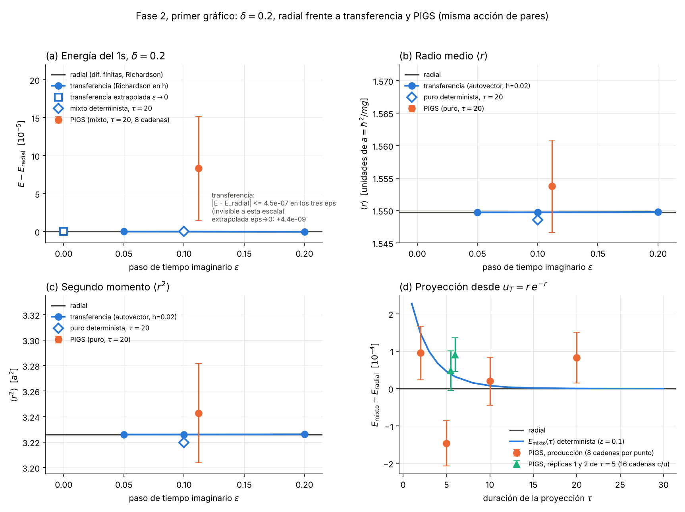
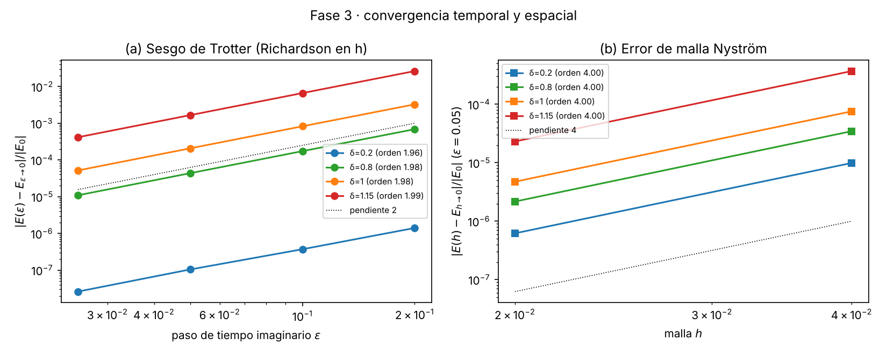
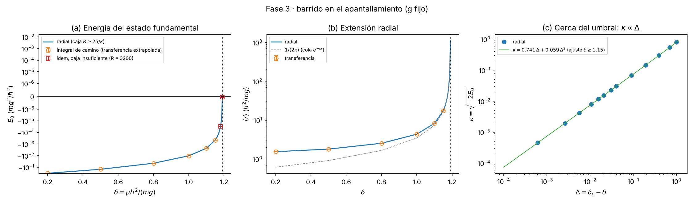
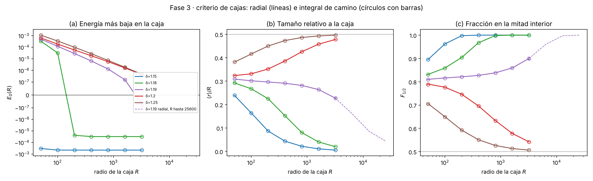
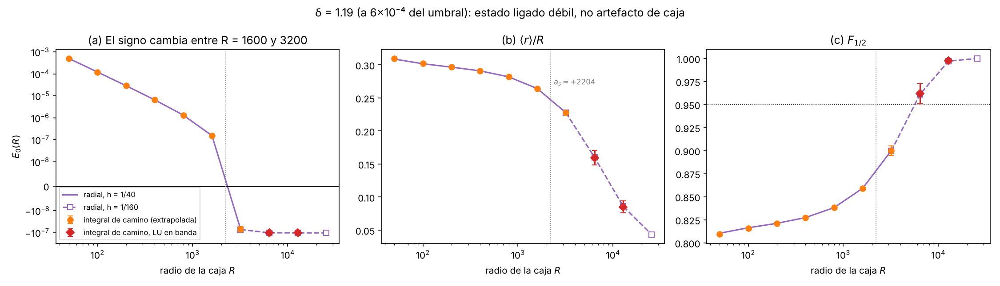

Juan Sebastián Calixto y Luis Felipe Ramírez · Universidad Nacional de Colombia · borrador del 10 de noviembre de 2026

> **Estado del borrador.** Están escritas las secciones de método, controles y resultados de las Fases 2 y 3. Faltan, para la Fase 4: el estudio de la extensión del estado, la discusión ampliada y las referencias cuya revista sigue sin confirmar. Todas las cifras salen de los scripts de `fase2/codigo` y `fase3/codigo` y de sus JSON.

## Resumen

Estudiamos en qué valor del apantallamiento deja de existir el estado ligado 1s del potencial $V(r)=-g\,e^{-\mu r}/r$. En unidades $\hbar=m=g=1$ todo depende de $\delta=\mu\hbar^2/(mg)$. Calculamos la energía $E_0(\delta)$ y el radio medio $\langle r\rangle(\delta)$ con dos métodos independientes:

1. un solucionador radial de diferencias finitas;
2. una integral de camino en tiempo imaginario, en la que la singularidad $-1/r$ se trata de forma exacta con la acción de pares de Coulomb y se evalúa como matriz de transferencia.

Lejos del umbral, los dos métodos coinciden a $\lesssim2\times10^{-8}$ en $E_0$ tras extrapolar en el paso temporal y en la malla. Los controles con solución exacta (Coulomb y Hulthén) se reproducen a $\sim10^{-9}$.

Cerca del umbral, el veredicto ligado / no ligado se toma con un criterio que compara varias cajas y observables de localización, no solo el signo del autovalor. Así obtenemos **$1.19<\delta_c<1.20$ con los dos métodos**, que coinciden en signo, tendencia y energía en las cajas $R=3200$, 6400 y 12800. La solución a energía cero, sin malla ni caja, lo acota a $1.1906<\delta_c<1.1907$. Todo es compatible con el valor de referencia $\delta_c=1.1906124211$.

En $\delta=1.19$ el autovalor más bajo cambia de signo entre $R=1600$ y $R=3200$. Lo que separa ese estado débil de un artefacto de caja es la extensión ($\langle r\rangle\approx1100$, del orden de la longitud de dispersión $a_s=+2204$).

Cerca del umbral, $\kappa=\sqrt{-2E_0}$ crece linealmente con $\Delta=\delta_c-\delta$ ($\kappa\simeq0.741\,\Delta$), y $\langle r\rangle\kappa\to1/2$.

## 1. Introducción

El potencial de Yukawa (o de Debye-Hückel) describe una interacción de Coulomb apantallada, con aplicaciones que van de los plasmas a la física nuclear. A diferencia del caso de Coulomb, solo tiene un número finito de estados ligados. El 1s desaparece en un apantallamiento crítico $\delta_c$.

Los métodos aproximados (perturbación y variacionales de un parámetro) fallan justamente cerca de $\delta_c$ [Lam y Varshni 1971; Varshni 1990], y en un cálculo numérico el estado se vuelve más grande que cualquier caja finita. La pregunta del proyecto es doble:

- delimitar un intervalo para $\delta_c$ con controles independientes;
- distinguir un estado ligado débil de un artefacto de la caja.

La integral de camino en tiempo imaginario es el formalismo que el curso pide usar. Con un potencial $-1/r$, la discretización ingenua (acción primitiva) da un peso no normalizable cerca del origen (Fase 1, sección 8). Nosotros usamos la acción de pares, que incorpora de forma exacta el propagador de Coulomb. Así el peso muestreado es real, positivo y normalizable sin suavizar el potencial, a diferencia de las técnicas de suavizado [Kole y De Raedt; Myrheim].

## 2. Modelo, unidades y cotas

La ecuación radial para $\ell=0$, con $u=rR_{10}$, es
$$-\tfrac12u''(r)-\frac{e^{-\delta r}}{r}\,u(r)=E\,u(r),\qquad u(0)=u(R)=0,$$
con $r$ en unidades de $\hbar^2/(mg)$ y $E$ en unidades de $mg^2/\hbar^2$. En la Fase 1 se acotó el umbral con dos cotas analíticas:

- cota variacional: $\delta_c\ge1.19055$;
- cota de Bargmann-Schwinger: $\delta_c\le1.24305$ [Bargmann 1952].

La referencia numérica del grupo (integración a energía cero) es $\delta_c=1.1906124210606$. Coincide con la de Gebremedhin y Weatherford (2023) en todas las cifras citadas, y difiere en $1.5\times10^{-7}$ de la de Roy, cuya incertidumbre declarada es $4\times10^{-8}$.

## 3. Métodos

**3.1 Solucionador radial.** Diferencias finitas de tres puntos con matriz tridiagonal simétrica, mallas $h=1/40$ y $1/80$ (o $1/160$ y $1/320$ en $\delta=1.19$) y extrapolación de Richardson de orden 2. Es la referencia de todos los resultados.

**3.2 Acción de pares.** Se escribe $V=-1/r+W$, con $W=(1-e^{-\delta r})/r\in[0,\delta]$ suave y acotado. El eslabón de tiempo imaginario $\epsilon$ es
$$T(r,r';\epsilon)=K_D(r,r';\epsilon)\,e^{-U_C(r,r';\epsilon)}\,e^{-\epsilon[W(r)+W(r')]/2},$$
donde:

- $K_D$ es el núcleo libre con una imagen en $r=0$;
- $U_C=-\ln(\rho_C/K_D)$ es la acción de pares del propagador exacto de Coulomb $\rho_C$, tabulada con Richardson.

La factorización simétrica tiene un sesgo $O(\epsilon^2)$ en $E_0$ (error de Trotter). El peso es real y positivo (0 elementos negativos en todas las matrices) y normalizable ($U_C$ es finita en el origen).

**3.3 Matriz de transferencia.** Con cuadratura de Nyström en $r_i=ih$, la energía es $E_0(\epsilon)=-\ln\lambda_0/\epsilon$, donde $\lambda_0$ es el mayor autovalor de la matriz en banda $hT(r_i,r_j)$. Se calcula con iteración de desplazamiento e inversión y se comprueba que el autovector cumple Perron-Frobenius (signo constante). La receta de producción es:

- Richardson en $h$ con exponente 4, porque la cúspide de Coulomb da un error de extremo $\propto h^4/\epsilon$;
- extrapolación en $\epsilon^2$ con $\epsilon=0.1$ y $0.05$;
- un error que suma la diferencia entre extrapolaciones y el sesgo de la pared en $R$ (sección 3.5).

**3.4 PIGS.** El muestreo de Monte Carlo de los caminos (Fase 2) se usó solo en $\delta=0.2$ como tercer método; queda fuera del barrido de esta fase.

**3.5 La pared en $R$.** $K_D$ tiene imagen solo en el origen. En $R$ la condición de Dirichlet se impone únicamente en los tiempos discretos, y la pared efectiva queda en $R+\beta\sqrt\epsilon$, con $\beta=-\zeta(1/2)/\sqrt{2\pi}=0.5826$ (valor medido; la atribución bibliográfica está pendiente de verificar). Por decisión del equipo, ese efecto no se corrige en el núcleo: se estima con el radial en la caja corrida y se suma a la barra de error.

**3.6 Criterio de cajas.** Para una terna de cajas consecutivas $R_1<R_2<R_3$:

- **Ligado:** (a) $E(R_2)$ y $E(R_3)$ son negativas y estables a menos de 10 %; (a') el error de malla es menor que el 10 % de $|E|$; (b) $\langle r\rangle/R$ decrece, $F_{1/2}$ crece y $F_{1/2}(R_3)>0.95$, donde $F_{1/2}$ es la fracción de la densidad en $r<R/2$.
- **No ligado:** $E>0$, las tendencias son las opuestas, y la energía sigue la ley de un estado libre en la caja, $\pi^2/[2(R-a_s)^2]$, con una desviación menor que 0.1 en $R_3$. Ese umbral de 0.1 se fijó antes de calcular los datos de la Fase 3.
- **Condición (c):** los dos métodos dan el mismo signo y la misma tendencia en las mismas cajas.

## 4. Controles

| Control | Resultado | Fase |
|---|---|---|
| Coulomb ($\delta=0$, método exacto para todo $\epsilon$) | $\lvert E+1/2\rvert\le2.2\times10^{-7}$ (solo error de malla) | 2 |
| Hulthén (misma singularidad, solución exacta) | $E$ a $\le5\times10^{-9}$ del exacto en $\delta=0.2$, 1.0 y 1.5; orden de Trotter 1.99 | 2 |
| Pozo cuadrado (sin singularidad, con salto) | Trotter de orden $\epsilon^{3/2}$: control cualitativo | 2 |
| Orden de Trotter, $\delta=0.2$ a 1.15 | 1.96 a 1.99 | 3 |
| Orden de la malla Nyström | 4.00 en los cuatro $\delta$ | 3 |
| Extrapolado frente al radial | $\le5\times10^{-9}$ en valor absoluto | 3 |
| Cotas $-1/2\le E_0\le-1/2+\delta$; $E_0(\delta)$ creciente | 0 violaciones en 13 valores de $\delta$ | 3 |
| Perron-Frobenius en las 210 matrices de cajas | mínimo $-2.8\times10^{-16}$ | 3 |

La tabla completa de la Fase 3 tiene 34 controles distintos: 23 pasan, 3 no pasan y 8 son medidos (sección 24). Los tres que no pasan tienen causa medida:

- el orden de Trotter en las cajas que toca la pared se recupera a 1.98–1.99 al comparar con el radial en $R+\beta\sqrt\epsilon$;
- una tendencia de $F_{1/2}$ que es ruido de redondeo cuando $F_{1/2}=1$;
- un orden que no se puede medir porque el sesgo es del tamaño del residuo de la tabla.

## 5. Resultados

**5.1 Punto fuertemente ligado ($\delta=0.2$).** El radial da $E_0=-0.3268085110$ y $\langle r\rangle=1.54972$. La transferencia extrapolada queda a $+4.4\times10^{-9}$ y el PIGS a $+1.22\sigma$, $+0.56\sigma$ y $+0.43\sigma$ en $E$, $\langle r\rangle$ y $\langle r^2\rangle$ (Fase 2; figura 1).

{width=92%}

**5.2 Convergencia.** El sesgo de Trotter crece hacia el umbral. Con $\epsilon=0.1$ vale $3.7\times10^{-7}$, $1.7\times10^{-4}$, $8.3\times10^{-4}$ y $6.6\times10^{-3}$ de $|E_0|$ en $\delta=0.2$, 0.8, 1.0 y 1.15. El error de malla con $h=0.02$ es 100 a 300 veces menor (figura 2). Sin extrapolar en $\epsilon$, el sesgo (siempre hacia abajo) llega al 20 % de $|E_0|$ cerca del umbral y podría fabricar un estado ligado. Por eso solo se usa la energía extrapolada.

{width=85%}

**5.3 Barrido en el apantallamiento.** La tabla 1 y la figura 3 dan $E_0(\delta)$ y $\langle r\rangle(\delta)$. Los dos métodos coinciden en los 8 valores en que se compararon, con una diferencia máxima de $1.8\times10^{-8}$.

| $\delta$ | $E_0$ (radial) | $E_0$ (integral de camino) | $\langle r\rangle$ |
|---|---|---|---|
| 0.2 | −0.3268085052 | −0.3268085066 ± 2.4×10⁻⁷ | 1.550 |
| 0.5 | −0.1481170153 | −0.148117021 ± 2.1×10⁻⁷ | 1.807 |
| 0.8 | −0.0447042980 | −0.044704313 ± 2.0×10⁻⁷ | 2.549 |
| 1.0 | −0.0102857842 | −0.010285802 ± 1.6×10⁻⁷ | 4.367 |
| 1.1 | −2.2872392×10⁻³ | −2.287252×10⁻³ ± 9×10⁻⁸ | 8.28 |
| 1.15 | −4.558844×10⁻⁴ | −4.55893×10⁻⁴ ± 3.5×10⁻⁸ | 17.45 |
| 1.18 | −3.09816×10⁻⁵ | (caja 3200) −3.0986×10⁻⁵ ± 1.4×10⁻⁸ | 64.4 |
| 1.19 | −1.030×10⁻⁷ | (caja 12800) −1.014×10⁻⁷ ± 2.3×10⁻⁸ | 1102 |

*Tabla 1. Radial en una caja $R\ge25/\kappa$. En $\delta=1.19$ la transferencia se evalúa en $R=12800$ con factorización LU en banda ($N=640000$).*

{width=98%}

Cerca del umbral, el ajuste $\kappa=A\Delta+B\Delta^2$ con $\delta\ge1.15$ da $A=0.7411$ y $B=0.059$, con un residuo de $7\times10^{-7}$. Es decir, $E_0\simeq-0.275\,\Delta^2$: la energía se anula de forma cuadrática, como corresponde a un estado $s$ en un potencial de corto alcance. Además, $\langle r\rangle\kappa$ baja de 0.527 ($\delta=1.15$) a 0.5003 ($\delta=1.19$): el estado queda dominado por su cola $e^{-\kappa r}$. El estudio sistemático de esta ley es tarea de la Fase 4.

**5.4 Cajas y umbral.** La figura 4 muestra los tres observables en 5 valores de $\delta$ y 7 cajas ($R=50$ a 3200). En las 35 celdas la integral de camino es compatible con el radial.

| $\delta$ | Veredicto | Terna decisiva | Observación |
|---|---|---|---|
| 1.15 | ligado | 50, 100, 200 | — |
| 1.18 | ligado | 200, 400, 800 | con $R\le100$ habría parecido "no ligado" ($E>0$) |
| 1.19 | indeterminado con $R\le3200$; **ligado** | 3200, 6400, 12800 | $E_0$ cambia de signo entre $R=1600$ y 3200 |
| 1.20 | no ligado | 200, 400, 800 | ley de caja con $a_s=-142.9$: desviación 0.021 |
| 1.25 | no ligado | 50, 100, 200 | — |

{width=98%}

**El caso $\delta=1.19$: un autovalor cercano a cero.** Con $R=1600$, $E_0=+1.5\times10^{-7}$; con $R=3200$, $E_0=-7.1\times10^{-8}$. Los dos métodos coinciden en ambas cajas. Un análisis que mirara solo el signo con $R\le1600$ concluiría "no ligado", y se equivocaría. Lo que decide es la localización:

- $\langle r\rangle/R$ baja de 0.23 ($R=3200$) a 0.043 ($R=25600$);
- $F_{1/2}$ sube de 0.90 a 0.99999;
- $E_0$ se estabiliza en $-1.030\times10^{-7}$.

La extensión del estado, $\langle r\rangle=1102$, es del orden de la longitud de dispersión $a_s=+2204$, que es la escala que la caja tiene que superar.

Para llevar la integral de camino a esas cajas cambiamos el solucionador de autovalores (no la acción): la factorización del modo shift-invert no cabía en memoria para $N\ge320000$, y la sustituimos por iteración inversa con LU en banda de LAPACK. Con la misma receta de extrapolación, la transferencia da $E_0(6400)=-1.003\times10^{-7}\pm2.2\times10^{-8}$ y $E_0(12800)=-1.014\times10^{-7}\pm2.3\times10^{-8}$, compatibles con el radial ($-1.017$ y $-1.030\times10^{-7}$). En la terna 3200/6400/12800 los dos métodos dan "ligado" y la condición (c) se cumple (figura 5).

{width=98%}

**Pruebas sin caja.** Integrando la ecuación radial desde la serie de Frobenius y empalmando con la cola $e^{-\kappa r}$, la energía en caja infinita es $E_0(1.19)=-1.0303\times10^{-7}$, igual al radial en $R=25600$. A energía cero, la longitud de dispersión cambia de signo entre $\delta=1.1906$ ($a_s=+1.1\times10^5$) y $1.1907$ ($a_s=-1.5\times10^4$). Por el teorema de nodos de Sturm, eso acota $1.1906<\delta_c<1.1907$. El cruce $E_0(R)=0$ se mueve hacia $R=a_s$ al refinar la malla (3692, 2451, 2261, 2218 para $h=1/40$ a $1/320$), como debe ser para un estado real.

**Intervalos.** Con los dos métodos y la condición (c), $1.19<\delta_c<1.20$. Con la solución a energía cero, $1.1906<\delta_c<1.1907$. Los dos contienen la referencia 1.1906124 y están dentro de las cotas analíticas.

## 6. Discusión

- **La caja es el sistemático dominante.** En $\delta=1.18$ y 1.19, una sola caja da el signo equivocado. El criterio de varias cajas con observables de localización evita ese error, y la integral de camino lo reproduce exactamente (24 de 25 ternas, y la que falla es ruido de redondeo en una terna ya saturada).
- **El paso temporal es el segundo sistemático.** Sin extrapolar puede bajar la energía hasta un 20 %. Con la acción de pares el orden es 2 en todos los $\delta$ y no hay término $O(\epsilon)$ de la singularidad.
- **La pared en $R$ sin imagen** sesga el orden en las cajas pequeñas y en los estados no ligados. Está medida y sumada al error.
- **Límites.** El PIGS no se usó cerca del umbral. La anomalía de $\tau=5$ en el PIGS de la Fase 2 ($p\approx1\%$) sigue abierta.

## 7. Uso de inteligencia artificial

El cálculo y la redacción los hizo un asistente de IA (Claude, Anthropic) bajo la dirección del equipo, que fijó la pregunta, el plan y las decisiones (umbral de 0.1 fijado antes de los datos, pared sin corregir en el núcleo, Richardson $h^4$). La verificación fue de tres tipos:

- un recálculo con código independiente;
- una auditoría adversarial interna;
- una auditoría externa con otro modelo (Gemini). En la Fase 2 no encontró errores de física y sí errores de documento. En esta fase, la auditoría adversarial de los autovalores cercanos a cero (Gemini 3.1 Pro, 10-11-2026) planteó 7 hallazgos. Seis se descartaron calculando: el sesgo de malla va hacia arriba y no puede fabricar un ligado; el cruce de signo converge a $a_s$; el orden de Trotter vuelve a 2 con la pared corregida; $\delta=1.20$ no tiene nodo a energía cero; la barra de error es mayor que la de un ajuste conjunto en $(h,\epsilon)$; el umbral de $F_{1/2}$ no decide nada. El séptimo era válido: la condición (c) no cubría $R>3200$. Lo resolvimos con la transferencia en 6400 y 12800. El chat literal está en `fase3/auditoria_gemini/`.

Ninguna referencia propuesta por una IA se incluye sin haberla comprobado en la fuente. El registro completo (consulta, respuesta, decisión humana, comprobación y corrección) está en la bitácora de IA de cada fase.

## Referencias (solo las verificadas; revista entre corchetes si no está confirmada)

- V. Bargmann, *Proc. Natl. Acad. Sci. USA* **38**, 961 (1952).
- J. M. Cai, P. Y. Cai, A. Inomata, *Phys. Rev. A* **34**, 4621 (1986).
- C. S. Lam, Y. P. Varshni, *Phys. Rev. A* **4**, 1875 (1971).
- Y. P. Varshni, *Phys. Rev. A* **41**, 4682 (1990).
- C. Stubbins, *Phys. Rev. A* **48**, 220 (1993).
- L. Hulthén, K. V. Laurikainen, *Rev. Mod. Phys.* **23**, 1 (1951).
- J. P. Edwards et al., *Prog. Theor. Exp. Phys.* **2017**, 083A01 (2017).
- M. Gebremedhin, C. A. Weatherford, *Phys. Rev. E* **108**, 045301 (2023) [valor de $\delta_c$ tomado de una fuente secundaria].
- A. K. Roy, arXiv:1312.5900 [revista no confirmada].
- J. S. Kole, H. De Raedt, arXiv:physics/0102015; J. Myrheim, arXiv:physics/0306168 [revistas no confirmadas].
- P. Dluhy, A. Gangopadhyaya, arXiv:1112.3674.
- R. P. Feynman, A. R. Hibbs, *Quantum Mechanics and Path Integrals*, McGraw-Hill (1965).
