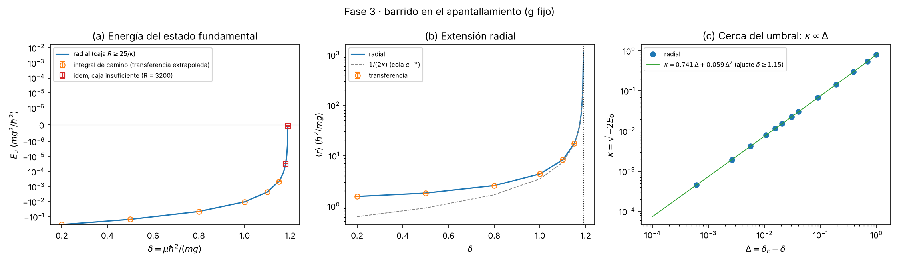
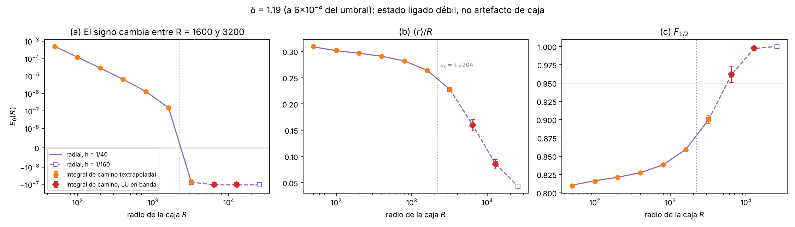
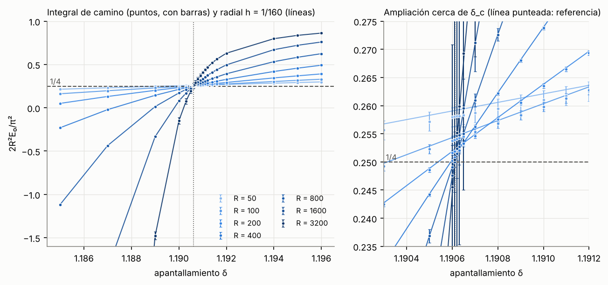
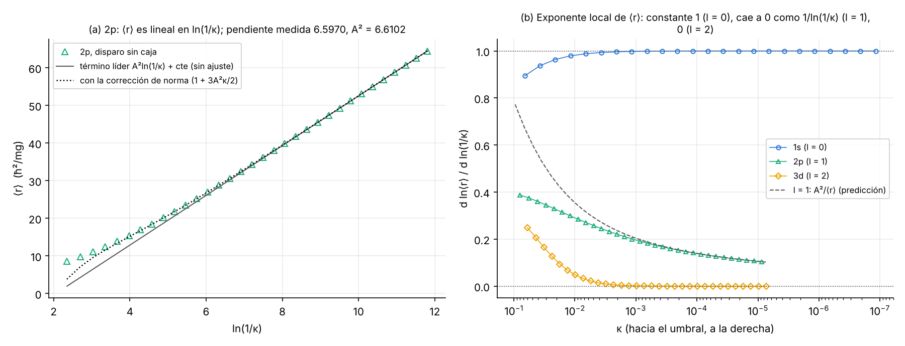
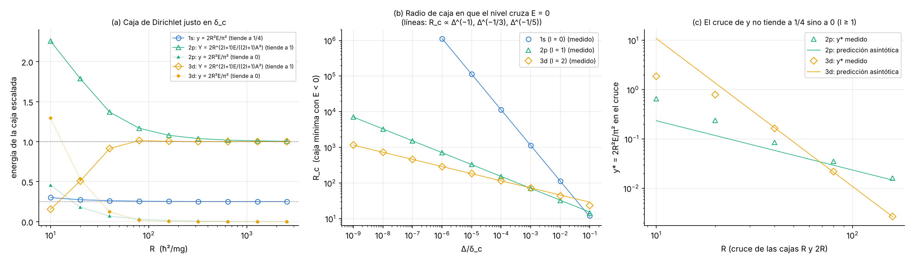
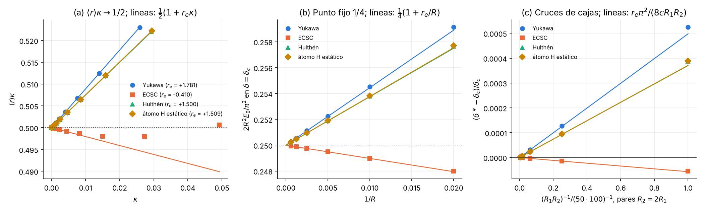
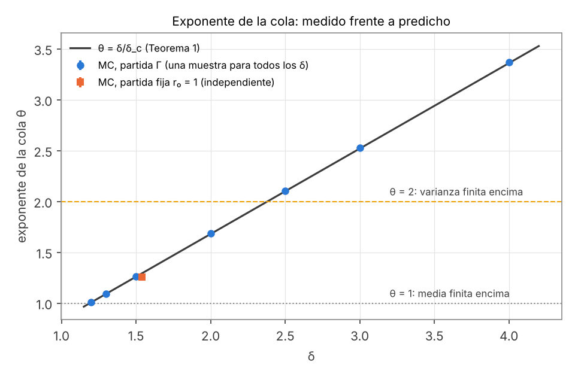
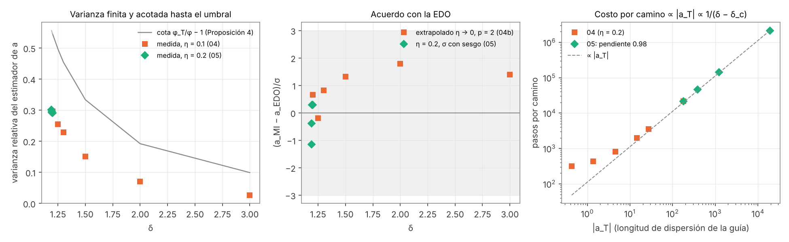

Juan Sebastián Calixto y Luis Felipe Ramírez · Universidad Nacional de Colombia · borrador del 17 de noviembre de 2026

> **Estado del borrador.** Integra el artículo de la Fase 3 con las extensiones de la Fase 4 (E1 a E5). El cuerpo principal es la Fase 3 actualizada, el cruce de cajas (E2) y la extensión según $\ell$ (E4); E1 entra como motivación. E3 y E5 van en apéndices **opcionales**: el equipo aún no decide cuáles se quedan. Todas las cifras están copiadas de los JSON de `resultados/` o de los textos generados desde ellos (la procedencia está en `NOTAS.md`). Las citas son solo de la bibliografía verificada del proyecto. Pendiente: la revisión del equipo de las decisiones D1 a D15 y la elección de los apéndices.

## Resumen

Estudiamos en qué valor del apantallamiento deja de existir el estado ligado 1s del potencial $V(r)=-g\,e^{-\mu r}/r$. En unidades $\hbar=m=g=1$ todo depende de $\delta=\mu\hbar^2/(mg)$, y la referencia es $\delta_c=1.1906124210606$. Calculamos $E_0(\delta)$ y $\langle r\rangle(\delta)$ con dos métodos independientes: un solucionador radial de diferencias finitas y una integral de camino en tiempo imaginario en la que la singularidad $-1/r$ se trata de forma exacta con la acción de pares de Coulomb, evaluada como matriz de transferencia. El peso es real, positivo y normalizable sin suavizar el potencial.

Con el criterio de varias cajas y observables de localización de la Fase 3, los dos métodos dan $1.19<\delta_c<1.20$, y la solución a energía cero lo acota a $1.1906<\delta_c<1.1907$. En $\delta=1.19$ el autovalor cambia de signo entre $R=1600$ y $R=3200$, y solo la localización del estado lo separa de un artefacto.

La aportación principal de la Fase 4 es una prueba de caja que no depende del signo de $E_0$. En una esfera de pared dura, en el umbral, $2R^2E_0/\pi^2$ vale $1/4$ y $\langle r\rangle/R$ vale $1/2-2/\pi^2$ para toda caja grande, así que las curvas de cajas distintas se cruzan cerca de $\delta_c$. La teoría de rango efectivo predice, sin parámetros libres, que el cruce converge como $1/R^2$. Con la integral de camino, la receta de errores de la Fase 3 da **$1.19054410<\delta_c<1.19067723$**, y aplicada al cruce da $1.19060859<\delta_c<1.19061621$. El cruce corregido por la ley predicha clasifica $\delta=1.19$ como ligado con cajas $R=50$ y $100$, donde el signo de $E_0$ dice lo contrario.

Para la extensión espacial: en el 1s, $\langle r\rangle\kappa$ tiende a $1/2$ y $E_0\propto-(\delta_c-\delta)^2$; en la onda p la energía se anula linealmente y $\langle r\rangle$ crece como $\ln(1/\kappa)$ con pendiente predicha $A^2=6.610$ (medida 6.597); en la onda d $\langle r\rangle$ queda finito. Para $\ell\ge1$ una caja da el signo correcto con radios $R\propto\Delta^{-1/(2\ell+1)}$.

## 1. Introducción y motivación física

El potencial de Yukawa, o de Debye y Hückel, describe una interacción de Coulomb apantallada [@Yukawa1935]. A diferencia del Coulomb, tiene un número finito de estados ligados, y el 1s desaparece en un apantallamiento crítico $\delta_c$. El espectro se ha calculado con métodos variacionales y numéricos [@Rogers1970; @LamVarshni1971; @Stubbins1993; @Gomes1994], y con gran precisión en años recientes [@Edwards2017; @Napsuciale2021PLB; @Gebremedhin2023]. Cerca de $\delta_c$ el estado se vuelve más grande que cualquier caja finita, y una caja puede fabricar conclusiones engañosas. La pregunta del proyecto es doble: delimitar un intervalo para $\delta_c$ con controles independientes, y distinguir un estado ligado débil de un artefacto de la caja.

**Qué significa $\delta_c$ en sistemas reales (extensión E1).** La guía pide no reclamar una cifra universal desligada de las unidades y los parámetros. La condición $\delta<\delta_c$ es exacta para el Yukawa, pero lo que dice en el laboratorio depende de qué se mantiene fijo al mover $\delta=\mu_\text{fís}\hbar^2/(mg)$. Tres ejemplos ilustran esto (figura 1):

- **Hidrógeno en un plasma de Debye.** El 1s deja de existir si $\lambda_D<a_0/\delta_c=0.8399039\,a_0=44.45$ pm, la longitud crítica que ya daban Rogers, Graboske y Harwood [@Rogers1970]. Con la longitud de Debye electrónica [@Huba2004], la curva de desaparición es $n_e=2.798\times10^{22}$ cm$^{-3}\,(k_BT/\text{eV})$. Sobre esa curva, el número de electrones en la esfera de Debye es $N_D=0.0103\,(k_BT/\text{eV})$, y vale 1 recién a 97 eV, cuando la teoría de Debye supone $N_D\gg1$. Donde el modelo estático predice que el 1s desaparece, el propio modelo deja de valer; por eso la literatura de descenso del continuo usa modelos más elaborados [@StewartPyatt1966; @Crowley2014]. El valor crítico es exacto **para el Yukawa estático**, no una predicción de la ionización por presión.
- **Materia oscura con un mediador ligero.** Con masa reducida $m_\chi/2$ y $g=\alpha\hbar c$, hay 1s si $\alpha m_\chi/m_\phi>2/\delta_c=1.679808$. Tulin, Yu y Zurek escriben que la primera resonancia s aparece en $b=1.68$ [@Tulin2013]; ese 1.68 es la etiqueta de una curva ilustrativa con dos decimales, y nuestro valor lo afina sin contradecirlo. La aproximación de Hulthén pone el umbral en $b=\kappa$ y se equivoca en $-4.8\%$ con $\kappa=1.6$ y en $-2.1\%$ con $\kappa=\pi^2/6$ [@Feng2010]. Petraki, Postma y de Vries dan solo la condición aproximada $\xi\gtrsim n^2$ [@Petraki2017].
- **Deuterón de juguete.** Un Yukawa en onda s con el alcance del pion, ajustado a la energía de enlace del deuterón ($B_d=2.224566$ MeV, [@CODATA2022]), da $\delta_d=0.83046=0.698\,\delta_c$ y $g/\hbar c=0.3541$. Si se mantienen $g$ y la masa reducida y solo se sube $m_\pi$, el deuterón se desligaría en $m_\pi^c=197.9$ MeV. La QCD en red lo contradice: NPLQCD encuentra el deuterón ligado a $m_\pi=805.9$ MeV [@NPLQCD2013], y para reproducirlo el modelo necesita una intensidad 3.02 veces la física. La sensibilidad local a $g$ fijo, $d\ln B_d/d\ln m_\pi=-4.76$, frente a $-1.74$ de la teoría quiral [@Berengut2013], muestra lo mismo. Ninguna de estas dos cifras del modelo a $g$ fijo es una predicción [@Epelbaum2003; @BeaneSavage2003].

La regla que dejamos para el resto del artículo es declarar siempre qué se mantiene fijo: aquí, $g$ y la masa.

{width=100%}

**El método.** La integral de camino en tiempo imaginario es el formalismo que el curso pide. Con $-1/r$, la discretización primitiva da un peso no normalizable cerca del origen (Fase 1). Usamos la acción de pares [@PollockCeperley1984; @Ceperley1995], que incorpora de forma exacta el propagador de Coulomb. Otras soluciones a la misma dificultad son una cota inferior exacta del propagador [@Kole2001], el suavizado gaussiano del potencial [@Myrheim2003] y el Monte Carlo de línea de mundo con potenciales suavizados [@Edwards2019].

## 2. Modelo, unidades y cotas

La ecuación radial para $\ell=0$, con $u=rR_{10}$, es
$$-\tfrac12u''(r)-\frac{e^{-\delta r}}{r}\,u(r)=E\,u(r),\qquad u(0)=u(R)=0,$$
con $r$ en unidades de $\hbar^2/(mg)$ y $E$ en unidades de $mg^2/\hbar^2$. En la Fase 1 se acotó el umbral con dos cotas analíticas: la variacional, $\delta_c\ge1.19055$, y la de Schwinger, $\delta_c\le1.24305$ [@Schwinger1961], que refina el criterio de Bargmann [@Bargmann1952].

La referencia numérica del grupo (integración a energía cero) es $\delta_c=1.1906124210606$. Coincide en todas las cifras citadas con la de Gebremedhin y Weatherford [@Gebremedhin2023], comprobada en el resumen del artículo. Difiere en $1.5\times10^{-7}$ del valor variacional de Gomes, Chacham y Mohallem, $1.19061227\pm0.00000004$ [@Gomes1994], unas 3.8 veces su barra declarada; ese número lo cita también Roy [@Roy2005], que no calcula su propio $\delta_c$.

Usamos la convención del grupo para la longitud de dispersión: $u\simeq r-a_s$ fuera del potencial, con $a_s>0$ cuando hay ligado; $a_s(1.19)=+2204$ y $a_s(1.20)=-142.9$.

## 3. Métodos

**3.1 Solucionador radial.** Diferencias finitas de tres puntos con matriz tridiagonal, mallas $h=1/40$ y $1/80$ (o $1/160$ y $1/320$ cerca del umbral) y extrapolación de Richardson de orden 2. Además, un disparo sin malla ni caja (integración desde la serie de Frobenius, DOP853) sirve de referencia casi exacta.

**3.2 Acción de pares.** Se escribe $V=-1/r+W$, con $W=(1-e^{-\delta r})/r\in[0,\delta]$ suave y acotado. El eslabón de tiempo imaginario $\epsilon$ es
$$T(r,r';\epsilon)=K_D(r,r';\epsilon)\,e^{-U_C(r,r';\epsilon)}\,e^{-\epsilon[W(r)+W(r')]/2},$$
donde $K_D$ es el núcleo libre con una imagen en $r=0$ y $U_C=-\ln(\rho_C/K_D)$ es la acción de pares del propagador exacto de Coulomb, tabulada con Richardson. La factorización simétrica tiene un sesgo $O(\epsilon^2)$. El peso es real y positivo (ningún elemento negativo en las matrices) y normalizable ($U_C$ es finita en el origen). El tratamiento exacto de la singularidad por integral de camino tiene antecedentes en el Hulthén [@Cai1986].

**3.3 Matriz de transferencia.** Con cuadratura de Nyström en $r_i=ih$, $E_0(\epsilon)=-\ln\lambda_0/\epsilon$, donde $\lambda_0$ es el mayor autovalor de la matriz en banda $hT(r_i,r_j)$, y se comprueba que el autovector tiene signo constante (Perron y Frobenius). La receta de producción es Richardson en $h$ con exponente 4 (la cúspide de Coulomb da un error $\propto h^4/\epsilon$), extrapolación en $\epsilon^2$, y un error que suma linealmente la diferencia entre extrapolaciones y el sesgo de la pared.

**3.4 La pared en $R$.** $K_D$ no tiene imagen en $R$, y la pared efectiva queda en $R+\beta\sqrt\epsilon$, con $\beta=-\zeta(1/2)/\sqrt{2\pi}=0.5826$ (valor medido; su atribución bibliográfica sigue pendiente). Por decisión del equipo ese efecto no se corrige en el núcleo: se estima con el radial en la caja corrida y se suma a la barra. La pared con imágenes es el método de Dluhy y Gangopadhyaya [@Dluhy2011].

**3.5 Criterio de cajas (Fase 3).** Para una terna $R_1<R_2<R_3$: *ligado* si $E(R_2)$ y $E(R_3)$ son negativas y estables a menos de 10 %, el error de malla es menor que el 10 % de $|E|$, $\langle r\rangle/R$ decrece y la fracción $F_{1/2}$ de la densidad en $r<R/2$ crece hasta superar 0.95; *no ligado* si $E>0$, las tendencias son las opuestas y la energía sigue la ley de un estado libre, $\pi^2/[2(R-a_s)^2]$, con desviación menor que 0.1 (umbral fijado antes de los datos); *condición (c)*: los dos métodos dan el mismo signo y la misma tendencia en las mismas cajas.

## 4. Resultados de las Fases 2 y 3

**4.1 Convergencia.** El orden de Trotter es de 1.96 a 1.99 y el de la malla 4.00 en $\delta=0.2$, 0.8, 1.0 y 1.15. El extrapolado queda a $\le5\times10^{-9}$ del radial. El sesgo con $\epsilon=0.1$ crece hacia el umbral, de $3.7\times10^{-7}$ a $6.6\times10^{-3}$ de $|E_0|$; sin extrapolar llega al 20 % de $|E_0|$, siempre hacia abajo, y podría fabricar un ligado. Por eso solo se usa la energía extrapolada. Los controles exactos se reproducen: Coulomb a $\le2.2\times10^{-7}$ (solo malla) y Hulthén a $\le5\times10^{-9}$ [@Varshni1990].

**4.2 Barrido en el apantallamiento.** Los dos métodos coinciden en 8 valores de $\delta$ con una diferencia máxima de $1.8\times10^{-8}$ (tabla 1, figura 2).

| $\delta$ | $E_0$ (radial) | $E_0$ (integral de camino) | $\langle r\rangle$ |
|---|---|---|---|
| 0.2 | −0.3268085052 | −0.3268085066 ± 2.4×10⁻⁷ | 1.550 |
| 0.5 | −0.1481170153 | −0.148117021 ± 2.1×10⁻⁷ | 1.807 |
| 0.8 | −0.0447042980 | −0.044704313 ± 2.0×10⁻⁷ | 2.549 |
| 1.0 | −0.0102857842 | −0.010285802 ± 1.6×10⁻⁷ | 4.367 |
| 1.1 | −2.2872392×10⁻³ | −2.287252×10⁻³ ± 9×10⁻⁸ | 8.28 |
| 1.15 | −4.558844×10⁻⁴ | −4.55893×10⁻⁴ ± 3.5×10⁻⁸ | 17.45 |
| 1.18 | −3.09816×10⁻⁵ | (caja 3200) −3.0986×10⁻⁵ ± 1.4×10⁻⁸ | 64.4 |
| 1.19 | −1.030×10⁻⁷ | (caja 12800) −1.014×10⁻⁷ ± 2.3×10⁻⁸ | 1102 |

*Tabla 1. Radial en una caja $R\ge25/\kappa$. En $\delta=1.19$ la transferencia se evalúa en $R=12800$ con factorización LU en banda ($N=640000$).*

{width=96%}

Cerca del umbral, el ajuste $\kappa=A\Delta+B\Delta^2$ con $\delta\ge1.15$ da $A=0.7411$ y $B=0.059$: la energía se anula de forma cuadrática, $E_0\simeq-0.275\,\Delta^2$, como corresponde a un estado s en un potencial de corto alcance. Además $\langle r\rangle\kappa$ baja de 0.527 ($\delta=1.15$) a 0.5003 ($\delta=1.19$). En la Fase 4 la pendiente se predijo sin ajuste desde la solución de energía cero, $c=-d(1/a)/d\delta=0.7411918$ (E2, E3 y E4), y coincide con la medida.

**4.3 Cajas y umbral.** En 5 valores de $\delta$ y 7 cajas ($R=50$ a 3200), las 35 celdas de la integral de camino son compatibles con el radial. Salen ligados $\delta=1.15$ y 1.18 (este último habría parecido no ligado con $R\le100$) y no ligados 1.20 y 1.25 (en 1.20, la ley de caja con $a_s=-142.9$ tiene desviación 0.021).

**4.4 El caso $\delta=1.19$: un autovalor cercano a cero.** Con $R=1600$, $E_0=+1.5\times10^{-7}$; con $R=3200$, $E_0=-7.1\times10^{-8}$; los dos métodos coinciden en ambas cajas. Mirar solo el signo con $R\le1600$ daría "no ligado", y sería un error. Lo que decide es la localización: $\langle r\rangle/R$ baja de 0.23 ($R=3200$) a 0.043 ($R=25600$), $F_{1/2}$ sube de 0.90 a 0.99999 y $E_0$ se estabiliza en $-1.030\times10^{-7}$, con $\langle r\rangle=1102$, del orden de $a_s=+2204$. La transferencia en $R=6400$ y 12800 (LU en banda) da $-1.003\times10^{-7}\pm2.2\times10^{-8}$ y $-1.014\times10^{-7}\pm2.3\times10^{-8}$, compatibles con el radial. En la terna 3200/6400/12800 los dos métodos dan ligado y la condición (c) se cumple (figura 3).

{width=96%}

**4.5 Sin caja.** El disparo desde Frobenius da $E_0(1.19)=-1.0303\times10^{-7}$. A energía cero, $a_s$ cambia de signo entre $\delta=1.1906$ ($+1.1\times10^5$) y $1.1907$ ($-1.5\times10^4$); por el teorema de nodos de Sturm, $1.1906<\delta_c<1.1907$. El cruce $E_0(R)=0$ se mueve hacia $R=a_s$ al refinar la malla (3692, 2451, 2261, 2218 para $h=1/40$ a $1/320$), como debe ocurrir con un estado real.

## 5. El cruce de cajas: una prueba que no depende del signo (extensión E2)

**5.1 Idea.** El criterio de signo es correcto pero lento cerca del umbral: en una caja de Dirichlet la energía nunca baja de la del espacio libre, así que el signo solo se equivoca en una dirección (dice "no ligado" cuando sí hay ligado) y lo hace hasta que $R$ supera $a_s$. Fuera del alcance del potencial, la solución s es $\sin(kr+\eta_0)$; la pared dura en $R$ impone, con $x=kR$ y el desarrollo de rango efectivo $k\cot\eta_0=-1/a+r_ek^2/2$ [@Bethe1949],
$$x\cot x=\frac{R}{a}-\frac{r_e}{2R}x^2,\qquad y\equiv\frac{2R^2E_0}{\pi^2}=\frac{x^2}{\pi^2}.$$
Es la condición del método de la pared esférica [@Borasoy2007]. En el umbral y con alcance cero, $x=\pi/2$: **$y=1/4$ para toda caja**, mientras que $y$ baja con $R$ si hay ligado y sube hacia 1 si no lo hay. La extensión tiene también un punto fijo, **$\langle r\rangle/R=1/2-2/\pi^2=0.2974$**. Desarrollando en $r_e/R$, el cruce de las cajas $R$ y $2R$ está en
$$\delta^*(R,2R)-\delta_c=\frac{\pi^2r_e}{16\,c\,R^2}+\frac{3\pi^2r_e^2}{32\,c\,R^3}+O(R^{-4}),$$
con $r_e=1.78063$ y $c=0.741192$ calculados a energía cero, sin ajuste ($\alpha=1.4819$, $\beta=3.958$). **La convergencia es en $1/R^2$**, aunque $y(\delta_c,R)=\tfrac14(1+r_e/R)$ tenga una corrección $1/R$. Para $\langle r\rangle/R$ el coeficiente es $\alpha_\rho=9.648$. En la integral de camino la pared sin imagen actúa como una pared en $R+0.1123$ (tras extrapolar en $\epsilon$), y mueve el cruce en $-\pi^2c_w/(8cR^2)$: $-1.18\times10^{-6}$ en el par 400/800.

**5.2 Método.** Rejilla de 23 valores de $\delta$ en $[1.185,1.196]$ (15 iniciales y 8 añadidos tras el control K7, sin cambiar su umbral; decisión D10) y $R=50$ a 3200 (161 celdas), con tres métodos: la integral de camino con la receta de la Fase 3 sin cambios ($h=0.02$ y 0.04, $\epsilon=0.2$, 0.1 y 0.05), el radial ($h=1/40$ y $1/160$) y el disparo sin malla. El cruce de cada par es la raíz de $y(\delta,R)-y(\delta,2R)$ interpolada con un spline cúbico. Su barra es la mayor entre un Monte Carlo de 20240 réplicas y la propagación lineal (D12). Para la integral de camino hay dos variantes, fijadas antes de calcular: **A**, la receta de la Fase 3 aplicada a $E_0$ y propagada al cruce (intervalo oficial, D11); **B**, la misma receta aplicada al cruce. La extrapolación en $R$ es un ajuste ponderado $\delta^*=\delta_c+\alpha/R^2+\beta/R^3$ con los pares de $R\ge100$, con la forma fijada antes de tener $R=1600$ y 3200.

{width=92%}

| Par | Integral de camino, A | Integral de camino, B | Radial $h=1/160$ | Disparo sin malla | Teoría (ERE) | $y$ en el cruce |
|---|---|---|---|---|---|---|
| 50/100 | 1.1911616 ± 3.5e-4 | 1.1911617 ± 1.2e-4 | 1.1912376 ± 1.2e-5 | 1.191237550 | 1.191238046 | 0.26390 |
| 100/200 | 1.1907465 ± 8.4e-5 | 1.1907468 ± 2.6e-5 | 1.1907646 ± 1.2e-5 | 1.190764616 | 1.190764645 | 0.25681 |
| 200/400 | 1.1906452 ± 2.4e-5 | 1.1906458 ± 5.5e-6 | 1.1906500 ± 1.2e-5 | 1.190649967 | 1.190649968 | 0.25337 |
| 400/800 | 1.1906197 ± 2.5e-5 | 1.1906208 ± 3.1e-6 | 1.1906218 ± 1.2e-5 | 1.190621745 | 1.190621745 | 0.25168 |
| 800/1600 | 1.1906124 ± 5.4e-5 | 1.1906145 ± 2.6e-6 | 1.1906147 ± 1.1e-5 | 1.190614744 | 1.190614744 | 0.25084 |
| 1600/3200 | 1.1906083 ± 1.3e-4 | 1.1906128 ± 2.5e-6 | 1.1906128 ± 1.2e-5 | 1.190613001 | 1.190613001 | 0.25042 |

*Tabla 2. Cruces $\delta^*(R,2R)$ de $2R^2E_0/\pi^2$. La última columna es el valor de $y$ en el cruce, con el disparo.*

**5.3 Resultados.** Tres hechos se leen en la tabla 2. Primero, **la teoría predice los cruces sin parámetros libres**: el modelo de rango efectivo coincide con el disparo a $5\times10^{-7}$ en el par 50/100 y a $2\times10^{-9}$ o mejor desde el 200/400. Segundo, los cocientes de diferencias sucesivas del disparo son 4.125, 4.062, 4.031 y 4.016 (ley $1/R^2$), y el valor en el cruce baja hacia $1/4$ como $1/4+3r_e/(8R)$. Tercero, la integral de camino queda sistemáticamente por debajo del disparo; con el método B la diferencia es $-7.6\times10^{-5}$, $-1.8\times10^{-5}$, $-4.2\times10^{-6}$ y $-9.4\times10^{-7}$ en los pares 50 a 400, frente a $-8.3\times10^{-5}$, $-2.0\times10^{-5}$, $-4.8\times10^{-6}$ y $-1.18\times10^{-6}$ que predice el corrimiento de la pared. Al restar ese corrimiento, el cruce de la integral de camino coincide con el exacto a $2.4\times10^{-7}$ o mejor desde el par 400/800.

| Fuente | Observable | $\delta_c$ | barra | intervalo |
|---|---|---|---|---|
| integral de camino, A | $2R^2E_0/\pi^2$ | 1.1906106662 | 6.66e-5 | [1.19054410, 1.19067723] |
| integral de camino, A | $\langle r\rangle/R$ | 1.1906107238 | 6.93e-5 | [1.19054141, 1.19068003] |
| integral de camino, B | $2R^2E_0/\pi^2$ | 1.1906123995 | 3.81e-6 | [1.19060859, 1.19061621] |
| integral de camino, B | $\langle r\rangle/R$ | 1.1906120950 | 1.57e-5 | [1.19059638, 1.19062781] |
| radial $h=1/160$ | $2R^2E_0/\pi^2$ | 1.1906123326 | 1.52e-5 | [1.19059710, 1.19062756] |
| radial $h=1/160$ | $\langle r\rangle/R$ | 1.1906124177 | 1.52e-5 | [1.19059722, 1.19062761] |
| disparo sin malla | $2R^2E_0/\pi^2$ | 1.1906124213 | 1.56e-9 | (solo modelo de extrapolación) |
| disparo sin malla | $\langle r\rangle/R$ | 1.1906124202 | 2.00e-9 | (ídem) |

*Tabla 3. Extrapolación en $R$ (pares con $R\ge100$) e intervalo final. Los diez intervalos contienen la referencia (control K9).*

El resultado de la integral de camino es **$1.19054<\delta_c<1.19068$ con la receta de la Fase 3 (método A)** y $1.190609<\delta_c<1.190616$ aplicando la receta al cruce (método B). Con solo cajas $R\le800$ los intervalos son $[1.19055557,1.19066686]$ (A) y $[1.19060344,1.19062166]$ (B): cajas de 800 bastan para estrechar el intervalo del signo, que necesitó $R=12800$, en más de dos órdenes de magnitud.

{width=92%}

**Por qué A es más ancho que B.** Desde $R=800$ la barra de la receta en $E_0$ queda casi constante mientras $E_0$ cae como $R^{-2}$; al pasar a $y$ se multiplica por $R^2$. El mecanismo se midió en la revisión R2: el error de Trotter actúa como un corrimiento del umbral, $s_\epsilon=\delta_c(\epsilon)-\delta_c=6.1\times10^{-4}$, $1.53\times10^{-4}$ y $3.8\times10^{-5}$ para $\epsilon=0.2$, 0.1 y 0.05 (ley $\epsilon^2$). En $E_0$ ese corrimiento entra por la parte curva de la función de escala, y la ley $\epsilon^2$ celda por celda pierde precisión en $R$ grande; el cruce, en cambio, se corre en $s_\epsilon$ para todo $R$ y la ley $\epsilon^2$ se le aplica limpia. Por eso B es legítimo y sus barras por par cubren la diferencia con el disparo en los seis pares. La barra de $\langle r\rangle/R$ incluye además el término de pared (hallazgo R2-01, decisión D14), como la de $E_0$: la barra final de B pasa de $1.47\times10^{-5}$ a $1.57\times10^{-5}$ y la de A de $6.04\times10^{-5}$ a $6.93\times10^{-5}$, sin mover los cruces; ningún control cambia de estado.

**5.4 El signo engaña, el cruce no ($\delta=1.19$).** Hasta $R=1600$ los tres métodos dan $E_0>0$ (en $R=50$, $+5.0224\times10^{-4}$ con el disparo y $+5.0012\times10^{-4}\pm3.3\times10^{-6}$ con la integral de camino), que leído por el signo es "no ligado"; el primer $E_0<0$ de la rejilla está en $R=3200$. En cambio $y$ queda por debajo de su valor en el umbral, $\tfrac14(1+r_e/R)$ (en $R=50$, $y=0.2544$ frente a 0.2589), y baja con $R$ desde el primer par. Eso solo no basta: como $r_e>0$, cada cruce crudo es una cota superior de $\delta_c$, y un $\delta$ entre $\delta_c$ y $\delta^*$ también daría $y(R)>y(2R)$ (lo señaló la auditoría externa, y la revisión R2 lo encontró en paralelo). Lo que clasifica $\delta=1.19$ es el cruce corregido con la ley predicha, $\delta^*-\alpha_y/R^2-\beta_y/R^3$, sin ajuste: con el par 50/100 vale 1.1906131 con el disparo y 1.1905372 con la integral de camino, $6.1\times10^{-4}$ y $5.4\times10^{-4}$ por encima de 1.19. **La prueba de cruce clasifica $\delta=1.19$ como ligado con las cajas $R=50$ y 100.** Como controles negativos, con el Yukawa repulsivo, con $\delta\in[1.4,2.0]$ (sin ligado) y con $\delta\in[0.8,1.0]$ (ligado profundo), $y(R)-y(2R)$ no cambia de signo en ningún par (K12).

**5.5 Originalidad.** La declaramos baja a moderada (decisión D13). La condición de cuantización es la del método de la pared esférica [@Borasoy2007]; el valor universal de la energía de dos cuerpos en una caja en la unitariedad se usa en redes periódicas [@Luscher1986; @Luscher1991; @Konig2011; @Drut2013], y en una trampa armónica es la fórmula de Busch et al. [@Busch1998; @Stetcu2010]; el cruce de curvas de dos tamaños es la renormalización fenomenológica de Nightingale [@Nightingale1976; @dosSantos1981]; el escalamiento de tamaño finito del Yukawa se hizo con el tamaño de la base [@Serra1998; @KaisSerra2003] y con un radio de corte del potencial [@SerraSpatial]. Lo que no encontramos, con buscadores abiertos, es el uso del cruce en una esfera dura para el apantallamiento crítico del Yukawa, la ley de convergencia con coeficientes predichos por $r_e$ y $c$, el punto fijo de $\langle r\rangle/R$ con su coeficiente propio, ni su uso con una integral de camino como prueba de artefacto. Límites: la ley depende del signo de $r_e$ (para $r_e<0$ los cruces llegan desde abajo; apéndice A), y para $\ell\ge1$ el punto fijo cambia (sección 6).

## 6. Cómo crece la extensión espacial según el momento angular (extensión E4)

**6.1 Pregunta y método.** La guía pide examinar cómo crece la extensión espacial cerca del umbral. Para $\ell\ge1$ la barrera centrífuga cambia la cola de la solución de energía cero de una constante a $A\,r^{-\ell}$, que es de cuadrado integrable: en el umbral queda un estado normalizable de energía cero. El problema general de los umbrales de acoplamiento lo plantearon Klaus y Simon [@KlausSimon1980]; para el Yukawa los exponentes $E\propto\Delta^2$ ($\ell=0$) y $E\propto\Delta$ ($\ell\ge1$) los dan Serra, Neirotti y Kais [@Serra1998], y las leyes de $\langle r^n\rangle$ son las de los halos [@Riisager2013; @Jensen2004; @Misu1997]. Medimos los umbrales 2s, 2p y 3d con un disparo sin caja (exterior exacto de Bessel modificada) y lo controlamos con diferencias finitas: $\delta_c(2s)=0.3102092827139$, $\delta_c(2p)=0.2202168066066$ y $\delta_c(3d)=0.0913451207717$, con un segundo método (recurrencia de energía cero) que coincide a $2.2\times10^{-11}$ o mejor. Para 2p, $1/\delta_c=4.5409800$, frente a $\lambda_c=4.540980(3)$ de Serra et al.

**6.2 Energía.** En las dos últimas décadas de cada barrido ($\Delta/\delta_c$ hasta $10^{-7}$ en $\ell=0$ y $10^{-9}$ en $\ell\ge1$), el exponente de $|E|$ frente a $\Delta$ sale 2.0000003 (1s), 2.0000007 (2s), 1.00009 (2p) y 0.9999999 (3d). Los coeficientes se predicen sin ajuste: $\kappa/\Delta$ tiende a $c_0=0.741192$ (1s, el 0.741 de la Fase 3) y 1.316956 (2s); $-E/\Delta$ tiende a $S=\langle e^{-\delta_cr}\rangle_0$ por Hellmann y Feynman, 0.126016 (2p, medido 0.126022) y 0.221917 (3d, medido 0.221917).

**6.3 Extensión (figuras 6 y 7).** Para $\ell=0$, $\langle r\rangle\kappa=0.5000001$ y $\langle r^2\rangle\kappa^2=0.5000001$ en 1s. Para $\ell=1$, $\langle r^2\rangle\propto\kappa^{-0.99992}$ y $\langle r^2\rangle\kappa$ tiende a $5A^2/4=8.2627$ (medido 8.2629). Para $\ell=2$, $\langle r\rangle$ y $\langle r^2\rangle$ quedan finitos: tienden a 21.6161 y 766.9. El punto fino es la onda p: $\langle r\rangle$ crece de 8.6 a 64.5 mientras $\kappa$ baja de 0.095 a $7.5\times10^{-6}$, y no es una potencia: el exponente local baja de forma monótona de 0.39 a 0.10. En cambio, $\langle r\rangle$ es lineal en $\ln(1/\kappa)$ con pendiente $6.597\pm0.001$, frente a la predicción $A^2=6.610$, la amplitud de la cola de la solución de energía cero normalizada. La fórmula completa,
$$\langle r\rangle=\{C_0+A^2[\ln(1/\kappa)+5/4-\gamma-\ln2]\}(1+3A^2\kappa/2),$$
con $C_0$ calculado en el umbral y sin ningún parámetro libre, reproduce $\langle r\rangle$ con un error relativo máximo de $2.3\times10^{-7}$. Un ajuste de potencia en cualquier ventana daría un exponente entre 0.1 y 0.4 que depende de la ventana; solo la gráfica contra $\ln(1/\kappa)$ con la pendiente fijada de antemano distingue el logaritmo.

{width=92%}

{width=80%}

**6.4 Qué ve una caja.** Justo en $\delta_c$, $2R^2E/\pi^2$ tiende a $1/4$ solo para $\ell=0$ (0.25017 en $R=2560$). Para $\ell\ge1$ tiende a 0, porque el estado de energía cero no llega a la pared; la variable con punto fijo es $Y=2R^{2\ell+1}E/[(2\ell+1)A^2]$, que tiende a 1 (1.0047 en 2p con $R=2560$ y 1.00007 en 3d con $R=640$). El radio de caja en que el nivel cruza $E=0$ sigue $R_c\propto\Delta^{-1}$, $\Delta^{-1/3}$ y $\Delta^{-1/5}$ para $\ell=0$, 1 y 2. En la práctica, con $R=100$ el signo de $E$ es fiable desde $\Delta/\delta_c=1.1\times10^{-2}$ en 1s, pero ya desde $3.6\times10^{-4}$ en 2p y $2.0\times10^{-4}$ en 3d (figura 8). La dificultad de caja que motivó la Fase 3 es, entonces, propia de $\ell=0$.

{width=100%}

**6.5 Integral de camino para $\ell=1$.** Ampliamos la matriz de transferencia a la onda p con el núcleo libre exacto de la onda p, $K_1$, que lleva la barrera centrífuga sin aproximación, y la acción de pares exacta del Coulomb en la onda p, $U_1$, tabulada como en la Fase 2. El peso es real, positivo y normalizable. Coulomb 2p da $E=-1/8+5\times10^{-11}$; los seis casos son compatibles con el radial y el orden de Trotter es 2.00 (1.61 en $\delta=0.219$ por la pared, 2.00 con la pared corrida). Hay un desfase común de unos $+5\times10^{-11}$ que la barra no cubre; al menos la mitad viene de la red de la tabla $U_1$ (revisión R4) y es una parte en $10^9$ de $|E|$. La alternativa primitiva para el centrífugo converge con orden 1.34 a 1.37 y deja errores de hasta 0.1 % tras extrapolar: la barrera no exige muestreo especial si se incluye exactamente en el núcleo libre.

## 7. Comparación de métodos y controles

**7.1 Intervalos para $\delta_c$.** La tabla 4 reúne las cotas con su método. Todas contienen la referencia y están dentro de las cotas analíticas de la sección 2.

| Método | Qué decide | Resultado |
|---|---|---|
| Cotas analíticas (Fase 1) | variacional y Schwinger | $1.19055\le\delta_c\le1.24305$ |
| Radial e integral de camino, criterio de cajas (Fase 3) | signo, localización, condición (c), $R\le12800$ | $1.19<\delta_c<1.20$ |
| Energía cero, sin caja ni malla (Fase 3) | signo de $1/a_s$ (Sturm) | $1.1906<\delta_c<1.1907$ |
| Integral de camino, cruce de cajas A (E2, oficial) | $y=1/4$, $R\le3200$ | $[1.19054410,1.19067723]$ |
| Integral de camino, cruce de cajas B (E2) | ídem, receta aplicada al cruce | $[1.19060859,1.19061621]$ |
| Radial $h=1/160$, cruce de cajas (E2) | ídem | $[1.19059710,1.19062756]$ |
| Disparo, cruce de cajas (E2) | ídem | $1.1906124213$ (barra del modelo $1.56\times10^{-9}$) |
| Literatura | | 1.19061227(4) [@Gomes1994]; 1.1906122105(5) [@Edwards2017]; 1.1906124207(2) [@Napsuciale2021PLB]; 1.19061242106061770… [@Gebremedhin2023] |

*Tabla 4. Cotas para $\delta_c$ por método.*

El valor de Edwards et al. [@Edwards2017], obtenido con Monte Carlo de línea de mundo, queda $2.106\times10^{-7}$ por debajo de la referencia $\delta_c=1.1906124210606$, unas 421 veces su incertidumbre declarada ($5\times10^{-10}$). Nuestra solución a energía cero, el cruce de cajas con el disparo ($1.1906124213$, barra $1.56\times10^{-9}$) y los cálculos de alta precisión de la tabla coinciden en el valor más alto, así que lo reportamos como discrepante, sin afirmar su causa; los intervalos de la integral de camino son demasiado anchos para distinguir entre los dos valores.

**7.2 Controles.** Los criterios de cada control se fijaron antes de calcular. Los que no pasan se reportan como "no pasa" con su causa medida, aunque la causa esté entendida y aunque la auditoría externa haya propuesto relajarlos (decisión D8). La tabla 5 resume los conteos de cada `controles.md`.

| Bloque | Controles | Pasan | No pasan | Otros |
|---|---|---|---|---|
| Fases 2 y 3 | 34 | 23 | 3 | 8 medidos |
| E1 contexto físico | 12 | 9 | 3 (C6, C7, C9) | ninguno |
| E2 cruce de cajas | 31 | 27 | 4 (K2, K7-disparo, K7-disparo-inicial, K11) | K11b informativo, no cuenta |
| E3 otros perfiles (opcional) | 32 | 29 | 2 (U2, S1) | 1 medido |
| E4 extensión según $\ell$ | 129 | 105 | 16 | 8 medidos |
| E5 Feynman–Kac (opcional) | 43 | 34 | 4 (C3, C11 en $\delta=1.5$ y 2, C16 con $\eta=0.8$) | 1 no aplicable, 4 informativos |

*Tabla 5. Controles por bloque.*

Las causas medidas de los que no pasan, en resumen:

- **Fase 3.** El orden de Trotter en cajas que tocan la pared (vuelve a 1.98–1.99 comparando con el radial en $R+\beta\sqrt\epsilon$); una tendencia de $F_{1/2}$ que es redondeo cuando $F_{1/2}=1$; un orden no medible porque el sesgo es del tamaño del residuo.
- **E1.** C6: $1/\delta_c=0.8399039$ redondea a 0.83990 y Rogers et al. dan 0.83991; atribuimos la diferencia (7 partes por millón) a la precisión de 1970. C7: el criterio relativo $10^{-6}$ falla cerca del umbral porque la diferencia absoluta entre disparo y caja es casi constante ($4.3$ a $6.7\times10^{-9}$) y es error de malla de la caja ($h=1/40$). C9: compara el cero exacto de $a_s$ ($b=4.4657$) con una etiqueta ilustrativa ($b=4.52$); el criterio estaba mal planteado.
- **E2.** K2 (orden de Trotter en 75.2 % de las celdas): en $R=50$ es la pared, y al restarla las 23 celdas vuelven al rango; en $R=3200$ son términos de orden superior en $\epsilon=0.2$. K7: PCHIP y el cúbico local se separan $4.6\times10^{-7}$ en el par 50/100 de $\langle r\rangle/R$, mientras el spline coincide con el cruce sin interpolar. K11: el colapso se evaluó a $\delta$ fijo cuando la corrección es $1/R$ a $z=R/a$ fijo.
- **E4.** Los 16 se agrupan en seis causas: el ajuste de $\delta_c$ con un modelo truncado; el error absoluto de malla de las diferencias finitas, casi constante, que pesa cada vez más cuando $E\propto\Delta^2$; el suelo de redondeo del autovalor tridiagonal; la diferencia centrada de Hellmann y Feynman en el último punto (unos $6\times10^{-18}$ absolutos en $E$); el error de la tabla $U_1$ en el primer nodo, medido con un estimador mal elegido; y la pared en $\delta=0.219$.
- **E3 y E5:** en sus apéndices.

## 8. Discusión

- **La caja es el sistemático dominante, y depende de $\ell$.** En $\delta=1.18$ y 1.19 una sola caja da el signo equivocado. El criterio de varias cajas con observables de localización evita ese error, y el cruce de cajas lo evita con cajas mucho menores: en $\delta=1.19$ bastan $R=50$ y 100, donde el signo necesita $R=3200$. Para $\ell\ge1$ la dificultad casi desaparece, porque el estado de energía cero es normalizable.
- **El paso temporal es el segundo sistemático.** Sin extrapolar puede bajar la energía hasta un 20 %. Con la acción de pares el orden es 2 en todos los $\delta$, y también en la onda p con el núcleo $K_1$ exacto. Cerca del umbral el error de Trotter se comporta como un corrimiento de $\delta_c$, y por eso extrapolar el cruce (método B) es más preciso que extrapolar cada $E_0$ (método A).
- **La pared sin imagen** sesga el orden en cajas pequeñas y mueve el cruce en una cantidad predicha ($-\pi^2c_w/(8cR^2)$) que coincide con la medida. Está en la barra.
- **Universalidad.** $E_0\propto-\Delta^2$, $\langle r\rangle\kappa$ que tiende a $1/2$ y los puntos fijos $1/4$ y $1/2-2/\pi^2$ no dependen de la forma del potencial; $\delta_c$ sí, y el primer término no universal lo fija $r_e$ (apéndice A). Esto responde a la advertencia de la guía sobre la cifra universal, igual que la sección 1 lo hace para las unidades.
- **Límites.** El PIGS se usó solo en $\delta=0.2$; la anomalía de $\tau=5$ de la Fase 2 ($p\approx1\%$) sigue abierta. La integral de camino de onda p se probó solo para $\ell=1$. No se repitió con $\ell\ge1$ el criterio completo de ternas de la Fase 3. La barra del método A es muy conservadora para el cruce.

## 9. Uso de inteligencia artificial

El cálculo y la redacción los hizo un asistente de IA (Claude, Anthropic) bajo la dirección del equipo, que fijó la pregunta, el plan y las decisiones de las Fases 1 a 3. En la Fase 4, por delegación de Luis Felipe Ramírez, las decisiones las tomó la IA y quedaron registradas (D1 a D15 en `fase4/extensiones/DECISIONES.md`) para que el equipo las revise. La verificación tuvo cuatro capas:

- **Recálculo propio** dentro de cada extensión, con un segundo método o un caso exacto (`verificacion.md`).
- **Revisión adversarial interna** (R1 a R5): un agente distinto del autor recalculó cada extensión con código propio. No encontró errores de cálculo graves; sí afirmaciones más firmes de lo que los datos permitían, que se corrigieron (por ejemplo, el término de pared en la barra de $\langle r\rangle/R$ en E2; el orden $\eta^4$ y la ventaja de costo en E5).
- **Verificación bibliográfica** de 86 referencias: 75 [V], 5 [V-arXiv], 4 [V-doc] y 2 no verificadas, que no se citan. Las correcciones de atribución se aplican aquí (decisión D9): la cota 1.24305 es de Schwinger (1961); el valor 1.19061227 es de Gomes et al. (1994), no de Roy; la cifra 1.68 es de Tulin, Yu y Zurek; Kole y De Raedt no suavizan el potencial; los autores de 2023 son D. Gebremedhin y C. Weatherford.
- **Auditoría externa con Gemini** (app web, un chat por extensión). En la Fase 3 planteó 7 hallazgos: seis se refutaron calculando y uno (la condición (c) no cubría $R>3200$) cambió el trabajo. En la Fase 4 hubo cinco chats nuevos, uno por extensión, de 2 o 3 rondas cada uno; Gemini no ejecutó código en ninguno y dio las referencias de memoria, así que ninguna cita suya se incorporó y cada dato se comprobó con un script propio. Se aceptaron tres aportes analíticos: el término $3r_e^2/(16R^2)$ del punto fijo de la caja (E3); la reformulación de la prueba de artefacto con el cruce corregido, porque con $r_e>0$ el cruce crudo es solo una cota superior (E2; el argumento original de Gemini era el contrario); y la causa de que los estados con $\ell\ge1$ no cuenten en la ley del funcional, $\langle e_k,f\rangle=0$ (E5). Se refutaron con cálculo, entre otros: que la degeneración de los electrones acorte la longitud de apantallamiento (E1; da $\lambda/\lambda_{De}=1.196$), que los fallos de E4 sean redondeo (es error de malla, cociente 3.95), un sesgo de la red en $r^4$ (E4), un sesgo de la ponderación del ajuste en $R$ (E2: $2.4\times10^{-10}$ frente a barras de $10^{-5}$ a $10^{-9}$) y dos objeciones de forma en E5. Las propuestas de relajar criterios de controles que no pasan se rechazaron (decisión D8).

Ninguna referencia propuesta por una IA se incluye sin haberla comprobado en la fuente.

**Entrada de la bitácora de IA para este borrador** (formato del curso):

| ID | Fecha | Consulta | Respuesta utilizada | Decisión humana | Comprobación | Corrección posterior |
|---|---|---|---|---|---|---|
| F4-ART-01 | 17-11-2026 | Lucho delega en Claude todas las extensiones de la Fase 4 y sus decisiones (D1 a D15); el coordinador pide un borrador del artículo final que integre la Fase 3, E2 y E4 en el cuerpo, E1 como motivación y E3 y E5 como apéndices opcionales | Este borrador (`fase4/articulo_final/`), escrito por un agente de Claude a partir de las secciones, controles y JSON de cada extensión y de la bibliografía verificada | Pendiente: el equipo (Juan Sebastián Calixto y Luis Felipe Ramírez) aún no revisa las decisiones ni elige qué apéndices quedan | Cifras de E2 contrastadas con `05_cruces.json` (versión con el término de pared); citas solo de `bibliografia_verificada.md`; conteos de controles copiados de cada `controles.md`; diferencia con Edwards et al. (2017) recalculada ($2.106\times10^{-7}$, unas 421 veces su barra) | Se aplicaron las correcciones de citas D1 a D30 que tocan el texto (D9); E5 se reescribió con la versión posterior a la revisión R5; se añadió la discusión del valor de Edwards et al. (2017); se incorporaron los resultados de la auditoría con Gemini de las cinco extensiones (término de segundo orden en E3, $\langle e_k,f\rangle=0$ y $\bar w_1=\delta_c/(2c)$ en E5, figura e5_05 regenerada) |

## Apéndice A (opcional). Otros perfiles de apantallamiento: qué es universal (extensión E3)

> **Sección opcional.** El equipo aún no decide si entra en la versión final. Responde a la ampliación que sugiere la guía, "cambiar el perfil de apantallamiento".

Repetimos el análisis del umbral para tres perfiles más, todos de la forma $V=-1/r+W$ con $W$ acotado, de modo que la misma acción de pares vale para todos: el ECSC, $-e^{-\delta r}\cos(\delta r)/r$, que tiene una zona repulsiva [@LamVarshni1972]; el Hulthén, exacto; y el potencial estático de un átomo de H 1s, $-(1/r+\delta/2)e^{-\delta r}$, que en $\delta=2$ es el potencial e–H estático. Con tres métodos que coinciden a $7\times10^{-12}$ o mejor:

| Perfil | $\delta_c$ | $c$ predicha | $A$ medida | $r_e(\delta_c)$ | cruce de cajas |
|---|---|---|---|---|---|
| Yukawa | 1.1906124211 | 0.7411918 | 0.7411918 | +1.78063 | desde arriba |
| ECSC | 0.7205240859 | 2.4710277 | 2.4710162 | −0.40996 | desde abajo |
| Hulthén | 2.0000000000 | 0.5000000 | 0.5000000 | +1.50000 | desde arriba |
| átomo H estático | 1.8210587560 | 0.5508545 | 0.5508545 | +1.50853 | desde arriba |

*Tabla A1. Umbral, pendiente $c=-d(1/a)/d\delta$ predicha por el wronskiano frente a la pendiente $A$ de $\kappa(\delta)$ medida, rango efectivo y sentido del cruce.*

El $\delta_c$ del ECSC coincide con las 8 cifras que se atribuyen a Singh y Varshni (0.72052408) [@SinghVarshni1983] y con las 7 de Roy (0.7205240) [@Roy2016]; el 0.72055425 de Nasser et al. [@Nasser2011] queda $3.0\times10^{-5}$ arriba.

**Universal y no universal.** En $\Delta/\delta_c=10^{-5}$, $\kappa a$ y $2\langle r\rangle\kappa$ difieren de 1 en menos de $8\times10^{-6}$ en los cuatro perfiles, y en la caja dura el punto fijo es $1/4$ para todos. La corrección sí depende del perfil, y la fija $r_e$: la pendiente medida de $\langle r\rangle\kappa$ frente a $\kappa$ es 0.89032, −0.20497, 0.75000 y 0.75427, frente a $r_e/2$ = 0.89032, −0.20498, 0.75000 y 0.75427. En la caja, $R(2R^2E_0/\pi^2-\tfrac14)$ en $R=1600$ vale +0.4455, −0.1025, +0.3753 y +0.3774. Eso es lo que da la forma con el término de segundo orden que señaló la auditoría externa, $2R^2E_0/\pi^2=\tfrac14\left(1+r_e/R+\tfrac34\,r_e^2/R^2\right)$, es decir, una corrección $r_e/(4R)+3r_e^2/(16R^2)$; la ecuación de la caja completa reproduce el valor a $2\times10^{-10}$ (relativo, $R\ge200$). Los cruces de cajas llegan desde arriba en Yukawa, Hulthén y átomo H, y **desde abajo en el ECSC**, como predice el signo de $r_e$; la fórmula de E2 se generaliza a $\delta^*-\delta_c\simeq r_e\pi^2/(8cR_1R_2)$. El ECSC es el único con $r_e<0$. Que la solución de energía cero sobrepase su asíntota es **necesario** para $r_e<0$ (si $V\le0$ en todo $r$, $r_e(\delta_c)>0$), y solo puede darse con una zona repulsiva; no es suficiente, y que el área con $\varphi_0>1$ pese más es un resultado numérico.

{width=96%}

**Integral de camino para el ECSC.** $W$ es positivo y acotado por $\delta$ (mínimo 0.0025 en $[10^{-8},400]$), así que el peso es real, positivo y normalizable. En cinco valores de $\delta$ y tres controles, los ocho casos están dentro de la barra (desviación máxima de 0.61 barras) y el orden de Trotter va de 1.975 a 2.009. El Hulthén en $\delta=1.8$ da $-0.0050000024$ frente al exacto $-0.005$.

**Controles.** 32 filas: 29 pasan, 2 no pasan y 1 medido. U2 no pasa porque el segundo método (ajuste cúbico de $\kappa(\delta)$) no sigue la fuerte curvatura del ECSC y falla por $5.5\times10^{-7}$; S1 no pasa por la truncación del polinomio en $k^2$ del ajuste a desfasajes. Las variantes añadidas después (U2b, S1b) pasan, están marcadas como posteriores y no cambian el veredicto original. La revisión R3 señaló que algunos criterios (K3, L4) son holgados frente a lo medido.

## Apéndice B (opcional). Un criterio de umbral sin caja: caminos brownianos a energía cero (extensión E5)

> **Sección opcional.** El equipo aún no decide si entra en la versión final. La revisión adversarial R5 y la auditoría externa con Gemini ya terminaron, y sus correcciones están incorporadas.

**Idea.** Los métodos anteriores proyectan el fundamental con $e^{-\tau H}$ dentro de una caja, y cerca del umbral necesitan $R\sim1/\kappa$ y $\tau\sim1/|E_0|$. Del lado no ligado ($\delta>\delta_c$) la representación de Feynman y Kac a energía cero no necesita ni caja ni tiempo de proyección [@ChungZhao1995; @Chung1985]: con $q=e^{-\delta r}/r$, la solución que tiende a 1 en el infinito es $\varphi(x)=E_x[W]$, $W=\exp\int_0^\infty q(B_t)\,dt$, y la longitud de dispersión es una media de pesos, $a=-(2/\delta^2)E[W]$, si el camino parte de $r_0\sim\Gamma(2,1/\delta)$ [@KacLuttinger1975; @He2011]. El movimiento browniano en tres dimensiones es transitorio, así que cada camino termina solo.

**Resultado 1: la varianza es infinita en $\delta_c<\delta\le2\delta_c$.** Con la fórmula de momentos de Kac [@FitzsimmonsPitman1999] y el operador de Birman y Schwinger, cuyo mayor autovalor es $\delta_c/\delta$, se demuestra (Teorema 1, confirmado por la revisión R5): **$E[W^p]<\infty$ si y solo si $p<\delta/\delta_c$**. La media existe para todo $\delta>\delta_c$, pero la varianza es infinita para $\delta_c<\delta\le2\delta_c\approx2.381$, igualdad incluida. Es un caso particular, con prueba elemental, de la equivalencia entre gaugeabilidad y subcriticidad [@Zhao1992; @Chen2002]. La ley del funcional es una mezcla de exponenciales con tasas $\delta/\delta_c(ks)$, las constantes críticas de todos los estados s. Los estados con $\ell\ge1$ no contribuyen porque su autofunción $e_k$ es ortogonal a la función radial $f=q^{1/2}$, $\langle e_k,f\rangle=0$; no depende del punto de partida (precisión que dejó la auditoría externa). Por eso la cola del peso es una ley de potencias, $P(W>w)\approx\bar w_1w^{-\theta}$ con $\theta=\delta/\delta_c$. La amplitud tiene forma cerrada, $\bar w_1=\delta_c/(2c)=0.803174$ con $c=0.741192$, y coincide con el valor 0.80317 que da la ley exacta para la partida $\Gamma$ (diferencia de $3\times10^{-13}$). El mismo código reproduce el caso exacto del tiempo de estancia en una bola [@CiesielskiTaylor1962] con error $10^{-11}$. Con $10^7$ caminos la tasa de la cola es $\hat\kappa=0.84160\pm0.00266$ frente a $1/\delta_c=0.83990$, es decir, $\delta_c=1.18821\pm0.00376$ desde la cola (figura B1). La consecuencia se ve en los datos (figura B2): en $\delta=1.5$ un solo camino lleva la media acumulada a 3.70 veces el valor exacto en $n\approx9.4\times10^5$, al final ($n=10^7$) sigue 1.25 veces por encima, y la varianza muestral crece con $n$ (pendiente +0.78). Cerca del umbral el Monte Carlo libre no sirve, aunque la media exista. Donde la varianza es finita funciona: $a(3)=-0.343302\pm0.000086$ y $a(4)=-0.169020\pm0.000023$ frente a $-0.343241$ y $-0.169017$ de la ecuación diferencial.

**Discretización.** La integral de $q$ en cada paso no puede hacerse con el trapecio: su media es infinita para todo paso (Proposición 3; en la práctica, $a(3)\approx-2.4\times10^{145}$). Usamos la media exacta de $\int q$ sobre el puente browniano, que el estimador exacto domina en todos sus momentos. Su sesgo es negativo y, según un argumento heurístico, de orden $\eta^4$: los datos excluyen el orden 2 a unos 2 a 3$\sigma$, pero no fijan el 4 (revisión R5-03).

{width=55%}

**Resultado 2: el remedio, una difusión guiada** (figura B3). Con la transformada h de Doob y una guía $\varphi_T$ que sea supersolución (la solución de energía cero de un Yukawa algo más atractivo, regla fijada antes: $a_T=1.25a$), el peso queda en $(0,1]$ y la varianza relativa queda acotada por $\varphi_T/\varphi-1$ (Proposición 4). Que la cota se mantenga uniforme cuando $\delta$ tiende a $\delta_c$ es un argumento, no una demostración (revisión R5-10); los valores medidos se estabilizan cerca de 0.30, por debajo de la cota ($\le0.556$).

| $\delta$ | $a$ (EDO) | $a$ (importancia) | varianza relativa (cota) |
|---|---|---|---|
| 1.5 | −3.6682 | −3.6629 ± 0.0041 (extrapolado en $\eta$) | 0.151 (0.333) |
| 1.3 | −11.580 | −11.560 ± 0.025 (extrapolado en $\eta$) | 0.228 (0.454) |
| 1.2 | −142.93 | −142.1 ± 1.2 (extrapolado en $\eta$) | 0.296 (0.546) |
| 1.195 | −306.71 | −306.0 ± 2.4 ($\eta=0.2$, con sesgo) | 0.296 (0.551) |
| 1.192 | −971.5 | −975 ± 9 ($\eta=0.2$, con sesgo) | 0.293 (0.555) |
| 1.1907 | −15404.5 | −15890 ± 420 ($\eta=0.2$, con sesgo) | 0.301 (0.556) |

*Tabla B1. Longitud de dispersión con muestreo por importancia frente a la ecuación diferencial.*

{width=92%}

{width=96%}

**Costo.** El número de pasos por camino crece como $|a_T|^{0.98}$, es decir, como $1/(\delta-\delta_c)$: $2.2\times10^6$ pasos por camino en $\delta=1.1907$, donde 621 caminos dan $a$ con 2.3 % de error en 100 s. El tiempo físico de difusión hasta $r\sim|a_T|$ crece como $(\delta-\delta_c)^{-2}$, igual que el tiempo de proyección de PIGS; la reducción a $(\delta-\delta_c)^{-1}$ pasos la da el paso adaptativo $dt=\eta^2r^2$, no el trabajar a energía cero (argumento de escala, revisión R5-04). La transferencia de la Fase 3 no usa $\tau$: su costo crece con la caja.

**Peso real, positivo y normalizable.** En todas las variantes el peso es real y positivo. El del Monte Carlo libre tiene media finita pero varianza no normalizable en $\delta_c<\delta\le2\delta_c$; el del trapecio no tiene media finita; el de la difusión guiada con supersolución está acotado. Este enfoque es complementario del Monte Carlo de línea de mundo, que sufre de submuestreo a tiempos largos [@Edwards2019]. La pendiente de $1/a$ en $\delta_c$, 0.7413, es la misma que la de $\kappa$ del lado ligado: $1/a$ pasa de forma analítica por el umbral.

**Controles.** 43 filas: 34 pasan, 4 no pasan, 1 no aplicable y 4 informativas. C3 no pasa porque el método de control (Nyström) tiene un error absoluto que escala con $\varphi\approx250$ en $\delta=1.2$; el relativo es $1.0\times10^{-6}$ y baja con más paneles. C11 ($\delta=1.5$ y 2) no pasa porque el estadístico de la pendiente de la varianza muestral es preasintótico y ruidoso. C16 ($\eta=0.8$) no pasa por la cuadratura de 3 nodos en el tiempo del puente: con 12 nodos queda a $-0.23\sigma$ (confirmado por R5-02). C8 no aplica porque el trapecio tiene media infinita. **Limitaciones:** la convergencia absoluta de la ley de mezcla no está demostrada; el criterio general para guías con energía local de signo variable descansa en el resumen de Zhao (1992); la difusión guiada usa Euler en la deriva (sesgo de unos 0.5 % con $\eta=0.2$); no hay muestreo por importancia del lado ligado.
