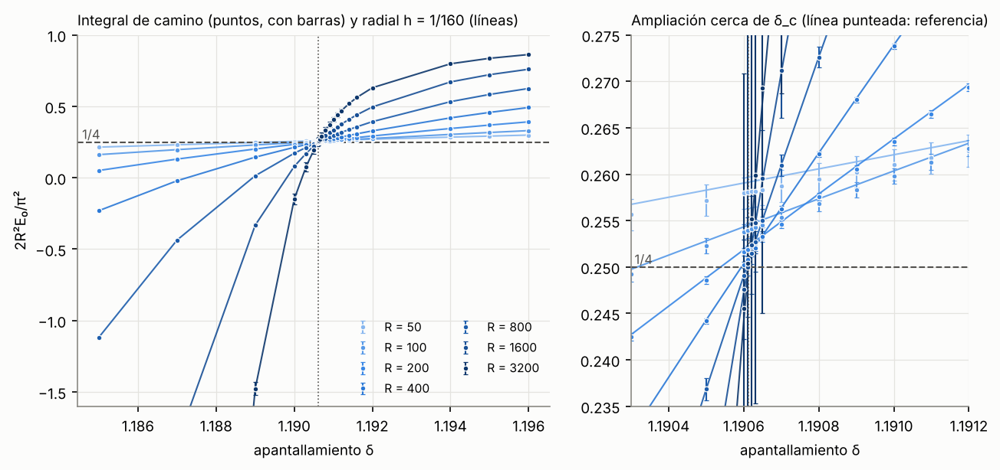
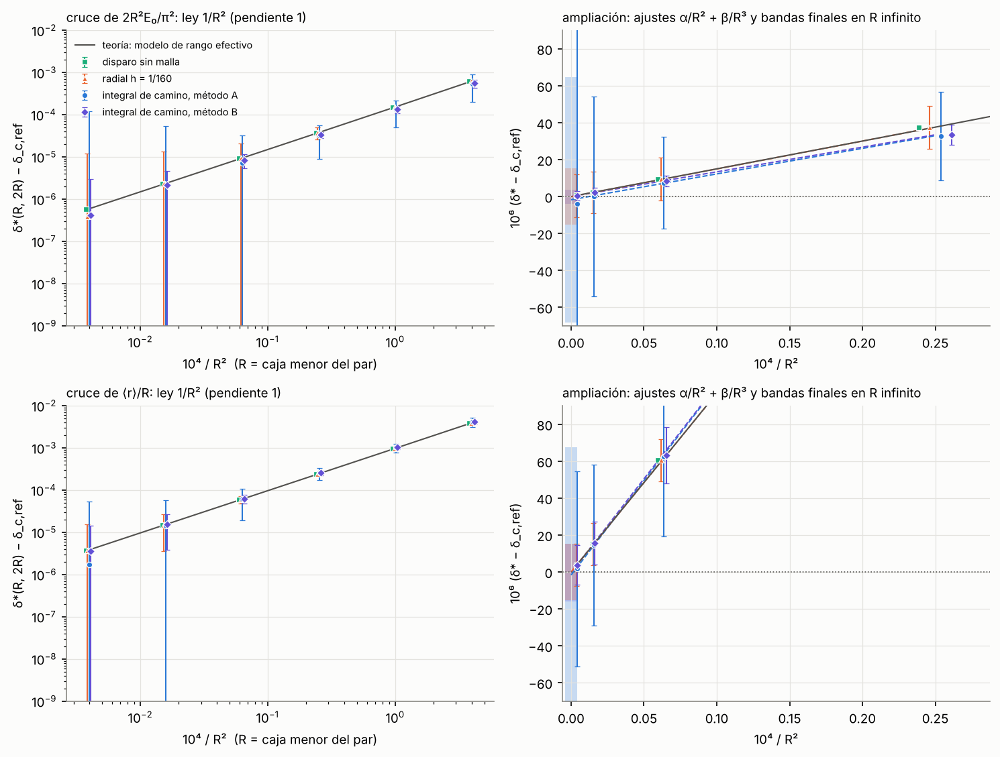
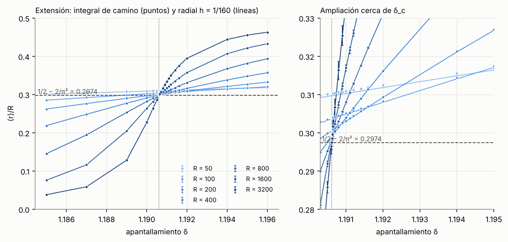
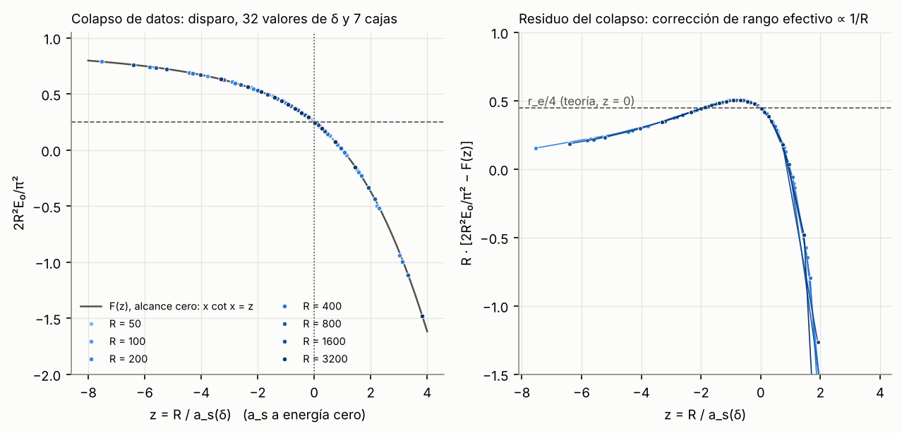

# Cruce de cajas: una prueba que separa un estado débil de un artefacto

*Sección para el artículo final (proyecto 05). Cálculo y redacción: Claude (IA), extensión E2 de la Fase 4. Todas las cifras
salen de `resultados/*.json`; la teoría completa está en `teoria.md`.*

## Motivación

En las Fases 2 y 3 decidimos "ligado o no ligado" por el signo de E₀ en cajas cada vez mayores. Ese criterio es correcto
pero lento cerca del umbral: en una caja de Dirichlet la energía nunca baja de la del espacio libre, así que el signo solo
puede equivocarse en una dirección, diciendo "no ligado" cuando sí hay ligado, y lo hace hasta que R supera la longitud de
dispersión a_s. En δ = 1.19, donde a_s = 2203.8, E₀ es positiva en todas las cajas hasta R = 1600 con los tres métodos
(tabla 3) y la Fase 3 necesitó R = 12800 para concluir 1.19 < δ_c < 1.20. Aquí proponemos otra prueba de caja que no
depende del signo: buscar dónde se cruzan las curvas de dos cajas.

## Idea y teoría

Fuera del alcance del potencial, la solución de onda s es sin(kr + η₀(k)) con el corrimiento de fase del espacio libre. La
pared dura en R impone, con x = kR y el desarrollo de rango efectivo k cot η₀ = −1/a + r_e k²/2,

$$x\cot x = \frac{R}{a} - \frac{r_e}{2R}x^2, \qquad y \equiv \frac{2R^2E_0}{\pi^2} = \frac{x^2}{\pi^2}.$$

Es la condición del método de la pared esférica de Borasoy et al. (2007). En el umbral (1/a = 0) y con alcance cero,
x = π/2: **y = 1/4 para toda caja**, mientras que y baja con R si hay ligado y sube hacia 1 si no lo hay. Con la función
de onda exterior cos(πr/2R), la extensión tiene también un punto fijo, **⟨r⟩/R = 1/2 − 2/π² = 0.2974**. Las curvas de
cajas distintas se cruzan, entonces, cerca de δ_c.

Desarrollando en r_e/R (`teoria.md`, sección 3), el cruce de las cajas R y 2R está en

$$\delta^*(R,2R) - \delta_c = \frac{\pi^2 r_e}{16\,c\,R^2} + \frac{3\pi^2 r_e^2}{32\,c\,R^3} + O(R^{-4}),$$

con r_e = 1.78063 (rango efectivo en el umbral) y c = −d(1/a)/dδ = 0.741192, los dos calculados a energía cero, sin
ajustar. Es decir, α = 1.4819 y β = 3.958: **la convergencia es en 1/R², no en 1/R**, aunque y(δ_c, R) = (1/4)(1 + r_e/R)
tenga una corrección 1/R. Para ⟨r⟩/R el coeficiente es α_ρ = 9.648, seis veces y media mayor. En la integral de camino la
pared sin imagen actúa como una pared en R + 0.1123 (tras la extrapolación en ε), lo que mueve el cruce en
−π²c_w/(8cR²): −1.18×10⁻⁶ en el par 400/800.

## Método

Rejilla: 23 valores de δ en [1.185, 1.196], más densos cerca de 1.1906, y R = 50, 100, 200, 400, 800, 1600 y 3200
(161 celdas). En cada celda se calcularon E₀ y ⟨r⟩ con tres métodos:

1. **Integral de camino** (matriz de transferencia con la acción de pares de Coulomb, `comun3.celda` de la Fase 3, sin
   cambios): h = 0.02 y 0.04 con Richardson h⁴, ε = 0.2, 0.1 y 0.05 con ley ε², y la barra de la Fase 3 (malla + Trotter +
   pared). Reproduce bit a bit las celdas de δ = 1.19 de la Fase 3 (control K14).
2. **Radial** de diferencias finitas con Richardson, h = 1/40 (la malla de la Fase 3) y h = 1/160.
3. **Disparo sin malla** (DOP853, tolerancia 10⁻¹², barra = diferencia con 10⁻¹³), como referencia casi exacta.

El cruce de cada par (R, 2R) es la raíz de y(δ, R) − y(δ, 2R) interpolada con un spline cúbico; se comparó con PCHIP, con un
cúbico local y con un cálculo sin interpolar (el disparo evaluado en cada δ pedido). La barra del cruce es la mayor entre un
Monte Carlo de 20240 réplicas gaussianas de cada celda (semilla fija) y la propagación lineal (σ_R + σ_2R)/|D′(δ*)|. Para la
integral de camino hay dos variantes, fijadas antes de calcular: **A**, la receta de la Fase 3 aplicada a E₀ y las barras
propagadas al cruce; **B**, la misma receta aplicada al cruce (se cruza con cada (h, ε) crudo y se extrapola), que mide
cuánto se mueve el cruce en vez de cuánto se mueve E₀. La extrapolación en R es un ajuste ponderado
δ* = δ_c + α/R² + β/R³ con los pares de R ≥ 100; a la barra se le suma la diferencia con el Richardson de los dos pares
mayores. Los umbrales de los controles se escribieron antes de correr (`criterios_previos.md`).

## Resultados

*Figura A. 2R²E₀/π² frente a δ para siete cajas: integral de camino (puntos con barras) y radial h = 1/160 (líneas). Todas
pasan cerca de 1/4 en el mismo δ. A la derecha, ampliación cerca de δ_c.*

**Tabla 1. Cruces δ*(R, 2R) de 2R²E₀/π².**

| Par | Integral de camino, A | Integral de camino, B | Radial h = 1/160 | Disparo sin malla | Teoría (modelo ERE) | y en el cruce (disparo) |
|---|---|---|---|---|---|---|
| 50/100 | 1.1911616 ± 3.5e-4 | 1.1911617 ± 1.2e-4 | 1.1912376 ± 1.2e-5 | 1.191237550 | 1.191238046 | 0.26390 |
| 100/200 | 1.1907465 ± 8.4e-5 | 1.1907468 ± 2.6e-5 | 1.1907646 ± 1.2e-5 | 1.190764616 | 1.190764645 | 0.25681 |
| 200/400 | 1.1906452 ± 2.4e-5 | 1.1906458 ± 5.5e-6 | 1.1906500 ± 1.2e-5 | 1.190649967 | 1.190649968 | 0.25337 |
| 400/800 | 1.1906197 ± 2.5e-5 | 1.1906208 ± 3.1e-6 | 1.1906218 ± 1.2e-5 | 1.190621745 | 1.190621745 | 0.25168 |
| 800/1600 | 1.1906124 ± 5.4e-5 | 1.1906145 ± 2.6e-6 | 1.1906147 ± 1.1e-5 | 1.190614744 | 1.190614744 | 0.25084 |
| 1600/3200 | 1.1906083 ± 1.3e-4 | 1.1906128 ± 2.5e-6 | 1.1906128 ± 1.2e-5 | 1.190613001 | 1.190613001 | 0.25042 |

Tres hechos se leen en la tabla. Primero, **la teoría predice los cruces sin parámetros libres**: el modelo de rango
efectivo coincide con el disparo a 5×10⁻⁷ en el par 50/100 y a 2×10⁻⁹ o mejor desde el 200/400. Segundo, los cocientes de
diferencias sucesivas del disparo son 4.125, 4.062, 4.031 y 4.016, la ley 1/R², y el valor en el cruce baja hacia 1/4 como
1/4 + 3r_e/(8R) (cocientes medido/predicho entre 1.040 y 1.001). Tercero, la integral de camino queda sistemáticamente por
debajo del disparo; con el método B la diferencia es −7.6×10⁻⁵, −1.8×10⁻⁵, −4.2×10⁻⁶ y −9.4×10⁻⁷ en los pares 50 a 400,
frente a −8.3×10⁻⁵, −2.0×10⁻⁵, −4.8×10⁻⁶ y −1.18×10⁻⁶ que predice el corrimiento de la pared. Al restar ese corrimiento, el
cruce de la integral de camino coincide con el exacto a 2.4×10⁻⁷ o mejor desde el par 400/800.

*Figura B. Izquierda: δ* − δ_c,ref frente a 1/R² en escala logarítmica (pendiente 1, ley 1/R²) para los cuatro métodos y la
teoría (los cruces que quedan por debajo de la referencia, como los dos últimos del método A, no caben en la escala logarítmica y se ven a la derecha). Derecha: ampliación lineal con los ajustes α/R² + β/R³ y las bandas finales en R infinito (azul: integral de camino
A; violeta: B; naranja: radial).*

**Tabla 2. Extrapolación en R e intervalo final** (pares con R ≥ 100).

| Fuente | Observable | δ_c | barra | intervalo | α ajustado (teoría) |
|---|---|---|---|---|---|
| integral de camino, A | 2R²E₀/π² | 1.1906106662 | 6.66e-5 | [1.19054410, 1.19067723] | 1.416 (1.482) |
| integral de camino, A | ⟨r⟩/R | 1.1906107238 | 6.93e-5 | [1.19054141, 1.19068003] | 10.231 (9.648) |
| integral de camino, B | 2R²E₀/π² | 1.1906123995 | 3.81e-6 | [1.19060859, 1.19061621] | 1.334 (1.482) |
| integral de camino, B | ⟨r⟩/R | 1.1906120950 | 1.57e-5 | [1.19059638, 1.19062781] | 10.117 (9.648) |
| radial h = 1/160 | 2R²E₀/π² | 1.1906123326 | 1.52e-5 | [1.19059710, 1.19062756] | 1.490 (1.482) |
| radial h = 1/160 | ⟨r⟩/R | 1.1906124177 | 1.52e-5 | [1.19059722, 1.19062761] | 9.649 (9.648) |
| disparo sin malla | 2R²E₀/π² | 1.1906124213 | 1.56e-9 | (barra solo del modelo de extrapolación) | 1.482 (1.482) |
| disparo sin malla | ⟨r⟩/R | 1.1906124202 | 2.00e-9 | (ídem) | 9.648 (9.648) |

Los diez intervalos contienen la referencia 1.1906124210606 (control K9). **El resultado de la integral de camino es
1.19054 < δ_c < 1.19068 con la receta de la Fase 3 (método A), y 1.190609 < δ_c < 1.190616 aplicando la receta al cruce
(método B).** Con solo cajas R ≤ 800 los intervalos son [1.19055557, 1.19066686] (A) y [1.19060344, 1.19062166] (B). Para
comparar: el signo de E₀ dio 1.19 < δ_c < 1.20 con R hasta 12800 (Fase 3), y la longitud de dispersión a energía cero dio
1.1906 < δ_c < 1.1907.

La barra del método A es grande por cómo escala. Desde R = 800, la barra de la receta en E₀ queda casi constante (en
δ = 1.1906 vale 9.1×10⁻⁹, 1.0×10⁻⁸ y 1.2×10⁻⁸ en R = 800, 1600 y 3200), mientras E₀ cae como R⁻². Al pasar a y se
multiplica por R², y la pendiente que separa las dos curvas solo crece como R; por eso la barra del cruce crece con R en
los pares grandes (tabla 1). Pero ese error es suave en δ y casi no mueve el cruce, que es lo que
mide el método B; la comparación con el disparo (diferencias de 2.4×10⁻⁷ o menos tras restar la pared) indica que A es muy
conservador.

El mecanismo se puede medir (revisión R2, `revision/resultados/r04_mecanismo_trotter.json`): el error de Trotter de la
transferencia actúa como un corrimiento del umbral, s_ε = δ_c(ε) − δ_c = 6.1×10⁻⁴, 1.53×10⁻⁴ y 3.8×10⁻⁵ para ε = 0.2, 0.1 y
0.05 (ley ε²). El E₀ exacto evaluado en δ − s_ε reproduce el E₀ crudo de la transferencia a 0.4 % de |E₀| o mejor, aunque el
error crudo llegue a 165 % (δ = 1.1906, R = 3200, ε = 0.2). En E₀ el corrimiento entra a través de z = R/a, que cambia en
c R s_ε (hasta 1.44 en R = 3200), es decir, en la parte curva de la función de escala: por eso la ley ε² aplicada a cada
celda pierde precisión en R grande (el orden de Trotter de 2.38 del control K2) y la barra de la receta crece. El cruce, en
cambio, se corre en s_ε para todo R, de forma lineal, y la ley ε² se le aplica limpia. Por eso el método B es legítimo y sus
barras por par cubren la diferencia con el disparo en los seis pares de 2R²E₀/π². La barra de B para ⟨r⟩/R incluye
también un término de pared, calculado con la misma receta que el de E₀ (radial en R + β√ε, extrapolado en ε;
`codigo/04b_pared_rho.py`) y, como en E₀, solo en la barra. Faltaba en la primera versión (revisión R2): la pared corre
el cruce de ⟨r⟩/R en +2.3×10⁻⁴ y +5.4×10⁻⁵ en los pares 50/100 y 100/200, más que la barra de malla y Trotter (1.2×10⁻⁴ y
3.7×10⁻⁵). Con el término, las barras por par son 3.5×10⁻⁴ y 9.1×10⁻⁵ y cubren la diferencia con el disparo en los seis
pares (cociente 0.59 o menos), y la barra final pasa de 1.47×10⁻⁵ a 1.57×10⁻⁵, con intervalo [1.19059638, 1.19062781],
que contiene la referencia y coincide con el recálculo independiente de la revisión (`revision/resultados/r05_impacto.json`).
El mismo término se suma, celda por celda, a la barra de ⟨r⟩/R del método A (como ya ocurre con la de E₀): las barras por
par de A pasan a 1.05×10⁻³ y 2.45×10⁻⁴ en 50/100 y 100/200 (antes 3.29×10⁻⁴ y 7.85×10⁻⁵) y la barra final de 6.04×10⁻⁵ a
6.93×10⁻⁵. Los cruces no se mueven; el centro extrapolado cambia en 1.3×10⁻⁷ solo porque el ajuste se pondera con 1/σ.

*Figura C. ⟨r⟩/R frente a δ: las curvas se cruzan cerca de 1/2 − 2/π² = 0.2974, con un corrimiento mayor que el de la
energía (α_ρ ≈ 9.65 frente a 1.48).*

*Figura D. Izquierda: 2R²E₀/π² de 32 valores de δ y 7 cajas (disparo) frente a z = R/a_s(δ), sobre la función de escala de
alcance cero x cot x = z. Derecha: el residuo multiplicado por R colapsa en una sola curva y vale r_e/4 en z = 0: la
corrección es de rango efectivo y de orden 1/R a z fijo.*

**Tabla 3. δ = 1.19: el signo engaña, el cruce no.**

| R | E₀ disparo | E₀ radial 1/160 | E₀ integral de camino | 2R²E₀/π² |
|---|---|---|---|---|
| 50 | +5.0224e-04 | +5.0224e-04 | +5.0012e-04 ± 3.3e-6 | 0.2544 |
| 200 | +2.8797e-05 | +2.8797e-05 | +2.8766e-05 ± 4.8e-8 | 0.2334 |
| 800 | +1.3199e-06 | +1.3199e-06 | +1.3200e-06 ± 1.0e-8 | 0.1712 |
| 1600 | +1.5224e-07 | +1.5223e-07 | +1.5300e-07 ± 1.3e-8 | 0.0790 |
| 3200 | -7.2582e-08 | -7.2582e-08 | -7.1475e-08 ± 1.8e-8 | -0.1506 |

Hasta R = 1600 los tres métodos dan E₀ > 0, que leído por el signo es "no ligado". En cambio y queda por debajo de su valor
en el umbral, (1/4)(1 + r_e/R) (en R = 50, y = 0.2544 frente a 0.2589), y baja con R desde el primer par, y todos los cruces medidos (el menor es 1.1906083) están por encima de 1.19. Eso solo no
basta: como r_e > 0, cada cruce crudo queda por encima de δ_c (es una cota superior), y un δ entre δ_c y δ* también daría
y(R) > y(2R). Lo que clasifica δ = 1.19 es el cruce corregido con la ley predicha, δ* − α_y/R² − β_y/R³, sin ajuste: con el
par 50/100 del disparo vale 1.1906131, 6.1×10⁻⁴ por encima de 1.19, y con la integral de camino 1.1905372, 5.4×10⁻⁴ por
encima (`codigo/13_cruce_corregido.py`, añadido tras la auditoría externa). Así, la prueba de cruce clasifica δ = 1.19 como
ligado con las cajas R = 50 y 100. Como controles negativos, con el Yukawa repulsivo, con
δ ∈ [1.4, 2.0] (sin ligado) y con δ ∈ [0.8, 1.0] (ligado profundo), y(R) − y(2R) no cambia de signo en ningún par (K12).
El repulsivo enseña además que "y baja con R" no basta: ahí a > 0 es pequeño, como en una esfera dura, e y baja hacia 1
desde arriba sin acercarse a 1/4.

**Controles** (`controles.md`): pasan 27 de 31. Perron-Frobenius (mínimo +1.2×10⁻⁹), transferencia frente a radial y frente
a disparo (161 de 161 celdas compatibles), sensibilidad a h, ley 1/R², valor en el cruce y controles negativos pasan. No
pasan: el orden de Trotter (75.2 % de las celdas en [1.8, 2.2]; en R = 50 es la pared, y al restarla las 23 celdas vuelven
al rango; en R = 3200 son términos de orden superior en ε = 0.2), la independencia de la interpolación en el disparo para
el par 50/100 de ⟨r⟩/R (PCHIP y el cúbico local se separan 4.6×10⁻⁷; el spline coincide con el cruce sin interpolar) y el
colapso evaluado en la rejilla de δ (el criterio estaba mal planteado: la corrección es 1/R a z fijo, no a δ fijo).

## Discusión

El cruce de cajas responde a lo que pide la guía para la segunda presentación: separa un estado débil de un artefacto con
cajas finitas, sin esperar a que R supere a_s, y con un número exacto (1/4) como referencia. Un artefacto que suma a E₀ un
error suave (malla, Trotter, pared) mueve el cruce en una cantidad que se puede medir y que cae como 1/R²; el caso de la
pared lo muestra cuantitativamente. La teoría de rango efectivo convierte la extrapolación en R en una comprobación: el α
ajustado del radial y del disparo coincide con el de la teoría a 0.6 % o mejor (1.490 y 1.4817 frente a 1.4819; 9.649 y 9.6485 frente a 9.648).

Sobre la originalidad hay que ser honestos (`fuentes.md`). La condición de cuantización es la del método de la pared
esférica; el valor universal de la energía de dos cuerpos en una caja en la unitariedad se usa en redes (caja periódica)
para ajustar acoplamientos, y en una trampa armónica es la fórmula de Busch et al.; el cruce de curvas de dos tamaños es la
renormalización fenomenológica de Nightingale; el escalamiento de tamaño finito del Yukawa se hizo con el tamaño de la base
(Serra, Neirotti y Kais 1998) y, para pozos con ℓ = 1, con un radio de corte del potencial (Serra). Lo que no encontramos es
el uso del cruce en una esfera dura para el apantallamiento crítico del Yukawa, la ley de convergencia con coeficientes
predichos por r_e y c, el punto fijo de la extensión con su coeficiente propio, ni su uso con una integral de camino como
prueba de artefacto.

Límites: la ley depende del signo de r_e (para r_e < 0 los cruces llegarían desde abajo); para ℓ ≥ 1 el estado no se va a
la pared y el punto fijo cambia (extensión E4); la barra de la receta de la Fase 3 es muy conservadora para este uso.

## Referencias

- B. Borasoy, E. Epelbaum, H. Krebs, D. Lee y U.-G. Meißner, *Eur. Phys. J. A* **34**, 185 (2007), arXiv:0708.1780.
- T. Busch, B.-G. Englert, K. Rzażewski y M. Wilkens, *Found. Phys.* **28**, 549 (1998).
- R. R. dos Santos y L. Sneddon, *Phys. Rev. B* **23**, 3541 (1981).
- J. E. Drut y A. N. Nicholson, arXiv:1208.6556, DOI 10.1088/0954-3899/40/4/043101.
- S. König, D. Lee y H.-W. Hammer, *Phys. Rev. Lett.* **107**, 112001 (2011).
- M. Lüscher, *Commun. Math. Phys.* **105**, 153 (1986); *Nucl. Phys. B* **354**, 531 (1991).
- M. P. Nightingale, *Physica A* **83**, 561 (1976).
- P. Serra, J. P. Neirotti y S. Kais, *Phys. Rev. A* **57**, R1481 (1998).
- P. Serra, "A spatial finite size scaling method for calculation of critical parameters for weakly bound states",
  *Phys. Lett. A* **303**, 20 (2002) (según la lista de publicaciones del autor; no verificada en el editor).
- I. Stetcu, J. Rotureau, B. R. Barrett y U. van Kolck, arXiv:1001.5071.
- H. A. Bethe, *Phys. Rev.* **76**, 38 (1949) [no verificada en esta búsqueda].
