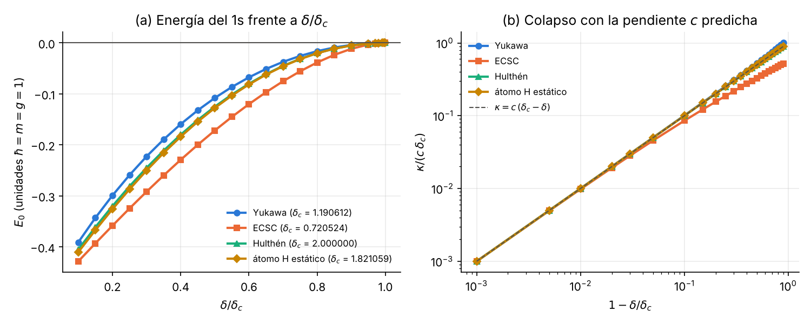
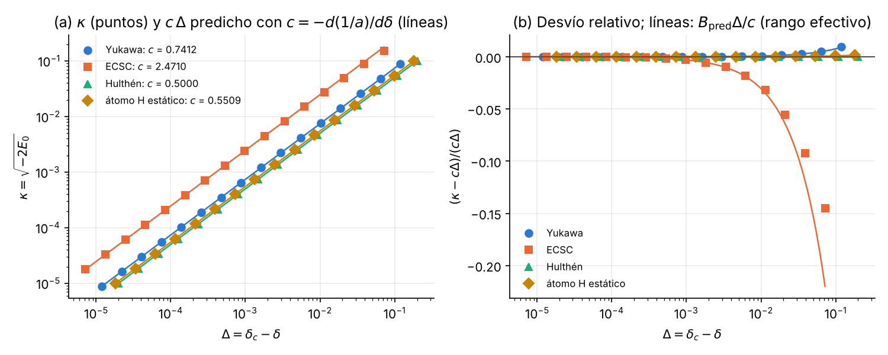
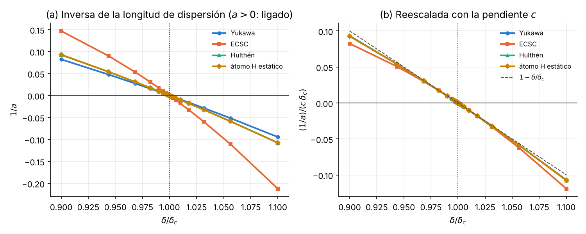
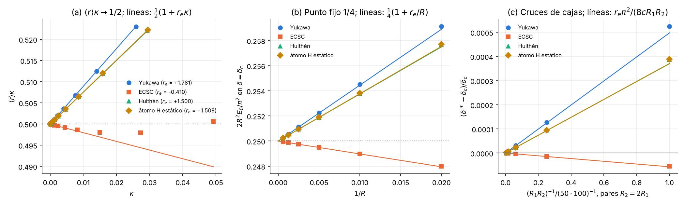
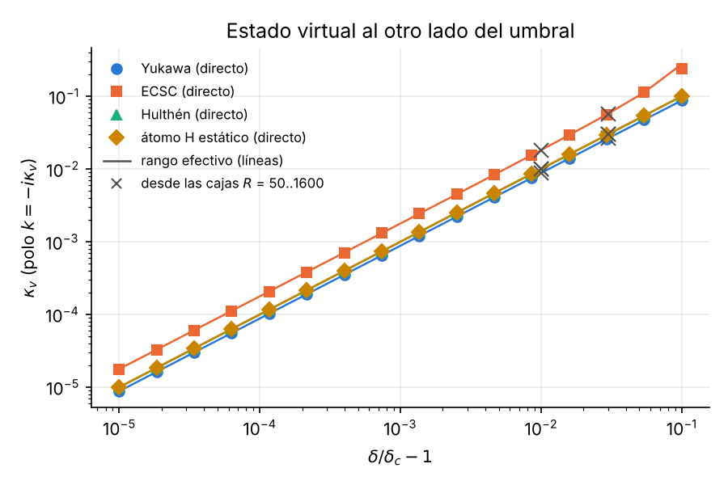
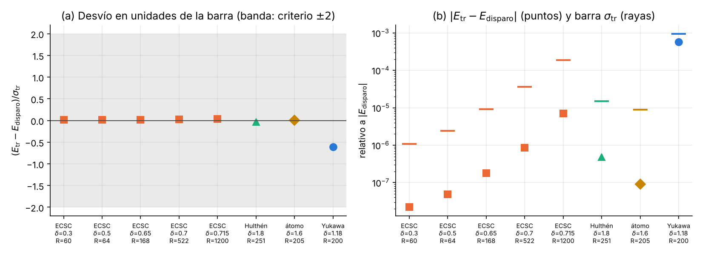

# Otros perfiles de apantallamiento: qué es universal cerca del umbral

*Sección para el artículo final (extensión E3). Todas las cifras salen de `fase4/extensiones/E3_otros_perfiles/resultados/*.json`.*

## Motivación

La guía sugiere, como ampliación, "cambiar el perfil de apantallamiento" y advierte que no se reclame "una cifra universal
desligada de las unidades y parámetros". Esta sección hace las dos cosas a la vez. Repetimos el análisis del umbral para
tres perfiles más y separamos lo que depende del perfil (el valor de $\delta_c$, la pendiente de $\kappa$, el sentido en que
las cajas se acercan al umbral) de lo que no depende de él. La respuesta es concreta: cerca del umbral todo el problema
se reduce a dos números de baja energía, la longitud de dispersión $a$ y el rango efectivo $r_e$; lo universal es lo que
no depende de ellos, y el primer término no universal lo fija $r_e$.

Los perfiles se eligen así. El ECSC (Coulomb apantallado con coseno) tiene una zona repulsiva ($\cos\delta r<0$) y es el
perfil clásico de comparación [Lam y Varshni 1972]. El Hulthén es exactamente soluble y ya era un control de la Fase 2. El
cuarto, $-(1/r+\delta/2)e^{-\delta r}$, es el potencial electrostático de un átomo de hidrógeno 1s (con radio $2/\delta$)
visto por una carga unidad; en $\delta=2$ es el potencial estático e–H en unidades atómicas. Lo añadimos porque tiene
sentido físico directo y porque su $W(0)=\delta/2$ y su forma lo hacen distinto del Yukawa. Todos se escriben como
$V=-1/r+W(r)$ con $W$ acotado y suave (tabla 1), así que la misma acción de pares de Coulomb vale para todos.

## Método

Usamos $\hbar=m=g=1$ y la convención del grupo, $u\simeq r-a$ fuera del alcance ($a>0$ cuando hay ligado).

*Energía cero.* Integramos $u''=2Vu$ desde la serie de Frobenius y, donde $|V|<e^{-60}/r$, escribimos $u=\alpha+\beta r$;
entonces $1/a=-\beta/\alpha$, que es continua a través del umbral. El umbral es $1/a(\delta_c)=0$. El rango efectivo sale de la
fórmula de Bethe, $r_e=2\int_0^\infty(\psi^2-\varphi^2)\,dr$ con $\psi=1-r/a$ y $\varphi\to1-r/a$ [Bethe 1949]. La
identidad del wronskiano entre dos soluciones de energía cero da, sin derivar numéricamente,
$$c\equiv-\frac{d(1/a)}{d\delta}\Big|_{\delta_c}=2\int_0^\infty\frac{\partial V}{\partial\delta}\,\varphi_0^2\,dr .$$

*Rango efectivo.* Con $k\cot\delta_0=-1/a+r_ek^2/2+Pk^4$, el polo ligado ($k=i\kappa$) y el virtual ($k=-i\kappa_v$) son
$$\kappa=\frac{1-\sqrt{1-2r_e/a}}{r_e},\qquad \kappa_v=\frac{-1+\sqrt{1-2r_e/a}}{r_e}\ (a<0).$$
Con $1/a=c\Delta+d_2\Delta^2$ ($\Delta=\delta_c-\delta$) resulta $\kappa=c\Delta+B\Delta^2$ con $B=d_2+r_ec^2/2$. La
normalización asintótica $A_s^2=2\kappa/(1-\kappa r_e)$ da $\langle r\rangle\kappa=\tfrac12(1+r_e\kappa)+O(\kappa^2)$.

*Caja dura.* Fuera del alcance $u=\sin k(R-r)$, así que $k\cot\delta_0=-k\cot kR$ y, con $x=kR$,
$$-x\cot x=-\frac{R}{a}+\frac{r_e x^2}{2R}+\frac{Px^4}{R^3} .\qquad(*)$$
En $\delta_c$ esto da $x\to\pi/2$, el punto fijo $2R^2E_0/\pi^2\to\tfrac14$, con $2R^2E_0/\pi^2\simeq\tfrac14(1+r_e/R)$. Para el cruce
de dos cajas ($R_1^2E_0(R_1)=R_2^2E_0(R_2)$), $(*)$ da a primer orden $1/a^\ast=-r_e\pi^2/(8R_1R_2)$, es decir
$$\delta^\ast-\delta_c\simeq\frac{r_e\,\pi^2}{8\,c\,R_1R_2} :$$
el signo de $r_e$ decide si los cruces llegan desde arriba o desde abajo.

*Cálculo.* Todo lo anterior se calcula sin malla (disparo con `solve_ivp` DOP853, rtol $10^{-13}$): $\kappa$ por empalme con
$e^{-\kappa r}$, $\kappa_v$ como la raíz de $u'-\kappa u=0$ (solución pura $e^{+\kappa r}$), $E_0(R)$ por $u(R)=0$. Para la
integral de camino usamos la matriz de transferencia de la Fase 2 con la acción de pares de Coulomb y $e^{-\epsilon(W_i+W_j)/2}$,
con la receta de errores de la Fase 3 (Richardson $h^4$, extrapolación $\epsilon^2$, sesgo de pared en la barra).

## Resultados

**Umbrales.** La tabla 1 da $\delta_c$ por energía cero y por un segundo método independiente (raíz de un ajuste cúbico de
$\kappa(\delta)$ obtenido de energías de ligado). Un tercer método, el de fase variable para $1/a$ con otro integrador,
coincide a $3\times10^{-12}$ o mejor. El Hulthén reproduce $\delta_c=2$ a
$1\times10^{-14}$ y el Yukawa el valor de las Fases 1–3 a $2\times10^{-15}$.
Para el ECSC obtenemos $\delta_c=0.7205240859$: coincide con las 8 cifras que Roy atribuye a Singh y Varshni (0.72052408,
diferencia $5.9\times10^{-9}$, compatible con un truncado) y con las 7 de Roy (0.7205240); el 0.7115 variacional de Lam
y Varshni queda $9.0\times10^{-3}$ abajo y el 0.72055425 de Nasser et al. $3.0\times10^{-5}$ arriba.
El valor de Ikhdair y Sever (1993), 0.72052408588, coincide con el nuestro en las 11 cifras que imprimen (diferencia
$2.0\times10^{-12}$). En el Yukawa, el $1.19061227\pm0.00000004$ de Gomes et al. queda
$1.5\times10^{-7}$ por debajo de nuestro valor, unas 4 veces su barra.

*Tabla 1. Perfiles y apantallamiento crítico del 1s.*

| Perfil | $V(r)$ | $W=V+1/r$ | $W(0)$ | $\delta_c$ (energía cero) | segundo método (variante posterior U2b) | literatura (verificada, ver fuentes) |
|---|---|---|---|---|---|---|
| Yukawa | $-e^{-\delta r}/r$ | $(1-e^{-\delta r})/r$ | $\delta$ | 1.190612421061 | 1.190612421061 | 1.190610 (Roy 2019); 1.19061227 (Gomes, Chacham y Mohallem 1994) |
| ECSC | $-e^{-\delta r}\cos(\delta r)/r$ | $(1-e^{-\delta r}\cos\delta r)/r$ | $\delta$ | 0.720524085882 | 0.720524085889 | 0.7205240 (Roy 2019); 0.72052408 (Singh y Varshni 1983); 0.72055425 (Nasser et al. 2011); 0.7115 (Lam y Varshni 1972); 0.72052408588 (Ikhdair y Sever 1993) |
| Hulthén | $-\delta e^{-\delta r}/(1-e^{-\delta r})$ | $1/r-\delta/(e^{\delta r}-1)$ | $\delta/2$ | 2.000000000000 | 2.000000000000 | 2.00000000 (Roy 2019); exacto: 2 |
| átomo H estático | $-(1/r+\delta/2)\,e^{-\delta r}$ | $(1-e^{-\delta r})/r-\tfrac{\delta}{2}e^{-\delta r}$ | $\delta/2$ | 1.821058756042 | 1.821058756042 | no encontrada |

El segundo método se fijó primero con puntos hasta $1-\delta/\delta_c=0.03$; en el ECSC el cúbico no sigue la fuerte
curvatura de $\kappa(\delta)$ y falla por $5.5\times10^{-7}$ (control U2, "no pasa"). Con puntos entre $10^{-4}$ y
$2\times10^{-3}$ (variante añadida después, indicada como tal) la diferencia baja a $7.1\times10^{-12}$.

**Pendiente predicha frente a medida.** La tabla 2 compara la pendiente $c$ predicha por la solución de energía cero con la
$A$ de un ajuste $\kappa=A\Delta+B\Delta^2+C\Delta^3$ a energías de ligado ($10^{-4}\le\Delta/\delta_c\le10^{-2}$). Para
el Yukawa, $c=0.7411918$ predice sin ajustar el $A=0.7411$ de la Fase 3 y $B=0.0565$ su $B=0.059$
(el ajuste de la Fase 3 usa pocos puntos y $\delta_c$ fijo). En el Hulthén $c=1/2$ y $B=0$ exactos, porque $\kappa=1-\delta/2$ es lineal.
En el ECSC la pendiente es más de tres veces la del Yukawa y la curvatura cambia de signo ($B=-7.54$). La figura 2
muestra $\kappa$ y $c\Delta$ en cuatro décadas, y la desviación relativa siguiendo $B\Delta/c$.

*Tabla 2. Parámetros de baja energía en el umbral y lo que ve la caja (la última columna es el cruce de $R=800$ y $1600$).*

| Perfil | $c$ predicha | $A$ medida | $B$ predicha | $B$ medida | $r_e(\delta_c)$ | $P$ | $R(2R^2E_0/\pi^2-\tfrac14)$, $R=1600$ | $\delta^\ast_{800/1600}-\delta_c$ |
|---|---|---|---|---|---|---|---|---|
| Yukawa | 0.74119177 | 0.74119177 | +0.0565 | +0.0565 | +1.780632 | -0.3735 | +0.44553 ($r_e/4$ = +0.44516) | $2.32\times10^{-6}$ |
| ECSC | 2.47102772 | 2.47101624 | -7.5420 | -7.5262 | -0.409964 | +3.5717 | -0.10247 ($r_e/4$ = -0.10249) | $-1.60\times10^{-7}$ |
| Hulthén | 0.50000000 | 0.50000000 | -0.0000 | +0.0000 | +1.500000 | -0.1286 | +0.37526 ($r_e/4$ = +0.37500) | $2.90\times10^{-6}$ |
| átomo H estático | 0.55085451 | 0.55085451 | +0.0049 | +0.0049 | +1.508532 | -0.1533 | +0.37740 ($r_e/4$ = +0.37713) | $2.65\times10^{-6}$ |

**Rango efectivo.** La fórmula de rango efectivo reproduce $\kappa$ con error relativo menor que
$1\times10^{-5}$ hasta
$\Delta/\delta_c=0.01$ en los cuatro perfiles. $r_e$ y $1/a$ por energía cero coinciden con los de un ajuste a desfasajes a
pequeño $k$ (diferencias de $1\times10^{-9}$ en $r_e$). El ECSC
es el único con $r_e<0$ en el umbral ($r_e=-0.4100$, con un parámetro de forma grande, $P=+3.57$).
En el umbral $r_e=2\int(1-\varphi_0^2)\,dr$. Si $V\le0$ en todo $r$, $\varphi_0''=2V\varphi_0\le0$ y $\varphi_0'\to0$, así que $\varphi_0$
crece hacia 1 sin pasarlo y $r_e(\delta_c)>0$. Por eso el sobrepaso de $\varphi_0$ sobre su asíntota es necesario para $r_e<0$,
y solo puede darse con una zona repulsiva ($\cos\delta r<0$ entre $\delta r=\pi/2$ y $3\pi/2$). No es suficiente: que el área con
$\varphi_0>1$ pese más es un resultado numérico. En el ECSC la solución de energía cero sube por encima de su asíntota, hasta $\varphi_0=1.1562$ en
$\delta r=1.023$, y luego baja; en la zona repulsiva la solución es convexa y se aplana sobre la asíntota desde arriba. En el Yukawa
$\varphi_0$ crece hacia 1 sin pasarlo (máximo 1.000000), y $r_e>0$.

**Universalidad.** En $\Delta/\delta_c=10^{-5}$, $\kappa a$ y $2\langle r\rangle\kappa$ difieren de 1 en menos de
$8\times10^{-6}$ en los cuatro perfiles. La
corrección sí depende del perfil, y la fija $r_e$: la pendiente medida de $\langle r\rangle\kappa$ frente a $\kappa$ es
0.89032, -0.20497, 0.75000 y 0.75427
(Yukawa, ECSC, Hulthén, átomo H), frente a $r_e/2$ = 0.89032, -0.20498,
0.75000 y 0.75427. Por eso en el ECSC $\langle r\rangle\kappa$ y $\kappa a$
llegan a sus límites desde abajo y en los otros tres desde arriba (figura 4a).

En la caja dura el punto fijo es $\tfrac14$ para los cuatro perfiles y la corrección es $r_e/(4R)$, más $3r_e^2/(16R^2)$ a
segundo orden (de $(*)$ con $x=\pi/2+\epsilon$; señalado en la auditoría externa, `auditoria_gemini/E3/informe.md`): en $R=1600$,
$R(2R^2E_0/\pi^2-\tfrac14)$ vale +0.4455, -0.1025,
+0.3753 y +0.3774, frente a $r_e/4$ (tabla 2) y a
$r_e/4+3r_e^2/(16R)$ = +0.4455, -0.1025, +0.3753, +0.3774, y la ecuación $(*)$ completa
reproduce el valor a $2\times10^{-10}$
(relativo, $R\ge200$). También $\langle r\rangle/R$ en $\delta_c$ tiende a $\tfrac12-2/\pi^2=0.29736$
(0.29775, 0.29727, 0.29769, 0.29769 en $R=1600$). Los cruces de pares $(R,2R)$ llegan **desde arriba** en
Yukawa, Hulthén y átomo H y **desde abajo** en el ECSC, como predice el signo de $r_e$; con $R_1=200$ el cruce está a
$3.75\times10^{-5}$ del umbral en el Yukawa y a $-2.55\times10^{-6}$ en el ECSC, y $(*)$ predice cada cruce
con error relativo menor que $2\times10^{-7}$
(figura 4c). El cruce converge como $1/(R_1R_2)$, así que el par $800/1600$ ya fija $\delta_c$ a $2.0\times10^{-6}$ relativo o mejor.

**Estado virtual.** Del otro lado del umbral el polo pasa a $k=-i\kappa_v$. La fórmula de rango efectivo y el cálculo
directo coinciden a $1\times10^{-5}$
hasta $\delta/\delta_c-1=0.01$; en $\delta/\delta_c-1=0.0086$, $E_{\rm virtual}=-\kappa_v^2/2$ vale
$-2.86\times10^{-5}$ (Yukawa) y $-1.21\times10^{-4}$ (ECSC). En el Hulthén el polo virtual sale en
$\kappa_v=\delta/2-1$, la imagen exacta del ligado $\kappa=1-\delta/2$ (diferencia $9\times10^{-10}$). La caja también
ve el polo virtual: con las energías positivas de $R=50$ a 1600 se reconstruye $k\cot\delta_0=-k\cot kR$, y el ajuste da $\kappa_v$
a $8\times10^{-4}$ o mejor (figura 5). La integral de camino, en
cambio, solo proyecta sobre el autovalor dominante de la caja; para ver el virtual necesita varias cajas y este mismo análisis.

**Integral de camino para el ECSC.** Para el ECSC, $W=(1-e^{-\delta r}\cos\delta r)/r=\delta(1-x^2/3+x^3/6-\dots)$ con $x=\delta r$
es una función entera de $r$, positiva y acotada por $\delta$ (medido en $[10^{-8},400]$: mínimo
0.0025, máximo $\delta$). Toda la singularidad está en el $-1/r$, que la acción de pares trata
de forma exacta, así que la factorización sigue siendo exacta en el origen y el error de $W$ es $O(\epsilon^2)$, como en el
Yukawa. Los elementos de la matriz son productos de factores positivos: el peso es real, positivo y normalizable. La tabla 3
compara la integral de camino con el disparo en la misma caja, sin malla. Los ocho casos están dentro de la barra
(desviación máxima de 0.61 barras), el orden de Trotter medido va de
1.975 a 2.009 y los autovectores son de signo constante.
El Hulthén en $\delta=1.8$ da $-0.0050000024$ frente al exacto $-0.005$, y la celda de Yukawa reproduce bit a bit la de
la Fase 3 en la misma $(h,\epsilon)$.

*Tabla 3. Integral de camino (acción de pares + $W$) frente al disparo en la misma caja.*

| Perfil | $\delta$ | $R$ | $E_0$ integral de camino | $E_0$ disparo (misma caja) | diferencia | orden de Trotter |
|---|---|---|---|---|---|---|
| ECSC | 0.3 | 60 | $-0.2194156872\pm2.4\times10^{-7}$ | $-0.2194156920$ | $4.8\times10^{-9}$ | 1.975 |
| ECSC | 0.5 | 64 | $-0.0776836808\pm1.9\times10^{-7}$ | $-0.0776836847$ | $3.8\times10^{-9}$ | 1.998 |
| ECSC | 0.65 | 168 | $-0.0111531655\pm1.0\times10^{-7}$ | $-0.0111531676$ | $2.0\times10^{-9}$ | 1.999 |
| ECSC | 0.7 | 522 | $-0.0011504417\pm4.1\times10^{-8}$ | $-0.0011504427$ | $9.8\times10^{-10}$ | 2.001 |
| ECSC | 0.715 | 1200 | $-0.0000901753\pm1.7\times10^{-8}$ | $-0.0000901760$ | $6.3\times10^{-10}$ | 2.009 |
| Hulthén | 1.8 | 251 | $-0.0050000024\pm7.5\times10^{-8}$ | $-0.0050000000$ | $-2.4\times10^{-9}$ | 1.993 |
| átomo H estático | 1.6 | 205 | $-0.0074427647\pm6.6\times10^{-8}$ | $-0.0074427654$ | $6.7\times10^{-10}$ | 1.998 |
| Yukawa | 1.18 | 200 | $-0.0000240766\pm2.3\times10^{-8}$ | $-0.0000240626$ | $-1.4\times10^{-8}$ | 1.994 |

## Discusión

*Qué es universal.* Para los cuatro perfiles: $E_0\propto-\Delta^2$ (estado $s$ que se pierde en el continuo), $\kappa a\to1$,
$\langle r\rangle\kappa\to\tfrac12$, el punto fijo $2R^2E_0/\pi^2=\tfrac14$ y $\langle r\rangle/R=\tfrac12-2/\pi^2$ en la caja dura.
No dependen de la forma del potencial porque solo dependen de que $1/a$ cruce cero.

*Qué no lo es.* El valor de $\delta_c$ (0.7205, 1.1906, 1.8211 y 2.0000), la
pendiente $c$ (de 0.50 a 2.47), la curvatura $B$ y el sentido por el que se llega a los límites.
Pero lo no universal está organizado: a primer orden todo lo fija $r_e$, que medimos de forma independiente por tres caminos
(Bethe, desfasajes, cajas). En particular, el sentido del cruce de cajas no es una propiedad del método sino del signo de $r_e$.
Esto responde a la advertencia de la guía: $\delta_c$ no es una cifra universal, depende del perfil y de cómo se defina
$\delta$; lo que sí se traslada de un perfil a otro son las leyes en $a$ y $r_e$.

*Contexto físico.* Con el perfil del átomo H, el potencial estático e–H ($\delta=2$) está del lado no ligado
($\delta_c=1.8211<2$): sin intercambio ni polarización, la aproximación estática no liga un electrón al hidrógeno, y
su longitud de dispersión en nuestra convención es $a=-9.447$ (radios de Bohr; no encontramos un valor publicado verificado
para compararla).

*Limitaciones.* La integral de camino solo se corrió para el ECSC y un caso de cada control (8 celdas); no repetimos con ella el
análisis de cruces. El $\delta_c$ del ECSC lo contrastamos con la tabla de Roy (que cita a Singh y Varshni, cuyo original no abrimos) y con Ikhdair y Sever (1993); el del átomo H no tiene referencia publicada que hayamos encontrado.

## Referencias de la sección

- H. A. Bethe, *Phys. Rev.* **76**, 38 (1949), DOI 10.1103/PhysRev.76.38 [V].
- C. S. Lam y Y. P. Varshni, *Phys. Rev. A* **6**, 1391 (1972), DOI 10.1103/PhysRevA.6.1391 [V] (ECSC).
- C. S. Lam y Y. P. Varshni, *Phys. Rev. A* **4**, 1875 (1971), DOI 10.1103/PhysRevA.4.1875 [V] (Yukawa).
- A. K. Roy, arXiv:1904.11166 (2019) [V-arXiv]: críticos de Hulthén, Yukawa y ECSC.
- D. S. Singh y Y. P. Varshni, *Phys. Rev. A* **28**, 2606 (1983), DOI 10.1103/PhysRevA.28.2606 [V] (la cifra, citada por Roy).
- I. Nasser, M. S. Abdelmonem y A. Abdel-Hady, *Phys. Scr.* **84**, 045001 (2011), DOI 10.1088/0031-8949/84/04/045001 [V] (la cifra, citada por Roy).
- S. M. Ikhdair y R. Sever, *Z. Phys. D* **28**, 1 (1993), DOI 10.1007/BF01437449 [V] (la cifra, leída en el PDF del repositorio staff.najah.edu).
- O. A. Gomes, H. Chacham y J. R. Mohallem, *Phys. Rev. A* **50**, 228 (1994), DOI 10.1103/PhysRevA.50.228 [V].
